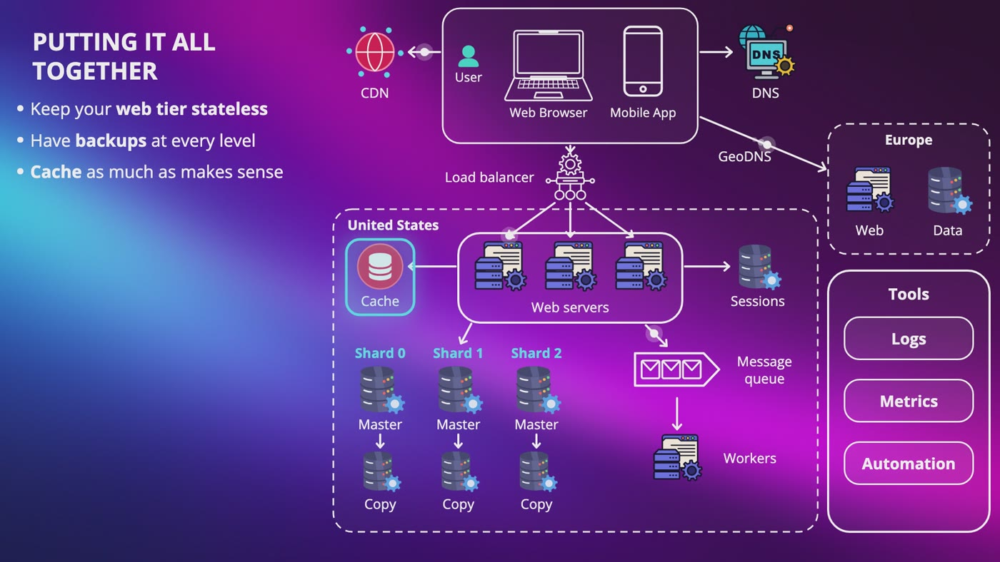

# System Design Interview Handbook

Free, visual notes for system design interviews: a cheat sheet for any question, a glossary of 700+ terms in plain words, and all 20 chapters of notes with diagrams, from the basics to 16 full designs.

## What's inside

| | Read on GitHub | PDF |
|---|---|---|
| **Interview cheat sheet:** the four steps, what to bring up when, estimation formulas, reference numbers, and the trade-offs to name | [cheat-sheet.md](cheat-sheet.md) | [PDF](pdf/System-Design-Interview-Cheat-Sheet.pdf) |
| **Glossary:** every term, A to Z, in plain words | [glossary.md](glossary.md) | [PDF](pdf/System-Design-Glossary-Whole-Course.pdf) |

### All 20 chapters

| # | Chapter | Lectures | Read on GitHub | PDF |
|---|---|---|---|---|
| 1 | **From One User to Millions** | 10 | [notes](notes/01-from-one-user-to-millions.md) | [PDF](pdf/System-Design-Chapter-01-Notes.pdf) |
| 2 | **Estimation: Thinking at Scale** | 7 | [notes](notes/02-estimation-thinking-at-scale.md) | [PDF](pdf/System-Design-Chapter-02-Notes.pdf) |
| 3 | **The Interview: A Four-Step Framework** | 5 | [notes](notes/03-the-interview-a-four-step-framework.md) | [PDF](pdf/System-Design-Chapter-03-Notes.pdf) |
| 4 | **Design Rate Limiter** | 8 | [notes](notes/04-design-rate-limiter.md) | [PDF](pdf/System-Design-Chapter-04-Notes.pdf) |
| 5 | **Consistent Hashing** | 5 | [notes](notes/05-consistent-hashing.md) | [PDF](pdf/System-Design-Chapter-05-Notes.pdf) |
| 6 | **Design Key-Value Store** | 12 | [notes](notes/06-design-key-value-store.md) | [PDF](pdf/System-Design-Chapter-06-Notes.pdf) |
| 7 | **Design Unique ID Generator** | 6 | [notes](notes/07-design-unique-id-generator.md) | [PDF](pdf/System-Design-Chapter-07-Notes.pdf) |
| 8 | **Design URL Shortener** | 7 | [notes](notes/08-design-url-shortener.md) | [PDF](pdf/System-Design-Chapter-08-Notes.pdf) |
| 9 | **Design Web Crawler** | 10 | [notes](notes/09-design-web-crawler.md) | [PDF](pdf/System-Design-Chapter-09-Notes.pdf) |
| 10 | **Design Notification System** | 8 | [notes](notes/10-design-notification-system.md) | [PDF](pdf/System-Design-Chapter-10-Notes.pdf) |
| 11 | **Design Instagram's Feed** | 8 | [notes](notes/11-design-instagram-s-feed.md) | [PDF](pdf/System-Design-Chapter-11-Notes.pdf) |
| 12 | **Design WhatsApp** | 10 | [notes](notes/12-design-whatsapp.md) | [PDF](pdf/System-Design-Chapter-12-Notes.pdf) |
| 13 | **Design Search Autocomplete** | 11 | [notes](notes/13-design-search-autocomplete.md) | [PDF](pdf/System-Design-Chapter-13-Notes.pdf) |
| 14 | **Design YouTube** | 10 | [notes](notes/14-design-youtube.md) | [PDF](pdf/System-Design-Chapter-14-Notes.pdf) |
| 15 | **Design Google Drive** | 10 | [notes](notes/15-design-google-drive.md) | [PDF](pdf/System-Design-Chapter-15-Notes.pdf) |
| 16 | **Design What's Near Me** | 12 | [notes](notes/16-design-what-s-near-me.md) | [PDF](pdf/System-Design-Chapter-16-Notes.pdf) |
| 17 | **Design Live Location** | 12 | [notes](notes/17-design-live-location.md) | [PDF](pdf/System-Design-Chapter-17-Notes.pdf) |
| 18 | **Design Google Maps** | 12 | [notes](notes/18-design-google-maps.md) | [PDF](pdf/System-Design-Chapter-18-Notes.pdf) |
| 19 | **Design Message Queue** | 12 | [notes](notes/19-design-message-queue.md) | [PDF](pdf/System-Design-Chapter-19-Notes.pdf) |
| 20 | **Design AI Chatbot** | 11 | [notes](notes/20-design-ai-chatbot.md) | [PDF](pdf/System-Design-Chapter-20-Notes.pdf) |

The PDFs have searchable text, so Ctrl+F works.

## How to use it

1. Start with the cheat sheet, and keep it open while you practice.
2. Read Chapter 1 if any of the building blocks feel shaky, then work through the designs.
3. Practice out loud with a pen, and look up any term in the glossary.

## The full course

These notes come from **[System Design: Zero to Interview Hero](https://www.udemy.com/course/system-design-zero-to-hero/?referralCode=183D59A1EBE9E71D26FF)** by Nata Vacheishvili: over 21 hours of animated lessons, 16 designs from scratch (including WhatsApp, YouTube, Google Maps and an AI chatbot), and a quiz after every lecture.

## License

These notes are free to read, download and share for personal study, with credit. Please don't sell them or publish changed versions. Licensed under [CC BY-NC-ND 4.0](https://creativecommons.org/licenses/by-nc-nd/4.0/).

If they helped you, a star helps other people find them.
