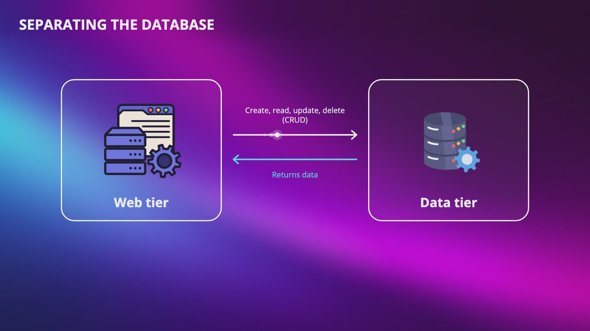
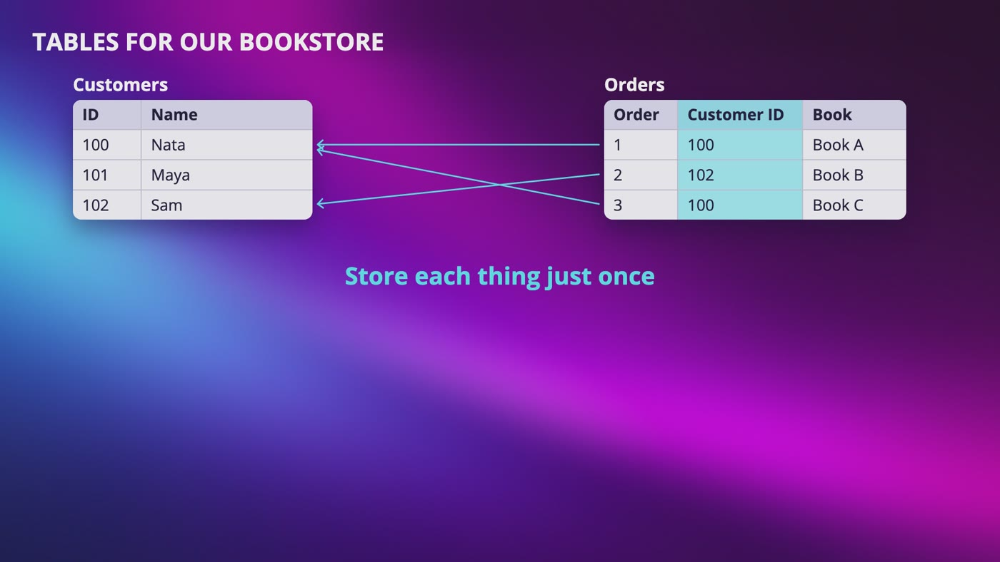
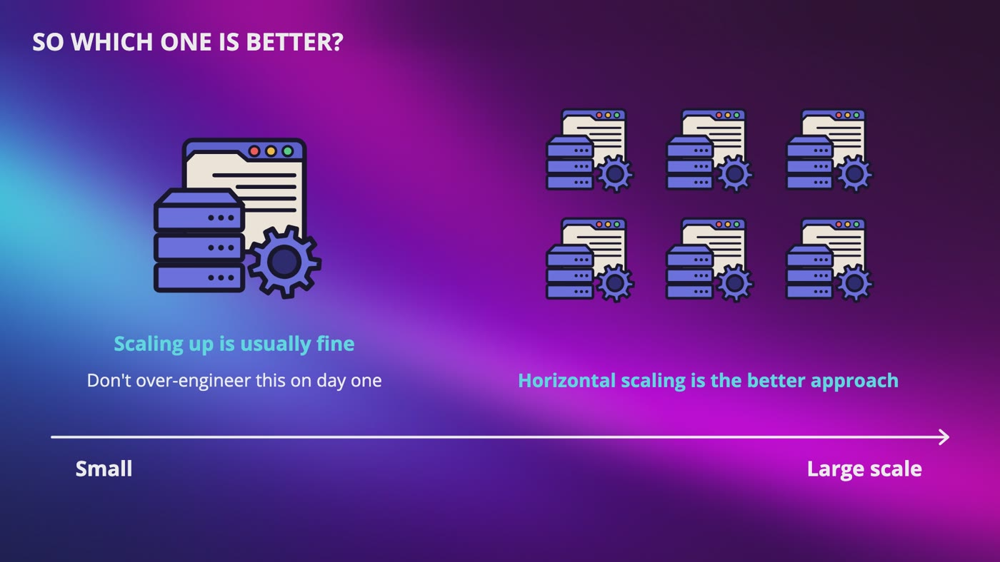
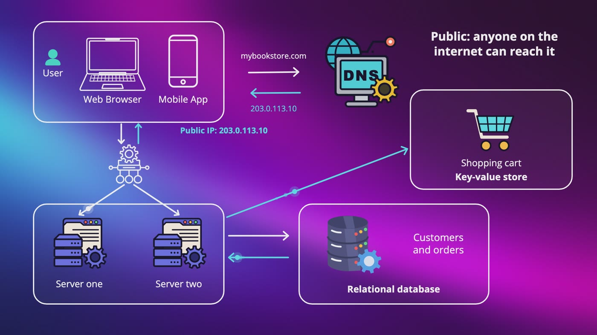
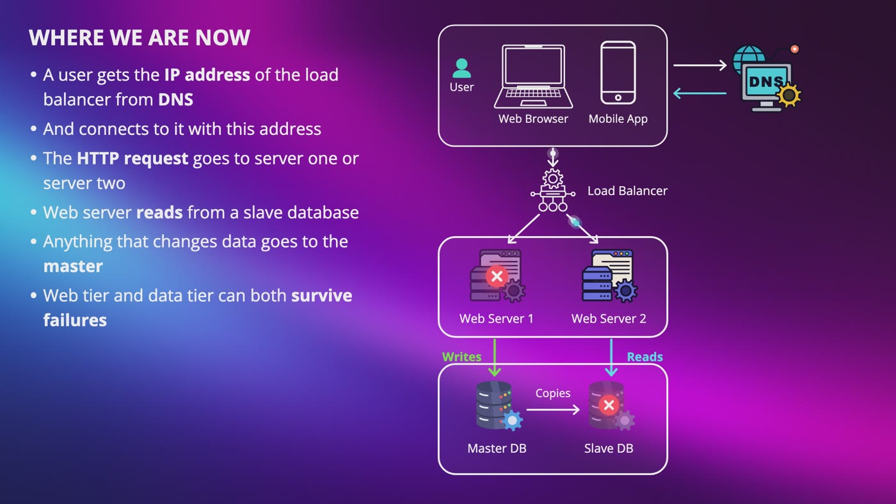
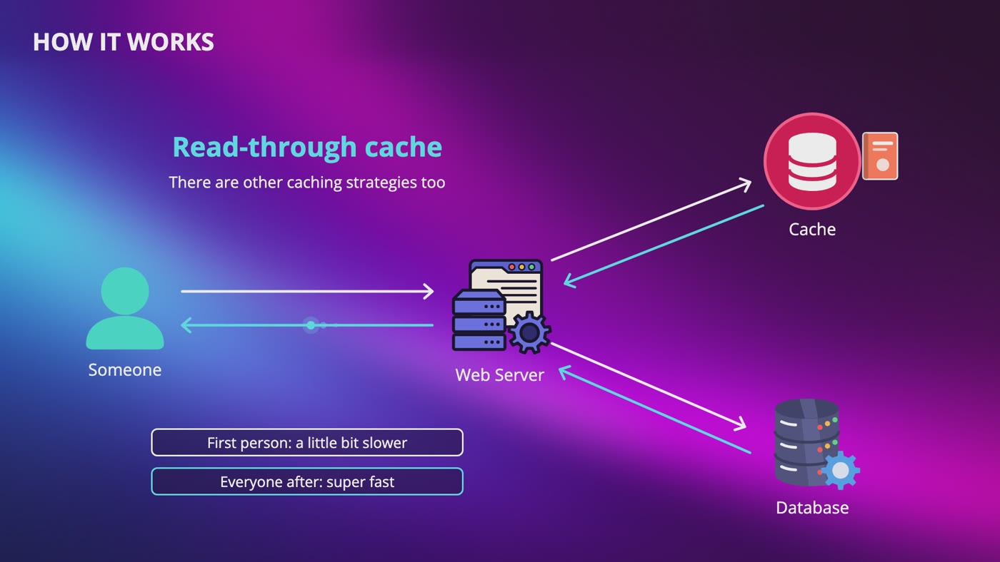
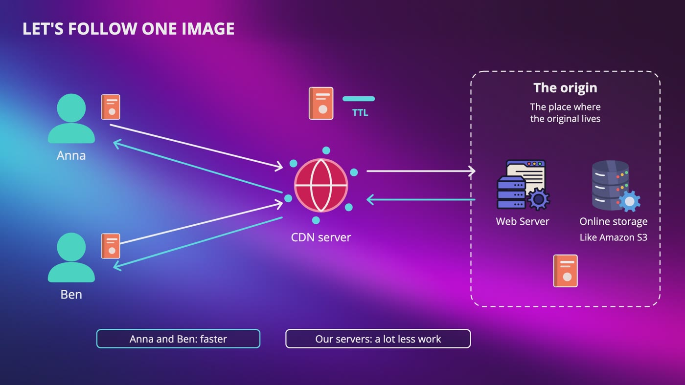
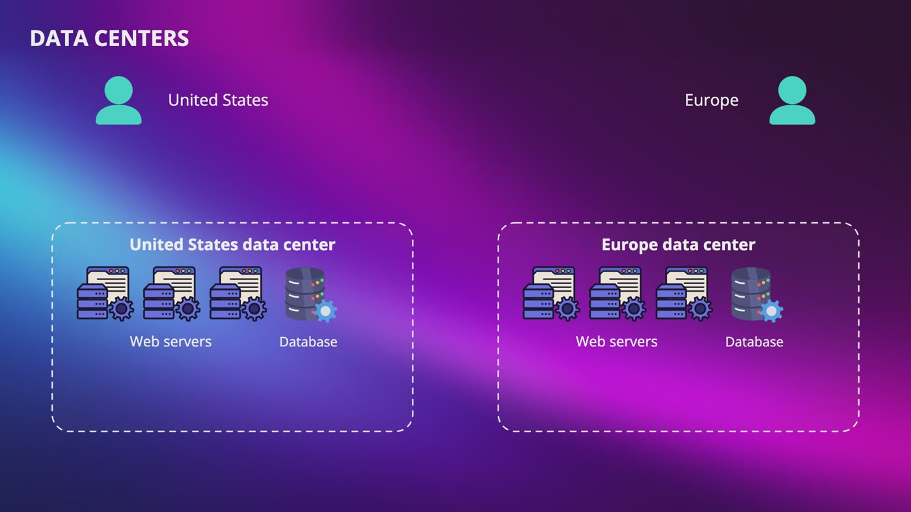
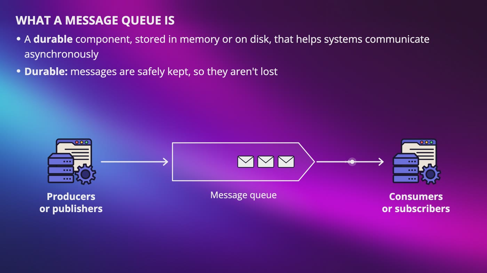
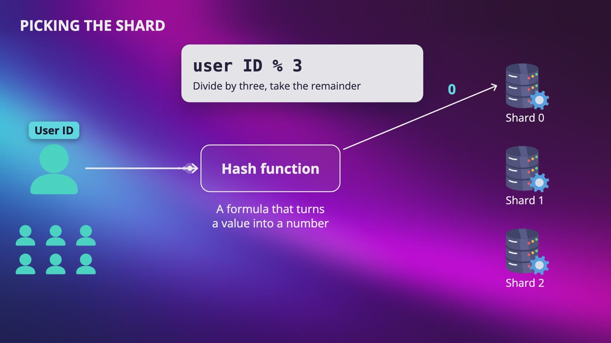

# [Chapter 1: From One User to Millions](https://www.udemy.com/course/system-design-zero-to-hero/?referralCode=183D59A1EBE9E71D26FF)

_One bookstore, one problem at a time: every piece of a large system, and why it's there._

[Download as PDF](../pdf/System-Design-Chapter-01-Notes.pdf)

## Contents

1. [How a Request Reaches a Server: DNS, HTTP and APIs](#1-how-a-request-reaches-a-server-dns-http-and-apis)
2. [Choosing a Database: Relational vs NoSQL](#2-choosing-a-database-relational-vs-nosql)
3. [Vertical vs Horizontal Scaling](#3-vertical-vs-horizontal-scaling)
4. [Load Balancers: Keeping Your Servers Online](#4-load-balancers-keeping-your-servers-online)
5. [Database Replication: Surviving a Database Failure](#5-database-replication-surviving-a-database-failure)
6. [Caching: Making Your System Faster](#6-caching-making-your-system-faster)
7. [CDNs: Delivering Files Closer to Your Users](#7-cdns-delivering-files-closer-to-your-users)
8. [Stateless Servers and Data Centers](#8-stateless-servers-and-data-centers)
9. [Message Queues, Logging and Metrics](#9-message-queues-logging-and-metrics)
10. [Sharding and Putting It All Together](#10-sharding-and-putting-it-all-together)

## 1. How a Request Reaches a Server: DNS, HTTP and APIs

> **The big idea:** Nobody builds for millions on day one. Start with one server and one user, then grow one problem at a time.

_We split one server into a web tier and a data tier, so each can grow on its own._

### Following one request

- Your phone asks **DNS** for the address of the bookstore, and gets back an **IP address**.
- Your phone sends an **HTTP request** directly to the web server.
- The server answers with an **HTML** page for a browser, or **JSON** data for a mobile app, which already has its own screens.

### Why split the database out?

- One server was doing two very different jobs: answering every visitor, and storing and searching all the data.
- Once they're separate, they grow independently. More visitors but no new books? Give more power to the web tier only.

> **In the real world:** In October 2021, Facebook, Instagram and WhatsApp went down. A big part of the reason was that Facebook's DNS servers became unreachable. The machines were there, but nobody could find them.

**New terms**

| Term | Meaning |
|---|---|
| **Server** | A computer, or a program on one, that provides services, data or resources to other computers. |
| **Client** | The computer or app asking the server for something. |
| **IP address** | A set of numbers that tells other machines where to find a machine, like a home address. |
| **DNS** | Domain Name System. Translates names like google.com into IP addresses, like the contacts on your phone. |
| **HTTP request** | A message your computer sends to a web server asking for something. |
| **HTML** | The file that describes what a page looks like. |
| **JSON** | JavaScript Object Notation, a simple text format for sending data. |
| **API** | A way for one program to request something from another. |
| **Web tier / data tier** | The layer handling web and mobile traffic, and the layer holding the database. |
| **CRUD** | Create, read, update and delete. |

## 2. Choosing a Database: Relational vs NoSQL

> **The big idea:** Don't memorize a list. Look at your data and how it will be used, then choose. Most developers should start relational.

_Customers and orders have relationships, so they fit tables. Each thing is stored just once._

### Compare them

- **Relational** stores tables and rows, and joins let you ask questions you didn't plan for. Think customers and orders.
- **Non-relational** generally gives up joins to get something else. Think a shopping cart, which you grab whole by user ID, and which must be fast and always work.

### Four types of NoSQL

- **Key-value:** look something up by its key, like a dictionary.
- **Document:** each item is a document, usually something like JSON.
- **Column:** groups related columns to handle huge amounts of data efficiently.
- **Graph:** keeps the connections between things, like who's friends with who.

### Good reasons to go non-relational

- You need super low latency.
- Your data is unstructured, or has no relations.
- You only need to serialize and deserialize your data.
- You need to store a massive amount of data.

### It isn't all or nothing

- Our bookstore can keep customers and orders in a relational database, and the cart in a key-value store.

> **In your interview:** Don't just say "I'd use NoSQL because it scales." Look at the data, ask how it's going to be used, and explain your choice out loud.

> **In the real world:** Amazon wrote that customers should be able to add to their cart even if disks are failing or a data center is destroyed by a tornado. That's a big part of why it built its own key-value store, Dynamo.

**New terms**

| Term | Meaning |
|---|---|
| **Relational database (RDBMS)** | Stores data in tables and rows, like a spreadsheet. Also called a SQL database. |
| **SQL** | The language you use to talk to a relational database. |
| **Join** | Combines rows from two or more tables based on a related column. |
| **NoSQL** | A non-relational database. Examples: CouchDB, Neo4j, Cassandra, DynamoDB. |
| **Latency** | The delay between sending a request and receiving the response. |
| **Unstructured data** | Data that doesn't fit neatly into tables. |
| **Serialization** | Converting something, like an object in your code, into a format that can be stored or sent, like JSON. Deserialization is the opposite. |

## 3. Vertical vs Horizontal Scaling

> **The big idea:** Scaling up gives you one stronger machine. Scaling out gives you more machines, and only that removes the single point of failure.

_When you're small, scaling up is usually fine. At large scale, horizontal scaling is the better approach._

|   | Scale up (vertical) | Scale out (horizontal) |
|---|---|---|
| What you do | Add CPU or RAM to your server | Add more servers to the pool |
| Like | One much faster chef | Hiring more chefs |
| Best part | Simple, with no code changes | Keeps growing, and survives a crash |
| Worst part | Hard limit, and if it dies you're offline | Several machines to manage |
| Use it | When you're small | For large scale applications |

> **In your interview:** Don't jump to the most complicated answer. Say what you'd start with, say when it would stop working, and then say what you'd do next.

**New terms**

| Term | Meaning |
|---|---|
| **CPU** | Central processing unit. The brain of a computer, which runs instructions and calculations. |
| **RAM** | Random access memory. The computer's short-term memory. |
| **Single point of failure** | One part of a system that takes the whole system down when it fails. |
| **Failover** | If one machine fails, another takes over. Swapping in the spare tire. |
| **Redundancy** | Having multiple copies of a resource. Having the spare tire. |

## 4. Load Balancers: Keeping Your Servers Online

> **The big idea:** A load balancer sits in front of a pool of servers and spreads requests across them, so one crash doesn't take you down.

_Users connect to the load balancer's public IP. Only the load balancer talks to the web servers._

### What it gives us

- If server one goes down, the load balancer sends everyone to server two.
- If traffic grows, add servers. The address users connect to never changes.
- It knows a server is down through **health checks**. If a server stops answering, it stops getting traffic.

### Watch out

- **Failover isn't instant.** For a short moment, some users can still see errors.
- **Keep spare room.** Two servers at 80%, and one dies? The other gets 160% of what it can handle and goes down too.
- **One load balancer is itself a single point of failure.** Usually we run two, and cloud providers can handle this for you.

> **In your interview:** Don't just draw the box and move on. Interviewers can ask what happens if it dies, and how it knows a server is down. And don't say failover is instant.

**New terms**

| Term | Meaning |
|---|---|
| **Load balancer** | Takes every incoming request and spreads the requests across servers. Like the host at a busy restaurant. |
| **Pool** | The group of servers behind a load balancer. |
| **Public IP** | An address anyone on the internet can reach. |
| **Private IP** | An address that only works between machines on the same private network. |
| **Subnet** | A range of addresses that defines which network machines belong to. |
| **Health check** | A small request sent to each server on a schedule, to see if it's still answering. |

## 5. Database Replication: Surviving a Database Failure

> **The big idea:** Keep copies of your database. All writes go to one place, and reads are spread across the copies.

_Where we are now: writes go to the master, reads come from the slave, and both tiers can survive failures._

### Why only one place for writes?

- The master is the single source of truth. If two customers bought the last copy on different databases, both could be told yes.
- Most apps have many more reads than writes, so there are usually more slaves than masters.

### What it gives us

- **Better performance:** more queries can run in parallel.
- **Reliability:** data survives if a server is destroyed.
- **High availability:** the app stays up if one database is offline.

### When a database goes offline

- **One slave down:** reads go temporarily to the master until a new slave replaces it.
- **One of many slaves down:** reads go to the healthy slaves.
- **Master down:** a slave gets promoted to be the new master. Copies take time, so it might be missing some data, which makes this very complicated in production.

> **In the real world:** In October 2018, GitHub lost the connection between two locations for 43 seconds. Its primary databases moved automatically, and neither side had the full picture. The result was 24 hours and 11 minutes of degraded service, with no user data lost in the end.

**New terms**

| Term | Meaning |
|---|---|
| **Database replication** | Keeping copies of your database on more than one server. |
| **Master / slave** | The original, which takes writes, and the copies, which serve reads. Also called primary and replica. |
| **Write operations** | Anything that changes data, like inserts, updates and deletes. |
| **Read operations** | Anything that only looks at data. |

## 6. Caching: Making Your System Faster

> **The big idea:** Keep frequently used answers in memory so that you don't ask the database the same question again and again.

_The web server checks the cache first, and only goes to the database if the answer isn't there._

### Read-through cache

- The server checks the cache first. If the data's there, it sends it right back.
- If not, it goes to the database, saves the answer in the cache, then sends it back.
- The first person is a little slower, and everyone after them gets the fast answer.

### Five things to think about

- **When to use it:** data that's read often and changed rarely. Never keep the only copy there, because memory is volatile.
- **Expiration:** not too short, or you lose the benefit. Not too long, or data goes stale.
- **Consistency:** if the price changes in the database but not the cache, a customer can see one price and be charged another.
- **Failures:** one cache server is a single point of failure, so use several.
- **Eviction:** when the cache is full, something has to go.

> **In the real world:** Facebook published a paper on its use of Memcached, a caching system, saying it handled billions of requests per second.

**New terms**

| Term | Meaning |
|---|---|
| **Cache** | Temporary storage for frequently used data, or responses that were expensive to get. |
| **Volatile** | Lost when a server restarts, as data in memory is. |
| **Persistent data store** | One that keeps data even when the power goes off. |
| **Stale data** | Data that's out of date. |
| **Eviction** | Removing an existing item to make room for a new one. |
| **LRU** | Least recently used. Removes whatever hasn't been used for the longest time. |
| **Multi-region** | Deployed in two or more geographic locations around the world. |

## 7. CDNs: Delivering Files Closer to Your Users

> **The big idea:** The closer the server is to the user, the faster the file loads. A CDN keeps copies of static files all around the world.

_Anna's request gets the file from the origin. Ben, nearby, then gets it straight from the CDN._

### How it works

- The image address points to the CDN, and the request goes to the nearest CDN server.
- The first time, the CDN gets the file from the origin, keeps a copy and sends it.
- The next nearby user gets it straight from the CDN, as long as the TTL hasn't expired.

### What to consider

- **Cost:** you pay for data transfers, so don't cache rarely used files.
- **Expiry:** not too long, and not too short.
- **Fallback:** if the CDN has an outage, clients should request from the origin.
- **Changing a file:** **invalidate** it through your provider's API, or use **versioning**, like cover.jpeg?v=2.

> **In the real world:** Netflix's Open Connect program partners with over a thousand internet service providers to put content closer to viewers.

**New terms**

| Term | Meaning |
|---|---|
| **CDN** | Content delivery network. Servers spread across locations that deliver static content. |
| **Static content** | Files that are the same for everyone, like images, videos, CSS and JavaScript. |
| **CSS** | The code that controls how a website looks. |
| **Origin** | The place where the original file lives, like your web server or Amazon S3. |
| **TTL** | Time to live. How long a file should stay cached. |
| **Invalidate** | Tell the CDN to remove a file. |
| **Versioning** | Adding a version number to a file's address, so the CDN treats it as new. |

## 8. Stateless Servers and Data Centers

> **The big idea:** Keep your web tier stateless, so that servers can come and go. Add data centers when you actually need them.

_Users are sent to the closest data center, and traffic can move if one has an outage._

### Stateful vs stateless

- **Stateful:** your session is on server one. The load balancer sends you to server two, and it looks like you got logged out.
- **Sticky sessions** keep you on one server, but adding or removing servers gets harder, and a crash loses sessions.
- **Stateless:** move sessions to a shared data store. Any server can help you, and auto scaling becomes much easier.

### Data center challenges

- **Traffic redirection:** sending traffic to the right place, where GeoDNS helps.
- **Data synchronization:** if Europe goes down and its orders exist only there, users see no orders. Replicating helps, but copies take time.
- **Testing and deployment:** automatic deployment tools keep every location consistent.

> **In your interview:** Don't draw multiple data centers just because it looks impressive. Ask how many users there are and where they are first.

> **In the real world:** On October 20, 2025, Amazon Web Services had a big outage in its Northern Virginia region. If your whole system lives in one place, its bad day is your bad day.

**New terms**

| Term | Meaning |
|---|---|
| **State / session data** | Information a server remembers about a user, like that you're logged in. |
| **Stateful server** | Remembers client data from one request to the next. |
| **Stateless server** | Keeps no state information. |
| **Sticky sessions** | The load balancer sends every request from one client to the same server. |
| **Redis** | An in-memory database that's very fast. |
| **Auto scaling** | Adding or removing web servers automatically based on traffic. |
| **Data center** | A building full of servers. |
| **GeoDNS** | A DNS service that gives back a different IP address based on the user's location. |

## 9. Message Queues, Logging and Metrics

> **The big idea:** Slow work shouldn't hold anyone up. A queue lets the parts of a system work at different times, and logs and metrics show you what's happening.

_Producers drop messages in the queue, and consumers pick them up whenever they're available._

### Why a queue helps

- A purchase saves the order and puts "send a confirmation email" in the queue, then immediately thanks the customer.
- If the email service is down for ten minutes, messages just wait, and nothing is lost.
- Producers and consumers scale independently. When the queue gets large, add workers. If it's mostly empty, use fewer and save money.

### Seeing inside your system

- **Logging** helps you detect errors. With many servers, bring logs into one central place.
- **Metrics** show health and business insights. Metrics tell you something's wrong, and logs help you find out what.
- **Automation** means fewer mistakes, by automating building, testing and deploying.

**New terms**

| Term | Meaning |
|---|---|
| **Synchronous** | The sender waits until the receiver is done. Like calling a friend. |
| **Asynchronous** | Sender and receiver don't have to work at the same time. Like texting a friend. |
| **Message queue** | A durable component that helps systems communicate asynchronously. Like a mailbox. |
| **Durable** | Messages are safely kept, so they aren't lost. |
| **Producer / consumer** | Producers (publishers) create messages, and consumers (subscribers) read them and do the work. |
| **Decoupling** | The sender doesn't care how fast the receiver is, or whether it's online. |
| **Log** | A record of what happened. |
| **Metrics** | Measurements over time, like CPU, or daily active users. |
| **Retention** | How many of your users keep coming back. |
| **Continuous integration** | Each code check-in is automatically verified, so teams detect problems early. |

## 10. Sharding and Putting It All Together

> **The big idea:** When data outgrows one database, split it into shards. Your sharding key is the most important decision you'll make here.

_A hash function sends each user to the right shard: user ID modulo 3. User seven goes to shard one._

### Choosing a sharding key

- It lets you send each query straight to the right database, instead of asking all of them.
- Pick one that spreads data evenly. Sharding by country could leave one shard with almost everyone.

### Why sharding is hard

- **Resharding:** moving from three shards to four means most users suddenly belong elsewhere. Consistent hashing helps, later in the course.
- **The celebrity problem:** Adele and other celebrities on one shard overwhelm it, while others stay quiet.
- **Joins:** hard across servers. A common workaround is denormalization.

> **In your interview:** Know the complexities of sharding for your interviews: resharding, the celebrity problem and joins.

> **In the real world:** Notion wrote about splitting its Postgres database, settling on 480 logical shards across 32 physical databases.

**New terms**

| Term | Meaning |
|---|---|
| **Sharding** | Horizontal scaling for databases. Splitting a large database into smaller parts called shards. |
| **Schema** | The tables and columns. Each shard has the same schema, with different data. |
| **Hash function** | A formula that turns a value into a number. |
| **Modulo** | Dividing and taking the remainder. |
| **Sharding key** | One or more columns that determine how data is distributed. Also called a partition key. |
| **Shard exhaustion** | When some shards fill up much faster than others. |
| **Hotspot key** | Another name for the celebrity problem. |
| **Denormalization** | Intentionally adding duplication, so queries don't have to join many tables. |

## Recap: How our bookstore grew

_You grow, something breaks, and you fix it._

| Every piece solved a real problem | |
|---|---|
| **One server** | You're the only user |
| **Separate database** | One machine had two jobs |
| **Load balancer** | One crash took us down |
| **Replication** | One database could lose everything |
| **Cache** | Same slow question every time |
| **CDN** | Files traveled across the world |
| **Stateless servers** | Servers couldn't come and go |
| **Data centers** | Customers around the world |
| **Message queue** | Slow work held people up |
| **Logs and metrics** | We couldn't see inside |
| **Shards** | Data got too big |

**What to remember**

- Keep your web tier stateless
- Have backups at every level
- Cache as much as makes sense
- Serve your static files from a CDN
- Think about multiple data centers when you actually need them
- Shard your data tier when it gets too big
- Split things into smaller services as you grow
- Always monitor your system

---

From the course **[System Design: Zero to Interview Hero](https://www.udemy.com/course/system-design-zero-to-hero/?referralCode=183D59A1EBE9E71D26FF)** by Nata Vacheishvili.
