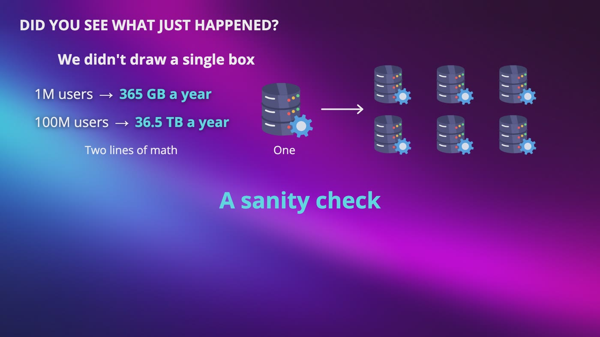
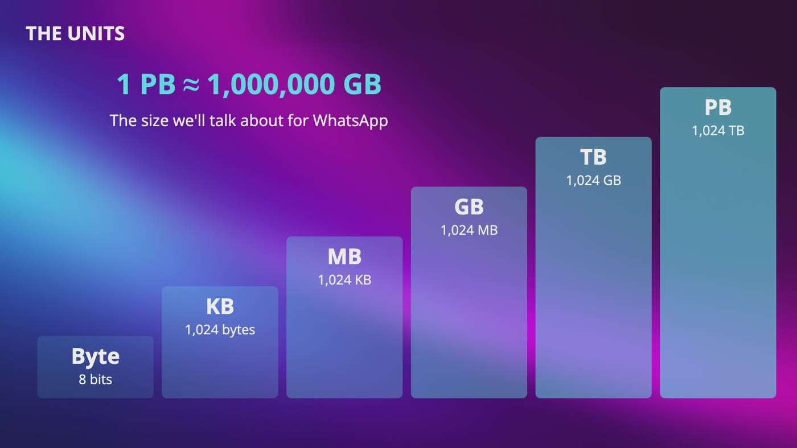
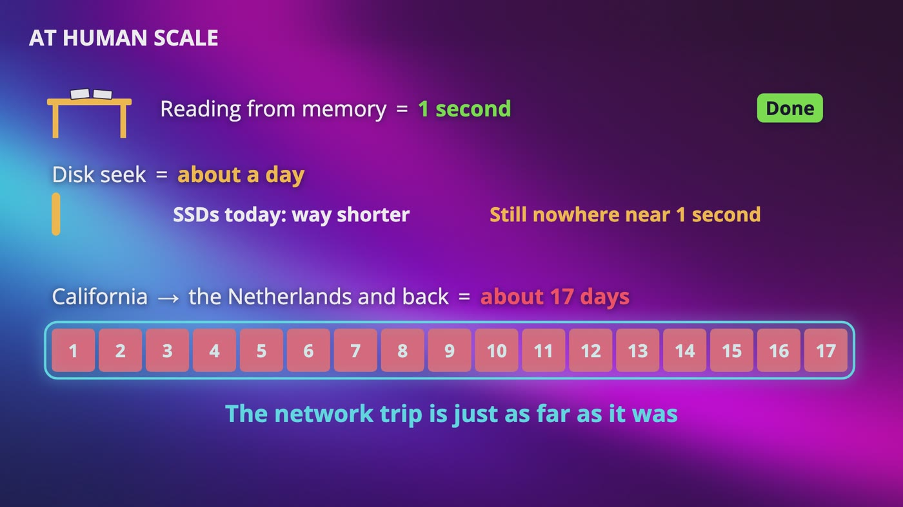
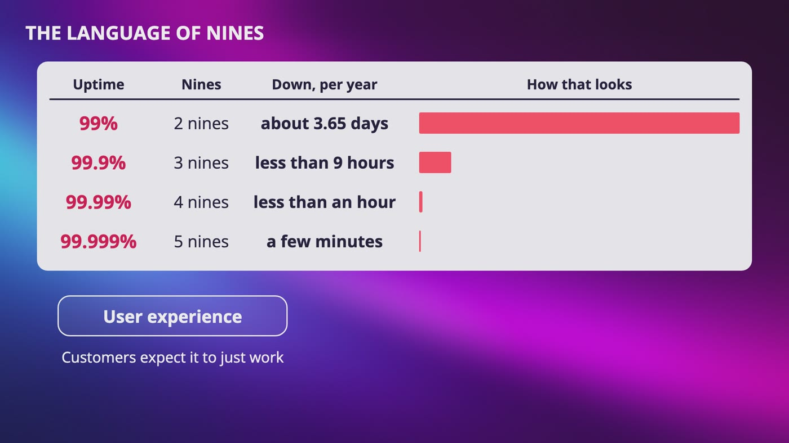
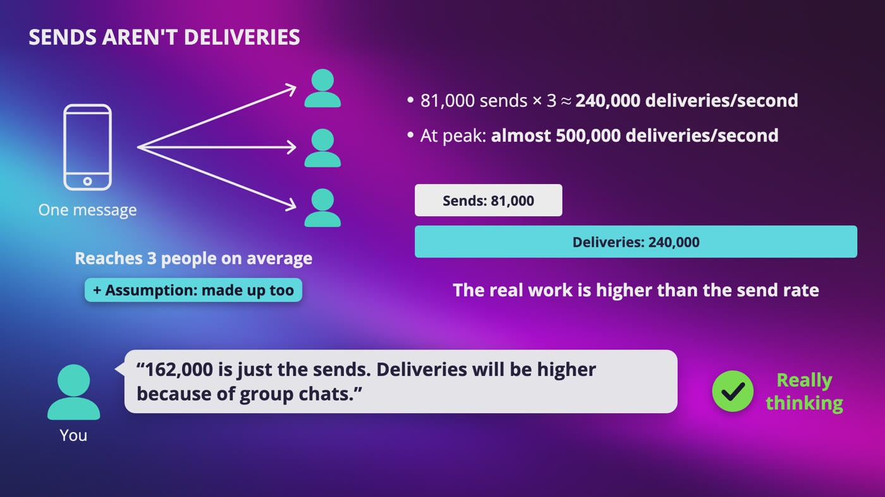
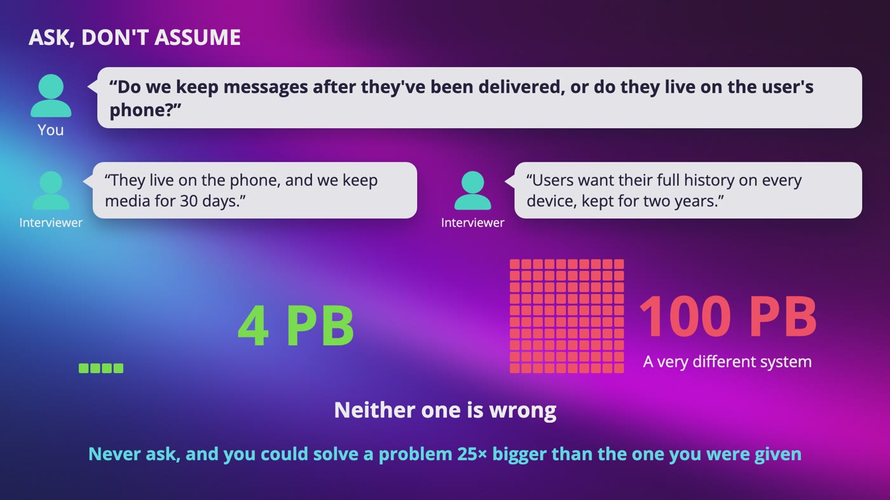
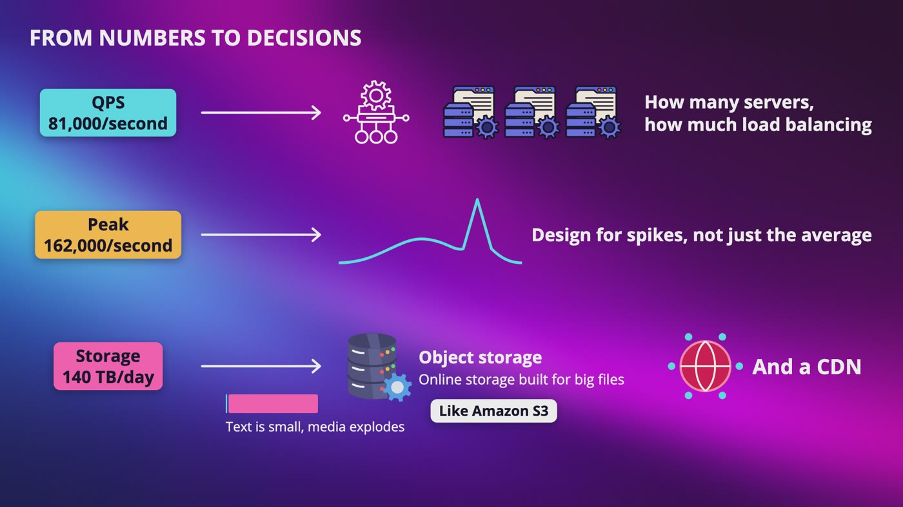

# [Chapter 2: Estimation: Thinking at Scale](https://www.udemy.com/course/system-design-zero-to-hero/?referralCode=183D59A1EBE9E71D26FF)

_Just multiplying and dividing with rounded numbers, so you can see what a design needs before you draw it._

[Download as PDF](../pdf/System-Design-Chapter-02-Notes.pdf)

## Contents

1. [Why Estimate? Thinking at Scale](#1-why-estimate-thinking-at-scale)
2. [Data Sizes: Bytes to Petabytes](#2-data-sizes-bytes-to-petabytes)
3. [Latency: What's Fast and What's Slow](#3-latency-whats-fast-and-whats-slow)
4. [Availability: The Language of Nines](#4-availability-the-language-of-nines)
5. [Designing WhatsApp: Assumptions and Traffic](#5-designing-whatsapp-assumptions-and-traffic)
6. [Designing WhatsApp: How Much Storage?](#6-designing-whatsapp-how-much-storage)
7. [Designing WhatsApp: What the Numbers Decide](#7-designing-whatsapp-what-the-numbers-decide)

## 1. Why Estimate? Thinking at Scale

> **The big idea:** In an interview, nothing is breaking yet. Quick, rounded math shows you what problems the system is going to have, and whether your design makes sense.

_Two lines of math took us from one database to many, and we didn't draw a single box._

### Why interviewers care

- They don't just want boxes and arrows. They want to see if you can **think at scale**.
- Even if nobody tells you to calculate anything, they expect you to reason about the numbers.
- Not a math person? Don't worry. It's just multiplying and dividing with rounded numbers.

### The chat app check

- Made-up numbers, not WhatsApp's: **1 million users**, 10 messages a day, 100 bytes each.
- 1 million × 10 = 10 million messages a day. 10 million × 100 bytes = 1 billion bytes, which is **1 GB a day**.
- 1 GB × 365 days = **365 GB a year**. A single server can easily store that, so keep the design simple.

### Now grow it

- At **100 million users**, it's the same math, a hundred times bigger: **36.5 TB a year**.
- One really big machine? Maybe, for a while. But vertical scaling has a limit, it's still a single point of failure, and the number keeps growing.
- So now you need distributed storage, like sharding. The math already changed the design.

### Three things you need to know

- **Power of two:** how we measure data.
- **Latency numbers:** how long things take.
- **Availability numbers:** how much a system is allowed to be down.

> **In your interview:** Include back of the envelope estimations when you explain your solution, even if you aren't asked to. It's a sanity check that helps you spot which designs are practical and which ones will break at scale.

**New terms**

| Term | Meaning |
|---|---|
| **Back of the envelope calculation** | A quick, approximate estimate, with math simple enough to do on the back of an envelope. The goal is a feel for the scale, not precision. |
| **Assumption** | A number you decide to go with because you don't know the real one. You share it with your interviewer. |
| **Distributed storage** | Spreading your data across many machines. |

## 2. Data Sizes: Bytes to Petabytes

> **The big idea:** Computers count in powers of two, so data units really go up by 1,024. In your interview, round to 1,000 and take care of the zeros.

_Each unit is 1,024 of the one before it, from a byte all the way up to a petabyte._

| Unit | Really | Rounded |
|---|---|---|
| Kilobyte | 1,024 bytes | A thousand bytes |
| Megabyte | 1,024 KB | A million bytes |
| Gigabyte | 1,024 MB | A billion bytes |
| Terabyte | 1,024 GB | A trillion bytes |
| Petabyte | 1,024 TB | A thousand TB |

### So do we round or not?

- In memory, a GB is 1,024 MB. Companies that make storage count in thousands, so both are out there.
- That's why a 1 TB hard drive shows up as around 930 GB. Nothing is missing.
- The gap is about **2%** at kilobytes and about **10%** at terabytes.
- Our guesses can be off by way more. We made up 10 messages a day, and if people send 20, we're off by double.

### Doing the math in your head

- **Multiply the numbers in the front, then take care of the zeros.**
- 10 million messages × 100 bytes: 7 zeros plus 2 zeros is 9 zeros. That's a billion bytes, or 1 GB.
- 50 million people × a 2 MB photo: 50 × 2 = 100. A million × a million is a trillion bytes, a TB. So **100 TB**.
- Dividing works the same way, you just cross out zeros instead.

> **In your interview:** Know it's really 1,024, and round it to 1,000. Say it out loud: "I know it's really 1,024, but I'm going to use 1,000 to keep the math simple." Pick one way and stay with it, because mixing them is how you get confused.

**New terms**

| Term | Meaning |
|---|---|
| **Capacity estimate** | Figuring out how much storage or memory a system needs. |
| **Power of two** | A number you get by multiplying 2 by itself repeatedly: 2, 4, 8, 16, and 10 times gets you 1,024. |
| **Binary** | Zeros and ones, which is how computers operate. |
| **Bit** | A single zero or one. |
| **Byte** | 8 bits. Enough for about one English letter. Emojis and many other alphabets take a bit more. |
| **Kilobyte (KB)** | 1,024 bytes. Round it to a thousand bytes. |
| **Megabyte (MB)** | 1,024 kilobytes. Round it to a million bytes. |
| **Gigabyte (GB)** | 1,024 megabytes. Round it to a billion bytes. |
| **Terabyte (TB)** | 1,024 gigabytes. Round it to a trillion bytes. |
| **Petabyte (PB)** | 1,024 terabytes, which is about a million gigabytes. |
| **Bandwidth** | How much data can move through a connection each second. |

## 3. Latency: What's Fast and What's Slow

> **The big idea:** It's not only how much data you have, but how quickly you can get it. Different operations live on completely different scales.

_If reading from memory took 1 second, a disk seek would take about a day, and a trip to the Netherlands and back about 17 days._

|   | How long it takes | If memory took 1 second |
|---|---|---|
| Memory | Nanoseconds | 1 second, grabbing a paper off your desk |
| Disk seek | Around 10 milliseconds | About a day |
| Packet, California to the Netherlands and back | Around 150 milliseconds | About 17 days |

### Memory and disk

- **Memory (RAM)** is the desk where you keep papers while you work. It's extremely fast, but space is limited, and it only holds data while the system is running.
- **Disk** is a filing cabinet across the room. You can store a lot more there, but it takes time to walk over.
- Disk can be thousands of times slower or more. That's why caching is so critical: keep frequently used data in memory, and your system feels instant.

### What else the list shows

- The CPU cache also takes nanoseconds, so it's practically instant.
- A round trip inside the same data center takes hundreds of microseconds.
- A disk seek is about **100,000 times slower** than memory.
- Today's solid state drives are a lot faster than that hard drive, but still nowhere near that 1 second. The network trip is just as far as it was.

### Back to our chat app

- A friend in the Netherlands costs some time, but in a chat you won't even notice it.
- If the server walked to the filing cabinet for every message, you definitely would.

> **In your interview:** Nobody is going to ask how many nanoseconds something takes. But if you can say "this read goes to the disk, so let's keep the recent ones in memory," you're showing exactly the thinking they want to see.

> **In the real world:** Dr. Jeff Dean from Google showed a famous list of how long common computer operations take in his talks around 2010. Computers have gotten way faster since then, so don't treat these as today's numbers. It's the ratios that matter.

**New terms**

| Term | Meaning |
|---|---|
| **Packet** | A small chunk of data that gets sent on its own. |
| **Millisecond** | One thousandth of a second. |
| **Microsecond** | One millionth of a second. |
| **Nanosecond** | One billionth of a second. |
| **Disk** | Long-term storage, like hard drives or solid state drives. Data stays there even after the power is off, but it's much slower to access. |
| **CPU cache** | A tiny, very fast memory right next to the processor. |
| **Disk seek** | When a hard drive has to move to the right spot before it can start reading. |

## 4. Availability: The Language of Nines

> **The big idea:** Availability is the percentage of time a system is up. Every extra nine gets harder and more expensive, so only pay for the ones this system really needs.

_Each extra nine in the uptime cuts the downtime allowed per year, from about 3.65 days down to a few minutes._

| Uptime | Nines | Down, per year |
|---|---|---|
| 99% | 2 nines | About 3.65 days |
| 99.9% | 3 nines | Less than 9 hours |
| 99.99% | 4 nines | Less than an hour |
| 99.999% | 5 nines | Just a few minutes |

### What an SLA really does

- A lot of people think the provider is promising that the service stays up. Nobody can promise that.
- An SLA really sets **what you get if it doesn't stay up**, usually service credits.
- If your app goes down on your biggest day of the year, a discount doesn't bring your customers back. You still have to design for failure yourself.

### Why parts multiply

- A web server and a database both have to work, and each has 99.9%. If either one is down, you're down.
- 99.9% × 99.9% is about **99.8%**. That takes us from about 9 hours of downtime a year to about **17.5 hours**.
- Every box you draw that has to work is another thing that can take your whole system down.

### Copies work the other way around

- With two copies where either one can do the job, you only go down when both are down at the same time.
- That's why we kept adding backups in the last section.

### When to stop adding nines

- Someone on a phone that's 99% reliable can't tell 99.99% from 99.999%. Their phone or wifi is failing way more often than your service.
- You could spend a lot of money on that extra nine, and they would never notice.

> **In your interview:** Don't say five nines just because it sounds impressive. Ask what this system actually needs, and how much that extra nine is worth paying for.

> **In the real world:** The target for AWS EC2 is 99.99% uptime in a month, if you run across at least 2 separate locations in a region. Miss it, and you get 10% of that month's bill back as credits, or more if it gets a lot worse. For one single server, the target is only 99.5%. That point about the 99% phone comes from Google's site reliability book.

**New terms**

| Term | Meaning |
|---|---|
| **High availability** | A system stays up and running without interruption for as long as possible. |
| **Availability** | How much a system is up, written as a percentage of uptime. |
| **Uptime** | The time that the system is up and working. |
| **SLA** | Service level agreement. A formal contract that says how much uptime a customer should expect, and what happens if the provider misses that. |
| **Service provider** | The company that runs and offers a service, like AWS, Google Cloud or Microsoft Azure. |
| **AWS** | Amazon Web Services. A service provider that offers infrastructure like servers, storage and databases. |
| **Service credits** | Money off your future bills. |
| **EC2** | The AWS service that rents out servers. |
| **Language of nines** | Describing uptime by counting the nines. 99.9% is three nines. |

## 5. Designing WhatsApp: Assumptions and Traffic

> **The big idea:** Write your assumptions down, then turn them into queries per second. Design for the peak, not the average, and remember that sends aren't deliveries.

_One message reaching 3 people turns 81,000 sends into around 240,000 deliveries every second._

| Assumption | Made-up number |
|---|---|
| Monthly active users | 500 million |
| Daily active users | 70% of them, so 350 million |
| Messages | 20 per user, per day |
| With media | 10% of messages have a photo or video |
| Text message | 100 bytes of text + 100 bytes of metadata = 200 bytes |
| Media file | 200 KB, a thousand times bigger than a text message |

### Queries per second

- 350 million users × 20 messages = **7 billion messages a day**.
- 24 hours × 60 minutes × 60 seconds = 86,400 seconds in a day.
- 7 billion ÷ 86,400 is around **81,000 messages per second**. That's our average QPS.
- In your head: call the seconds in a day 100,000, cross out 5 zeros, and you get 70,000. Close enough.

### Why the peak matters

- People are awake at certain times, and huge spikes come on days like New Year's Eve or the World Cup final.
- Build only for the average, and you're overloaded every time traffic goes above it.
- We assume peak is double the average: around **162,000 QPS**. Double is an assumption too, so say it out loud.

### Sends aren't deliveries

- One message to a group of 50 people is around 50 deliveries.
- If each message reaches 3 people on average, 81,000 sends turn into around **240,000 deliveries every second**, and almost half a million at peak.

> **In your interview:** Write your assumptions down as you go, because everything depends on them. A sharp interviewer can ask about deliveries, so say: "162,000 is just the sends, and deliveries will be higher because of group chats."

> **In the real world:** In October 2020, Mark Zuckerberg said on Facebook's earnings call that roughly 100 billion messages were being exchanged on WhatsApp every day, about 1.2 million per second. Our 7 billion is about 14 times lower. WhatsApp said it had 2 billion users that year, 4 times our 500 million. The statement also doesn't say if it counts sends or deliveries. Our method is fine, we just picked smaller numbers.

**New terms**

| Term | Meaning |
|---|---|
| **Monthly active users** | People who opened the app at least once in the month. |
| **Daily active users** | People who open the app on any given day. |
| **Metadata** | Information a message carries about itself, like a message ID, who sent it, who it's going to, and a timestamp. |
| **QPS** | Queries per second. How many operations, like sending a message, happen in each second. |

## 6. Designing WhatsApp: How Much Storage?

> **The big idea:** Text is small and media explodes. But one question changes the answer more than any math: do we keep messages after they've been delivered?

_One question to the interviewer decides whether you're designing for 4 PB or 100 PB. Neither one is wrong._

|   | The math | Storage |
|---|---|---|
| Text, per day | 6.3 billion × 200 bytes | A little over 1 TB |
| Media, per day | 700 million × 200 KB | 140 TB |
| Keep 1 year | Everything: 140 TB × 365 days | Around 50 PB |
| Keep 2 years | Everything: double that | Around 100 PB |
| Keep 30 days | Only media: 140 TB × 30 days = 4,200 TB | About 4 PB |

### Text barely changes the number

- Only 1 out of 10 messages has media in it, but media is around **99%** of our storage.
- So our total is around **140 TB per day**.

### The question that changes everything

- We assumed we keep every message after it's delivered, and we never said it out loud. Should we?
- Going from 100 PB to 4 PB is around **25 times less**, with the same users and the same messages.
- This doesn't tell us what WhatsApp really stores, because these are still made-up numbers. It tells us how much this one decision matters.

### It's a real tradeoff

- If your history lives on your phone and you lose your phone, the server can't just give it back. Now you need something like backups.

> **In your interview:** Ask: "Do we need to keep messages after they've been delivered, or do they live on the user's phone?" If you never ask, you could spend your whole interview on a problem 25 times bigger than the one you were given. This question moved the answer the most, and it took no math.

> **In the real world:** WhatsApp's privacy policy says messages are deleted from its servers once delivered. If a message can't be delivered, it's kept in encrypted form for up to 30 days. The policies for the UK and Europe say media is kept for up to 30 days, to help with things like forwarding.

**New terms**

| Term | Meaning |
|---|---|
| **Data retention** | How long we keep the data for. The longer the retention, the larger the total storage we need. |
| **Encrypted** | Scrambled, so that it can't be read without a key. |

## 7. Designing WhatsApp: What the Numbers Decide

> **The big idea:** These numbers aren't for memorizing. They guide decisions. The way you got to your number matters way more than the number itself.

_QPS points to servers and load balancing, the peak to designing for spikes, and storage to object storage and a CDN._

### From numbers to decisions

- **QPS:** how many servers, and how much load balancing.
- **Peak:** design for spikes, not just the average.
- **Storage growth:** text is small and media explodes, which pushes you towards object storage and a CDN.

### How many servers?

- Your phone keeps a connection open with the server, so a message can reach you right away.
- Be generous: all 350 million daily users connected at once, 2 million per server. That's **175 servers**.
- That's a best case, not the answer. Real servers do actual work and need spare room. But now you know it's not 5 servers, and why it's a lot more than 175.

### How much bandwidth?

- Networks are measured in bits, so 140 TB of media a day × 8 is around 1,100 terabits.
- Divide by the seconds in a day: around **13 gigabits per second** on average, and around **26** at peak.
- That's only uploads. Each file also has to be downloaded by the people who receive it.

### Why availability matters here

- At 99.9%, almost 9 hours of downtime a year means more than **2.5 billion messages** lost or delayed.
- Even 1 minute is around 5 million messages.
- So a service at this scale would aim for 4 nines or higher, and that's why redundancy and failover are required.

### Tips for your interview

- **Round.** Don't waste time on messy math. The point is your reasoning, not your arithmetic.
- **Write down your assumptions.** You can come back to them, and your interviewer can change one.
- **Label your units.** Write 200 KB, not 200. Mixing up megabytes and gigabytes can be the difference between a system that works and one that's broken.
- **Practice the common estimations:** queries per second, peak load, storage growth, cache size and number of servers.

> **In your interview:** The interviewer doesn't care whether you say 90 or 100 petabytes. They're looking for whether you can take a vague, open-ended problem, reason about it in a structured way, and connect your numbers to real design decisions.

> **In the real world:** WhatsApp wrote in 2012 that it pushed a single server past 2 million connections. That was a team tuning its servers to see how far they could push them.

**New terms**

| Term | Meaning |
|---|---|
| **Object storage** | Online storage built for big files, like Amazon S3. |

## Recap: What we estimated

_Interviewers aren't testing your calculation skills. They're testing your ability to think clearly about scale._

| Every number answers a question (our made-up WhatsApp) | |
|---|---|
| **Power of two** | How do we measure data? |
| **Latency** | What's fast and what's slow? |
| **Availability** | How much downtime is okay? |
| **81,000 messages a second** | What's the average traffic? |
| **162,000 at peak** | What about New Year's Eve? |
| **240,000 deliveries a second** | What's the real work? |
| **140 TB a day** | How fast does storage grow? |
| **4 or 100 PB** | Do we keep messages after delivery? |
| **175 servers** | What's the best case starting point? |
| **13 gigabits per second** | How much data do uploads move? |

**What to remember**

- Know it's really 1,024, and round to 1,000
- Round your math, because the point is your reasoning
- Write down your assumptions
- Label your units
- Design for the peak, not just the average
- Ask before you assume
- Don't say five nines just because it sounds impressive
- Connect every number to a design decision

---

From the course **[System Design: Zero to Interview Hero](https://www.udemy.com/course/system-design-zero-to-hero/?referralCode=183D59A1EBE9E71D26FF)** by Nata Vacheishvili.
