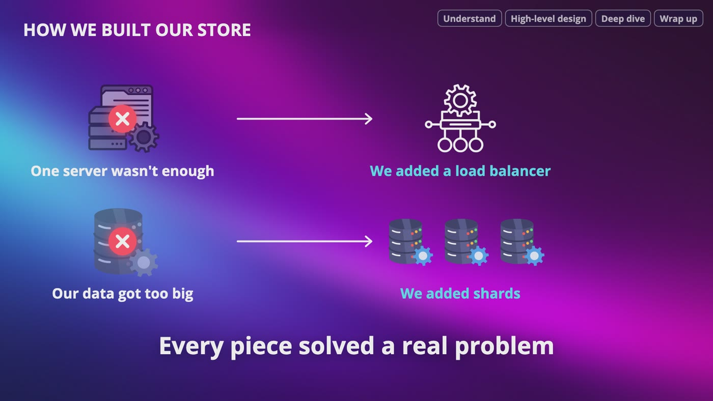
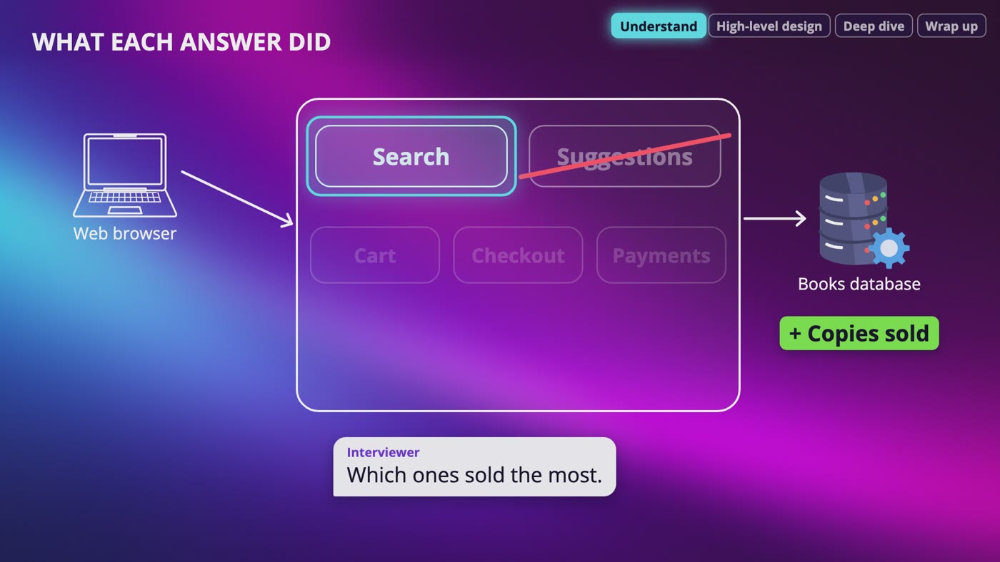
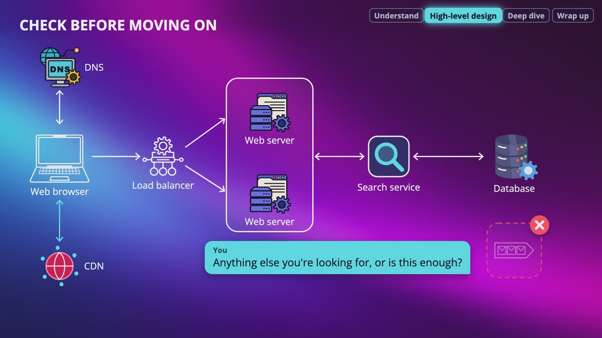
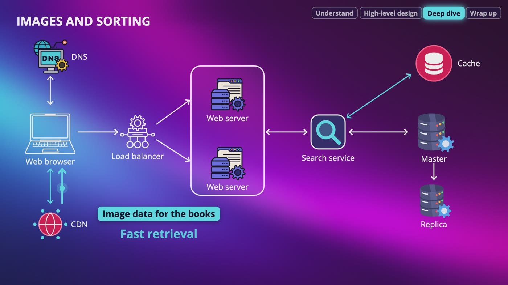
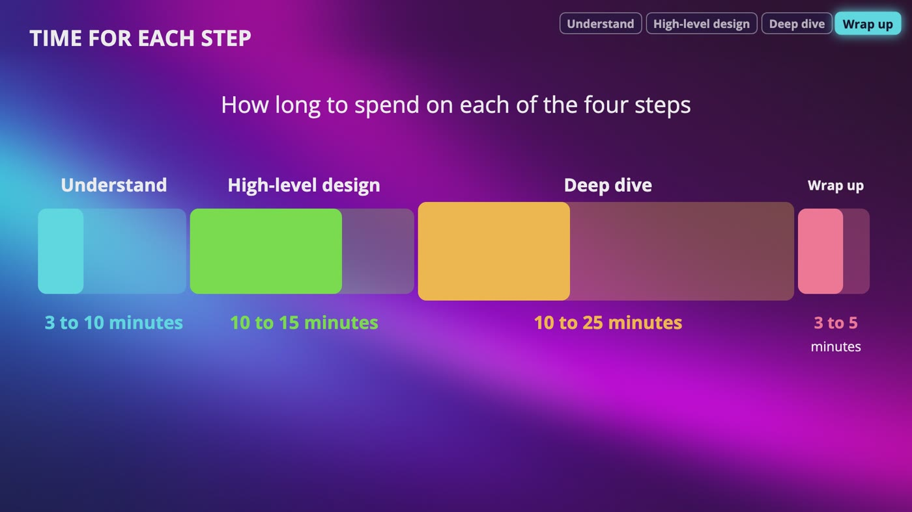

# [Chapter 3: The Interview: A Four-Step Framework](https://www.udemy.com/course/system-design-zero-to-hero/?referralCode=183D59A1EBE9E71D26FF)

_Every interview is different, but there are ground rules: understand the problem, draw the big picture, go deep, and wrap up._

[Download as PDF](../pdf/System-Design-Chapter-03-Notes.pdf)

## Contents

1. [What Interviewers Actually Look For](#1-what-interviewers-actually-look-for)
2. [Step 1: Ask Questions First](#2-step-1-ask-questions-first)
3. [Step 2: Propose a High-Level Design](#3-step-2-propose-a-high-level-design)
4. [Step 3: The Deep Dive](#4-step-3-the-deep-dive)
5. [Step 4: Wrapping Up, Timing, and What Not to Do](#5-step-4-wrapping-up-timing-and-what-not-to-do)

## 1. What Interviewers Actually Look For

> **The big idea:** Nobody expects a perfect answer. What companies want to see is whether you can work with your interviewer, ask good questions and defend your choices.

_We added a load balancer when one server wasn't enough, and shards when our data got too big. Every piece solved a real problem._

### Why it's scary, and the good part

- You never know what to expect, and questions are always abstract and broad.
- The expectations for perfect answers are very low. Every interviewer knows that designing a real world application in one hour is impossible.
- The problem is always open-ended, and there's no perfect answer. The final design matters less than the thoughts you discuss along the way.

### What they're trying to see

- Can you collaborate with your interviewer to understand the goal of the problem?
- Can you work under pressure, and clear up a vague question?
- **Can you ask good questions?** That's the most important thing you can do to impress someone.

### Red flag: over-engineering

- I ask you to design a bookstore. In your first 5 minutes you draw data centers in 3 countries, shards and message queues everywhere.
- It looks impressive, but you don't even know how many people use this bookstore.
- Maybe it's a small store with a few thousand customers, and they'd be paying for problems they don't have.
- **Add it when you need it.**

### Red flag: ignoring the tradeoffs

- A cache makes our bookstore faster, but we could be showing a customer an old price.
- "I'd add a cache because caches are fast" is only half of it. Tell me what it costs you too.

### The four steps

- **1.** Understand the problem. **2.** Propose a high level design. **3.** Go deep on the important parts. **4.** Wrap up.

> **In your interview:** I run these interviews as a software engineering manager. I pick a question that lets me assess you accurately, because finishing and still not knowing if you can do the job is the worst outcome for me, and it's not fair to you either.

**New terms**

| Term | Meaning |
|---|---|
| **Ambiguity** | The question is vague, and it could mean a lot of different things. |
| **Red flag** | Something you do that makes the interviewer worried about hiring you. |
| **Over-engineering** | Building something way more complicated than the problem actually needs. |
| **Tradeoff** | What you give up in order to get something. |

## 2. Step 1: Ask Questions First

> **The big idea:** Understand the requirements before you design anything. Never make assumptions. If you really have to, say it out loud and check it first.

_The answers crossed out suggestions, faded the cart, checkout and payments, and added copies sold to the database._

| We asked | The interviewer says | What it did |
|---|---|---|
| Web or mobile? | Just the web app | The whole mobile path is gone |
| Who sells? | The company sells its own books, so no marketplace | Nothing needed for people uploading books |
| Main feature? | Searching for books | Cart, checkout and payments fade away for today |
| Search by? | Titles and authors only | We don't search by genre or price |
| Any sorting? | Price both ways, and most popular | We have to track copies sold |
| Suggestions? | No, skip that | A whole feature we don't have to build |
| Images? | Yes, one for each book | Each result shows one image |

### Slow down

- As engineers, we like to jump to solutions. That's likely to lead you to design the wrong system.
- Every company and every interviewer is different. You never know what they're looking for unless you ask.
- Don't assume they're launching to millions of users, or need to scale quickly.

### Questions you can use

- What specific feature do we want to build? What are we focusing on?
- How many users are we serving? How fast does the company expect to scale up?
- Are there other features that may connect to this one?

### What this showed

- Skip the questions, spend your time on the mobile app and the suggestions, and you've made a nice design of something nobody asked for.
- The goal is not your performance. It's to have the system built the way they need it built.
- Find out: what do they want you to design, what matters most to them, and how might it develop over time?

> **In your interview:** If you give yourself answers to the questions you may be shy to ask, you will not get hired. Companies want you to reach out if you don't understand or doubt the requirements. Thinking, asking and listening literally defines the level of an engineer you are.

> **In the real world:** Designing a bookstore isn't just a practice question. I actually got asked this in an Amazon interview.

**New terms**

| Term | Meaning |
|---|---|
| **Scope** | What's included in the thing we're building, and what's not. |

## 3. Step 2: Propose a High-Level Design

> **The big idea:** Draw the big picture, ask for feedback, and treat your interviewer like a coworker. Only draw what this problem needs.

_Our bookstore's high level design, with the message queue left out, and a check with the interviewer before moving on._

### What to do in this step

- Come up with an initial blueprint and reach an agreement with your interviewer.
- Draw the key components: APIs, servers, data stores, caching systems, CDN, message queues and so on.
- Do you need a message queue here? Someone is waiting for a search answer, and there's no slow job to hand off. So I wouldn't draw one right now.
- Then do your back of the envelope estimation, thinking out loud and asking about your assumptions.

### Following one search

- Someone types Harry Potter and sorts by the lowest price.
- The browser gets the address of our **load balancer** from DNS.
- The request goes through the load balancer to one of the **web servers**.
- The web server asks the **search service**. A sorted list of books comes back, each with a title, an author, a price and a link to its cover on the CDN.
- The browser shows the list, and gets each cover from the **CDN**.

### Say why each box is there

- Multiple servers give you high availability if one goes down.
- Multiple servers then need a load balancer, so no server is too busy.

### APIs and the database: a quick sketch

- It depends on how big the question is. For a whole online store, tables and columns this early are way too much detail. For one feature, a quick sketch can help.
- **API:** one search request. It takes a title or an author, how we want it sorted, and which page we want. It gives back the list of books.
- **Database:** a books table with the title, the author, the price, the number of copies sold and the link to the cover.
- Copies sold is only there because of the question we asked about sorting.

> **In your interview:** Not sure how much detail they want? Ask: "Would you like me to go through the API and the tables now, or should we keep going?" Before you dive deep, also ask if there's anything else they're looking for, or if this is enough.

**New terms**

| Term | Meaning |
|---|---|
| **High level** | The big picture: the main boxes and how they connect, without the details of each one yet. |
| **Search service** | A separate part of our system whose only job is finding books. |

## 4. Step 3: The Deep Dive

> **The big idea:** You can't go deep on everything, so go deep on the parts that matter. Your interviewer will give you hints about which parts those are.

_The deep dive adds a cache, a master database with a replica, and a CDN that holds the book images._

### Choosing what to go deep on

- Hints sound like small questions: "How would you keep this fast?" or "What happens if this database goes down?" Follow them, even if you planned something else.
- No hints? Pick what matters most, say it out loud, and check: "I'd like to go deeper on the search service and how we keep it fast. Does that sound good?"
- Watch your time. Don't spend 10 minutes going back and forth between Redis and Memcached before you've said what the cache is doing.

### The cache

- Ask: do we care about caching, and how long do we keep it?
- Check the search cache first. Books like Harry Potter or Game of Thrones get searched a lot, so it can save trips to the database.
- If the results are there, grab them. If not, grab them from the database and put them in the cache for next time.
- Ask about the **cache expire time** too.

### Databases, images and sorting

- Have a master and a replica in case of emergencies, so there's no single point of failure.
- A lot of books? Discuss hashing and dividing the data across databases, which is sharding.
- CDNs can hold the image data for fast retrieval. Also discuss where sorting is handled.
- Estimate: how much data are we storing, over time, and how many databases will we need?

### The client and pagination

- The front end turns the data into a results page: covers from the CDN, titles, authors, star ratings, prices, availability and sorting indicators.
- When the user scrolls or goes to the next page, the client sends a paginated request, and the search service repeats the same process.
- If each page has 20 books, page 2 has an offset of 20.
- The response includes the top results, pagination tokens, and any applied filters or sorting options.

> **In your interview:** Don't over-engineer here either. Over-engineered systems directly relate to the company's costs, and many companies pay a very high price for this, literally and figuratively.

**New terms**

| Term | Meaning |
|---|---|
| **Design deep dive** | Going into a lot more detail on the parts that matter. |
| **Pagination** | Sending the results one page at a time, instead of all of them at once. |
| **Offset** | How many results to skip. |
| **Pagination token** | A little marker that tells the next request where to continue from. The same idea as an offset. |

## 5. Step 4: Wrapping Up, Timing, and What Not to Do

> **The big idea:** Finish with a conclusion, what you'd do with more time, and a few error cases or scale up opportunities. Never say your design is perfect.

_How long to spend on each of the four steps. The deep dive takes the most time._

| Step | Time |
|---|---|
| 1. Understand | 3 to 10 minutes, understanding the problem and establishing the design scope |
| 2. High level | 10 to 15 minutes, on the high level design |
| 3. Deep dive | 10 to 25 minutes. This takes the most time |
| 4. Wrap up | 3 to 5 minutes |

### Follow up questions you might get

- **Bottlenecks:** what struggles first? A new Harry Potter book comes out and everybody searches at once. Probably the database, because every search that isn't in the cache ends up there.
- **Failures:** if the cache server dies, all that traffic lands on the database. If the CDN goes down, the client should get the cover from the origin.
- **Monitoring:** watch how long searches take, how many fail, and how often the answer is in the cache.
- **10 times the users:** more web servers, more replicas, a bigger cache, and shards when the data gets too big. You didn't build that on day one, but you know when you would.

### If you get stuck

- Don't just sit there quietly. If you go quiet for a long time, your interviewer has nothing to go on.
- **Say where you are, out loud:** "I'm trying to decide how long to keep search results in the cache. I'm worried about showing old prices, but I also don't want to keep going back to the database."
- **Ask for a hint:** "I'm a little stuck here, could you give me a hint?" That's not failing. You'd ask a coworker too.

### What not to do

- Don't make assumptions without checking them.
- Don't jump into a solution before you understand the requirements.
- Don't over-engineer, and don't ignore the tradeoffs.
- Don't get lost in small details when you have a whole system to talk about.
- Don't tell your interviewer that your design is perfect.

> **In your interview:** There's always something to improve, so mention what you'd do with more time. Give a conclusion of what you discussed, and bring up a few error cases or scale up opportunities.

**New terms**

| Term | Meaning |
|---|---|
| **Bottleneck** | The one part of a system that slows everything else down, like one narrow door in a very busy store. |

## Recap: The four steps

_The actual final design is less important than the thoughts you discuss during the design process._

| Each step, and how long to spend on it | |
|---|---|
| **1. Understand** | Ask questions, set the scope: 3 to 10 minutes |
| **2. High level design** | Draw it and agree on it: 10 to 15 minutes |
| **3. Deep dive** | Go deep on what matters: 10 to 25 minutes |
| **4. Wrap up** | Conclude, say what's next: 3 to 5 minutes |

**What not to do**

- Don't make assumptions without checking them
- Don't jump into a solution before you understand the requirements
- Don't over-engineer
- Don't ignore the tradeoffs
- Don't get lost in small details
- Don't sit quietly if you're stuck. Say where you are, and ask for a hint
- Don't tell your interviewer that your design is perfect

---

From the course **[System Design: Zero to Interview Hero](https://www.udemy.com/course/system-design-zero-to-hero/?referralCode=183D59A1EBE9E71D26FF)** by Nata Vacheishvili.
