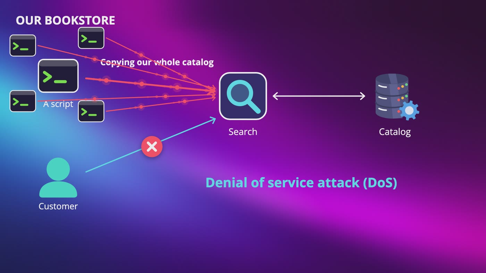
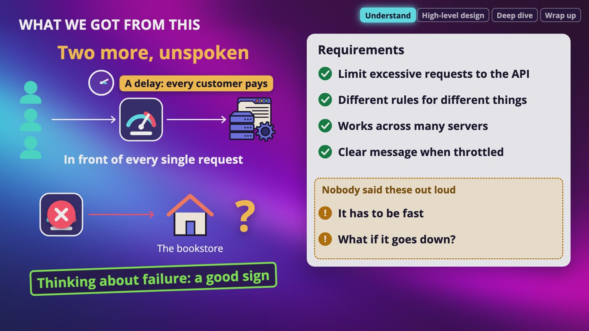
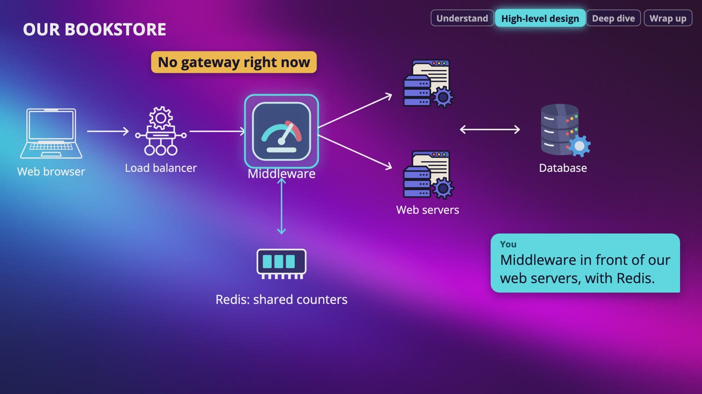
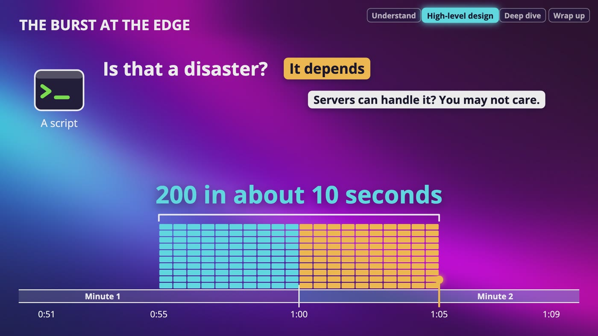
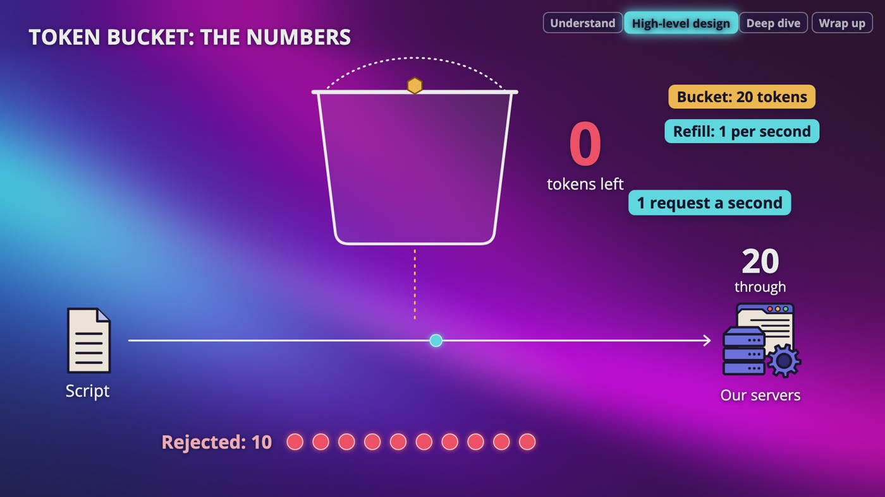
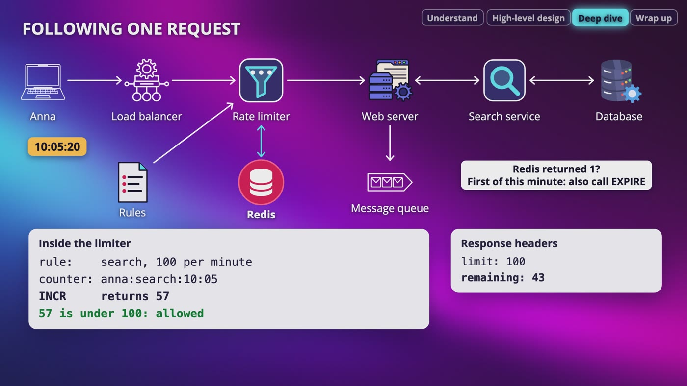
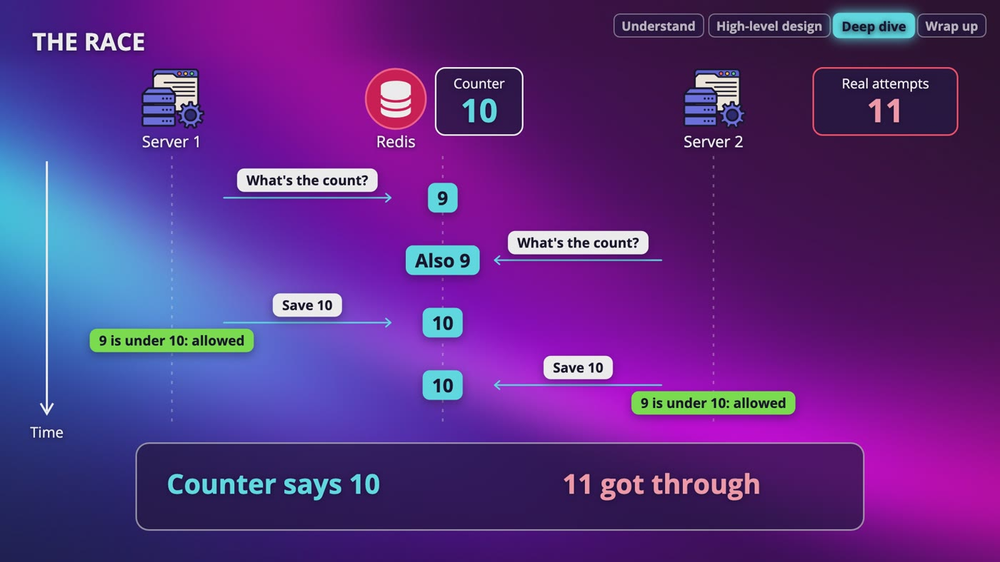
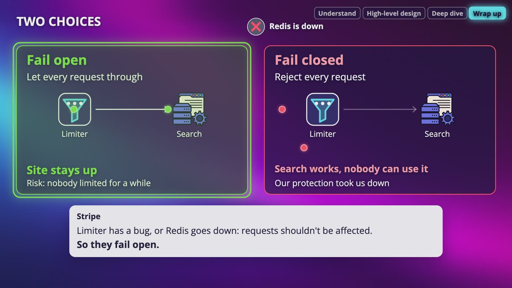

# Chapter 4: Design Rate Limiter

_Your first full design: the same four steps, from the first question to what happens when the limiter itself breaks._

[Download as PDF](../pdf/System-Design-Chapter-04-Notes.pdf)

## Contents

1. [Why Rate Limit?](#1-why-rate-limit)
2. [Asking the Right Questions](#2-asking-the-right-questions)
3. [Where Does It Go?](#3-where-does-it-go)
4. [Counting Requests: Three Window Algorithms](#4-counting-requests-three-window-algorithms)
5. [Token Bucket and Leaky Bucket](#5-token-bucket-and-leaky-bucket)
6. [The Design: Counters, Rules and Saying No](#6-the-design-counters-rules-and-saying-no)
7. [Making It Work Across Many Servers](#7-making-it-work-across-many-servers)
8. [When the Limiter Breaks, and Wrapping Up](#8-when-the-limiter-breaks-and-wrapping-up)

## 1. Why Rate Limit?

> **The big idea:** A rate limiter decides how many requests a client can send over a period of time, and blocks the extra ones. It protects your system from overload and abuse.

_Scripts flood our search, and a real customer can't get in. Doing this on purpose is a denial of service attack._

### Why we need one

- It stops a single user from consuming all the resources, and keeps overall performance stable and predictable.
- Without a limit, one client or a buggy script can send thousands of requests per second and crash your backend or database.
- Even one client spamming the system can give other users slow responses, timeouts or failures.

### What it stops

- **Our bookstore:** someone's script keeps hammering our search to copy the whole catalog, and a customer sits there waiting.
- **Password guessing:** attackers try thousands and thousands of password combinations on your users' accounts.
- **A leaked secret key:** someone uses your key to send a bunch of requests, and your compute bills go up. So a limit can save you money too.
- **Spam:** stop someone leaving dozens of book reviews in one day from the same IP address.

> **In the real world:** On a Saturday in July 2023, people scrolling Twitter got a message saying rate limit exceeded. Elon Musk, who owned Twitter, posted that the company had applied temporary limits on how many posts people could read each day, because of what he called extreme levels of data scraping and system manipulation. You can also look up GitHub's limits for its API: 60 requests per hour if you're not logged in, counted by IP address, and 5,000 if you are.

**New terms**

| Term | Meaning |
|---|---|
| **Rate limiter** | Decides how many requests a client is allowed to send over a certain period of time. Extra requests get blocked. |
| **Throttling** | Limiting someone's requests. If a user is throttled, the rate limiter stepped in. |
| **Data scraping** | Using programs to automatically copy large amounts of data from a website. |
| **Compute power** | The CPU and memory that do the actual work. |
| **Brute force** | Trying every possible answer until one of them works. |
| **Backend** | Everything that runs on our side, like the servers and the data. |
| **Denial of service attack (DoS)** | Flooding a system on purpose, so that real users can't get in. |
| **Secret key** | Like a password that one program uses to prove who it is to another program. |

## 2. Asking the Right Questions

> **The big idea:** All we've been told is "design a rate limiter." So before picking an algorithm or drawing anything, we ask, and turn the answers into requirements.

_Our four requirements, plus the two nobody said out loud: it has to be fast, and what happens if it goes down?_

| We asked | The interviewer says |
|---|---|
| What for? | An online bookstore, and we care most about search and login |
| Which side? | Limit requests to our API, so server side |
| Count who? | Keep it flexible, with different rules for different things |
| Logged in? | Logged in customers get a higher limit, because we know who they are |
| Numbers? | 100 searches a minute per customer, and 10 login attempts in 15 minutes |
| The scale? | A large number of requests, on many machines instead of one |
| Service? | Its own service, or inside our code? You decide, and it shows what you know |
| Tell users? | Definitely yes, for a good user experience |

### Our requirements

- Limit excessive requests to the API. That's the main job.
- Support different rules, for search, login and logged in customers.
- Work across many servers or processes.
- Show clear messages when requests are throttled, instead of the page just breaking.

### Two more nobody said out loud

- **It has to be fast.** It sits in front of every single request, so if it adds a delay, every customer pays for it.
- **What if it goes down?** Does the whole bookstore go down with it? We come back to this at the end of the chapter.

> **In your interview:** Just asking what happens if the limiter goes down tells me that you're thinking about failure, and that's a really good sign. And never make assumptions: if we'd assumed one limit for everyone on one server, we'd have designed the wrong thing.

**New terms**

| Term | Meaning |
|---|---|
| **Algorithm** | A step by step way of doing something. |
| **Use case** | What something is actually going to be used for. |
| **Distributed environment** | Running on many machines instead of one. |
| **Requirement** | Something our design has to do. |
| **Process** | A program that's running on a machine. |

## 3. Where Does It Go?

> **The big idea:** The client side can't be trusted, so limiters mostly go on the server side or in a gateway. For our bookstore, we build it as middleware, with Redis for the counters.

_Our decision for the bookstore: middleware in front of our web servers, with Redis for the shared counters._

| Where | What it means | Watch out |
|---|---|---|
| Client side | The code runs on the user's device | Unreliable. Requests are easily forged, and anyone can turn it off or skip our website |
| Server side | You control the code, so users can't bypass it, and you protect everything downstream | Many microservices each need their own code, or a shared library |
| Middleware | Sits between the client and our API servers, and looks at every request | With many servers, the counters still have to be shared |
| API gateway | A service in front of your APIs, with rate limiting already built in | It really fits if the company already has one |

### Many servers, one count

- In a distributed environment, you need shared storage to keep track of requests.
- **Redis** is in memory, so it's incredibly fast, and perfect for small pieces of data that change quickly.
- All servers see the same counter. That's a shared, consistent state.

### Saying no

- With a limit of 100 searches a minute, the first 100 go through.
- Search number 101 is throttled, and gets the HTTP code **429**, which means too many requests.

### Making the decision

- It really depends on the company: what are they running, how many engineers do they have, and what matters most right now?
- Building it yourself gives you full control of the algorithm, but it takes time.
- Already have microservices with an API gateway? You may just add it there.

> **In your interview:** Say your decision out loud, then check: "Let's build this as middleware in front of our web servers, with Redis for the shared counters. Does that work for you?" Knowing the different HTTP codes may also impress your interviewer. And you can bring up API gateways in other design interviews too.

> **In the real world:** Redis is a very common choice for rate limiters. Stripe has written about building its limiters on it, and the open source limiter that Lyft runs in production uses it too.

**New terms**

| Term | Meaning |
|---|---|
| **Forged** | Faked. |
| **Downstream** | Anything further along that the request would have gone to next. |
| **Microservice** | A small separate service that does one job, like the search service. |
| **Redis** | Remote Dictionary Server. A key-value store in memory that you can run yourself, or get as a managed service from cloud providers such as AWS and Microsoft. |
| **Middleware** | Software that sits between the client and our API servers, and looks at every request before it gets through. |
| **429** | The HTTP code for too many requests. |
| **API gateway** | A service in front of your APIs that handles jobs they all need, like checking who's calling, and rate limiting. |

## 4. Counting Requests: Three Window Algorithms

> **The big idea:** Don't memorize these, just follow the problem. Each algorithm fixes a problem with the one before it. Same limit for all of them: 100 searches a minute.

_The burst at the edge: 100 requests at the end of one minute and 100 at the start of the next, so 200 in about 10 seconds._

|   | Fixed window counter | Sliding window log | Sliding window counter |
|---|---|---|---|
| How it works | One counter per minute, back to 0 when the next minute starts | Keeps a timestamp for each request, and looks back exactly 60 seconds | Two counters, then an estimate |
| Best part | Simplest, least memory | Most accurate | Close, with two numbers per customer |
| Worst part | Burst at the edge | A lot of memory | It's an estimate, sometimes a little wrong |
| Memory | About 8 MB for 1 million customers | About 800 MB for 1 million customers | Two numbers per customer |

### Fixed window counter

- Like a phone plan with a monthly data limit: you use it up, you're stuck, then you get all of it back at once.
- A script sends 100 requests in the last 5 seconds of a minute, and 100 in the first 5 seconds of the next. Nobody broke the rule, but that's **200 requests in about 10 seconds**.
- Is that a disaster? It depends. If your servers can handle it, you may not care.

### Sliding window log

- On each request: throw away timestamps older than 60 seconds, count what's left, and if there's room, add this one.
- Our script gets a no, because all 100 are still in the last 60 seconds.
- The memory: 1 million customers × 100 timestamps × 8 bytes is about 800 MB.
- One catch: some versions also log rejected requests, so a client that keeps trying can stay blocked.

### Sliding window counter

- 45 seconds into the current minute, the last 60 seconds cover those 45, plus the last 15 of the previous minute.
- 15 out of 60 is a quarter, so we take **a quarter of the previous count, plus the current count**.
- Previous 80, current 70: 20 + 70 = 90, under 100, so it goes through. If the current count was 85, we'd have 105, and we'd say no.
- We don't know when those requests happened. We assume they were spread evenly.

> **In your interview:** The burst at the edge is a great thing to bring up. And don't just give the name of the one you picked. Say what you're giving up, and why it's okay for this system.

> **In the real world:** Cloudflare wrote about using the sliding window counter, and checked it on about 400 million requests. Only 0.003% of them were wrongly allowed or limited.

**New terms**

| Term | Meaning |
|---|---|
| **Window** | The stretch of time that we're counting in. |
| **Fixed window counter** | Cuts time into windows, gives each customer a counter, and resets it when the next window starts. |
| **Timestamp** | A record of the exact time that something happened. |
| **Sliding window log** | Keeps a log of timestamps for each customer, and looks back at exactly the last 60 seconds on every request. |
| **Sliding window counter** | Keeps counts for the current and previous minutes, and estimates how many requests are in the last 60 seconds. |

## 5. Token Bucket and Leaky Bucket

> **The big idea:** A burst is sometimes just a real customer doing something normal. These two algorithms limit the average while giving you some room, or a steady flow.

_30 requests at once: 20 go through and empty the bucket, and the other 10 are rejected._

### Why bursts can be good

- Anna looks at a page for a minute, then clicks a book. That page asks for its details, reviews and her cart, all at the same moment.
- She did nothing wrong. We want a limit on the average, with some room for short bursts.

### Token bucket

- Every request pays with 1 token, like at an arcade. Empty bucket means rejected. Tokens come back at a steady speed, and extras fall out when it's full.
- **Two settings:** the bucket size decides how big a burst can be, and the refill rate decides the average over a long time.
- Say 20 tokens, and 1 added every second. Anna sends 5 at once, has 15 left, and 5 seconds later she's back at 20.
- A script sends 30 at once: 20 go through and 10 are rejected. Then it gets 1 a second, so 60 a minute, and no more than 20 at once.
- No timer on millions of buckets. We save the tokens left and the last check time, then work out the refill on the next request.
- It's simple with little memory, but the two numbers can be hard to get right, and a burst still reaches your servers.

### Leaky bucket: two different things

- **Version 1, a real queue:** requests wait in order, and servers take them at a fixed speed. A queue of 10, at 2 a second: 15 arrive, 10 line up, 5 are rejected, and the last in line waits about 5 seconds.
- That's a steady flow, great for a payment company that only accepts so many per second. But who wants to wait 5 seconds for search results?
- **Version 2, just a meter:** each request adds to the bucket, it drains steadily, and if it's full you're rejected right away. Nobody waits. It behaves very much like a token bucket.

### Which one for our bookstore?

- **Search: token bucket.** Real customers come in bursts and want an answer right now. A sliding window counter is fine too, if you can say why.
- **Login: sliding window log.** Nobody needs to burst, we want 10 attempts to mean 10, and 10 is little to remember.
- **Sending to a payment company: the queue.** What we care about there is the steady speed.

> **In your interview:** If you say leaky bucket, say which one you mean. It shows that you actually understand how it works. Which algorithm you pick depends on what you're protecting, so be able to say why.

> **In the real world:** Stripe has written that it uses the token bucket for its API, and so does Amazon's API Gateway, which calls the two settings the rate and the burst. Nginx describes its rate limiting as the queue. Shopify's API limits work like the meter, and its docs describe requests as marbles going into a bucket that leaks.

**New terms**

| Term | Meaning |
|---|---|
| **Burst** | A lot of requests arriving at once. |
| **Token bucket** | Each request pays with a token from a bucket that refills at a steady speed. Empty means rejected. |
| **Refill rate** | How fast tokens come back. |
| **Leaky bucket** | A bucket that drains at a steady speed and overflows if you pour too fast. Either a real queue, or just a meter. |
| **FIFO** | First in, first out. Things leave in the order they arrived, like a line at a coffee shop. |
| **Nginx** | Very popular software for web servers and load balancers. |

## 6. The Design: Counters, Rules and Saying No

> **The big idea:** Three questions finish the design. Counters live in Redis, rules live in a configuration file, and rejected people get a 429 and a clear message.

_Anna's search: the limiter reads its rules, Redis returns 57, and she gets through with 43 requests left._

### Where the counters live

- Our database? Every request would read and write to it, and databases usually write to disk, which is slow. Our protection would slow everyone down.
- So we keep them in memory, in Redis, using **INCR** and **EXPIRE**.
- If Redis restarts, the worst thing that happens is some customers get a fresh count. These numbers were going to be thrown away in a minute anyway.

### Where the rules live

- Hard coded numbers mean changing our code and deploying again. If a limit is hurting real customers, you want to fix that right now.
- So rules go in a simple configuration file, often YAML: search, per customer, 100 requests a minute. Login, per account, 10 attempts in 15 minutes.
- Each limiter keeps a copy in memory and refreshes it every so often, the same idea as a cache.

### Saying no

- Send a **429**, plus headers. Without them, the client guesses, usually by trying again right away, and that makes everything worse.
- For customers, write something a person can read: "You're searching a little too quickly, try again in a few seconds."
- Do we always reject? A search, yes, because if we hold it the customer is already gone. An order is worth more, so we could put it in a message queue and process it when we have room.

### Following one request

- Anna searches at 20 seconds past 10:05. Her request goes through the load balancer to the middleware, which sees a limit of 100 a minute.
- It builds the counter's name from her user ID, the word search and the current minute, then sends INCR. Redis gives back **57**. Under the limit, so she gets her books, and the headers say limit 100, 43 left.
- If Redis had given back 1, this would be the first request of the minute, so we'd also call EXPIRE.
- A script on another customer's account reaches request 101 at 48 seconds past. It never reaches the web server. It gets a 429 and Retry-After says 12 seconds, and we write down that it happened.

> **In the real world:** GitHub sends headers called x rate limit limit (your total), x rate limit remaining (how many you have left) and x rate limit reset (when you get them back). These names differ between APIs, so don't memorize them. GitHub can also answer with a 403 or a 429, so not everyone does this the same way. Lyft's open source limiter also keeps its rules in a configuration file, and Stripe makes the point that the message should tell you what to do next.

**New terms**

| Term | Meaning |
|---|---|
| **INCR** | A Redis command that adds 1 to a counter and gives you back the new number. If the counter doesn't exist yet, it starts from 0. |
| **EXPIRE** | A Redis command that deletes a key after a certain number of seconds. |
| **YAML** | A text format that's an easy way to write settings so that people can read them. |
| **Headers** | Small pieces of information that travel along with a response. The user doesn't see them, but the program on the other side does. |
| **Retry-After** | A standard, optional header that tells the client how long to wait before trying again. |

## 7. Making It Work Across Many Servers

> **The big idea:** With many servers, counts have to be shared, and the counting has to be one step that nothing can interrupt. And remember that limits aren't guarantees.

_The race: both servers read 9 and both save 10, so the counter says 10, but 11 attempts got through._

### Why not count on each server?

- With 3 servers and a limit of 100 a minute, each one only sees a part of a customer's requests. They could get up to **300 a minute**.
- Sticky sessions would fix the counting, but adding or removing servers gets harder, and a dead server takes its counters with it.
- So we have one shared place for all the counts: Redis.

### The race

- Our login limit is 10, and someone has used 9. They send 2 more at the exact same moment, to 2 different servers.
- Both servers ask for the count and get 9. Both say 9 is under 10, and both save 10.
- The counter says 10, but **11 attempts got through**. It's the same problem as 2 customers buying the last copy of a book.
- With thousands of requests at once, it won't be off by just 1.

### The fix

- A **lock** works, but everyone waits in line for the counter, and this sits in front of every request. I wouldn't start there.
- Reading and adding were 2 separate steps. So we do them as one **atomic** step, and that's why we use INCR.
- Run it again: Redis has 9. Server 1 gets back 10, which is allowed. Server 2 gets back 11, which is rejected. They can never get the same number.
- More than one step, like the token bucket? Redis lets you run a **Lua script** as one atomic step.

### Far away users

- If every request asks one Redis in the United States, someone in Tokyo waits for that trip every time.
- So some systems run limiters in edge locations, the same idea as a CDN. They share counts in the background.
- 60 requests to Tokyo and 60 to Paris within a few seconds: each thinks it's under 100, so all 120 get through. For search, that's probably okay.

> **In your interview:** If asked whether your limiter is perfectly accurate, you can honestly say no, and explain how much you're okay with being off, and why. And don't draw edge locations unless you've asked where the users are. Add it when you need it.

> **In the real world:** In 2019, security researcher Laxman Muthiyah found a problem with Instagram's password reset on mobile. A 6-digit code, so a million possible codes, was valid for 10 minutes, and attempts were limited per IP address. He showed the limit could be beaten with many simultaneous requests from many IP addresses. Facebook, which owned Instagram, fixed it and paid a $30,000 bounty. So for login, also count attempts for each account. And Amazon says in its docs that API Gateway limits are applied on a best-effort basis: think of them as targets, not guaranteed ceilings.

**New terms**

| Term | Meaning |
|---|---|
| **Race condition** | The result depends on the timing of two things happening at the same moment. |
| **Lock** | One server says, nobody touch this until I'm done. |
| **Atomic** | It either happens all at once, or it doesn't happen at all, and nobody can see it halfway through. |
| **Lua script** | A small program you can run in Redis, as one atomic step. |
| **Edge location** | One of many locations close to users where a system runs something, like limiters. |
| **Eventual consistency** | Copies can disagree for a moment, but they catch up. |

## 8. When the Limiter Breaks, and Wrapping Up

> **The big idea:** A limiter can fail open or fail closed, and it can be different for different parts of your system. Test every limit before you turn it on, then keep watching it.

_If Redis goes down, failing open keeps the site up, and failing closed means search works but nobody can use it._

### If the limiter goes down

- **Fail closed:** search works perfectly, but nobody can use it. The thing that protects us just took us down.
- **Fail open:** the site stays up, and the risk is nobody being limited for a little while. For most things, I'd do this.
- **Login?** My own opinion, not a rule: I might fail closed, or fall back to a stricter limit on each server.
- Make it less likely too: give Redis a replica, and use a short timeout, so customers aren't all waiting on it.

### Test it, then watch it

- Run it first in a mode that decides but doesn't block, and only writes down what it would have blocked. Is that a script, or our best customer?
- Then watch how many requests are rejected, for each rule. A limit can be wrong in 2 ways.
- **Too strict:** a lot of real customers are getting 429s.
- **Not doing its job:** the script still gets through, and the servers are struggling.

### A few more things

- **Hard and soft limits:** for login I'd want a hard limit, and for search, a soft one is probably fine.
- **Different places:** we looked at HTTP requests, layer 7. You can also limit much earlier by IP address, layer 3, so a flood costs you very little.

### What if you're the client?

- Cache what you can, so that you don't ask twice.
- Read their headers, and slow down before you hit the limit.
- Got a 429? Don't just keep trying. Wait, and if it still fails, wait longer each time: 1 second, then 2, then 4.

> **In your interview:** There's no perfect answer on failing open or closed. Your interviewer wants to hear that you thought about it, and that it can differ across your system. If they ask what you'd do with more time, you have a lot to say now. Just don't tell them your design is perfect.

> **In the real world:** That Saturday in July 2023, Elon Musk first posted limits of 6,000 posts a day for verified accounts, 600 for unverified and 300 for new unverified. Later that day: 8,000, 800 and 400. Then 10,000, 1,000 and 500. Any limit touches real people, so picking the number is the hard part. Stripe fails open, and calls testing a limit a dark launch, and Lyft's limiter calls it shadow mode. GitHub warns that if you keep sending requests while limited, your integration can get banned.

**New terms**

| Term | Meaning |
|---|---|
| **Failing open** | If the limiter breaks, let every request through. |
| **Failing closed** | If the limiter breaks, reject every request. |
| **Dark launch** | Running a new limit so it decides but doesn't block anybody, and only writes down what it would have blocked. Also called shadow mode. |
| **Hard limit** | A limit that can never be passed. |
| **Soft limit** | A limit that can be passed for a short time. |
| **Layer 7** | The application layer, where we look at HTTP requests. |
| **Layer 3** | The network layer, where we can limit by IP address. |
| **Exponential backoff** | Waiting longer after each failure: 1 second, then 2, then 4. |

## Recap: How we designed it

_All you needed was the same four steps, and everything we learned when we grew our bookstore._

| Each decision, and the problem behind it | |
|---|---|
| **Questions first** | Different rules, on many servers, with clear messages |
| **Server side middleware** | The client side can't be trusted |
| **Fixed window counter** | We need something simple |
| **Sliding window log** | The burst at the edge |
| **Sliding window counter** | The log uses a lot of memory |
| **Token bucket** | Real customers come in bursts |
| **Leaky bucket queue** | Something behind us needs a steady speed |
| **Redis** | Counters must be fast and shared |
| **Configuration file** | Limits must be quick to change |
| **429 and headers** | Clients would guess and try again |
| **Atomic steps** | The race between servers |
| **Failing open or closed** | The limiter itself can break |

**What to remember**

- Start with the questions
- Put the limiter on the server side, as middleware or in a gateway
- Pick the algorithm that fits each feature, and say what you're giving up
- Use Redis for the counters, and atomic steps to stop the race
- Limiting by IP address alone isn't enough
- Ask what happens when it breaks
- Test a limit, watch it, and make sure you can change it quickly

---

From the course **[System Design: Zero to Interview Hero](https://www.udemy.com/course/system-design-zero-to-hero/?referralCode=183D59A1EBE9E71D26FF)** by Nata Vacheishvili.
