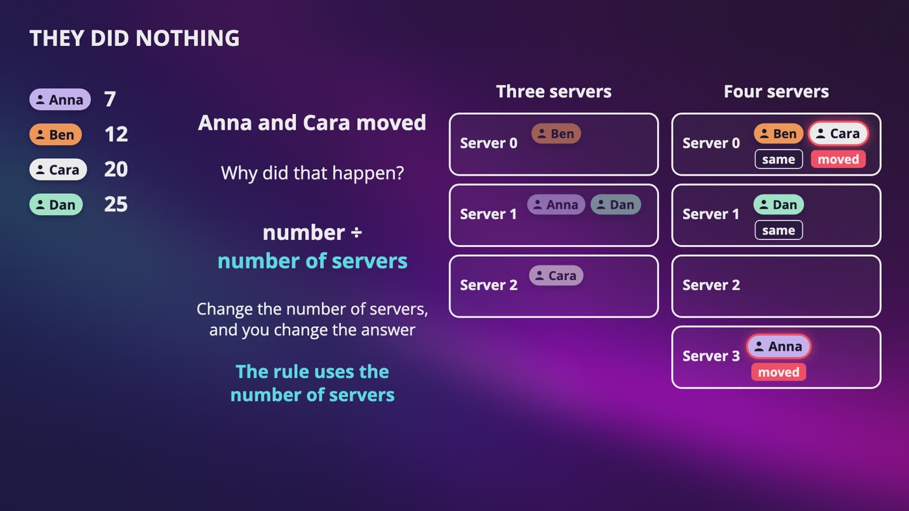
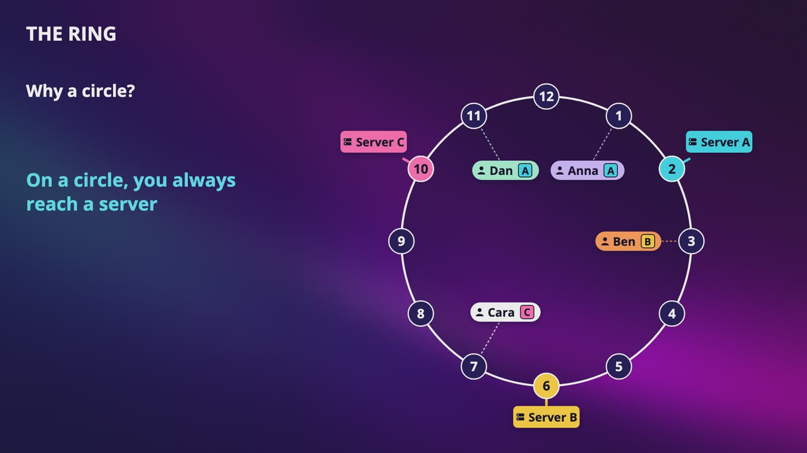
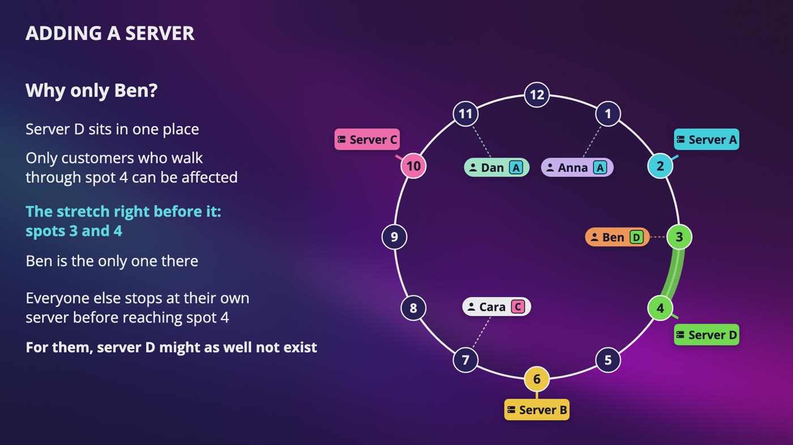
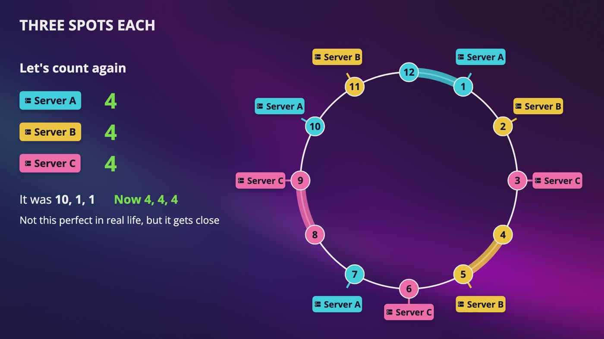
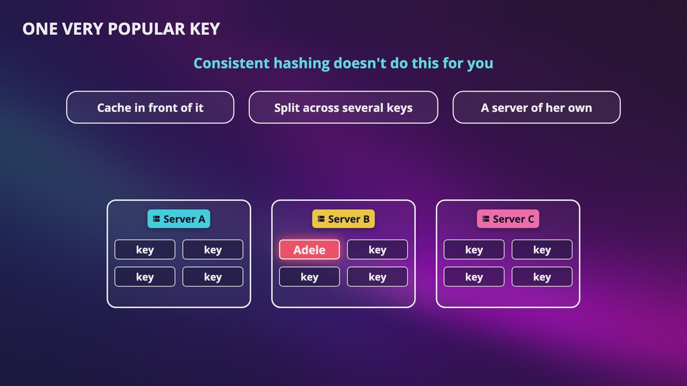

# [Chapter 5: Consistent Hashing](https://www.udemy.com/course/system-design-zero-to-hero/?referralCode=183D59A1EBE9E71D26FF)

_A hard one, taken one small step at a time. All you need to picture it is a clock._

[Download as PDF](../pdf/System-Design-Chapter-05-Notes.pdf)

## Contents

1. [Why Adding One Server Breaks Everything](#1-why-adding-one-server-breaks-everything)
2. [The Ring: A New Way to Find a Server](#2-the-ring-a-new-way-to-find-a-server)
3. [Adding and Removing Servers](#3-adding-and-removing-servers)
4. [Virtual Nodes: Making It Fair](#4-virtual-nodes-making-it-fair)
5. [Real Systems, and What It Doesn't Solve](#5-real-systems-and-what-it-doesnt-solve)

## 1. Why Adding One Server Breaks Everything

> **The big idea:** Dividing by the number of servers works, until that number changes. Then a lot of people move, even though they did nothing.

_Going from three servers to four, Anna and Cara moved and did nothing, because the rule uses the number of servers._

| Customer | Pretend hash | ÷ 3 servers | ÷ 4 servers | Moved? |
|---|---|---|---|---|
| Anna | 7 | Server 1 | Server 3 | **Moved** |
| Ben | 12 | Server 0 | Server 0 | Same |
| Cara | 20 | Server 2 | Server 0 | **Moved** |
| Dan | 25 | Server 1 | Server 1 | Same |

### The question of this chapter

- Our bookstore has 3 cache servers, and each customer's data is on just one.
- When Anna opens her page, which server has her data? We need a rule: **you give it a name, and it gives you a server**.
- It's the same question for shards: which database has this user?

### The remainder rule

- A hash function turns a name into a number. The same name always gives the same number, on every web server.
- Divide that number by the number of servers, and take what's left over. Anna is 7. 3 goes into 7 twice, with 1 left over, so server 1.
- It's simple and fast, and every web server gets the same answer.

### Now add one server

- For the holiday season, we add a fourth. The names still give the same numbers. Only what we divide by changed.
- **The rule uses the number of servers.** Change that number, and you change the answer for a lot of people.

### How bad is it?

- Simulate it with a lot of made-up customers: 3 servers to 4 moves about **75%** of them.
- A bigger system has it worse: 10 servers to 11 moves about **91%**.
- Anna's data is still on server 1, but our web server now asks server 3, so that's a cache miss.
- We added a server to help on a busy day, and sent a flood to our database on that same day.

> **In your interview:** Be able to explain why remainders break, in your own words, with one small example. If you say consistent hashing without knowing what problem it solves, a good interviewer will notice right away.

**New terms**

| Term | Meaning |
|---|---|
| **Remainder** | What's left over after dividing. |
| **Cache miss** | The cache doesn't have the answer, so we have to go to the database. |

## 2. The Ring: A New Way to Find a Server

> **The big idea:** Put servers and customers on a circle. Start at the customer's spot and walk clockwise, and the first server you reach is your server. The rule never uses the number of servers.

_Walking clockwise, Anna and Dan reach server A, Ben reaches server B and Cara reaches server C. On a circle, you always reach a server._

### Picture a clock

- 12 spots in a circle, and we're not telling the time. After 12 comes 1.
- Hash each server's name to get its spot: **server A on 2, server B on 6, server C on 10**.
- Hash each customer too: **Anna on 1, Ben on 3, Cara on 7, Dan on 11**. These are new pretend numbers, so don't connect them to the last video.

### Walk clockwise

- Anna is on 1. One step to 2, so server A.
- Ben is on 3. Walk to 6, so server B.
- Cara is on 7. Walk to 10, so server C. The matching letters are just a coincidence.
- Dan is on 11. Walk past 12, on to 1, then 2, so server A.
- On a straight line, Dan would fall off the end. On a circle, you always reach a server.
- If a customer lands exactly on a server's spot, that's their server.

### Each server owns a stretch

- Server B owns 3, 4, 5 and 6. Server C owns 7 through 10. Server A owns 11, 12, 1 and 2.
- A stretch is the part of the clock that ends at that server.
- They're all 4 spots long, but only because these spots are nice and even.

### In real life

- The walk is just a picture. Every web server keeps a **sorted list** of where the servers sit: 2, 6, 10.
- For Ben on 3, it finds the first number that's 3 or bigger, which is 6.
- For Dan on 11, nothing is that big, so it goes back to the start of the list, which is 2.

> **In your interview:** Practice this with a pen. Draw a circle, put a few servers on it, put one customer on it, and walk them clockwise to their server, out loud. It doesn't matter if you forget the exact words, but please don't skip the drawing.

**New terms**

| Term | Meaning |
|---|---|
| **Clockwise** | The direction that the hands of a clock move. |
| **Consistent hashing** | Finding a server by walking around a ring. It's called consistent because when the servers change, most of the answers stay the same. |
| **Hash ring** | The circle that servers and keys sit on. Also just called a ring. |

## 3. Adding and Removing Servers

> **The big idea:** When a server comes or goes, only one stretch of the clock changes, and the rest of it doesn't move at all.

_Server D lands on spot 4, and only the stretch right before it changes. Ben is the only customer there, so only Ben moves._

| Customer | Spot | Before | Server D added on 4 | Server B crashes |
|---|---|---|---|---|
| Anna | 1 | Server A | Server A | Server A |
| Ben | 3 | Server B | **Server D** | **Server C** |
| Cara | 7 | Server C | Server C | Server C |
| Dan | 11 | Server A | Server A | Server A |

### Why only Ben?

- Server D sits in one place. Only customers who walk through spot 4 can be affected.
- That's the stretch right before it, spots 3 and 4, between server A on 2 and server D on 4.
- Everyone else stops at their own server first. For them, server D might as well not exist.
- Think of a one way road in a loop, with a few coffee shops. Everybody walks to the first shop they pass. If a new one opens, only people living just before it switch.

### Removing a server

- Starting again with 3 servers, server B crashes. Ben finds nothing on 6, so he keeps walking to server C on 10.
- Server B was only serving customers whose walk ended there, so nobody else cares that it's gone.

### How much actually moves?

- Simulate 3 servers to 4: about **75%** move with remainders, and only about **25%** on a ring.
- That 25% isn't a waste. With 4 servers, each should have about a quarter, so the new one has to get its quarter from somewhere.
- A move means a cache miss. So about a quarter of customers miss, not three quarters.

### Something isn't fair

- After the crash, server C owns spots 3 to 10, which is 8 spots, while server A still has 4. Server C got double the work.
- When we added server D, it only took customers from server B. Servers A and C got no help.
- And I picked nice even spots. The hash picks them, so what if it picks badly? That's next.

> **In your interview:** Be able to add a server to your drawing and show who moves, then take one away and show who moves. Expect "what happens when a server dies?" The first half of your answer: only that server's customers move, to the next server on the ring. Bring up consistent hashing when servers get added or removed often and moving everything would hurt, like with caches and sharded databases.

## 4. Virtual Nodes: Making It Fair

> **The big idea:** Give each server many spots on the ring, so that each one ends up with close to a fair share of the data.

_Each server now has 3 spots on the clock, and each one owns 4 spots. It was 10, 1 and 1 before._

### When the hash picks badly

- Nobody chooses the spots. Say server A lands on 1, B on 2 and C on 3.
- Every spot from 4 to 12 walks around to server A. So A owns **10 spots**, and B and C own 1 each.
- Placing them evenly by hand falls apart as soon as a server gets added or crashes.

### Give each server more than one spot

- Cut a pizza with your eyes closed. 3 random slices for 3 friends, and someone gets a huge one. 30 random slices handed out, and they all end up with about the same amount.
- Server A on 1, 7 and 10. Server B on 2, 5 and 11. Server C on 3, 6 and 9.
- Spot 4 walks to B on 5, spot 8 walks to C on 9, and spot 12 walks to A on 1. So it's **4, 4 and 4**.
- Now Anna and Cara are on server A, Ben is on C, and Dan is on B. Server B is finally doing some work.

### It's the same server

- Server C on 3, 6 and 9 is one machine that shows up on the clock 3 times.
- It's not a copy of any data. A customer on spot 8 walks to 9, and her data lives on server C, once.
- Some places call virtual nodes replicas. Be careful with that word: a replica is a real copy of your data, and nothing is being copied here.

### How many spots?

- When you simulate this with 4 servers, the load is about **70%** uneven with 1 spot per server. That means that if a fair share is 100 customers, a typical server is about 70 customers away from it.
- With 10 spots it's about 21%, with 100 about 8%, with 200 about 5%, and with 1,000 about 2%.
- More spots means fairer servers, but every web server has to keep a longer sorted list.

### Two nice extras

- If server B crashes on our new clock, spots 2, 4 and 5 go to server C, but Dan on 11 goes to server A. Its work doesn't all land on one neighbor.
- If one machine is more powerful, you can just give it more spots.

### Just for the curious: standard deviation

- 4 servers holding 30, 30, 170 and 170 customers average 100, and each is 70 away, so it's 70.
- Holding 95, 95, 105 and 105 also averages 100, but each is 5 away, so it's 5.
- You most probably won't be asked this level of detail in an interview.

> **In your interview:** Have one sentence ready, and be able to say it without thinking: each server takes many spots on the ring, so that each one ends up with close to a fair share of the data.

**New terms**

| Term | Meaning |
|---|---|
| **Virtual node** | One more place on the ring for a real machine. It isn't a real machine, and it isn't a copy of any data. |
| **Standard deviation** | A measure of how spread out numbers are around their average. |
| **Key** | Anything we look up, like Anna. |
| **Partition** | A stretch of the ring that one server owns. |
| **Hash space** | All of the possible spots together. Ours has 12, and real rings have billions and often way more. |

## 5. Real Systems, and What It Doesn't Solve

> **The big idea:** The ring tells you where a key should be. It doesn't fix one very popular key, and it doesn't move your data for you.

_Adele is one key, on one server. Consistent hashing doesn't fix that, so you cache in front of it, split her across keys, or give her a server of her own._

### One very popular key

- A lot of people get this wrong. Virtual nodes make it less likely that celebrities end up together, so it helps a little.
- But they even out the **number of keys**, not how busy those keys are.
- Adele is one key. She hashes to one spot, walks to one server, and all her fans go there. More spots won't help, because one key is still one key.
- So **cache** her data in front of that server, **split** it across several keys, or give her a **server of her own**.

### Data doesn't teleport

- **Cache:** Ben moves to server D, so that's a miss. We go to the database and save the answer on D. His old data on server B sits there until it expires.
- **Database:** Ben's data doesn't exist anywhere else, so it has to be copied from B to D, while customers are still using the system. That's real work the ring doesn't do for you.

### What if server B crashes?

- **Cache:** we just get misses again.
- **Database:** there's nothing left to copy from, unless you have replicas.
- A common way is to keep copies on the next few servers around the ring, skipping any spot from a machine you've already used.
- 3 copies on one machine wouldn't protect you from anything.

### When to bring it up

- When you're splitting data across servers, and those servers get added or removed often, like sharded databases and caches.
- If your number of servers almost never changes, the remainder rule is fine, and it's simpler. Don't add this just because it sounds smart.

### What to know well

- Why remainders break, with a small example.
- How to draw the ring and walk one key.
- Who moves when a server is added or removed.
- Virtual nodes, in one sentence.

> **In your interview:** "What happens when a server dies?" Only its keys move, to the next server on the ring, and if it's a database, you need replicas or that data is gone. "What about one very popular key?" Consistent hashing doesn't fix that, so you'd use caching or split the key. Please don't say it solves the celebrity problem, because that's exactly what they're checking.

> **In the real world:** Just for the curious. The name comes from a 1997 paper by David Karger and a group at MIT, about caching on the web. Amazon's 2007 Dynamo paper said adding to your cart can never be forgotten or rejected, and that the cart service handled tens of millions of requests, with well over 3 million checkouts, in one day. Cassandra's docs say it relies on techniques from Dynamo. Discord wrote in 2017 about reaching 5 million users online at once. It uses a ring to find which machine handles each community, and when lots of people reconnected, the process in charge of the ring couldn't keep up.

**New terms**

| Term | Meaning |
|---|---|
| **Dynamo** | A storage system Amazon built for its own use, including its shopping cart. It uses a ring with virtual nodes. |
| **Apache Cassandra** | A popular open source database whose machines sit on a ring. It calls each spot a token. |

## Recap: From remainders to a ring

_Now when you hear consistent hashing, you can just picture a clock._

| Each idea, and the problem it deals with | |
|---|---|
| **Remainder rule** | Which server has this customer? |
| **The ring** | The rule used the number of servers |
| **The sorted list** | Nobody really walks the clock |
| **Virtual nodes** | One server got most of the spots |
| **Replicas around the ring** | A crash can lose a database's data |
| **Caching or splitting the key** | One very popular key |

**What to remember**

- Why remainders break, with a small example
- How to draw the ring and walk one key
- Who moves when a server is added or removed
- Each server takes many spots on the ring, so each gets close to a fair share
- A virtual node is not a replica
- Consistent hashing doesn't solve the celebrity problem
- The ring only says where a key should be, and it doesn't move the data
- If your number of servers almost never changes, the remainder rule is fine

---

From the course **[System Design: Zero to Interview Hero](https://www.udemy.com/course/system-design-zero-to-hero/?referralCode=183D59A1EBE9E71D26FF)** by Nata Vacheishvili.
