# Chapter 6: Design Key-Value Store

_One cart on many servers: how Anna's books stay safe when cables break and servers crash._

[Download as PDF](../pdf/System-Design-Chapter-06-Notes.pdf)

## Contents

1. [What Is a Key-Value Store?](#1-what-is-a-key-value-store)
2. [The CAP Theorem](#2-the-cap-theorem)
3. [Splitting and Copying the Data](#3-splitting-and-copying-the-data)
4. [Quorum: How Many Copies Have to Agree?](#4-quorum-how-many-copies-have-to-agree)
5. [Strong, Weak and Eventual Consistency](#5-strong-weak-and-eventual-consistency)
6. [Vector Clocks: Spotting Conflicts](#6-vector-clocks-spotting-conflicts)
7. [Gossip: How Servers Know Who's Down](#7-gossip-how-servers-know-whos-down)
8. [Sloppy Quorum and Hinted Handoff](#8-sloppy-quorum-and-hinted-handoff)
9. [Merkle Trees: Repairing Lost Copies](#9-merkle-trees-repairing-lost-copies)
10. [The Architecture and the Write Path](#10-the-architecture-and-the-write-path)
11. [The Read Path and Bloom Filters](#11-the-read-path-and-bloom-filters)
12. [The Whole Design, for Your Interview](#12-the-whole-design-for-your-interview)

## 1. What Is a Key-Value Store?

> **The big idea:** A key-value store saves a value under a key and gives it back. It's fast on one server, but one server isn't enough.

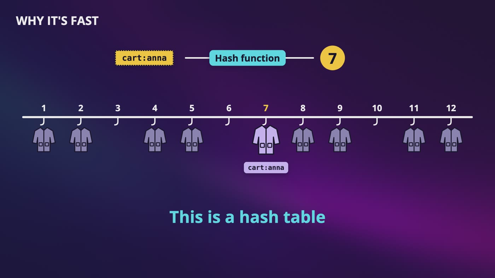

_A hash function turns cart:anna into 7, so we walk straight to hook 7 instead of looking through every coat._

### How it works

- Think of a **dictionary**: the word is the key, and the definition is the value. Anna's key is cart:anna, and the value is Dune and Emma.
- There are only 2 operations. **Put** saves a value under a key. **Get** gives you the value for a key.
- There are no joins, and you can't ask which carts have Dune in them. If you need that kind of question, this isn't the right choice.

### A few small rules

- **The key has to be unique.** A second Anna would overwrite the first one's cart, so in real life the key uses a user ID.
- **Keys should be fairly short.** A very long key takes more memory and is slower to compare.
- **The store doesn't look inside the value**, like a coat check. But not every store works like this: Redis understands types of values, like lists.

### Why one server isn't enough

- With 100 GB of memory and 10 KB per cart, we're out of room at 10 million carts.
- Two tricks buy us time: compress the values, or keep popular data in memory and move the rest to disk.
- If that one server dies, every customer loses their cart at once. So we spread the data across many servers.

> **In your interview:** Don't start drawing yet. Ask how big the values are, how much data there is, whether it should still answer when something fails, how it grows, whether everyone needs the latest data right away, and how fast it has to be. Know the 2 operations, why the dictionary in memory is fast, and why one server isn't enough.

> **In the real world:** Memcached calls itself an in-memory key-value store. Dynamo was built for Amazon's own services. Don't mix it up with DynamoDB, a database service Amazon sells, which is based on the ideas from Dynamo but isn't the same system.

**New terms**

| Term | Meaning |
|---|---|
| **Key-value store** | Saves values under unique keys, like a dictionary. It only knows how to find things by their key. |
| **Put / get** | The 2 operations. Put saves a value under a key, and get gives you the value for a key. |
| **Opaque** | The store can't see inside the value, like a coat check that never goes through your pockets. |
| **Hash table** | The dictionary programmers use all the time. A hash function gives you the hook number, so you jump straight there. |
| **Compression** | Squeezing data to take less space, like a zip file. |
| **Tunable consistency** | Being able to tune how in sync the copies are. |

## 2. The CAP Theorem

> **The big idea:** When servers can't talk to each other, do you stay correct, or do you stay available? You only make that choice when something breaks.

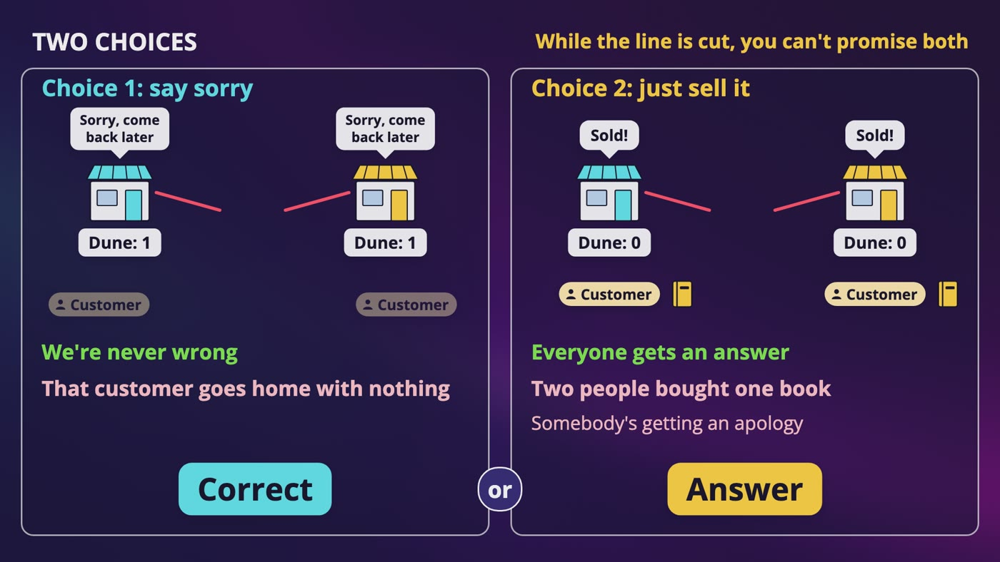

_While the phone line is cut, each branch can stay correct or keep answering, but it can't promise both._

|   | CP: stay correct | AP: stay available |
|---|---|---|
| During a break | A and B are 2 out of 3, so they keep working. C refuses. | All 3 servers keep answering. |
| The risk | Some customers get refused. | C might sell a book that A and B also sold. They compare and clean up later. |
| In our bookstore | The last copy of a book | Anna's cart |

### The phone line

- Our downtown and airport branches share one stock list, and they call each other after each sale. One day the line gets cut, and both lists say 1 copy of Dune is left.
- **Say sorry:** we're never wrong, but that customer goes home with nothing.
- **Just sell it:** everyone gets an answer, but 2 people just bought 1 book.

### Why "pick any two" is misleading

- You don't get to pick whether your network breaks, so partitions aren't something you choose. That's why a system called CA isn't real over a network.
- When the network is fine, you don't give anything up. You get consistency and availability, both of them.
- A crashed server and a cut cable look exactly the same from the outside, so the choice is the same either way.

### Choose for each kind of data

- The last copy of a book needs one right answer. I'd rather say please try again than sell a book we don't have.
- If Anna's cart is out of date for a moment, we can fix that later. Refusing her is a store refusing to take money.
- Same store, two different answers. So be careful with a sentence like "banks are CP".

> **In your interview:** Never just pick one. Ask which data we're talking about, and what's worse for the user, seeing something old or being refused. If they draw the triangle and ask you to pick two, say partitions aren't optional over a network, so the real choice is what we do during one. When the network is healthy, we can have both.

> **In the real world:** Eric Brewer, who came up with the idea, wrote 12 years later that "two of three" was always misleading. He uses the ATM as an example: if it loses its connection, it can keep working with a limit like $200, and the bank sorts it out afterward. Amazon wrote in the Dynamo paper that the cart has to let customers add and remove items even during failures. Cassandra lets you decide for each request how many copies have to respond.

**New terms**

| Term | Meaning |
|---|---|
| **Theorem** | A rule that somebody has proven. |
| **CAP theorem** | When servers can't talk to each other, you have to choose between staying correct and staying available. |
| **Consistency (in CAP)** | Everyone sees the same, latest data. |
| **Availability (in CAP)** | Every request gets an answer and not an error, even if the answer is out of date. |
| **Network partition** | A broken connection between servers. Nothing has crashed, they just can't talk. |
| **Partition tolerance** | The system keeps working through a network partition. |
| **CP / AP** | CP stays correct during a partition. AP stays available. |
| **Majority** | More than half. Only one side of a break can ever have one. |

## 3. Splitting and Copying the Data

> **The big idea:** Use the clock to find a key's home, then keep walking clockwise to put its copies on the next N different machines.

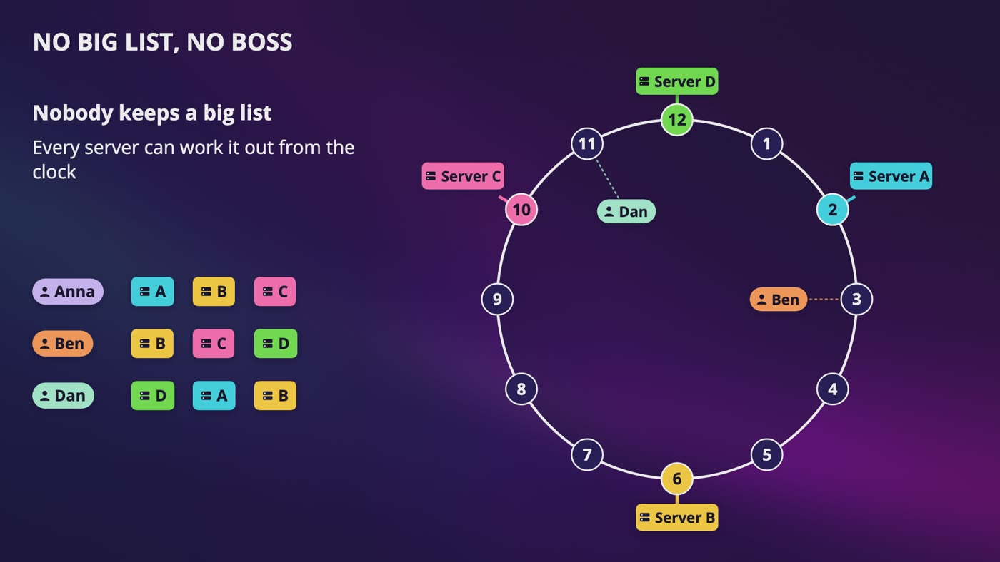

_With N of 3, each key walks clockwise to 3 servers. Nobody keeps a big list, because every server can work it out from the clock._

### Where the copies go

- Server A is on spot 2, B on 6 and C on 10. Anna's cart lands on spot 1, so it lives on A, B and C.
- Add server D on spot 12. Ben is on spot 3, so he gets B, C and D. Dan is on spot 11, so he gets D, then A and B.
- None of the 3 is a master, so there's no boss. Amazon's paper says a typical value of N is 3.

### Trap 1: virtual nodes

- A is on spots 1, 7 and 10, C is on 3, 6 and 9, and B is on 2, 5 and 11. Cara lands on spot 7 and walks to A, then C, then A again.
- 2 copies on one machine means losing both when it dies. So we skip it and walk to spot 11, which is B.
- The real rule: walk clockwise until you have N **different machines**, not N spots.

### Trap 2: the building

- 3 different machines in one data center all go down together if the power goes out.
- So we put copies in different data centers. But sending data across the country is way slower than inside one building.
- For a small system in one region, you probably don't need this. Ask first.

### One word, two meanings

- **Network partition:** something broke.
- **Data partition:** we split the data on purpose. If your interviewer says partition and you're not sure which one, just ask.

> **In your interview:** Practice this sentence: I'd put each key on a ring using consistent hashing, then I'd keep copies on the next N different machines going clockwise, and in different data centers if we need to survive losing a building. If they ask what happens when a server dies, nothing is lost, because the next servers around the ring already have the copies.

> **In the real world:** Amazon wrote that a cart should still work even if a data center gets destroyed by a tornado. Dynamo walks to N different machines, and it puts copies in different data centers too.

**New terms**

| Term | Meaning |
|---|---|
| **Partitioning (data)** | Splitting your data across servers. Each piece is called a partition. |
| **N** | The number of copies of each key. |

## 4. Quorum: How Many Copies Have to Agree?

> **The big idea:** We don't need every server to answer, just enough of them. If W plus R is greater than N, a read and a write have to overlap.

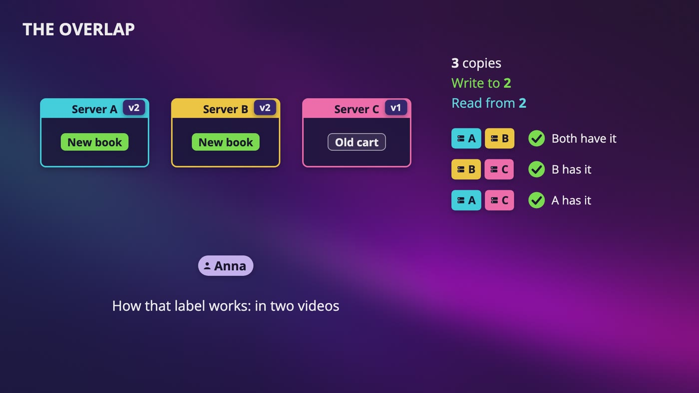

_With 3 copies, write to 2 and read from 2. Whichever pair answers, at least one of them has the new book._

| With N of 3 | W + R | What you get | Think of |
|---|---|---|---|
| W 3, R 1 | 4, overlaps | A fast read | A book's description, which rarely changes |
| W 1, R 3 | 4, overlaps | A fast write and a slower read |  |
| W 2, R 2 | 4, overlaps | The common setting. One slow server can't hold you up. | Anna's cart |
| W 1, R 1 | 2, can miss | The fastest, but it can show stale data | A counter of how many people viewed a book |

### A write with W of 2

- Anna adds a book, and the coordinator sends it to all 3 servers. A says got it, B says got it, and that's 2, so she's done. C is just catching up.
- **The trap:** W of 1 doesn't mean one copy. All 3 servers still receive the write. W is only how long we wait. It's the same with R.

### The overlap

- The write landed on A and B. The 3 possible pairs of readers are A and B, B and C, and A and C. Each pair has someone with the new book.
- 2 writers and 2 readers is 4 names for only 3 servers, so somebody has to be on both lists.
- When 2 answers disagree, each copy carries a small version label, so the reader picks the newest one.
- Don't call this a perfect guarantee. There are failure cases where it isn't, and we see one with sloppy quorum.

### You wait for the slowest one you're waiting for

- Say A takes 5 ms, B takes 10 and C takes 200. With W of 3, you wait 200 ms. With W of 2, you only wait 10.
- W of 1 has a real cost. If the one server that said got it dies before it passes the data on, that write can be lost.

> **In your interview:** Be able to draw this: 3 boxes, 2 writers, and the pairs of readers. Say W plus R greater than N, and say that 2 and 2 with 3 copies is the common setting. If they ask you to make reads faster, you know which number to change, and what that costs you.

> **In the real world:** Amazon says a few Dynamo services use R of 1 and W of 3, the ones with a lot of reads and not many updates, and several use 2 and 2. Cassandra lets you make this choice for each request, with settings called one, quorum and all.

**New terms**

| Term | Meaning |
|---|---|
| **Quorum** | The rule some clubs have, that a vote only counts if enough members show up. Here, enough servers have to answer. |
| **Coordinator** | Whichever server takes the request, like a waiter passing your order to the kitchen. Any server can do this. |
| **Acknowledgment** | The "got it" message a server sends back. |
| **W** | How many servers have to say got it before a write is finished. |
| **R** | How many servers have to answer before a read is finished. |

## 5. Strong, Weak and Eventual Consistency

> **The big idea:** There are 3 promises you can make when data changes. Eventual consistency is the one you'll hear the most, and it can leave you with 2 different copies.

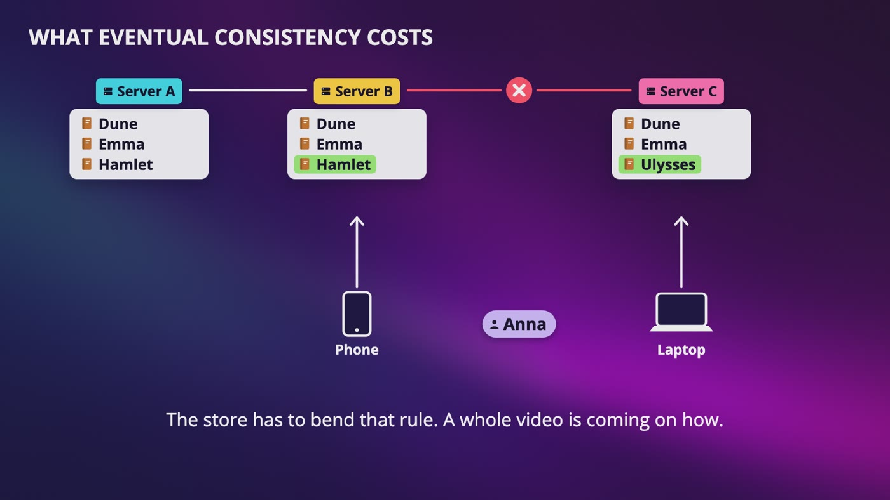

_Anna adds Hamlet on her phone and Ulysses on her laptop while server C is cut off. Now 2 copies disagree, and neither one is right._

| Promise | What it means | Good for |
|---|---|---|
| Strong | Once the change is finished, nobody ever sees the old one again. | The last copy of a book |
| Weak | You might see the new one or the old one, and the system doesn't tell you when that changes. | A live count of people looking at a book |
| Eventual | A kind of weak, with one promise added: if people stop making changes, all of the copies end up the same. There's no exact time on that. | A profile picture, and Anna's cart |

### What the promises feel like

- **Strong:** when servers can't talk, the system has to make you wait or refuse you. You get the right answer, but sometimes you don't get any answer.
- **Eventual:** share news in a big family group chat. Your sister sees it right away, your uncle an hour later, and your grandmother tomorrow. In the end, everyone has the same news.
- A single product can often do more than one, so don't say a system simply is one of these.

### What eventual consistency costs

- Anna's cart has Dune and Emma on A, B and C. A cable breaks, and C can't talk to A and B.
- On her phone she adds Hamlet, which goes to B. On her laptop she adds Ulysses, which goes to C. To stay available, the store accepts both.
- Which copy is right? Neither of them. She wanted both books.

### Can't we just use the time?

- Keeping the newest one is called **last write wins**, and it's a real strategy. But it has 2 problems.
- Clocks on different servers don't agree perfectly, so the one that looks newer might not be newer.
- Even with perfect clocks, we keep Ulysses and throw away Hamlet. We told Anna it worked, and we lost her book.

> **In your interview:** If they ask whether eventual consistency is okay here, don't just say it's fine. Say what the user would actually see. For a moment, Ben might see Anna's old picture, and that's okay. Or 2 people might pay for 1 book, and that's not okay.

> **In the real world:** DNS works this way. Change your website's IP address, and some people get the new one right away while others keep the old one for a while. Werner Vogels from Amazon wrote that DNS is the most popular system that works this way, and Amazon's paper says Dynamo is designed to be eventually consistent too.

**New terms**

| Term | Meaning |
|---|---|
| **Strong consistency** | Once a change is finished, every read, from anyone, gets the new data. |
| **Weak consistency** | You might see new data or old data, and the system doesn't tell you when that changes. |
| **Eventual consistency** | If people stop making changes, all of the copies end up the same, with no exact time on it. |
| **Last write wins** | Look at the time and keep the newest version. It's simple, but it can lose an update. |

## 6. Vector Clocks: Spotting Conflicts

> **The big idea:** Each version carries a small list of how many writes each server has handled. That list tells you if one version is just newer, or if the two split.

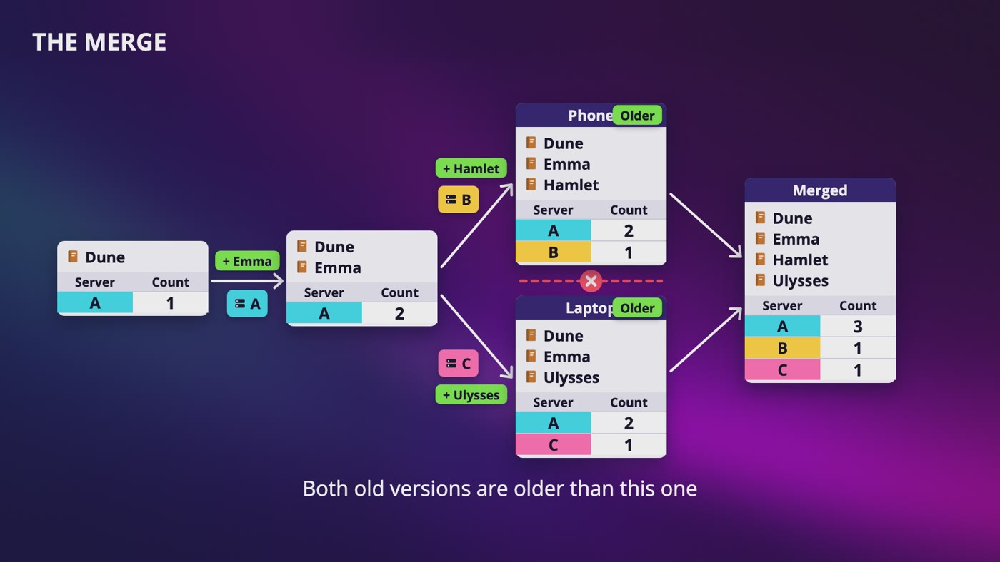

_The cart split into 2 versions. The merged version's list is A 3, B 1, C 1, and both old versions are older than it, so they can go away._

|   | Vector clocks | Last write wins |
|---|---|---|
| What it does | Keeps everything, and spots the conflict | Keeps the version with the newest timestamp |
| What it costs | Your application has to merge | It can lose an update, like Anna's book |
| Who uses it | The shopping cart in Dynamo | Customer sessions in Dynamo, and Cassandra |

### Walking through it

- Anna adds Dune and server A handles it: **A 1**. She adds Emma, and A handles that too: **A 2**.
- The cable breaks. Her phone adds Hamlet on B: **A 2, B 1**. Her laptop adds Ulysses on C: **A 2, C 1**.
- They both remember A 2, because that's where they split.

### The one rule

- X is older than Y if every number in X is less than or equal to the same number in Y. A server that isn't on the list counts as 0.
- A 2 against A 2, B 1: everything passes, so A 2 is older and safe to replace.
- A 2, B 1 against A 2, C 1: the first is ahead on B, and the second is ahead on C. Neither one is older, so that's a **conflict**. And we never looked at the time.

### What happens to a conflict

- We keep both, because the store doesn't look inside the value. The next time Anna opens her cart, her app gets both versions and merges them into Dune, Emma, Hamlet and Ulysses.
- For the new list, take the highest number for each server, then the server handling the write adds one. If that's A, we get A 3, B 1, C 1.

### What it costs

- Deleted items can come back. If Anna removes Emma on her phone, the laptop still has her, so Emma returns after the merge.
- Your application has to contain the merge code. A cart is easy, but what would it mean to merge 2 profile pictures?
- The list can keep growing. Dynamo sets a limit, the paper's example is 10, and past that it drops the oldest entry.

> **In your interview:** If they ask how you'd handle 2 writes that conflict, draw this exact example: one split, 2 lists, and neither one is older. Then say both options and what each one costs, and choose one for the data you're talking about.

> **In the real world:** Amazon says in the Dynamo paper that adding to a cart is never lost, but deleted items can come back. Cassandra's docs say it uses the simpler last write wins model, so please don't say it uses vector clocks.

**New terms**

| Term | Meaning |
|---|---|
| **Vector clock** | A small list of servers and write counts that travels with each version. Vector means a list of numbers, and it tells you the order things happened in without looking at the time. |
| **Conflict** | Neither version is older. Each one knows about a write the other one doesn't. |
| **Merge** | Combining 2 versions into one. |

## 7. Gossip: How Servers Know Who's Down

> **The big idea:** Servers spread a heartbeat counter like an office rumor. If a server's number stops going up for a while, it's treated as down.

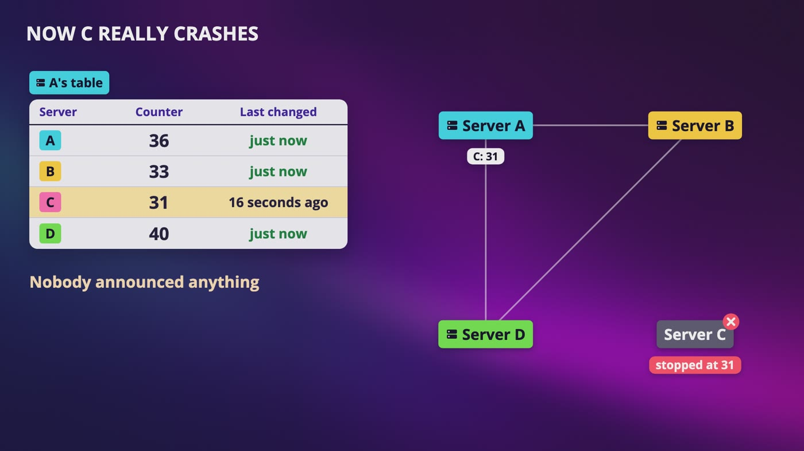

_Server C crashed, so its counter stopped at 31. Everyone keeps passing around 31, and the time in that row stops changing._

### Why not something simpler?

- No answer from server C might only mean one bad cable. One server's opinion isn't enough, so we want more than one witness.
- **Everyone checks everyone:** with 100 servers, that's 99 messages from each one, so 9,900 messages per round.
- **One special checker:** if it dies, nobody knows anything. That's a single point of failure.

### How it works

- Each server adds 1 to its own heartbeat counter regularly, let's say every second.
- Each server keeps a table with one row per server: its name, the highest counter we've heard, and the time that number last went up.
- Every second, a server picks a few others at random and sends its table. Whoever receives it goes row by row and keeps the higher number.

### What the table tells us

- A has D at 25, and B says 26. So A takes 26 and writes down the time. A learned D is alive without hearing from D. It's a rumor.
- **Broken cable:** if the cable between A and C is cut, C's number still reaches A through other servers, and nobody panics.
- **Real crash:** only C can raise its number, so it stops. After a time limit, say 30 seconds in this example, each server decides on its own that C is probably down.

### Is this fast enough?

- Simulate 100 servers, each telling 3 random servers per round. About 4 know after round 1, then about 15, 47, 87 and 99. All 100 usually know after 5 or 6 rounds.
- That's 300 messages per round, instead of 9,900.
- The tradeoff: for those few rounds, different servers believe different things. It's the same eventual idea from our consistency video.

> **In your interview:** Say that each server has a heartbeat counter, they share their tables with a few random servers and keep the highest numbers, and a number that stops going up for a while means that server is treated as down. Why not one central health checker? It's a single point of failure. Why not trust the server that noticed? Only the link between those two might be broken. Don't memorize the simulation numbers. Just say the news reaches everyone in a few rounds.

> **In the real world:** The Cassandra database gossips every second with up to 3 other servers, and it uses a smarter way of deciding than a fixed time limit. Dynamo's paper also gossips every second with 1 random server, but to share who's in the ring. For a temporary failure, each server just notices when its own messages fail.

**New terms**

| Term | Meaning |
|---|---|
| **Gossip** | Servers telling a few random servers what they know, so news spreads like an office rumor. That's the real technical word. |
| **Heartbeat counter** | One number a server keeps about itself and adds to regularly. As long as it keeps going, you're alive. |
| **Round** | One time through. |

## 8. Sloppy Quorum and Hinted Handoff

> **The big idea:** When the usual servers are down, the next healthy ones take the write, with a note. A sloppy quorum accepts it, and hinted handoff gets it back home.

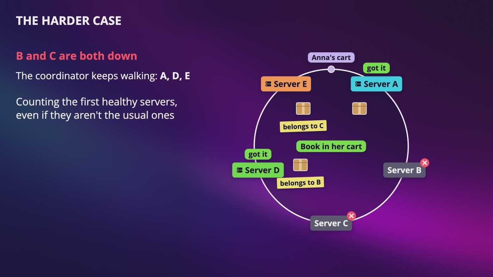

_With B and C down, the coordinator keeps walking and uses A, D and E. D and E keep their copies with a note saying who they belong to._

### The problem

- Anna's cart is on A, B and C, with W of 2. If B and C are both down, only A says got it. A strict rule has to refuse her write.
- Anna is trying to give us money, and we're telling her no.

### A parcel at your door

- When you aren't home, the driver doesn't cancel your order. Your neighbor takes the parcel, and you get a note. When you get home, your neighbor hands it over.
- This only makes sense because you're coming back soon.

### How it works

- **B is down:** the coordinator walks along the ring to the next healthy server, D. The write goes to A, C and D.
- D keeps this copy to the side, with a **hint** saying it really belongs to B.
- **B comes back:** D hears through gossip, hands over the copy, and deletes its own once B has it safely.
- **B and C are down:** we use A, D and E. A and D say got it, that's 2, and Anna's book is in her cart.

### The catch

- W is 2 and R is 2, so it looks safe. Anna's write went to A, D and E.
- B and C come back, but the handoff hasn't happened yet. The coordinator asks A, B and C for a read. B and C answer first, and neither has the new book.
- **Remember this sentence:** with a sloppy quorum, W plus R greater than N doesn't guarantee the overlap anymore, because the servers that took the write might not be the ones you read from.
- That's a fine deal for Anna's cart, because the book shows up after the handoff. For the last copy of a book, you wouldn't want this.

> **In your interview:** Name both ideas and keep them apart. A sloppy quorum is about who counts toward W when the usual servers are down. Hinted handoff is how the data gets back home. Use them for temporary failures, when accepting the write matters more than reading the latest. They cost you old reads for a while, and the overlap isn't guaranteed. If you say sloppy quorum and also say W plus R greater than N always gives the latest, a good interviewer will ask about that.

> **In the real world:** Amazon's Dynamo paper says customers have to be able to add to their cart even while disks and networks are failing, and it accepts giving up consistency in certain failure cases to stay available. Cassandra stores hints too, on the coordinator, but with its usual settings a hint doesn't count toward W. Only its loosest setting, called ANY, counts one.

**New terms**

| Term | Meaning |
|---|---|
| **Strict quorum** | Only counts the usual servers, like A, B and C. |
| **Sloppy quorum** | Counts the first healthy servers, even if they aren't the usual ones. |
| **Hint** | A note saying this copy really belongs to another server. |
| **Hinted handoff** | A server holds a copy with a hint, then hands it back when the real owner returns. |

## 9. Merkle Trees: Repairing Lost Copies

> **The big idea:** Each server keeps a tree of fingerprints. 2 servers compare from the top down, and they only copy what's different.

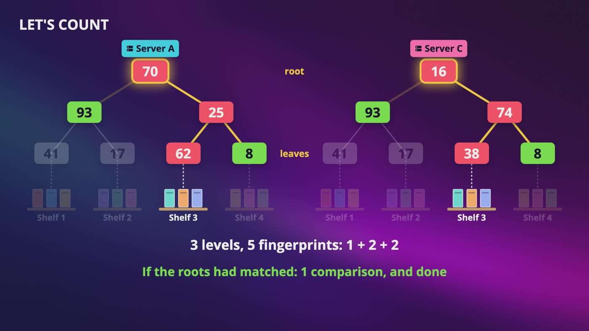

_We start at the root and only go down where fingerprints differ: 3 levels, 5 fingerprints, and only shelf 3 gets copied._

### The problem

- What if server B never comes back, or the neighbor dies too? Then our copies stay different, and nobody knows it.
- Sending a billion keys across the network to find a few differences would take forever.
- One fingerprint for the whole list tells us if something is different, but not what.

### Let's build it

- Take 12 books on 4 shelves. Using pretend numbers, the shelves hash to 41, 17, 62 and 8.
- Hash shelves 1 and 2 together to get 93, and shelves 3 and 4 to get 25. We aren't adding them, we're feeding them into the hash.
- Hash 93 and 25 together to get 70. That one number at the top depends on every book underneath it.

### Let's find the difference

- Server C is missing a change on shelf 3. So its shelf 3 is 38, the pair above is 74, and its root is 16.
- 70 against 16: different, so go down. 93 against 93: the same, so we never look at those 6 books. 25 against 74: different, so go down that side.
- 62 against 38: different. 8 against 8: the same. We copy shelf 3, so that's 3 books instead of 12.
- That's 5 fingerprints compared. If the roots had matched, it would have been 1.

### At real size

- With only 4 shelves, a tree doesn't save us anything. It pays off with a billion keys on a million shelves, about 1,000 keys per shelf.
- Cutting a million in half reaches 1 after about 20 cuts, so about 20 levels. With one shelf different, that's about 40 comparisons, and we copy about 1,000 keys.

### What it costs

- Somebody has to read the data to build these trees, which is real work for the disks.
- When a whole data center comes back after a power cut, this comparing is one of the ways it catches up.

> **In your interview:** You most probably won't be asked to code this. What you want is the one line: each server keeps a tree of fingerprints, 2 servers compare from the top down, and they only copy what's different. And say when: hinted handoff is for a short failure, and anti-entropy with Merkle trees is for when copies have drifted for a long time, or a server has been replaced.

> **In the real world:** Dynamo uses Merkle trees for this, and Cassandra's repair does too. Dynamo's paper points out that when servers join or leave, the trees can have to be rebuilt.

**New terms**

| Term | Meaning |
|---|---|
| **Fingerprint** | A hash used as one short number that stands for something bigger. Change even one letter, and you almost certainly get a different number. |
| **Tree** | A shape of fingerprints that branches out, even though it's upside down. |
| **Root** | The one number at the top of the tree. |
| **Leaves** | The bottom of the tree, which are the shelves here. |
| **Merkle tree** | A tree of fingerprints where each one depends on the ones below it. Named after Ralph Merkle. |
| **Anti-entropy** | Servers quietly comparing and fixing their copies in the background. Entropy is things slowly drifting into disorder. |

## 10. The Architecture and the Write Path

> **The big idea:** Every server does the same jobs, with no leader. Inside one server, a write goes to a log on disk, then to memory, then to a sorted box that never changes.

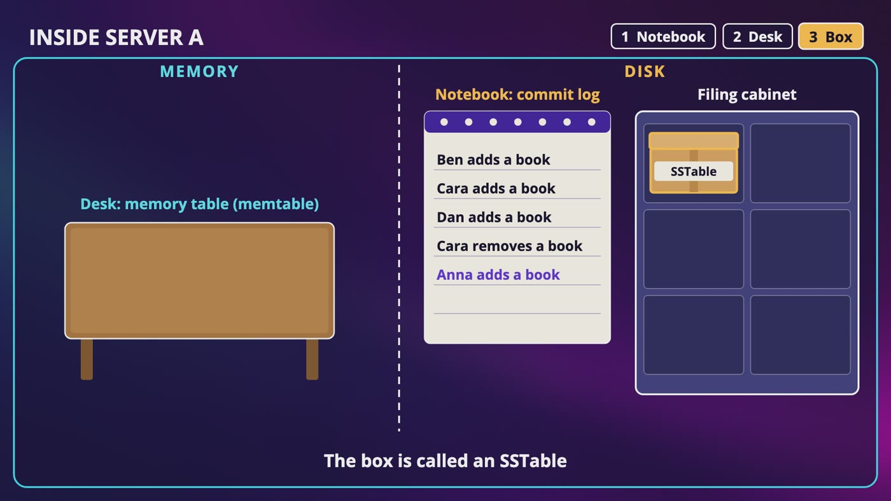

_Anna's write goes in the notebook on disk and on the desk in memory. When the desk fills up, it's sorted and flushed into a box._

### The whole store

- A request can go to any server. That coordinator uses the ring to find the 3 servers with this key.
- **There's no leader.** Every server runs the same program, so no special server can take everything down.
- Every server can coordinate, knows the ring and holds copies, notices conflicts, gossips, holds a parcel for a neighbor, and compares Merkle trees.

### The problem inside one server

- **Memory** is your desk: everything is easy to grab, but it's gone if the power goes out.
- **Disk** is the filing cabinet: it's safe, but every write has to walk across the room, find the right folder and change it. That's slow.

### Three steps

- **1. The notebook.** Write the change at the very end of the commit log, on disk. You never go back and change older lines.
- **2. The desk.** Put the change in the memory table too, and tell the coordinator got it. If the power goes out, server A reads the notebook when it starts up and puts everything back.
- **3. The desk fills up.** Sort everything and put it in a new box in the cabinet. That's a flush, and the box is an SSTable. Once it's safe on disk, those notebook lines can be cleared.

### Why it's so fast

- Adding to the end of a file doesn't need any searching, the desk is memory, and the box gets written once, all in one go. A write never goes looking for anything.
- Don't mix up the notebook and the copies. The notebook protects you when one server loses power and comes back. The copies protect you when a server is gone for good.

> **In your interview:** If they ask why this is so good at writes, say a write only adds to the end of a log and updates memory, and nothing on disk gets searched or changed. If they ask what happens if the server crashes before the flush, it reads the commit log when it restarts. Know the order: log first, then memory, then disk.

> **In the real world:** This is modeled on Cassandra, whose docs say this part of its design came from Google's Bigtable. By default, Cassandra pushes the notebook to the physical disk every 10 seconds, so a crash can lose a few seconds on that one machine. Dynamo's paper lets you plug in different storage engines, so don't say every key-value store works this way.

**New terms**

| Term | Meaning |
|---|---|
| **Commit log** | The notebook on disk. Every change gets added at the very end, so it survives a power cut. |
| **Memory table (memtable)** | The desk: recent changes in memory, used for quick answers. |
| **Flush** | Writing the desk out to disk. |
| **SSTable** | Sorted string table. A box on disk that's sorted and never changed. |
| **Immutable** | Can't be changed. |

## 11. The Read Path and Bloom Filters

> **The big idea:** A Bloom filter lets us skip most boxes without touching the disk. It only has 2 answers: definitely not, or maybe.

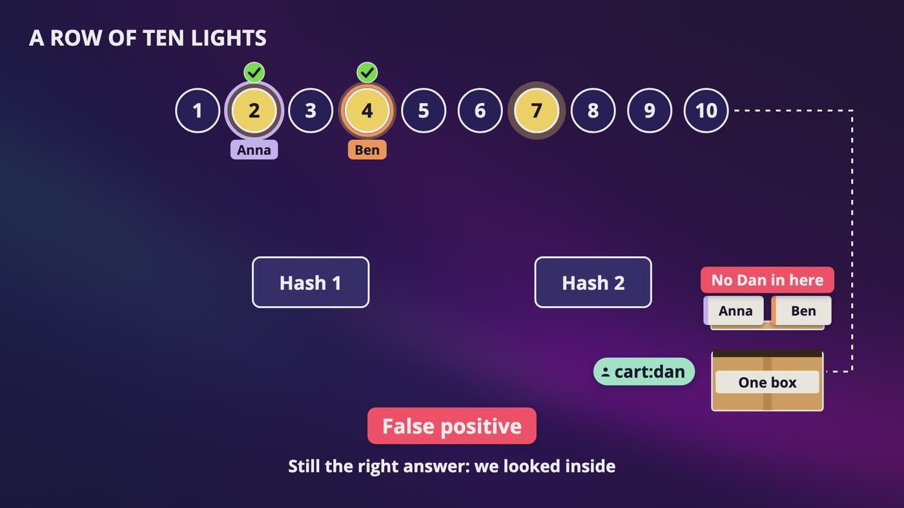

_cart:dan's lights, 2 and 4, are on only because of Anna and Ben. The filter says maybe, we open the box, and Dan isn't there._

### A row of 10 lights

- Each box gets its own row of lights, in memory. Two hash functions turn a key into 2 light numbers.
- Anna hashes to 2 and 7, and Ben to 4 and 7. So lights 2, 4 and 7 are on.
- **Cara** hashes to 3 and 7. Light 3 is off, so she's definitely not in this box, and we didn't walk anywhere.
- **Dan** hashes to 2 and 4. Both are on, so maybe. We open the box, and he isn't there. That's a **false positive**, and it cost us one wasted walk.
- It can never say definitely not when the key really is in the box, because lights only ever get turned on.

### The read, in 5 steps

- **1.** Check the desk.
- **2.** If it's not there, go through the boxes from newest to oldest, and ask each box's lights.
- **3.** If they say definitely not, skip that box without touching the disk.
- **4.** If they say maybe, open the box and look for the key. It's quick because it's sorted.
- **5.** Send the answer to the coordinator, which waits for R answers and picks the newest.

### Why this works

- If Anna's cart is in the second newest of 6 boxes, that's one trip across the room instead of up to 6.
- We go newest first because an older box might still have an old version of her cart.
- Since a box never changes, it's fine that we can't turn lights off.

### Too many boxes

- **Compaction:** a server merges a few boxes into one new box in the background and keeps only the newest version of each key. That means fewer boxes and less wasted space, for some extra disk work.
- **Deleting:** we can't change a box, so we write a small marker called a tombstone, and compaction removes the old data later.

> **In your interview:** Most people won't be asked to build one. Know what it answers, definitely not or maybe, and why it exists, to skip slow disk reads for keys that aren't in a box. It can say maybe by mistake, but never definitely not by mistake. People mix those up, so practice saying it. If they ask how a read works: memory, then each box's filter, then the box itself.

> **In the real world:** Burton Bloom wrote about this idea in 1970. His example was a dictionary too big to fit in memory, where he accepted a few wrong guesses to avoid most of the trips to disk. In Cassandra, the default for most tables is about 1 wrong guess in 100, and fewer wrong guesses cost more memory.

**New terms**

| Term | Meaning |
|---|---|
| **Bloom filter** | A row of lights in memory that answers definitely not, or maybe. Named after Burton Bloom. |
| **False positive** | The answer looked like a yes, and it was wrong. |
| **Compaction** | Merging a few boxes into one new box and throwing the old ones away. |
| **Tombstone** | A small marker that says this was deleted. |

## 12. The Whole Design, for Your Interview

> **The big idea:** Don't memorize a list of terms. Follow the questions about Anna's cart, and every piece has a reason to be there.

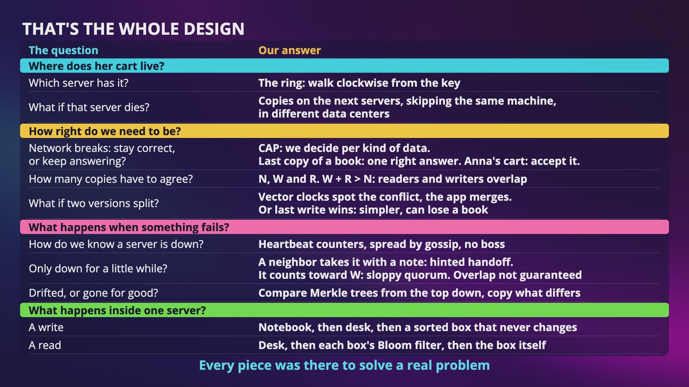

_Every question we kept asking about Anna's cart, with the answer we built. Every piece was there to solve a real problem._

### How to run it in the interview

- **Step 1, ask.** How big is each value? How much data? If the network breaks, is it more important to always answer, or to always be right? That last answer decides most of your design.
- **Step 2, high level design.** Draw the client and the ring, then walk one key to 3 servers. Say any server can be the coordinator and there's no leader. N of 3 with W and R of 2 is a good place to start.
- **Step 3, deep dive.** Hints sound like small questions. Down for 10 minutes? Hinted handoff. Updated from 2 places at once? Vector clocks. How do you know a server is down? Gossip.
- **Step 4, wrap up.** Say what you'd improve and what could still break, like one very popular key, which the ring doesn't fix. Never say your design is perfect.

### What to know well

- **Draw with a pen:** CAP in its real form, the quorum overlap with 3 copies and 2 and 2, and the ring with its copies.
- **Explain with one small example:** vector clocks, gossip, and hinted handoff, including what it does to the overlap.
- **Just recognize, with one sentence each:** Merkle trees compare fingerprints from the top down. Bloom filters say definitely not, or maybe.

> **In your interview:** If they draw the triangle and say pick any two, say network failures aren't optional, so the real choice is only during a failure. And don't say DynamoDB works like this, or that Cassandra uses vector clocks, because someone might actually know. You can say this is a design inspired by Dynamo and Cassandra. That's a great sentence.

> **In the real world:** The design we built is a blend. The ring, the quorum, vector clocks and hints mostly come from Amazon's Dynamo paper, and the notebook, the desk and the boxes are how Cassandra stores its data. Cassandra uses timestamps and last write wins for your data. Google's Bigtable is a very different design, with a master and one server in charge of each piece of the data at a time. Amazon's DynamoDB has a leader for each piece of data.

## Recap: How Anna's cart stayed safe

_When someone asks you to design a key-value store, you can just follow Anna's cart._

| Every piece answered a real question | |
|---|---|
| **The ring** | Which server has her cart? |
| **Copies** | What if that server dies? |
| **CAP** | The network breaks: stay correct, or keep answering? |
| **Quorum** | How many copies have to agree? |
| **Vector clocks** | What if 2 versions split? |
| **Gossip** | How do we know a server is down? |
| **Hinted handoff** | What if it's only down for a little while? |
| **Merkle trees** | What if a copy has drifted, or a server is gone for good? |
| **Commit log and SSTables** | How does a write stay fast and safe? |
| **Bloom filters** | How do we find her cart without opening every box? |

**What to remember**

- Draw CAP in its real form
- Draw the quorum overlap: 3 copies, 2 and 2
- Draw the ring with its copies
- Explain vector clocks with one small example
- Explain gossip and hinted handoff the same way
- A sloppy quorum doesn't guarantee the overlap
- Merkle trees: compare fingerprints from the top down
- Bloom filters: definitely not, or maybe

---

From the course **[System Design: Zero to Interview Hero](https://www.udemy.com/course/system-design-zero-to-hero/?referralCode=183D59A1EBE9E71D26FF)** by Nata Vacheishvili.
