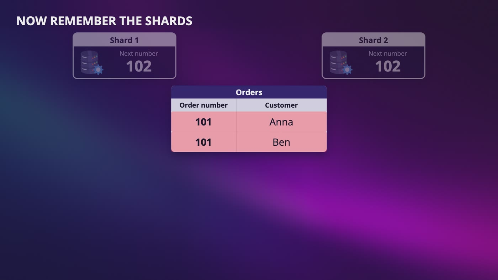
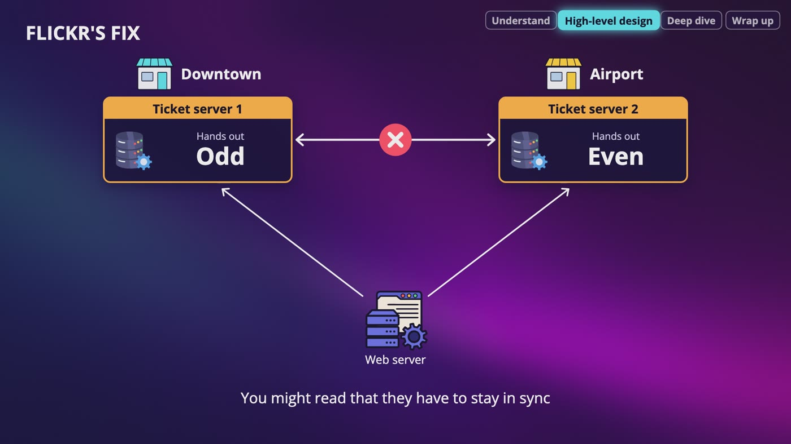
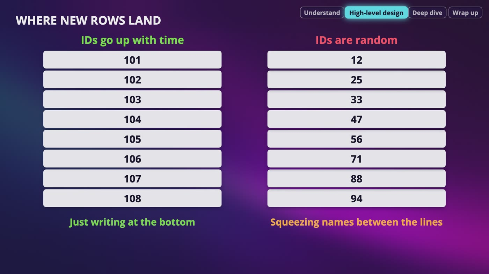
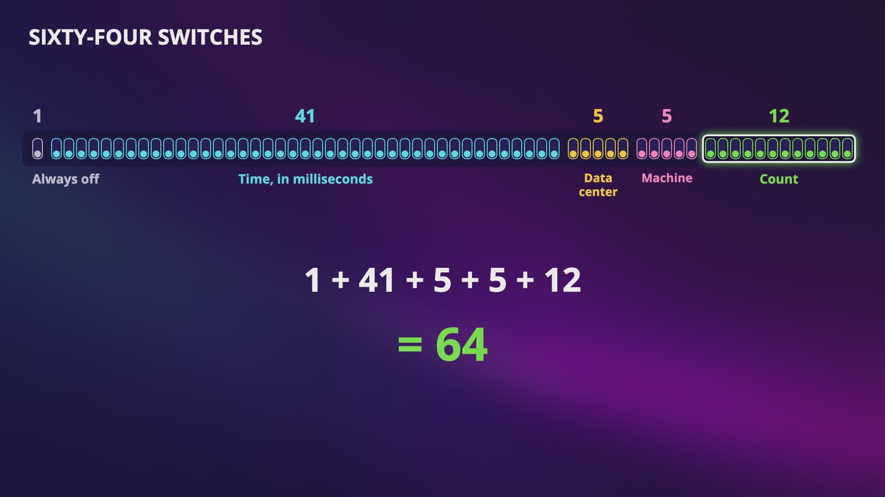
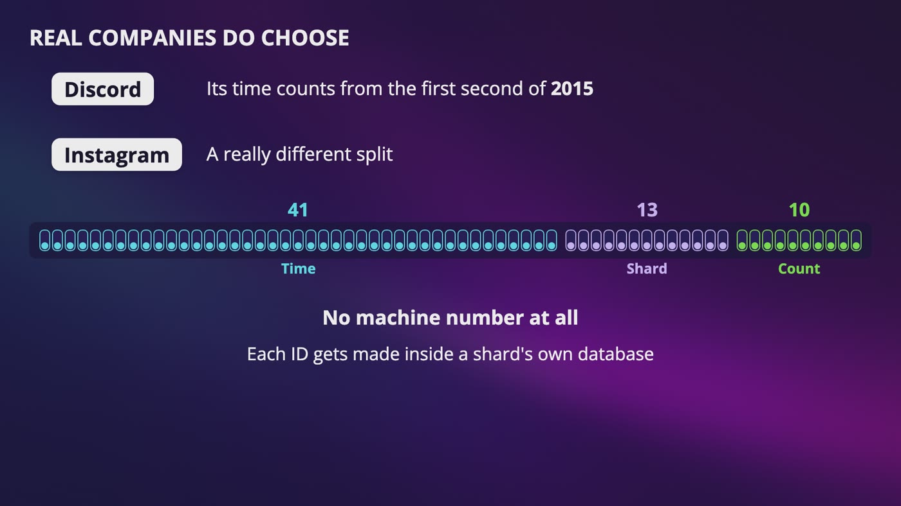
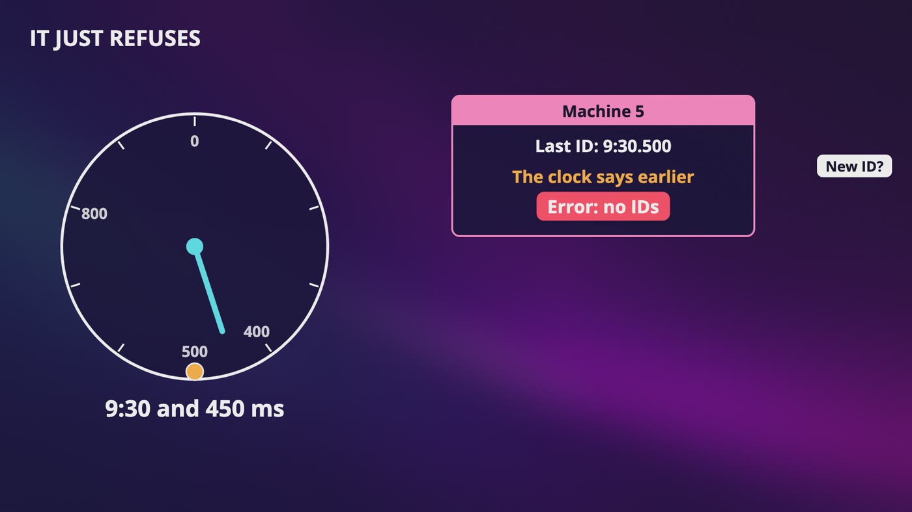

# Chapter 7: Design Unique ID Generator

_It sounds like the smallest problem in this course: one order, one number that nobody else has._

[Download as PDF](../pdf/System-Design-Chapter-07-Notes.pdf)

## Contents

1. [Why Can't We Just Count?](#1-why-cant-we-just-count)
2. [Skipping Numbers and Ticket Servers](#2-skipping-numbers-and-ticket-servers)
3. [UUIDs: Never Ask Anyone](#3-uuids-never-ask-anyone)
4. [Snowflake: An ID With Sections](#4-snowflake-an-id-with-sections)
5. [Building One ID, Bit by Bit](#5-building-one-id-bit-by-bit)
6. [What Can Go Wrong, and Your Interview](#6-what-can-go-wrong-and-your-interview)

## 1. Why Can't We Just Count?

> **The big idea:** On one database, auto increment just works. With many databases, each one has its own counter, and one number can mean 2 different orders.

_Each shard has its own counter, so Anna and Ben both get order number 101._

### Counting breaks across shards

- Each row in our orders table needs a **primary key**, and on one database, **auto increment** gives each row the next number. It can't make a mistake, because there's only one counter.
- With 2 shards, Anna is on shard 1 and Ben is on shard 2. Each shard has its own counter, and neither knows the other exists.
- Both counters are at 101, so both orders get number 101. That's a **collision**. And when we add shards, data moves around, so those rows could end up in the same place.

### Step 1: ask questions

- Is this only for orders? No, it's anything in the store that needs a number.
- Unique across all our databases? Yes. Letters, or only numbers? Only numbers.
- Should a newer ID be bigger? Yes, but gaps are fine.
- How big can it be? It has to fit in 64 bits. How many do we need? 10,000 per second at our busiest.

### What each answer did

- **Newer IDs are bigger:** to show the newest orders first, you just sort by the ID. If it had to go up by exactly 1, this would be a much harder problem.
- **64 bits:** that's 8 bytes. The ID sits in every row and gets compared on every lookup. It's small to store, quick to compare, and fits a normal number type in most languages and databases.
- **10,000 per second:** a wild amount of orders for a bookstore, but it's not only orders. This tells us how fast it has to be.

> **In your interview:** This is one of the shorter designs, and it looks easy, so people say "just use auto increment" and start moving on. Know this part well. You should be able to show why auto increment breaks with 2 shards and 2 customers.

**New terms**

| Term | Meaning |
|---|---|
| **Primary key** | A column where every row has a different value, so one number can only mean one row. |
| **Auto increment** | The database has a counter. It gives a new row the next number, then adds 1. |
| **Collision** | 2 different things get the same ID. |

## 2. Skipping Numbers and Ticket Servers

> **The big idea:** We can keep counting by skipping numbers, or by asking one ticket machine. Each has a cost, and Flickr's fix brings the 2 ideas together.

_Flickr's fix: 2 ticket servers that copy nothing between them. One hands out odd numbers and the other hands out even ones._

|   | Skipping numbers | One ticket server |
|---|---|---|
| How it works | Each database adds 2, starting from a different number | One server's only job is handing out the next number |
| Unique, numbers, 64 bits | Yes | Yes |
| Going up with time | No | Yes, because it's one counter |
| What goes wrong | Adding a database means changing every one | If it dies, nobody gets a number |

### Idea 1: skipping numbers

- Downtown goes 1, 3, 5, 7, and the airport goes 2, 4, 6, 8. They never collide, and they never had to talk.
- **Time order fails.** Downtown is busy, so Anna gets 1,001. A minute later at the quiet airport, Ben gets 42. His order is newer, with a way smaller number.
- **Adding a database fails.** Now everyone adds 3. The airport goes from 40 to 43, and downtown handed out 43 a long time ago. It's that remainder rule again.

### Idea 2: the ticket machine

- Think of the deli counter at a grocery store. You pull a ticket that says 57, and the next person gets 58. Nobody can get the same number, because there's only one machine.
- Anna's web server asks for a number, gets 101, and saves her order on shard 1. Ben's gets 102, and his order goes on shard 2.
- **Single point of failure:** if it dies, we can't take Anna's order. Also, every order has to wait for a trip over the network.

### Flickr's fix

- Add a second machine. One gives odd numbers, the other gives even numbers. That's our first idea again!
- Web servers take turns, and if one machine is down, they use the other.
- The 2 machines don't copy anything between them. You might read that they have to stay in sync, but Flickr split the numbers so they don't need to.

> **In your interview:** For a small or medium system, a couple of ticket servers is a really good answer. It's cheap, simple and everyone understands it. Don't build something fancy when this is enough, because over-engineering is a red flag. Know the 2 costs: numbers drift out of time order when you split them, and one machine that everyone asks is a single point of failure.

> **In the real world:** Flickr, the photo site, wrote about ticket servers in 2010. Theirs had been running since the start of 2006, on plain MySQL. They said it's not particularly elegant but works shockingly well, and called it an example of the dumbest possible thing that will work. They had a few hundred thousand more odd numbers than even ones, and said this hurts no one.

**New terms**

| Term | Meaning |
|---|---|
| **Multi-master replication** | The name you might see for skipping numbers. Multi means more than one database that accepts writes. No IDs are actually being copied. |
| **Ticket server** | A small database with a counter, whose only job is to hand out numbers. Like the ticket machine at a deli counter. |

## 3. UUIDs: Never Ask Anyone

> **The big idea:** A UUID is so big and so random that you can make one by yourself, without asking anyone. But it's 128 bits, so it doesn't fit our 64.

_When IDs go up with time, each new one is just written at the bottom of the index. Random IDs get squeezed in between the lines._

### How safe is it?

- Imagine everyone picking up one random grain of sand from a huge beach. Could 2 people pick the same grain? In theory, yes. In real life, it's never going to happen.
- Version 4 is the common, random one. A few bits say which kind of UUID it is, which leaves 122 random bits.
- For a 50% chance of even one duplicate, you'd need about 2.7 quintillion. At a billion every second, that takes about 86 years.
- You don't need to worry about it, as long as your randomness is good.

### What it gives you

- Our web server makes one right there, by itself, with no trip over the network and no ticket machine.
- If one web server dies, nobody else notices. If we add 10 more, no rule has to change.
- It's great when you need an ID and don't need order. Anna's app can make one UUID for a payment and send it with every try. If our server sees it again, it doesn't charge her twice.

### Against our list

- **Unique, and 10,000 per second:** yes, easily.
- **Numbers only:** yes. Those letters are hexadecimal, so underneath it's one giant number. The real problem is its size.
- **64 bits:** no. It's 8 extra bytes on every order, so with a billion orders, that's 8 more gigabytes every place you keep this ID.
- **Going up with time:** no for version 4. Random IDs land in the middle of the index, so the database has to keep making room.

### The update: version 7

- In May 2024, a new official standard added version 7. The first 48 bits are the time in milliseconds, and most of the rest is random.
- So now they do sort by time, and nobody has to ask anybody. But it's still 128 bits, so it still misses our 64.

> **In your interview:** If nobody says anything about 64 bits, a UUID is a really good answer, and it might be the simplest one you've got. I'd say version 7 if order matters, which shows you know what's current. And that's why "how big can it be?" matters so much. That one answer rules out all of this.

> **In the real world:** Flickr didn't use random IDs like these, because it said they're big and they index badly. PostgreSQL added a built-in function for version 7 in September 2025.

**New terms**

| Term | Meaning |
|---|---|
| **UUID** | Universally unique identifier. A 128-bit number so big and so random that you can make one whenever you want. |
| **Hexadecimal** | Counting with 16 symbols, 0 to 9 and then a to f. Each symbol stands for 4 bits. |
| **Quintillion** | A billion billions. |
| **Idempotency** | Doing something twice has the same effect as doing it once. |
| **Index** | A sorted list a database keeps so it can find a row without reading the whole table, like the list of topics at the back of a book. |

## 4. Snowflake: An ID With Sections

> **The big idea:** An ID made of time, place and a count fits in 64 bits, goes up with time, and doesn't have to ask anyone.

_64 switches cut into sections: 1 always off, 41 for time, 5 for the data center, 5 for the machine and 12 for the count._

| Section | Switches | What it's for |
|---|---|---|
| Always off | 1 | In a lot of languages, the first bit says plus or minus. Nobody wants a negative order number. |
| Time | 41 | Milliseconds, like the 0930 on a receipt but a lot more exact |
| Data center | 5 | 32 data centers, like our branch |
| Machine | 5 | 32 machines in each one, like our register, so 1,024 in total |
| Sequence number | 12 | 4,096 values, back to 0 every new millisecond |

### A paper receipt

- A receipt number has 4 parts: the time, the branch, the register, and a count of sales this minute.
- Downtown at 9:30, register 3, second sale: 0930, 1, 3, 2. The airport at the same minute: 0930, 2, 3, 2. Same time, same register, same count, and still a different number.
- They never called each other. To match, 2 receipts would need the same minute, branch, register and count.
- The time comes first, so sorting the receipts by number sorts them by time too.

### What a bit can hold

- A bit is a light switch. 1 switch makes 2 patterns, 2 make 4, and 3 make 8. Every switch you add doubles it.
- 5 switches make 32, 10 make 1,024, and 12 make 4,096.
- So 2 to the power of 12 just means 12 switches, and all the patterns they can make.

### Why it works

- 2 machines in the same millisecond have different machine numbers. One machine in the same millisecond has a different count. The next millisecond has a different time.
- Nobody checked anything. Each machine builds its number by itself.
- Time is on the left, and you compare numbers from the left. So a later millisecond is a bigger number, and sorting by ID sorts by time, roughly.

> **In your interview:** Be able to draw this row with a pen: 1, 41, 5, 5, 12, and what each one is for. If you forget the numbers, you can still say time, place and a count, and explain why that means no two match.

> **In the real world:** The most famous version, Snowflake, was built at Twitter, which is now called X. It was open sourced in 2010, so search for "Twitter Snowflake". Twitter was moving from MySQL to Cassandra, which has no auto increment, and needed tens of thousands of IDs per second, roughly sorted, in 64 bits. Ticket servers didn't give the ordering it needed, and UUIDs needed 128 bits.

**New terms**

| Term | Meaning |
|---|---|
| **Snowflake** | An ID layout built at Twitter: sections for time, place and a count, in 64 bits. |
| **Open source** | Sharing the code with everyone. |
| **Sequence number** | The count section of the ID. It goes back to 0 every new millisecond. |

## 5. Building One ID, Bit by Bit

> **The big idea:** Slide each section into place and you have a real ID. Then do the quick math: 41 bits is about 69 years, and 12 bits is about 4 million IDs per second per machine.

_The sections are a choice. Instagram uses 41 bits of time, 13 for the shard and 10 for the count, with no machine number at all._

### Anna's ID

- Our **epoch** is January 1, 2020, at midnight UTC. Anna pays on May 16, 2026, at 9:30 UTC, on data center 2, machine 5, with a count of 0.
- That's a little over 200 billion milliseconds since the epoch.
- To put them together, we **shift**: the time slides 22 places left, the data center 17, the machine 12, and the count doesn't slide at all.
- The result has 18 digits, about 843 quadrillion. Another order on machine 5 in the same millisecond has a count of 1, so it's just 1 bigger.

### Reading it back

- Slide it 22 places to the right, and we're left with that 200 billion. Add the epoch, and we get May 16, 2026, at 9:30.
- The next 5 switches give data center 2, the next 5 give machine 5, and the last 12 give 0. We didn't even need to open the database.

### How long does it last?

- 41 switches make about 2.2 trillion patterns, and a year is about 31.5 billion milliseconds. That's about 69.7, so people say 69 years.
- We started in 2020, so we run out in September 2089.
- From 1970, we'd have used 50 years before selling a single book, and we'd run out in 2039. So start your epoch close to launch day.

### How many can it make?

- 12 switches is 4,096 per millisecond, so about 4 million per second on one machine.
- We asked for 10,000. 4 million divided by 10,000 is 400, so one machine covers us 400 times over.
- All 1,024 machines together could make about 4 billion per second. You'd run a few, so one dying doesn't matter.

### The sections are a choice

- Move 2 switches from the count to the time. The count has 10, which is 1,024 per millisecond, or still about 1 million per second per machine. The time has 43, so 69 years becomes almost 280.
- Do that if each machine only makes a few IDs and the system has to last a very long time. With huge bursts on each machine, go the other way.

> **In your interview:** Do this math out loud: 41 bits is about 69 years, 12 bits is about 4 million per second per machine, and we only need 10,000, so one machine is already plenty. You don't need exact numbers, and nobody will ask for the 2.2 trillion. If they ask you to change the layout, you trade switches between sections.

> **In the real world:** Discord has its own version, and its time counts from the first second of 2015. Instagram makes each ID inside a shard's own database, which allows 1,024 per shard every millisecond. The ID tells you which shard the data is on, which is really handy once you've split your data.

**New terms**

| Term | Meaning |
|---|---|
| **Epoch** | The moment we start counting time from. It's like a birthday. |
| **Unix time** | Computers usually count time from January 1, 1970. |
| **UTC** | One clock that the whole world agrees on, so that time zones don't confuse anything. |
| **Shifting** | Sliding bits to the left to leave room, like adding 3 zeros after 0930. Each place is the same as doubling the number. |

## 6. What Can Go Wrong, and Your Interview

> **The big idea:** This design depends on the clock and on unique machine numbers, and it's only roughly sorted. Know what happens when each one goes wrong.

_The clock got pulled back, so it says 9:30 and 450 ms while the last ID was at 500. Machine 5 refuses to make IDs until it passes that time._

| If they ask | What happens |
|---|---|
| What if the clock goes backward? | Snowflake remembers the last time it made an ID. If its clock says an earlier time, it gives back an error and makes no IDs until the clock passes that time. |
| What if the count runs out? | It waits for a tiny moment until the next millisecond, and the count goes back to 0. Don't say it fails. |
| What if 2 machines get the same number? | This one really breaks everything. You get duplicates, and nobody gets an error. So a machine claims its number when it starts up. |
| What if a machine dies? | It just stops making IDs. A load balancer sends those requests to another machine, and nothing else changes. |

### The clock, slowly

- Every server has its own clock, and NTP can pull one back if it's running a little fast.
- Machine 5 makes an ID at 9:30 and 450 ms, with a count of 0. At 500 ms, its clock gets pulled back by 100 ms.
- When the clock reaches 450 again, with the count back at 0, that's the same ID. A short pause is way better than a duplicate.
- Snowflake's docs say it's even better to set up NTP so it won't move the clock backward at all.

### Why only roughly sorted?

- If machine 5's clock is a little ahead of machine 6's, a later order on machine 6 can get a smaller number.
- Anna and Ben pay in the same millisecond and data center, on machines 5 and 3. Anna was first, but Ben's number is smaller. In the same millisecond, IDs are ordered by machine number.
- For showing the newest orders first, that doesn't matter at all. But don't say these are perfectly ordered.

### For the curious

- **IDs reveal things.** With plain counting, a competitor can order today and tomorrow, subtract, and know your orders per day. Snowflake mostly hides that, but anyone who knows your layout can read when and on which machine an ID was made.
- **JavaScript** normally can't keep a whole number exact past about 9 quadrillion. Ben's ID, with a count of 7, gets rounded to exactly Anna's number. There's no error, so his order page asks for Anna's order.

### The 3 sentences to know

- An ID is made of time, place and a count, so no two machines ever have to talk.
- It's 41 bits of time, 10 of place and 12 of count, so about 69 years and about 4 million per second on each machine.
- It depends on the clock and on unique machine numbers, and it's only roughly sorted.

> **In your interview:** Step 1, ask: unique everywhere, numbers only, up with time, how big, how many. The size question alone decides between a UUID and what we built. Step 2, go through the ideas: auto increment breaks across shards, skipping numbers isn't in time order, a ticket server is a single point of failure, and a UUID doesn't fit. For a small system, 2 ticket servers are fine. Then draw the row. Step 3, do the quick math and follow their hints. Step 4, wrap up with what could still break, and never say your design is perfect.

> **In the real world:** At Twitter, machines claimed their numbers in ZooKeeper, and only at startup, so it isn't in the way of making each ID. When Twitter announced Snowflake, it promised ordering within about a second, and aimed for much less. X's and Discord's APIs send these IDs as text because of the JavaScript problem.

**New terms**

| Term | Meaning |
|---|---|
| **NTP** | A way for a computer to ask a trusted clock what time it is. |
| **ZooKeeper** | A small and very reliable place where machines can agree on things. You don't need to know how it works. |

## Recap: How Anna's order got its number

_You can read that number like a receipt._

| Every idea we tried | |
|---|---|
| **Auto increment** | 2 shards give out the same number |
| **Skipping numbers** | Not in time order, and adding a server is painful |
| **One ticket server** | A single point of failure |
| **2 ticket servers** | Not in perfect time order, but fine for a small system |
| **UUID** | Never asks anyone, but it doesn't fit in 64 bits |
| **Snowflake** | Fits in 64 bits, goes up with time, and asks nobody |

**What to remember**

- An ID is time, place and a count
- 41 bits of time, 10 of place and 12 of count
- About 69 years
- About 4 million per second on each machine
- It depends on the clock and unique machine numbers
- It's only roughly sorted
- The size question decides between a UUID and this
- Never say your design is perfect

---

From the course **[System Design: Zero to Interview Hero](https://www.udemy.com/course/system-design-zero-to-hero/?referralCode=183D59A1EBE9E71D26FF)** by Nata Vacheishvili.
