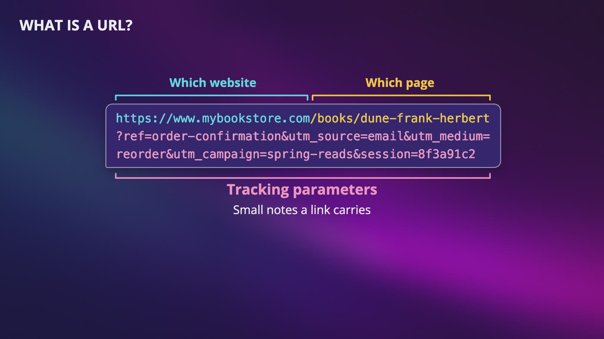
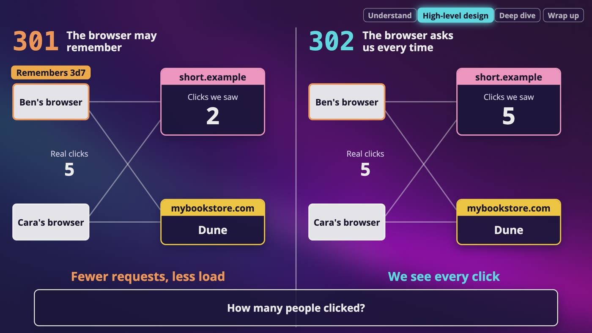
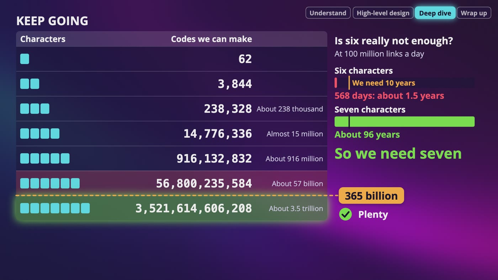
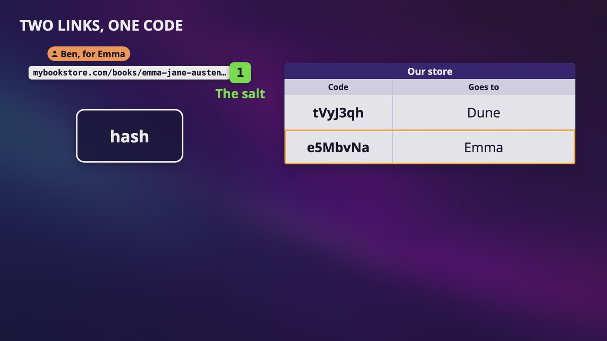
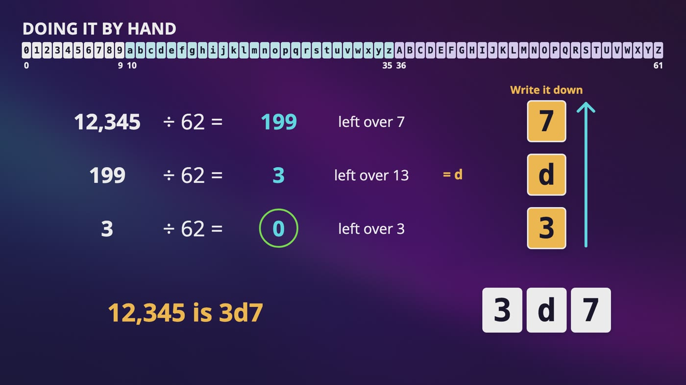
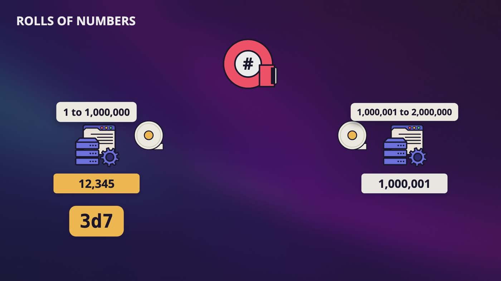
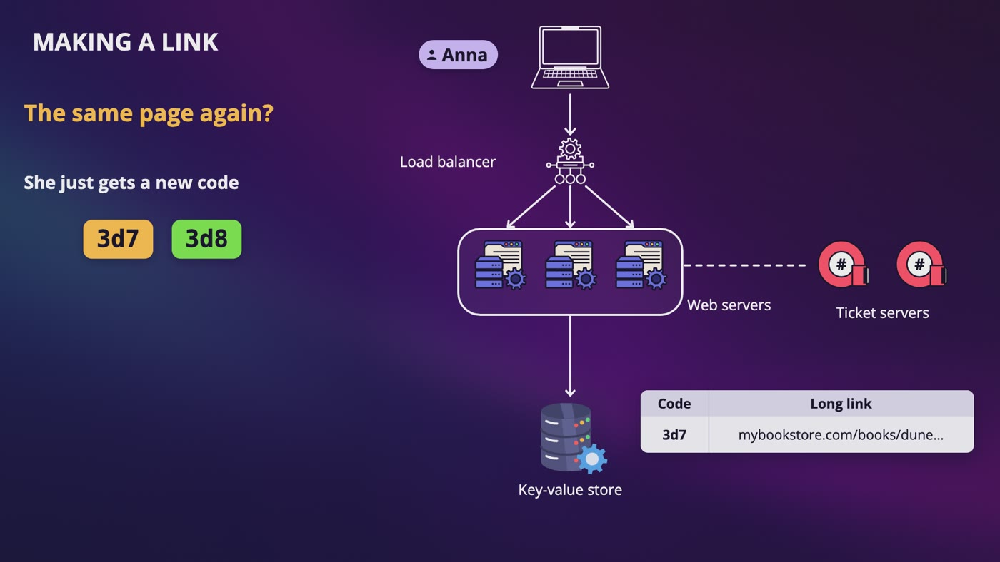

# [Chapter 8: Design URL Shortener](https://www.udemy.com/course/system-design-zero-to-hero/?referralCode=183D59A1EBE9E71D26FF)

_Anna wants to send Ben one link, and almost everything we've learned comes back to make it short._

[Download as PDF](../pdf/System-Design-Chapter-08-Notes.pdf)

## Contents

1. [URL Shortener: What Are We Building?](#1-url-shortener-what-are-we-building)
2. [The API and Redirects](#2-the-api-and-redirects)
3. [How Short Can It Be?](#3-how-short-can-it-be)
4. [Option One: Hash the URL](#4-option-one-hash-the-url)
5. [Option Two: Base 62](#5-option-two-base-62)
6. [Which ID Should We Use?](#6-which-id-should-we-use)
7. [The Whole URL Shortener Design, for Your Interview](#7-the-whole-url-shortener-design-for-your-interview)

## 1. URL Shortener: What Are We Building?

> **The big idea:** You give it a long link, and it gives you a short one. A click ends up on the long page. It sounds like one table, but almost everything we've learned comes back.

_A URL says which website and which page. Everything after the question mark is tracking parameters, small notes that a link carries._

| The number | How we get it | What it decides |
|---|---|---|
| About 1,160 writes a second | 100 million links a day, divided by 86,400 seconds | How fast we save new links |
| About 11,600 reads a second | 10 clicks for every link, and about double at our busiest | This system mostly answers clicks, so a cache helps a lot |
| 365 billion links | 100 million a day, times 365 days, times 10 years | How long our short codes have to be |
| 36.5 terabytes | 365 billion links, at about 100 bytes each | Way more than one normal database wants to hold |

### Why we need it

- Anna pastes the link for Dune into a chat with Ben, and one book takes up 3 lines.
- Our bookstore also wants to print links on the paper bookmarks in every order. One wrong letter when you type it, and you get an error page.

### Step 1: ask questions

- Who makes links? Anyone, with no login. How many a day? 100 million.
- How short? As short as possible. What characters? Only numbers and letters.
- Can people delete or change a link? Not for now. How long do they last? At least 10 years.
- How many clicks? About 10 on average.

### What each answer did

- **Anyone can make a link:** someone could write a script and make millions of them, so remember that for later.
- **Links can't change:** an answer in the cache never gets old. If people could edit links, this would be harder.
- **10 years:** we can't clean anything up. Every link we ever make has to stay somewhere.
- **Careful:** the 10 years are already inside the 365 billion, so don't multiply by 10 again. With 3 copies of everything, it's over 100 terabytes.

> **In your interview:** Know how to do this math out loud, and say what each number decides. You don't need exact numbers, and nobody is going to check your division.

> **In the real world:** TinyURL and Bitly are the famous shorteners, and X wraps every single link in a post with its own shortener, called t.co.

**New terms**

| Term | Meaning |
|---|---|
| **URL** | Uniform resource locator. The full address of a page on the internet. |
| **Tracking parameters** | Small notes a link carries after the question mark, so a company knows where you came from. |

## 2. The API and Redirects

> **The big idea:** Our server doesn't fetch the page. It just tells the browser where to go, and whether that's a 301 or a 302 decides who sees the clicks.

_With a 301, the browser may remember, so we saw only 2 of the 5 real clicks. With a 302, it asks us every time, so we saw all 5._

|   | 301 | 302 |
|---|---|---|
| Means | Moved permanently | Found, but only for now |
| Like | The shop that moved for good | A note saying we're closed this month, please go to our other branch |
| The browser | Is allowed to remember the answer | Normally asks us every time |
| You get | Fewer requests, so less load | You see every click |
| Pick it when | Nobody is counting clicks, and you want as little traffic as possible | Someone needs to count clicks, like whether bookmarks bring people in |

### 2 items on the menu

- An API is like a menu: what you're allowed to order, without knowing how the kitchen makes it.
- **POST** makes something new. You send the long link, and you get the short one back.
- **GET** is what your browser sends when you click. It just has the short code on the end, like 3d7.

### What happens when Ben clicks

- His browser sends a GET for 3d7, and our server looks up the code in a table and finds the long link.
- It answers with one of those 300s and the long link in the Location header. That's the whole answer.
- His browser immediately sends a brand new request to the bookstore, and Ben sees Dune. It's so quick he doesn't notice.
- That's one browser remembering one link. When Cara clicks for the first time, her browser has to ask us, no matter which code we picked.

### Status codes

- The first digit tells you what kind of answer it is. 200s mean it worked, and 300s mean go somewhere else.
- 400s mean there's a problem with your request, and 500s mean there's a problem on our side.

### Why our bookstore picks 302

- Marketing wants to know if those printed bookmarks bring people in, and we already planned for 11,000 reads a second.
- The bookmark is printed, so we can never take it back. If the Dune page moves, a 302 lets us fix it on our side. A browser that remembered a 301 can keep going to the old page.

### For the curious

- A header called Cache-Control can say remember this for 90 seconds, or don't keep this at all. So a service can send the permanent code and still see most of the clicks.
- A 301 is also a strong signal to search engines, like Google, that the new address is the real one.

> **In your interview:** This can easily be one of the first deep questions you get. Don't say 301 or 302 like there's one right answer. Say what each one costs, ask whether anyone needs to count clicks, then pick one and say why. For the API, what goes in and what comes out is all you have to say at this step.

**New terms**

| Term | Meaning |
|---|---|
| **Endpoint** | One specific address you can send a request to. One item on the API's menu. |
| **REST** | A popular style of building web APIs, where each thing has its own address and you use a few standard words. |
| **GET / POST** | GET means give me something. POST means here's something new, please save it. |
| **Redirect** | Like a note on a shop door saying we've moved. The server doesn't fetch the page, it tells the browser where to go. |
| **Status code** | The number every answer from a web server starts with. The first digit tells you what kind of answer it is. |
| **Location header** | A header that holds the address to go to. |
| **Analytics** | Counting and studying what people do. |
| **Cache-Control** | A header that controls how long a browser remembers an answer. |

## 3. How Short Can It Be?

> **The big idea:** We have 62 characters to choose from, and 62 to the power of 7 is about 3.5 trillion. That covers our 365 billion links, so we need 7 characters.

_6 characters make about 57 billion codes, which is under our 365 billion. 7 characters make about 3.5 trillion, so we need 7._

| Characters | Codes we can make | At 100 million links a day |
|---|---|---|
| 1 | 62 |  |
| 2 | 3,844 |  |
| 3 | About 238 thousand |  |
| 4 | Almost 15 million |  |
| 5 | About 916 million |  |
| 6 | About 57 billion | Runs out in 568 days, so about a year and a half |
| 7 | About 3.5 trillion | Lasts about 96 years |

### Why 62?

- 10 digits, 26 small letters and 26 capital letters. A small a and a capital A count as different.
- A lot of other symbols already mean something inside a URL, like the question mark and the slash, so we stay away from them.
- Every character multiplies by 62, just like every light switch doubled the patterns.
- With only digits, 365 billion is a 12-digit number, so our codes would be 12 characters instead of 7.

### Printed on paper

- A zero and a capital O look really similar, and so do a small l and a capital I.
- Some systems remove the ones that look alike, which leaves about 58 characters. 7 of those still gives you over 2 trillion.

### Where do they live?

- The code is the coat check ticket, and the long link is the coat. That's a key and a value.
- All in memory? 36.5 terabytes at 100 gigabytes a server is 365 servers for one copy. So no. It lives on disk, and only the popular ones sit in memory.
- A relational database is a really easy way to picture it: one table with a number, the short code and the long link.
- But it's a massive amount of data with no relationships, and we never need a join. Saving a code and getting a link by its code is just put and get.
- One exact code stays quick to find, because a hash function tells us which hook to walk to. What it can't do is find a coat by its color.

> **In your interview:** You don't need the whole table. Say that 62 to the power of 7 is about 3.5 trillion, and that it covers what we need. If they change the numbers, multiply by 62 until you pass it. For the database, either one works. Sketch the table because everyone understands it, then say that since it's only ever looked up by the code, and it's this much data, a key-value store is a natural fit. What your interviewer wants to hear is why.

## 4. Option One: Hash the URL

> **The big idea:** Hash the long link, write it in 62 characters, and keep 7. It works, but collisions come way sooner than you'd think, and they cost real work.

_Pretend Ben's link hashes to the same code as Anna's. We add a 1, called a salt, and hash again, and this time the code is free._

### The trap

- MD5 gives us one big number in hexadecimal, 32 characters long. Why not chop it and keep the first 7?
- Those 7 only use 16 symbols, which makes about 268 million codes. We need 365 billion, about 1,360 times more. We'd use up every code in less than 3 days.
- **The fix:** write that same number using all 62 characters, and keep 7 of those. We keep the last 7, because the very first character isn't evenly spread.
- There's no way back from the code to the long link. The only way back is to look it up in our table.

### 2 links get the same code

- Put 23 people in a room, and it's about a coin flip that 2 of them share a birthday. Each new person gets compared to everyone already there.
- With 3.5 trillion codes, it's a coin flip that we've had our first collision after only about 2.2 million links. That's about half an hour after we launch.
- At 365 billion links, about 1 new code in 10 lands on a code that's taken.
- If Ben's new link overwrites Anna's, everyone clicking her bookmark goes to the wrong page.

### What we do about it

- We look in the database, and that code is taken. So we stick something on the end of Ben's long link, like the number 1, and hash again.
- Even a tiny change gives a completely different code. If that's taken too, we add a 2 instead and try again.

### What this costs

- **A check on every new link:** about 1,160 a second, and most of the time it's a wasted trip.
- **A Bloom filter cuts those checks:** definitely not means nobody has used this code. Maybe means we go and check. For this many links, it's over 400 gigabytes of lights.
- **2 servers at once:** both check, both see it's free, and both save. So we need a uniqueness rule, and the database refuses the second save. A key-value store needs a way to save only if the key is empty, and not every store gives you that cheaply.

### The good parts

- There's no shared counter, because each web server can do this alone.
- The same long link gives the same code, with no salt. But then 2 marketing campaigns share one code, and you can't count their clicks separately. So ask.
- MD5 isn't safe for security anymore, but we're not using it for that, so it's fine here.

> **In your interview:** Don't say you can just take the first 7 characters of a hash, because a sharp interviewer will catch it. And don't say decode the hash, because that isn't possible. Be able to name the costs: writing the hash in 62 characters before you chop, a check on every new link, a Bloom filter to cut down those checks, and a uniqueness rule for 2 servers at once.

**New terms**

| Term | Meaning |
|---|---|
| **MD5** | A real hash function. It gives one big number, written as 32 hexadecimal characters. |
| **Birthday surprise** | With just 23 people in a room, it's about a coin flip that 2 share a birthday. Collisions come much sooner than you'd expect. |
| **Salt** | The extra bit you add to the input before hashing again, like the number 1. |
| **Uniqueness rule** | Something you tell the database about a column: no 2 rows can ever have the same value here. |

## 5. Option Two: Base 62

> **The big idea:** Give every new link its own number, then write that number in a shorter way. If the numbers are all different, the codes are all different, so there's no collision, ever.

_Divide by 62, keep the remainder, and do it again with what's left. Read from the bottom up, and 12,345 is 3d7._

|   | Hash | Base 62 |
|---|---|---|
| Collisions | Yes | No, because the number is unique |
| Extra checks on every save | Yes | No |
| Needs someone to give it a number | No | Yes |
| Code length | Always 7 characters | Depends on the number. Small numbers make short codes. |

### How you already count

- On a car's odometer, each wheel goes from 0 to 9, then rolls over. We call this base 10, because it has 10 digits before it rolls over.
- Light switches are base 2, and hexadecimal is base 16. It's the same odometer with a different number of symbols on each wheel.

### 62 digits

- 0 to 9 are the ones you know. Then a is 10, b is 11, c is 12, up to z, which is 35. Capital A is 36, up to capital Z, which is 61.
- After capital Z, the wheel rolls over to 1 0, which means 1 sixty-two and no ones.
- 125 has 2 sixty-twos in it, which is 124, with 1 left over. So it's written as 21.

### Doing it by hand

- 12,345 divided by 62 is 199, with **7** left over.
- 199 divided by 62 is 3, with 13 left over, and 13 is **d**.
- 3 divided by 62 is 0, with **3** left over. When you hit 0, you're done.
- The first remainder is the last digit, so we read from the bottom up: **3d7**.
- **Check it:** 3 times 3,844 is 11,532. 13 times 62 is 806. Add 7, and you get 12,345.

### The odometer rolls over

- The biggest 4-character code is capital Z, 4 times, which is 14,776,335. Add 1, and every wheel rolls over to 1 with 4 zeros.
- The last code with 7 characters is capital Z, 7 times. That's our 3.5 trillion, minus 1.

### It goes both ways

- With a hash, there's no way back. Base 62 isn't scrambling anything. It's the same number written differently, like writing 12 in Roman numerals.
- That gets you the number, not the long link. You still need our table to find out where 12,345 goes.

> **In your interview:** Be able to do one of these by hand. It only takes a minute, and you really don't want to see it for the first time on a whiteboard. Try it right now with any number, like your birth year, then check it by multiplying back.

**New terms**

| Term | Meaning |
|---|---|
| **Base** | How many digits you have before a wheel rolls over. Base 10 has 10, and base 2 has 2. |
| **Base 62** | Counting with 62 digits: 0 to 9, a to z, then capital A to Z. |

## 6. Which ID Should We Use?

> **The big idea:** Snowflake gives us 11 characters, because it's big on purpose. Different requirements give a different winner, so we use the counter we rejected and hand out ranges.

_Each web server counts through its own block. Number 12,345 on web server 1 becomes 3d7, and web server 2 starts at 1,000,001._

### Let's try Anna's ID

- We slid the time 22 places to the left, so Anna's number is about 843 quadrillion, no matter how few books we've sold. In base 62, it's 11 characters.
- To count to 365 billion, you need about 39 switches, and Snowflake uses 63. On a printed bookmark, you can see every one of those extra 24.

### So was the last chapter wrong?

- No. Anna's order needed numbers that sort by time, in 64 bits, with nobody stopping to ask, at 10,000 a second.
- Does anyone sort short links by time? No. What matters is short, and we never cared about that before.
- Snowflake is still what Anna's order should use. It's just the wrong tool here. The answer depends on the questions you asked.

### Ranges: rolls of tickets

- At a school raffle, each seller gets a whole roll of numbered tickets, and only goes back to the office when it runs out.
- Web server 1 asks the ticket machine for a block and gets 1 to a million. Web server 2 gets the next million. Each one counts in its own memory, without asking anybody.
- Anna's link gets 12,345, so 3d7. Ben's gets 1,000,001, so 4c93.

### What that did

- **Fewer trips:** at about 1,160 links a second, a million numbers lasts about 14 minutes. So the ticket machine gets asked about 4 times an hour.
- **It goes down?** Every server still has numbers left. You can also run 2 of them, one giving odd blocks and one giving even. The numbers drift out of time order, and here nobody cares.
- **A web server crashes?** Those numbers are just gone. Even if 100 crash every day and each loses a million, we use 730 billion over 10 years, out of 3.5 trillion.
- **A bonus:** codes start out tiny and grow. But we use up 4 characters in about 3.5 hours, and 6 in about a year and a half.

### The catch

- These codes are easy to guess. If 3d7 is a link, then 3d8 is probably someone else's. So a short link isn't a password.
- For the curious, you can scramble the number first. But once we have all our links, about 1 random code in 10 is real, and every code is the full 7, so you lose that bonus.
- What really helps is longer codes for anything private, and rate limiting anyone who's scanning.

> **In your interview:** You can say: Snowflake is great when you need order, but here it gives me 11 characters, so I'd use a counter with ranges. That one sentence shows you picked based on what they asked for. A hash is still fine if you can't run any shared service at all, or if the same long link really has to give the same code.

> **In the real world:** In 2016, 2 researchers working with Cornell Tech published a paper called Gone in Six Characters. They just tried random short codes. On Bitly, about 42% of the 6-character codes they tried were real links. Through Microsoft OneDrive links, they found shared files, and through Google Maps links, driving directions that could reveal where someone lives. They suggested 10 characters or more, and Google moved its map links to 11 or 12. PostgreSQL also has a setting that hands out numbers in blocks, and its docs say unused numbers just get lost.

**New terms**

| Term | Meaning |
|---|---|
| **Ranges** | Giving each server a block of numbers to count through on its own, instead of asking for one number at a time. |
| **Scanning** | Trying code after code. |

## 7. The Whole URL Shortener Design, for Your Interview

> **The big idea:** Making a link takes a number from a block, writes it in base 62, and saves it. A click checks the cache, then the store, and answers with a 302.

_Anna's code is saved with her long link in the key-value store. If she makes a link for the same page again, she just gets a new code._

### Making a link

- Anna sends her long link in a POST, through the load balancer to a web server.
- That server takes the next number from its block, 12,345, and writes it as 3d7. It saves 3d7 with the long link in the key-value store and sends the short link back.
- No collisions to check, and we only talk to the ticket server when a block runs out.
- If you want the same code every time, you need another lookup by long link, and you lose the separate click counts. So ask.

### Clicking a link

- This flow gets 10 times the traffic. Ben's GET for 3d7 goes through the load balancer to a web server, which checks the cache first.
- If it isn't there, the key-value store hashes the code and goes straight to the right spot. We leave a copy in the cache for next time.
- Links can't change, so a cached answer can't be out of date. And a small number of links usually get most of the clicks.
- **A code that doesn't exist** gets a 404. A Bloom filter that says definitely not lets us send it without touching the store.

### The follow ups

- **Scripts making millions of links?** Our rate limiter sends a 429, and it also slows down anyone trying code after code.
- **More traffic?** Web servers are stateless, so add more behind the load balancer. If one dies, we lose the rest of its block, and that's fine.
- **All that data?** Split it across servers with the ring, and keep copies.
- **Counting clicks without slowing Ben down?** Drop a message in a queue and redirect him right away. A separate program counts later.
- **Scams?** A short link hides where it's going. So check where a link goes when it's made, and block the bad ones.

### What to know well

- **Know well:** why 7 characters, one base 62 conversion by hand, 301 against 302, why chopping a hash collides, and why requirements decide which ID generator wins.
- **Just recognize:** the birthday math, scrambling the numbers, and the exact headers real services send.

> **In your interview:** Step 1, ask, then do the math out loud: 1,160 writes a second, 11,600 reads, 365 billion links, 36.5 terabytes, and what those numbers decide. Step 2, give your 2 items on the menu, explain the redirect, pick 301 or 302, and say why. Step 3, go deep: 7 characters because 6 only lasts a year and a half, the 2 options, and Snowflake makes 11 characters, so you use ranges, and they're easy to guess. Step 4, wrap up with the follow ups, and never say your design is perfect.

> **In the real world:** Google had a shortener called goo.gl. In 2018, it said it would stop making new links. In 2024, it announced that all the old links would stop working in August 2025. Just before that date, it changed its mind and only turned off links with no activity in late 2024. So a short link is a promise, and it's hard to take back. In your interview, you can ask if links ever expire.

**New terms**

| Term | Meaning |
|---|---|
| **404** | A status code that means not found. |

## Recap: How Anna's link got short

_The answer depends on the questions you asked._

| Every decision we made | |
|---|---|
| **7 characters** | 6 only lasts a year and a half |
| **A 302 redirect** | Someone has to count the clicks |
| **Key-value store** | Lots of data, only looked up by the code |
| **Base 62** | Hashes collide, and unique numbers don't |
| **Ranges** | Snowflake makes 11 characters |
| **Cache** | Most traffic is clicks, and links can't change |
| **Rate limiter** | Scripts and people scanning codes |

**What to remember**

- Why we need 7 characters
- How to do one base 62 conversion by hand
- 301 against 302, and what each one costs
- Why chopping a hash collides
- Why requirements decide which ID generator wins

---

From the course **[System Design: Zero to Interview Hero](https://www.udemy.com/course/system-design-zero-to-hero/?referralCode=183D59A1EBE9E71D26FF)** by Nata Vacheishvili.
