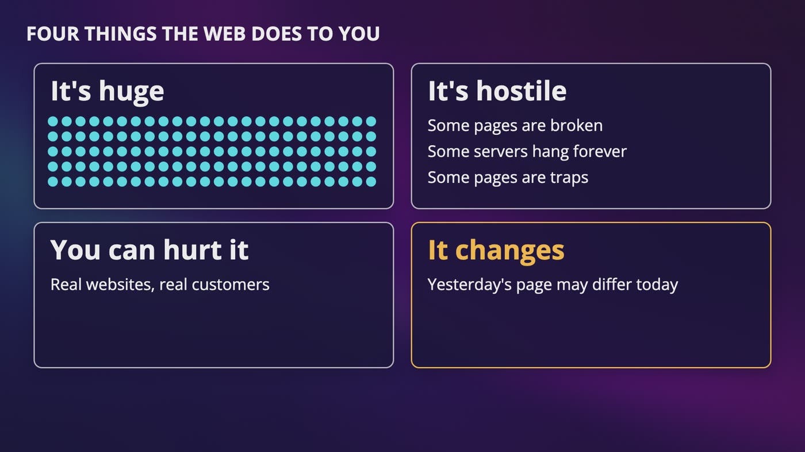
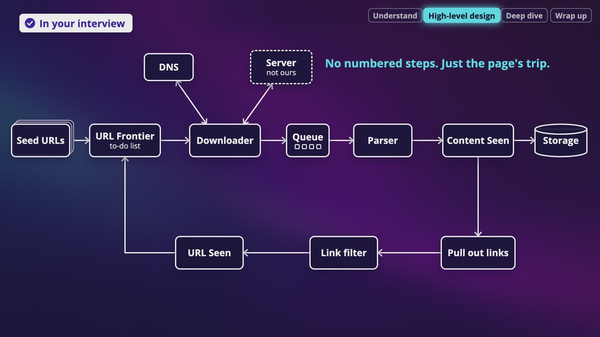
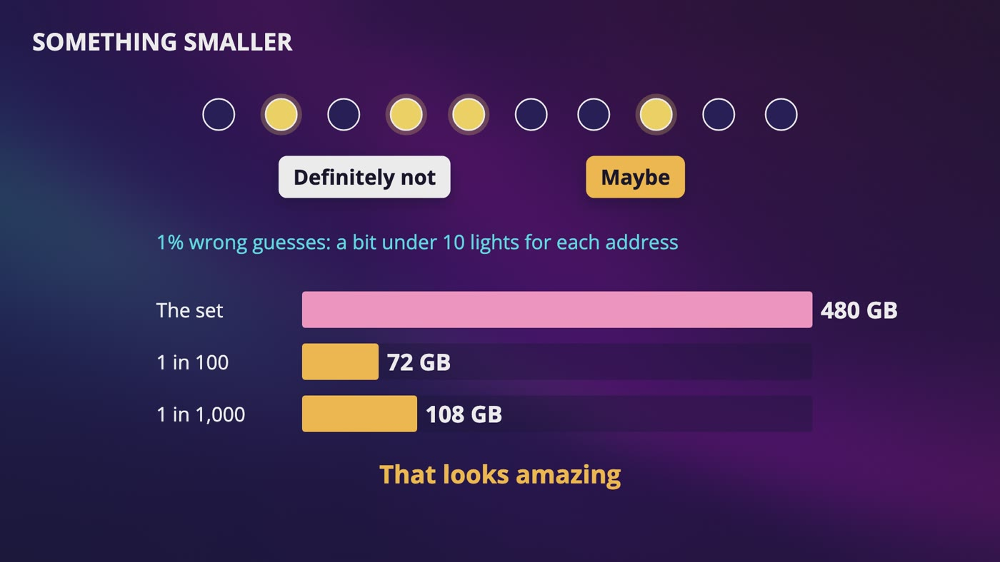
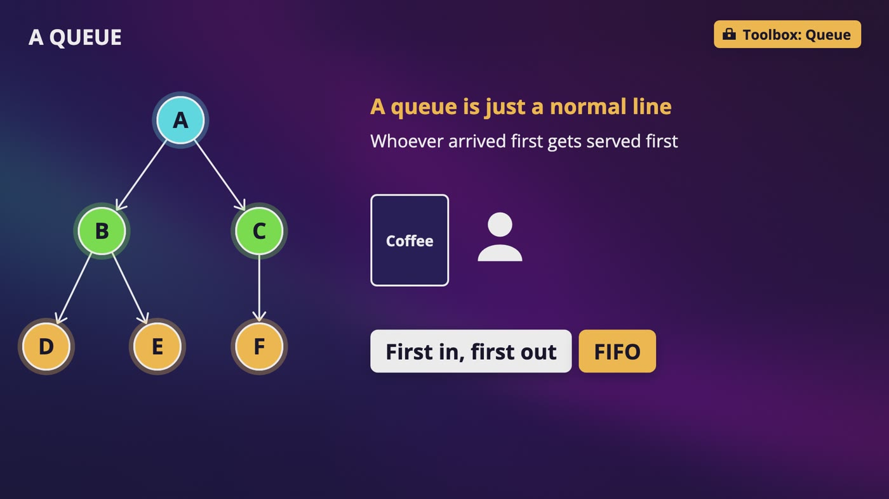
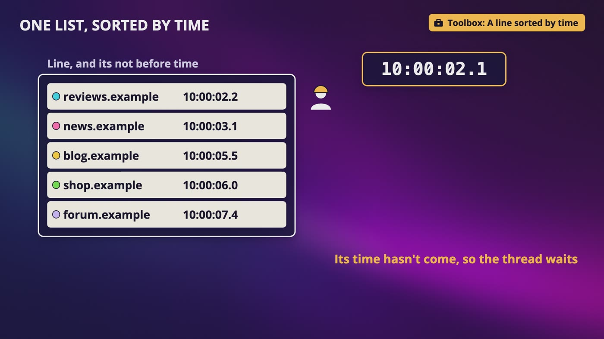
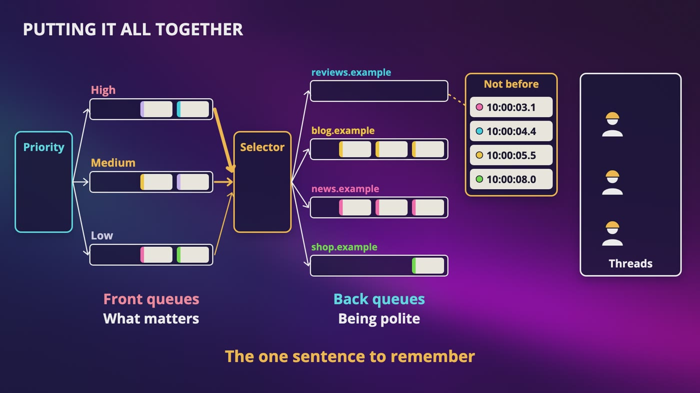
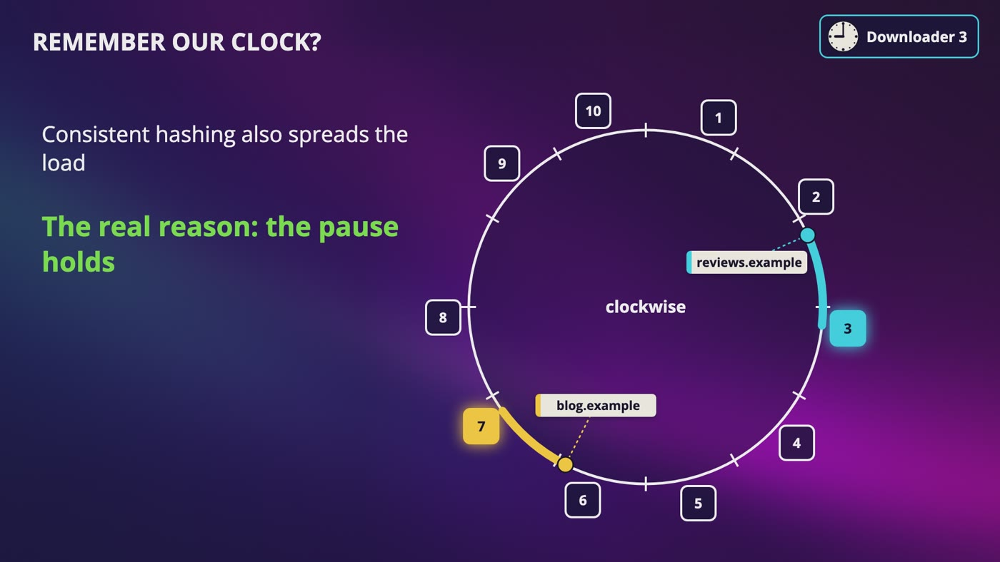
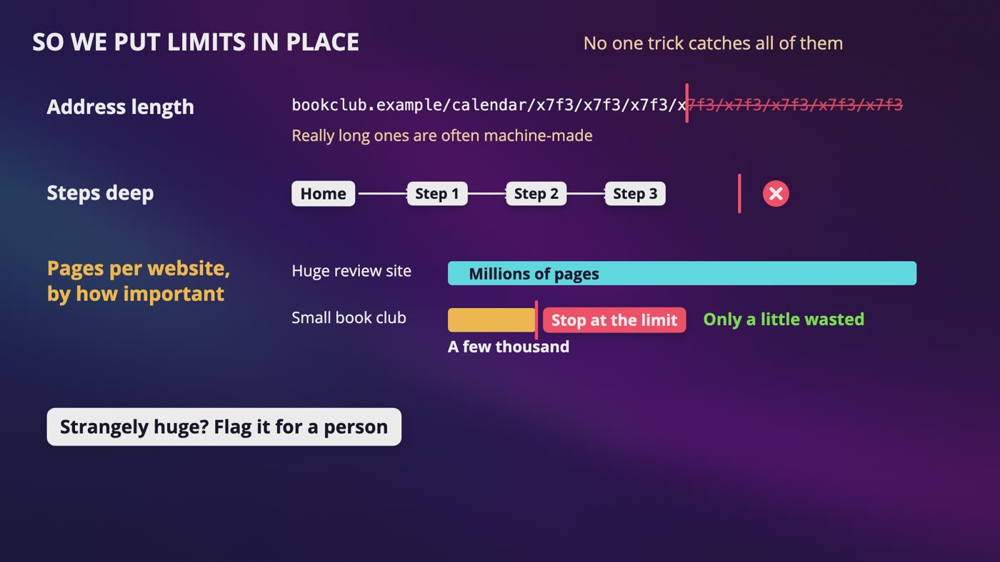
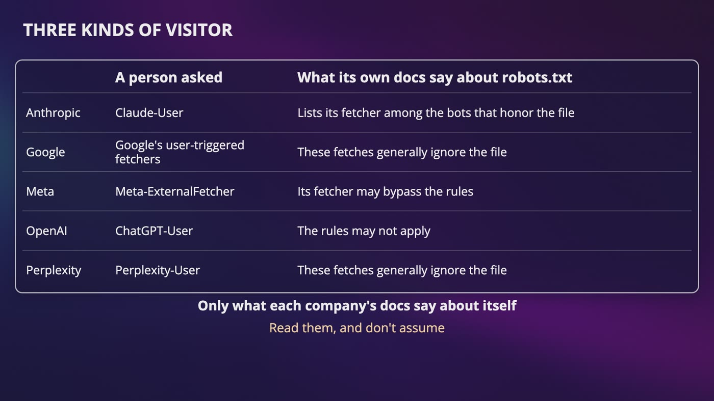
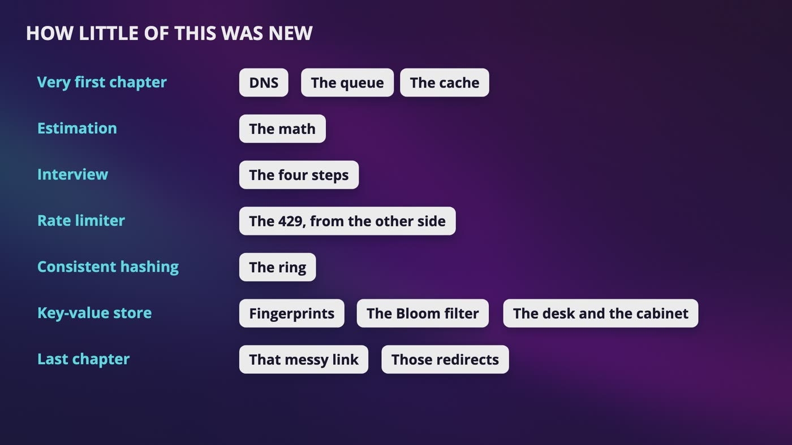

# [Chapter 9: Design Web Crawler](https://www.udemy.com/course/system-design-zero-to-hero/?referralCode=183D59A1EBE9E71D26FF)

_Crawling isn't hard because downloading is hard. It's hard because every page belongs to someone else._

[Download as PDF](../pdf/System-Design-Chapter-09-Notes.pdf)

## Contents

1. [What Is a Web Crawler?](#1-what-is-a-web-crawler)
2. [Following One Page Through the System](#2-following-one-page-through-the-system)
3. [Have We Seen This Before?](#3-have-we-seen-this-before)
4. [Which Link Next?](#4-which-link-next)
5. [Being Polite](#5-being-polite)
6. [What Matters, and What Changed?](#6-what-matters-and-what-changed)
7. [Going Fast Without Falling Over](#7-going-fast-without-falling-over)
8. [Traps, Junk and JavaScript](#8-traps-junk-and-javascript)
9. [AI Crawlers: The Same Design, New Requirements](#9-ai-crawlers-the-same-design-new-requirements)
10. [The Whole Web Crawler Design, for Your Interview](#10-the-whole-web-crawler-design-for-your-interview)

## 1. What Is a Web Crawler?

> **The big idea:** A crawler downloads a page, pulls out its links, adds them to its list, and goes again. Those steps work for 100 pages, and everything changes at billions of pages on other people's websites.

_Your design has to survive 4 things the web does to you: it's huge, it's hostile, you can hurt it, and it changes._

| The number | How we get it |
|---|---|
| About 400 pages a second | A billion pages a month, divided by about 2.5 million seconds. The exact answer is about 386, and double at our busiest is 800. |
| 500 terabytes a month | A billion pages at 500 KB each, and 500 KB is a guess |
| 30 petabytes | 60 months in 5 years, before compression |
| 1.6 gigabits a second | 400 pages times 500 KB is 200 MB a second, times 8 bits. About 3.2 at our peak. |

### Why Ben needs this

- Ben wants to know what people are saying about Dune, so our bookstore wants a new feature on every book page, called what people are saying.
- Nobody is going to send us those pages. And unlike our bookstore search, this collects other people's pages, from websites that have no idea who we are.
- Think of a librarian. She takes a book off her list, reads it, writes down every book it mentions, and adds those to the end of her list.

### Step 1: ask questions

- What is it for? Finding pages that talk about books. How much? A billion pages a month.
- Only the words? Yes, only HTML. Do we need to notice edits? Yes, and this one is going to break our design later.
- How long do we keep it? 5 years. Copies of the same review? We don't want to store those twice.

### The surprise in the numbers

- 1.6 gigabits a second is a lot for your home internet, but inside a data center, it doesn't take many machines.
- So downloading fast isn't the hard part. The hard part is what those downloads do to everybody else.

> **In your interview:** Do the math out loud, including the network number people usually skip. Then say that downloading fast isn't the hard part of this question. That's a really good thing to say.

> **In the real world:** Search engines can only show you pages a crawler already found. Google says its search index covers hundreds of billions of pages. The Internet Archive passed 1 trillion saved pages in October 2025. Common Crawl collected about 2 billion pages in 2 weeks in October 2026. And a lot of the text AI models learn from was collected by crawlers.

**New terms**

| Term | Meaning |
|---|---|
| **Web crawler** | A program that goes and gets pages from around the web: download, pull out the links, add them to the list, and repeat. |
| **Search index** | The collection of pages a search engine can search through. |
| **Internet Archive** | A non-profit library that saves copies of web pages. Its tool for looking at old copies is called the Wayback Machine. |
| **Common Crawl** | A non-profit that crawls the web and gives the results away for free, so researchers don't need a crawler of their own. |

## 2. Following One Page Through the System

> **The big idea:** Follow one page, and every time it needs something, add a box. The whole design is a loop, with the librarian's 3 steps still inside it.

_The whole design is a loop. New links go through URL Seen and back to the frontier, and a queue sits between the downloader and the parser._

### The page's trip

- **Seed URLs:** we start with well known book review sites, because they link to a lot of other places that talk about books.
- **URL frontier:** our to-do list, with every link we want to visit and haven't visited yet.
- **Downloader:** it asks DNS for the IP address, sends an HTTP request, and the server sends back the page.
- **Parser:** it works out the pieces of the HTML, like pulling the ingredients from a recipe. This is where we give up on garbage pages.
- **Content Seen:** have we already seen these exact words? If so, throw the page away. If not, save it to storage.
- **Pull out links:** a relative link like /dune/comments gets the website's name stuck on the front.
- **Link filter:** a link ending in .jpg is an image, and we said only HTML, so it's gone.
- **URL Seen:** have we already got this address? If not, it goes back to the frontier.

### Books only

- If a page isn't about books, we don't keep the words. I'd still keep its links, because the next page might be.

### Why are these separate boxes?

- A downloader spends most of its time waiting for somebody else's server. A parser never waits, and it uses our own computer as hard as it can.
- So we put a queue between them. If parsing falls behind, pages wait, nothing is lost, and we can add parsers without touching the downloaders.

### What about all that storage?

- 30 petabytes is before compression, and HTML squeezes really well, because it repeats the same tags over and over.
- Our 500 KB guess was on the high side, and that's okay. A guess is allowed to be wrong, as long as you said it's a guess.

> **In your interview:** Be able to draw this loop on a blank page, and say why each box exists. You don't need numbered steps, just the page's trip. There's no perfect answer for seeds, so think out loud. If they point at a box and ask what happens without it, have an answer. Without URL Seen, you go in circles forever. Without the queue, one slow side holds up the other side.

> **In the real world:** Common Crawl's October crawl has about 370 terabytes of raw content, and its main archive is about 86 terabytes once it's compressed. That's more than 4 times smaller, and it works out to under 200 KB a page.

**New terms**

| Term | Meaning |
|---|---|
| **Seed URLs** | A few starting addresses, called seeds because everything else grows from them. |
| **URL frontier** | The crawler's to-do list. It holds every link we want to visit and haven't visited yet. |
| **Downloader** | The program that actually fetches pages. |
| **Parsing** | Going through a long string of letters and working out the pieces, like reading a recipe and pulling out the ingredients. |
| **Content Seen** | The box that asks: have we already seen these exact words somewhere else? |
| **URL Seen** | The box that asks: have we already got this address? |
| **Relative link** | A link that isn't a full address, like saying the room down the hall. It only makes sense if you know which building you're in. |

## 3. Have We Seen This Before?

> **The big idea:** URL Seen asks about the address, before we download anything. Content Seen asks about the words, after. And a Bloom filter's wrong guess costs something completely different here.

_At 1% wrong guesses, a Bloom filter needs about 72 GB for 60 billion addresses, against 480 GB for the set._

|   | URL Seen | Content Seen |
|---|---|---|
| It's about | The address | The words |
| When | Before we download anything | After we download the page |
| Like | One bookstore listed twice in the phone book, spelled 2 ways | 2 different bookstores selling the same book |
| Without it | Your crawler walks in circles forever | You store more copies |

### One page, many addresses

- Tracking notes after the question mark don't change the page, so a careless crawler downloads Dune a thousand times.
- So we **normalize**: make the website's name small letters, remove a slash at the very end if this site treats both the same, and remove the tracking parameters.
- You can't delete everything after a question mark. Page equals 2 is a different page. Cleaning too much loses pages, and cleaning too little wastes downloads.
- A short link gets a redirect, so we follow it and store the page where we landed. We stop after a few redirects, so nobody can send us around in circles.

### Remembering 60 billion addresses

- A billion a month for 60 months, at about 100 bytes each, is 6 terabytes.
- An 8-byte hash of each address brings that down to 480 GB. It's a set, and it never gives you a wrong answer.
- That's too much for the memory of one normal server, but you can put it on disk, or split it across a few machines.

### The Bloom filter trap

- At 1% wrong guesses, it's a bit under 10 lights per address, about 72 GB. At 1 wrong guess in 1,000, it's about 108.
- Last chapter, a wrong maybe cost one wasted trip. Here, maybe we've seen it means **we skip it**. We never visit the page, so we never find out we were wrong.
- At 1%, that's 10 million pages out of every billion new ones.
- **Your choice:** keep a set and pay for the space, use only the filter and lose some pages, or put the filter in front of the set and pay for both.
- For our bookstore, losing 1 review in 100 is fine, because popular books get talked about in lots of places. If every page matters, I'd keep the set.

### Have we seen these words?

- Hash the whole page to get a fingerprint, and keep a set of fingerprints.
- But change one letter, and you get a completely different number. A review with today's date on one site gets saved twice.
- So fingerprints only catch exact copies, and a lot of the web is almost copies, with a different ad or date.

> **In your interview:** If you only have time for one, it's URL Seen. Start with the addresses, then the exact fingerprint, then mention near copies if there's time. Whatever you choose, say what a wrong guess costs, because just saying Bloom filter doesn't tell your interviewer very much.

> **In the real world:** Google published a paper in 2007 on using SimHash across billions of pages. You most probably won't be asked how it works. Just be able to say that exact hashes miss near copies, and that this exists.

**New terms**

| Term | Meaning |
|---|---|
| **Normalizing** | Cleaning up an address before asking if we've seen it, so all of its versions turn into one. |
| **Set** | A hash table for the question, have I seen this? We only care whether the hook has been used. |
| **SimHash** | A way of making a fingerprint where similar pages get almost the same number, so you can spot near copies. |

## 4. Which Link Next?

> **The big idea:** It's the same loop either way. The only difference is whether new links go on top of a pile, or at the back of a line. And a plain line still fails on the real web.

_Breadth first reads in layers: A, then B and C, then D, E and F. It's built with a queue, where whoever arrived first gets served first._

|   | Depth first | Breadth first |
|---|---|---|
| The idea | Keep going deeper before you ever come back up | Everything on this page first, then everything those pages link to |
| Like | Clicking link after link at 3 in the morning | Going out 1 step in every direction, then 2 |
| Built with | A stack, like a pile of plates: last one on, first one off | A queue, like a line at a coffee shop: first in, first out |
| On our map | A, then C, then F, with B still waiting | A, B, C, D, E, F |
| For a crawler | A bad choice. You could spend days inside one site. | What crawlers have mostly been built around |

### The web is a map

- Every page is a dot, and every link is an arrow from one dot to another.
- It's one way. If a Dune review links to a page about the author, the author page doesn't have to link back.

### Watching a plain line go wrong

- **Failure 1:** the home page of reviews.example has 1,000 links, and nearly all go to its own reviews. They join the line next to each other.
- We want 400 pages a second, so many downloaders take the next links, and they all hit that one little website. A small server can actually crash from this.
- **Failure 2:** a line treats everyone the same. The home page of a huge review site, which a million people read, waits like a forum post from 2011 that nobody has opened since.
- So a plain line doesn't know it's hurting someone, and it doesn't know what matters.

> **In your interview:** If they ask which one, say breadth first. But don't stop there, because this is what they're really checking. Say that a plain queue would hit one site way too hard, and that it treats every page as equally important.

**New terms**

| Term | Meaning |
|---|---|
| **Graph** | Dots and arrows. It isn't the kind with a line going up from math class. |
| **Node / edge** | A dot is a node, and an arrow is an edge. |
| **Depth first** | Keep going deeper before you ever come back up. |
| **Stack** | A pile of plates. The last one on is the first one off. |
| **Breadth first** | Read everything on this page first, then everything those pages link to. Breadth means how wide something is. |
| **FIFO** | First in, first out. A normal line, where whoever arrived first gets served first. |

## 5. Being Polite

> **The big idea:** Give each website its own line, one worker at a time, and a pause. That pause is what makes crawling hard.

_One list of lines, sorted by not before time. A thread takes the line at the top, and if its time hasn't come yet, it waits._

### Why it matters

- Imagine it's aimed at us. Anna is checking out, a crawler downloads every page as fast as it can, her page spins, and she gives up.
- So being impolite isn't only rude. The site slows down or crashes for real people, or they block you, and then you get nothing.

### One line per website

- Think of a bank where each line has its own teller, and the teller waits a little between customers.
- Each website gets its own line, and only 1 thread can serve it at a time, with a pause between requests.
- **How long?** Pause 10 times however long the last download took, so a slow website gets more time. If a page took a fifth of a second, we wait 2 seconds and write down a not before time.

### What the pause costs

- At 1 request per second, a site with 1,000 pages takes about 17 minutes, and a site with a million pages takes about 11 and a half days. No hardware makes that faster.
- So we get 400 pages a second by working on at least 400 different websites at the same moment.

### Reusing the lines

- There are hundreds of millions of websites, so we keep a limited number of lines. When one runs out of links, we give it to a new website.
- With 100 threads, we'd use about 300 lines, because at any moment most lines are waiting out a pause.
- One list of the lines is sorted by not before time, like a waiting room. While a thread works on a line, that line isn't on the list, so nobody else can touch it.

### Listening to what they tell you

- A 429 or a stream of 500s is your sign to slow down, so wait, and wait longer each time. Retry-After says how long.
- Lots of small websites can share one server, so careful crawlers keep an eye on the IP address too.

### The sign on the door

- robots.txt is a small file at the same spot on every website, and a good crawler reads it before downloading anything else.
- It's a sign on a door and not a lock. A good crawler obeys, and a bad one walks right in. So never list a secret page in there, because anybody can read it.
- Crawlers shouldn't use a saved copy for more than 24 hours.

> **In your interview:** Bring up politeness before they ask, because it's the thing that makes crawling hard. Say one line per website, one worker at a time, and a pause. Be ready for what if a site has a million pages, and what if it sends you a 429. You don't need Mercator's name, or the 3 times.

> **In the real world:** In April 2025, the Wikimedia Foundation wrote that bandwidth for downloading images and videos had grown by 50% since January 2024, largely from automated programs feeding AI models. Bots were about 35% of page views, but at least 65% of its most expensive traffic, because crawlers read pages that aren't in the cache. A year later, it was blocking or slowing about 30% of automated requests. Google's founders wrote in 1998 that they got emails almost every day about it. robots.txt started in 1994 as a convention and became an official standard in 2022.

**New terms**

| Term | Meaning |
|---|---|
| **Bot** | A program that visits websites by itself. A crawler is one. |
| **Thread** | One worker inside a program, doing one thing at a time. |
| **Mercator** | A crawler that 2 researchers at Compaq built around 1999, to work out how a crawler could grow to the size of the web. |
| **Not before time** | The earliest we can go back to a website. |
| **Heap** | A sorted list that gives you the earliest one quickly. |
| **robots.txt** | A small file where a website says what it wants crawlers to do. It's voluntary. |

## 6. What Matters, and What Changed?

> **The big idea:** The front is about what matters, and the back is about being polite. And a revisit schedule fixes the bug that hides inside URL Seen.

_Front queues decide what matters, and back queues keep us polite. A thread takes a website's line when its not before time comes._

### A triage desk for links

- In an emergency room, a broken finger shouldn't go ahead of a heart attack just because it came in first.
- A small program gives each link a priority, without reading the page. The signals can be simple, like how many pages link to it, and whether it's about books.
- **The lines:** high, medium and low. A selector picks from high most often, medium less often, and low once in a while. Otherwise the low ones would wait forever.

### One link's trip

- A link to reviews.example/dune arrives at the desk. Lots of good pages link to it, so it goes in the high line.
- The selector picks it and adds it to the line for reviews.example, at the back.
- When that line's not before time comes, a thread takes the line, downloads our page, and writes down a new time.
- If a website line runs out of links, it asks the selector for more. A brand new website takes over the empty line, so 300 lines serve hundreds of millions of websites, a few at a time.

### Our design has a bug

- A blogger writes about Dune on Monday, and we read it. On Thursday, they add a long new section.
- A link to that post comes in, and URL Seen throws it away. So our crawler can only find new pages, and never notices that an old one changed.
- **The fix:** keep a schedule of pages we've read and when to visit each one again. That link goes straight into the frontier from the side, like a dentist who books your next visit.

### How often should we come back?

- A news site changes every hour, and an old essay might never change. Checking everything every day is a lot of downloads for other people's servers.
- Keep each page's fingerprint next to its address. Same fingerprint? Come back less often. Different? Come back sooner.
- Check the blog every week. Same, so try 2 weeks. Same again, so try 4. It changes, so go back to 1 week. We learned that on our own.
- If a page didn't change, we don't store a second copy. But a page that only changes its date looks changed too.

### For the curious

- A crawler can ask, has this changed since Tuesday? If it hasn't, the server sends a 304, which means not modified, with no page attached.

> **In your interview:** This is a great thing to catch by yourself. Draw URL Seen, then say out loud that this would throw away pages we need to revisit, so you're adding a schedule that feeds the frontier from the side. Know the 2 sets of queues well. Nobody needs the formula for PageRank, and the idea is enough.

> **In the real world:** PageRank came from Google's founders in 1998. A page that a lot of good pages link to is probably a good page, like a book that gets mentioned by a lot of other books. Don't say this is how Google ranks pages today, because nobody outside Google can tell you that. Say it's the original idea.

**New terms**

| Term | Meaning |
|---|---|
| **Triage** | The desk at the front of an emergency room, where a nurse decides how urgent you are. |
| **PageRank** | A score for how important a page is, based on the pages that link to it. |
| **Selector** | Takes links out of the priority lines, picking from high most often. |
| **Front queues** | The importance lines: what matters. |
| **Back queues** | The per-website lines: being polite. |
| **304** | A status code that means not modified. |

## 7. Going Fast Without Falling Over

> **The big idea:** All of a website's links have to go to the same machine, or the pause stops working. The rest of a bad day comes down to timeouts, batches and saving your game.

_We hash the website's name onto the ring, so all of its links go to one downloader, and the pause holds._

### Whose job is this website?

- If downloaders 3 and 7 both have links for reviews.example, each one waits carefully, but the website gets twice as many requests.
- So we hash the **website's name**, not the whole address, and walk clockwise on the ring. That's the real reason, not only spreading the load.
- Add an 11th downloader, and about 10% of websites move. With the remainder rule, it's about 91%. Those websites' lines have to be handed over.
- One huge website is one key on one machine, but the pause means it can't overwhelm it. That crawl takes a long time, on purpose.

### DNS and distance

- Each lookup means waiting, and the answer doesn't change very often. So keep a small list of answers in memory, and only ask again when the TTL says it's too old.
- You can run downloaders in a few data centers, near the websites they download. That's more money and more to run, so only bring it up after the basics.

### The site that never answers

- A thread only does one thing at a time, so one silent website leaves it stuck. A few more, and all threads are stuck.
- So set a **timeout**, like letting a phone ring for a while, and try that link again later. Too short, and you give up on slow but real sites.
- Also limit how big a download can be, because a server can keep sending you data forever.

### The to-do list doesn't fit

- All on the desk, it doesn't fit, and it's gone when we crash. All in the cabinet, we walk across the room for every link.
- In a line, we add to the back, take from the front, and never touch the middle.
- So we keep 2 small trays on the desk, one with the next few links and one with the newest, and everything in the middle lives in the cabinet. We carry whole batches in one trip.

### The crash

- Every so often, each downloader writes down its lines, its not before times and what it's already seen, on storage that survives the machine.
- A new machine reads the last save and carries on. At worst, we repeat a little work, and Content Seen catches a page downloaded twice.

> **In your interview:** They might point at any of this: what if you add a machine, what if a site hangs, what if it crashes, and where does the frontier live? Know the ring reason really well, because it connects politeness to everything else, and know the desk and cabinet answer. You might read that DNS lookups block everything, but that was about the tools one team had in the nineties. Today, say lookups add waiting, so you'd cache them.

**New terms**

| Term | Meaning |
|---|---|
| **Timeout** | How long we're willing to wait before giving up. |
| **Buffer** | A small area in memory, like the 2 trays on the desk. In Mercator, those trays held only 600 links each. |
| **Checkpoint** | Writing down where you are on storage that survives the machine. It's like saving your game. |

## 8. Traps, Junk and JavaScript

> **The big idea:** The real web does 3 things to a crawler: pages that never end, junk, and pages that come back empty. Each fix is a tradeoff, because any limit can cut off something real.

_No one trick catches every trap, so we limit the address length, the steps deep, and the pages per website based on how important it is._

### The page that never ends

- A book club's calendar has a next month link. October leads to November, and a program is happy to make a page for the year 3000.
- Every safety check says yes, because each address is new and each page's words are a little different.
- A session value in every link can also make one page look like endless addresses. That's one more reason to clean up addresses first.
- **So we put limits in place:** how long an address can be, how many steps deep we go, and a limit per website based on how important it is.
- A website with a strangely huge number of pages can get flagged, so a person can look and add a rule.

### Junk

- Someone could put up 1,000 pages that mention Dune and link to whatever they're selling, and that shows up under what people are saying.
- Our priority desk already helps, since spam sites don't get many links from good pages.
- After reading a page, we can score it on things like whether it's mostly ads, and keep a list of websites to stay away from.

### The page that comes back empty

- A modern page can come back with only a title, an empty box, and a pointer to some JavaScript. Ben's browser runs that code, and the code fetches the review.
- Our crawler only read the text that came back, so it thinks the page is about nothing.
- So we run a **headless browser**, let it load the page and run the code, and read whatever ends up on the page.

### What this costs

- Downloading text is mostly waiting, but a whole browser takes real computing power and memory.
- It makes many more requests, to somebody else's website, so our politeness rules still apply.
- So download the plain page first. If it's almost empty, or we've learned a website always works like this, send it to separate machines that run browsers, with a queue in front. Most pages never go there.

### If we want images next year

- We can plug in a new box next to the parser, with an image downloader, and everything else stays the same. A sentence or two is enough for this one.

> **In your interview:** You avoid traps by limiting the length, the depth and the pages per website. You keep out junk by filtering on quality and importance. You handle JavaScript pages with a headless browser, only where you need it. Don't say you can detect every trap. And don't say a crawler uses server-side rendering. That's the wrong word. Say it renders the page in a headless browser.

> **In the real world:** Google has written about how it does this. Its crawler downloads a page, the page waits in a queue, and then a recent version of Chromium runs the code. Google's docs now call dynamic rendering a workaround they don't recommend, and they tell websites to use things like server-side rendering instead.

**New terms**

| Term | Meaning |
|---|---|
| **Spider trap** | A path of pages a crawler can follow forever. A crawler is sometimes called a spider, and some people build these on purpose. |
| **Spam** | Pages stuffed with popular words to fool search engines. |
| **Extensibility** | Designing so that you can add something new without redoing everything. |
| **Headless browser** | A real browser without a screen. |
| **Server-side rendering** | The website's own server builds the full page before sending it. |
| **Chromium** | The free, open source browser project that Google's Chrome browser is built on. |
| **Dynamic rendering** | A website sends crawlers a different version of its page. |

## 9. AI Crawlers: The Same Design, New Requirements

> **The big idea:** Change one sentence, to collect text for training an AI model, and it's the same design with different requirements, so we get different answers.

_For the third kind of visitor, here's what each company's own docs say about robots.txt. They don't all treat it the same way._

| Kind of visitor | What it does | Names |
|---|---|---|
| Training | Collects text for training | GPTBot, ClaudeBot, Meta-ExternalAgent. Google-Extended is a setting in your robots file, not a separate visitor. |
| Search index | Builds an index, so the assistant can find your page later | Googlebot, OAI-SearchBot, Claude-SearchBot, Meta-WebIndexer, PerplexityBot |
| A person asked | Reads one page right then, and doesn't follow links | ChatGPT-User, Claude-User, Meta-ExternalFetcher, Perplexity-User |

### Walking the same boxes

- **Step 1 again:** English first, good quality writing, and a large snapshot, because training happens in big batches. Do we need to crawl this ourselves at all? A Mozilla Foundation report found that at least 64% of the 47 language models it studied, from 2019 to 2023, used Common Crawl.
- **The same:** the downloader, the frontier and URL Seen. Politeness doesn't change at all.
- **The parser does more:** we want the real writing, without the menus, ads and cookie messages, or the model learns from them too.
- **Content Seen matters more:** a 2021 paper found one sentence repeated more than 60,000 times in a popular training set, and models trained on cleaned up data repeated memorized text about 10 times less often. So SimHash moves to the middle of the design.
- **Quality filters become a main box**, because anything that gets through ends up inside the model.
- **Freshness goes way down.** But if the tool answers questions about today's news, it matters a lot. So ask what the data is for.

### The person-asked kind and robots.txt

- Google and Perplexity say these fetches generally ignore the file, because a person asked.
- OpenAI says the rules may not apply, and Meta says its fetcher may bypass them. Anthropic's page lists its fetcher among the bots that honor the file.
- That's only what each company's docs say about itself, so read them and don't assume.

### What can a website do?

- It has the sign, a rate limiter that sends a 429, and blocking traffic before it reaches its servers.
- Anyone can write any name in their request, so a website can't simply trust the name. Google publishes a way to check whether a visitor is really Googlebot, using DNS.

### The trade

- With search, you let the crawler read your page, and it sends you visitors. A training crawler mostly doesn't send anyone.
- Cloudflare reported pages crawled for each visit sent back, in July 2025: about 5 for Google, 40 for Microsoft, 1,000 for OpenAI and 38,000 for Anthropic. It sells blocking tools, so take that as one measurement from one company.
- On the other side, a site can opt out of training and allow search, and search crawlers can get your site cited and linked. So blocking everything can cost you visibility.
- A 2024 study called Consent in Crisis warned that as more sites restrict crawlers, non-commercial AI and academic research are affected too.
- There are real legal questions too, which are unsettled, and you don't need a side in your interview.

> **In your interview:** If they ask what if this is for AI training, say you'd keep the same loop, put more into extracting clean text, near duplicates and quality filters, and care less about freshness. If they ask what if you're the website, you've got the sign, the rate limiter and blocking, and the 3 kinds of visitor call for different answers. Don't memorize the names, because they keep changing. Know the 3 kinds, and that robots.txt is voluntary.

> **In the real world:** In July 2025, Cloudflare started blocking AI crawlers by default on new websites, with the owner able to change that. It then announced that from September 2026, the default for new websites allows search, and blocks training and agents on pages that show ads.

**New terms**

| Term | Meaning |
|---|---|
| **Google-Extended** | A setting in your robots file for whether what Google crawled can train Gemini, its AI model. |
| **Perplexity** | An AI search tool. |
| **Cloudflare** | A company that a huge number of websites put in front of their servers, to protect them from attacks and speed them up. |
| **Agent** | A tool that acts for a person. |
| **Opt out** | Just saying no. |

## 10. The Whole Web Crawler Design, for Your Interview

> **The big idea:** Nobody finishes this design in an interview. Say so out loud, agree on what to go deep on, and follow one page.

_How little of this was new: each piece came from an earlier chapter, and now you built a web crawler out of them._

| If they ask | You say |
|---|---|
| What if we have many machines? | Hash the website's name onto the ring, because a website has to stay on one machine for the pause to hold. |
| What if a website has a million pages? | It takes about 11 and a half days at 1 a second. You can't make that faster, so you work on many websites at the same time. |
| What if a site sends a 429? | Slow down, and listen to Retry-After. |
| What if it's a calendar that never ends? | That's a trap, so limit the length, the depth, and the pages per website. |
| What if the page comes back empty? | It's built with JavaScript, so run a headless browser, only where you need to. |
| What if this is for AI training? | Same loop, with more work on clean text, near copies and quality, and less on freshness. |

### You won't finish, and that's okay

- If you try to cover everything, you end up rushing through 20 boxes and explaining none of them.
- Say something like: there's a lot here, and I'd like to spend most of our time on politeness and the frontier, because I think that's what makes this hard. Does that work for you?
- That one question shows you know the problem, and it gets you a hint for free.

### The 45 minutes

- **Step 1, 3 to 10 minutes:** ask your questions and do the math. About 400 pages a second, about 1.6 gigabits a second, and 30 petabytes before compression. The download speed isn't scary.
- **Step 2, 10 to 15 minutes:** draw the loop by following one page, and say why there's a queue between the downloader and the parser.
- **Step 3, 10 to 25 minutes:** go deep on what you agreed on. If nobody picked, start with why a plain line fails, then back queues, then front queues, then one link walking through.
- If there's time, do the 2 seen questions, then catch your own bug and add a schedule from the side.
- **Step 4, 3 to 5 minutes:** wrap up with whatever is left.

### What to know well

- **Really well:** the loop and why each box exists, why a plain line fails and how the queues fix it, that politeness is what makes this hard, why a website lands on one machine, and URL Seen against Content Seen.
- **In a sentence:** traps, JavaScript, the revisit schedule, the desk and the cabinet for the frontier, and the 3 kinds of AI visitor.
- **Just recognize:** how PageRank is calculated, how SimHash works, Mercator's numbers, the 304, and any company's crawler names.

> **In your interview:** If they ask your opinion on the AI debate, you can describe both sides fairly and stay away from legal claims, because that's not what they're testing. And if you want one sentence to carry out of this chapter, make it this one: crawling isn't hard because downloading is hard, it's hard because every page belongs to someone else.

## Recap: How Ben found that book blog

_Crawling isn't hard because downloading is hard, it's hard because every page belongs to someone else._

| Every box solved a real problem | |
|---|---|
| **URL frontier** | Links need somewhere to wait |
| **URL Seen** | We'd walk in circles forever |
| **Content Seen** | The same words on lots of sites |
| **Queue before the parser** | Downloading and parsing run at different speeds |
| **Back queues** | A plain line hits one site too hard |
| **Front queues** | A plain line doesn't know what matters |
| **Revisit schedule** | We never noticed an edited page |
| **The ring** | A website has to stay on one machine |
| **Checkpoints** | A crash would lose everything in memory |
| **Limits** | Pages that never end |
| **Headless browser** | Pages that come back empty |

**What to remember**

- The loop, and why each box exists
- Why a plain line fails, and how the front and back queues fix it
- Politeness is what makes this hard, with the math behind it
- Why a website has to land on one machine
- URL Seen against Content Seen
- What a wrong Bloom filter guess costs you

---

From the course **[System Design: Zero to Interview Hero](https://www.udemy.com/course/system-design-zero-to-hero/?referralCode=183D59A1EBE9E71D26FF)** by Nata Vacheishvili.
