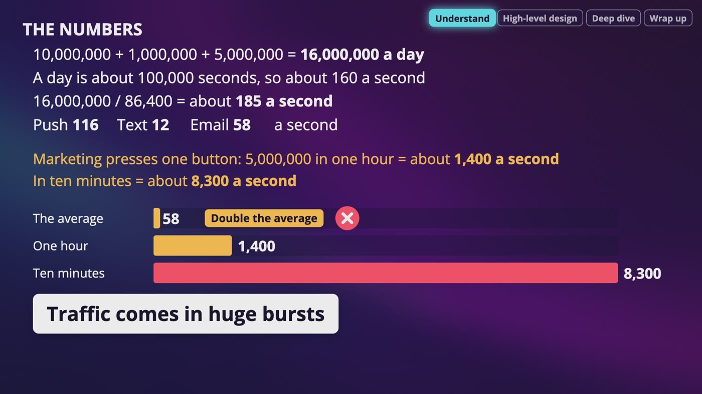
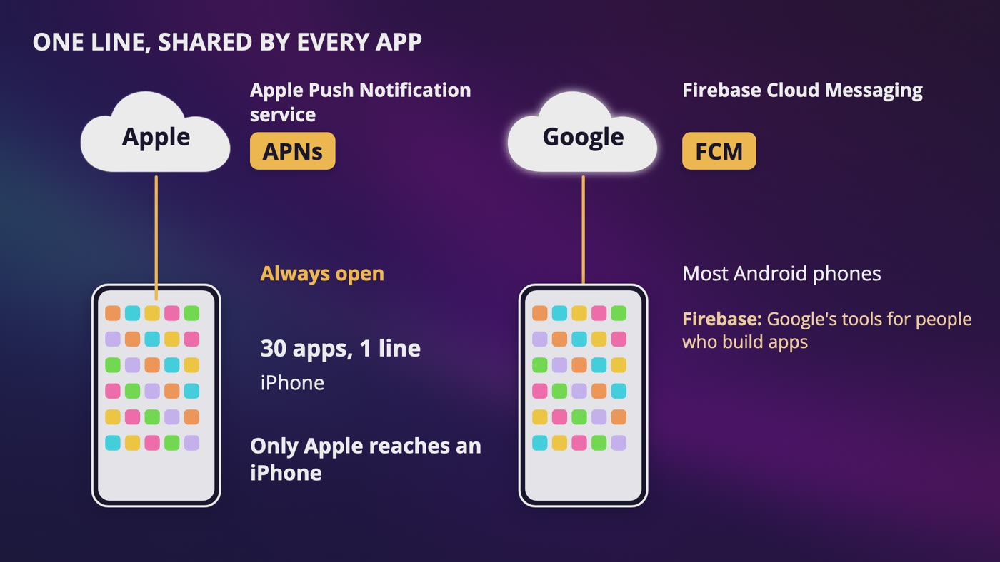
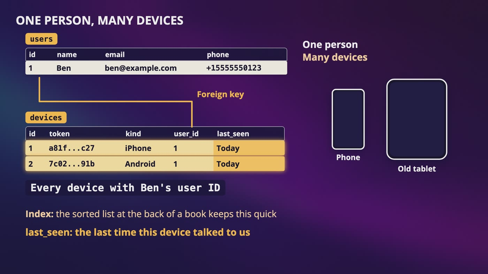
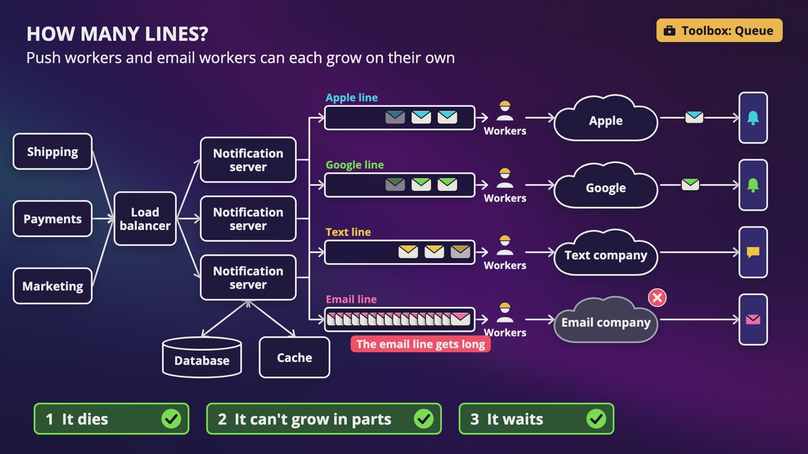
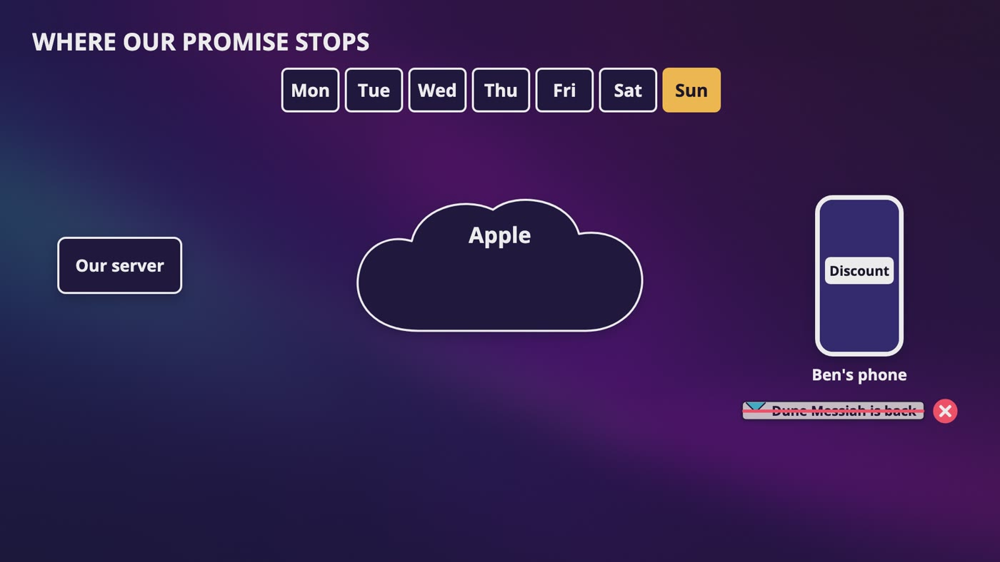
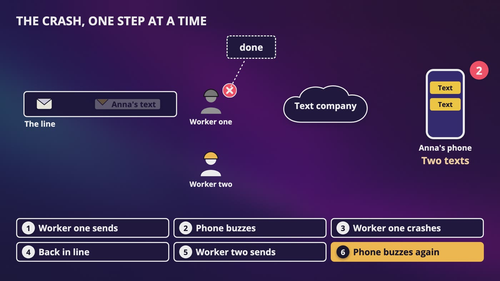
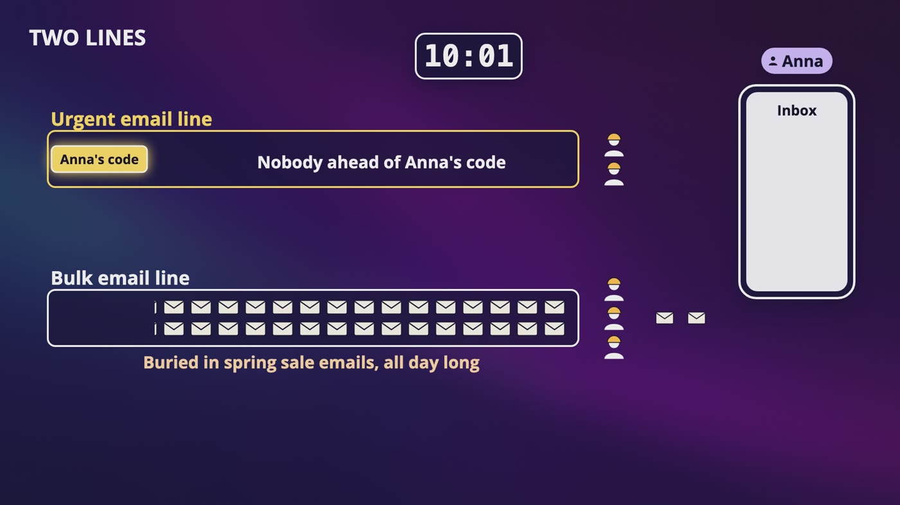
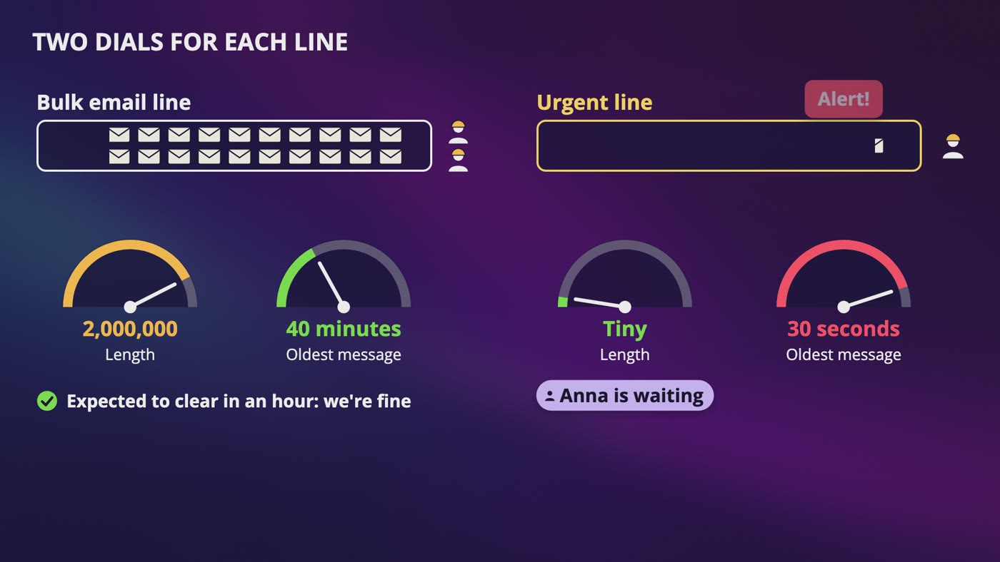

# [Chapter 10: Design Notification System](https://www.udemy.com/course/system-design-zero-to-hero/?referralCode=183D59A1EBE9E71D26FF)

_Ben taps one small button, and some day next week we have to make his phone buzz, even with our app closed._

[Download as PDF](../pdf/System-Design-Chapter-10-Notes.pdf)

## Contents

1. [Notification System: What Are We Building?](#1-notification-system-what-are-we-building)
2. [How a Message Reaches a Phone](#2-how-a-message-reaches-a-phone)
3. [Who Do We Send It To?](#3-who-do-we-send-it-to)
4. [The First Design, and What Breaks](#4-the-first-design-and-what-breaks)
5. [Can We Promise Never Lost?](#5-can-we-promise-never-lost)
6. [Can We Promise Only Once?](#6-can-we-promise-only-once)
7. [Not Every Notification Is Equal](#7-not-every-notification-is-equal)
8. [Watching It Work, and Your Interview](#8-watching-it-work-and-your-interview)

## 1. Notification System: What Are We Building?

> **The big idea:** Almost everything we've built so far waits for someone to ask. This time we start the conversation, and traffic comes in huge bursts.

_Marketing presses one button, so the average of 58 emails a second becomes 1,400 or even 8,300._

### Three messages we follow

- **Ben's push:** Dune Messiah is back in stock. It only works if he has the app.
- **Anna's text:** her book has shipped. A text goes over the phone network, so she doesn't need our app.
- **A marketing email:** a spring sale, going out to 5 million people.
- In the middle of that email, Anna forgets her password and asks for a reset code. That collision is what makes this design real.

### What each answer did

- **"Soon, and a little late is okay"** is soft real time, so messages can wait in line for a moment.
- **What sets it off:** shipping and payments call us, so we need an API. Scheduled messages need a cron job.
- **People can say no,** so we check what they want before every single send.

### The numbers

- 10 million pushes + 1 million texts + 5 million emails = **16 million messages a day**.
- That's about 185 a second: about 116 pushes, 12 texts and 58 emails.
- All 5 million emails in 1 hour is about **1,400 a second**. In 10 minutes it's about **8,300 a second**, more than 100 times the average.
- A small record of each message, at about 1 KB (our own guess), is 16 GB a day and about 5.8 TB a year. Storage isn't what makes this hard.

### Two honest surprises

- You might hear that a notification system should never lose a message, and should send each one exactly once.
- We're going to find out that we can't fully promise either of them.

> **In your interview:** Say out loud that the average is lying, because traffic comes in huge bursts. A lot of people stop at the average.

> **In the real world:** Twilio's public price for a US text was a bit over 1 cent in October 2026, once you add the phone company's fee. So 1 million texts a day is more than $10,000 a day, and that's why you can't just retry texts carelessly.

**New terms**

| Term | Meaning |
|---|---|
| **Notification** | A message we send to a person, without them asking for it at that moment. |
| **Push notification** | A little message that pops up on your screen from an app, even when the app is closed. |
| **SMS** | Short message service. A text message, sent over the phone network to a phone number. |
| **Soft real time** | We try to be quick, and nothing is broken if we're a few seconds behind. |
| **Cron job** | A program set to run on a schedule, like the alarm on your phone. |
| **Twilio** | A company that businesses pay to send texts for them. |

## 2. How a Message Reaches a Phone

> **The big idea:** We can't make Ben's phone buzz ourselves. We don't deliver anything, we hand off to a courier.

_A phone keeps 1 open line, shared by all its apps. Apple runs it for iPhones, and Google for most Android phones._

### We can't knock on his phone

- A phone moves between networks and goes to sleep, so there's no address to knock on. And if the app kept asking our server, Google's Android docs say separate connections from each app can drain the battery quickly.
- So a phone keeps **one line open to one service**, and every app shares it. Only Apple can reach an iPhone. On most Android phones, that's Google's job.

### The address and the package

- **The address** is a device token. It tells us nothing about Ben, and only means something to the courier. A token belongs to one app on one device.
- **The package** is the payload, written in JSON: who it's to, a title, a body, and a link to open when he taps.
- Both couriers limit it to about 4 KB, so a push is a short note and not the whole page.

### Proving who we are

- **Apple** gives two choices: a certificate, or a signed pass we make with a secret key. Apple's docs say to make a new pass at least once an hour.
- **Google** uses a short-lived pass from OAuth. Its older way, with one long-lasting key, was shut down in 2024.

### Texts and email

- We don't own a phone network, so we pay a third party, like Twilio or Vonage (Nexmo in older material).
- A basic text holds **160 characters**, or 70 with a single emoji. Over the limit, it's split into pieces, and Twilio charges per piece.
- Anna's long link is 154 characters, so her shipping text is over 200 characters and we pay twice. With our short link, the whole thing is 68.
- Email goes through a company like SendGrid, part of Twilio since 2019. Sending is easy. The hard part is the inbox, because services like Gmail decide whether to trust you, based on rules and your history.
- Web browsers can show push too, and on iPhones since iOS 16.4 it works for web apps added to the home screen. Mention it and move on.

> **In your interview:** If you draw an arrow from your server straight to a phone, your interviewer is going to notice, so draw the courier in the middle. And just say that we use short-lived credentials.

> **In the real world:** Google's service needs Google Play services on the phone, and a lot of phones sold in China don't have it, so companies there use other push services. That's a good reason not to tie your whole design to one courier.

**New terms**

| Term | Meaning |
|---|---|
| **APNs** | Apple Push Notification service. The service that delivers messages to iPhones. |
| **FCM** | Firebase Cloud Messaging. Firebase is Google's set of tools for people who build apps, and this is the part that delivers messages. |
| **Device token** | A long string of letters and numbers that Apple or Google gives to our app on a phone. A delivery address only the courier understands. |
| **Payload** | The actual content that we're sending. |
| **Authentication** | Proving who you are. |
| **Certificate** | Like an ID card for our server. |
| **OAuth** | A standard, and a common way to get a temporary pass instead of handing over your real secret. |
| **Google Play services** | Google's own software that comes on most Android phones. |
| **Third party** | Someone outside of our company doing part of our job. |

## 3. Who Do We Send It To?

> **The big idea:** One person has many devices, tokens die, and settings go by kind of message, not only by channel.

_Ben has 1 row in users and 1 row in devices for each device. The user ID links them, and last\_seen shows the last contact._

| Table | What each row has | Why |
|---|---|---|
| Users | ID, name, email, phone number | Who we're reaching |
| Devices | ID, token, kind of device, user ID, last seen | One person can have many devices. The kind tells us which courier to use. |
| Settings | User ID, category, channel, allowed or not | Ben wants a text when his order ships, and no text about a discount. |
| Waiting list | Book ID, user ID | When Dune Messiah comes back, this is how Ben gets found at all. |

### Getting the address

- A phone won't show our notifications just because we'd like it to. On Android 13 and newer, a new app has them off until the person says yes, and on an iPhone you have to ask as well.
- You only really get one good chance. Apple's docs recommend asking when people can see the reason, and Ben tapping "tell me when it's back" is a perfect moment.
- Our app asks Apple for a token, then sends it to our server along with who Ben is.

### A phone number isn't a number

- Store it as an integer, and the plus sign and any zero at the start are gone. Now it's a different phone number.
- So we store it as text, in the standard format called **E.164**.

### When the address goes stale

- Ben buys a new phone, and gets a new token. Our app should send its token **every time it starts**, because Apple tells you to ask on each launch.
- Now he has two rows. We send to both, and the old one comes back with a status code: **410** from Apple, or **404** with "unregistered" from Google. So we delete that row.
- If we never clean up, we waste work and our numbers lie. 10 million pushes might really be 8 million.
- Don't only wait for those answers, because an Apple engineer has written that a 410 can come back with a delay, on purpose. Google's docs treat a device that hasn't connected for over a month as stale, and suggest a job that regularly removes old rows.
- If Ben signs out on that old tablet, remove the token, or his notifications keep showing up on a device someone else might be holding.

> **In your interview:** These tables are something an interviewer could easily ask you to sketch. Know the three big ideas. You don't need the exact error words, because saying that the courier tells you when a token is dead is enough. Storing the phone number as text is a really nice detail to mention.

**New terms**

| Term | Meaning |
|---|---|
| **Foreign key** | A column that points to a row in another table. |
| **E.164** | The standard phone number format: a plus, a country code, then the rest of the number, with at most 15 digits. |

## 4. The First Design, and What Breaks

> **The big idea:** A simple design breaks three ways: it dies, it can't grow in parts, and it waits. Queues, one for each courier, are the real answer.

_Each courier has its own line and workers. When the email company has a terrible afternoon, only the email line gets long._

### The first version

- Shipping, payments and marketing all call one notification server. It looks things up in the database, then calls the couriers.
- If our store sent 100 messages a day, this would be fine. Think of one person at a small post office, who does everything. That's fine until the holidays.

### Three ways it breaks

- **It dies:** one server is a single point of failure. Anna's shipping text and every password code just don't happen.
- **It can't grow in parts:** if push needs more power, you can't give more to only push, because it's all one program on one machine.
- **It waits:** say each call to the email company takes 2 seconds instead of a tenth of a second, and 5 million emails arrive. Everything ends up stuck, and Anna's text is stuck behind them, even though the texting company is fine.

### Fixing them

- Move the database and a cache onto their own machines. We keep asking for the same tokens and settings, so a cache helps a lot.
- Add more stateless notification servers behind a load balancer. If one dies, the others carry on.
- More servers would just give us more people stuck on the phone. So our server **drops the message in a queue and it's done**, and workers call the couriers.
- Now 8,300 emails a second can arrive and nothing falls over, because they wait in line. If the line gets long, add workers.
- One big line would make texts wait behind stuck emails, so we give **each courier its own line and workers**: Apple, Google, texts and email. Push and email workers can also grow on their own.

### Anna's shipping text

- Shipping calls our API. It doesn't mention a phone number, or that this is a text, because that isn't shipping's job.
- Our server does four things: checks who's asking, checks that the message makes sense, looks up the details (cache first), and puts the message in the text line.
- Then it tells shipping "got it". That means we've accepted it, not that Anna has it.
- A worker sends it to our texting company, the company hands it to Anna's phone company, and her phone buzzes.

> **In your interview:** Draw this exact path and say why each piece is there. Why one queue per courier? So one bad courier can't hold up the others. Why a queue at all? Don't only say it's for scale. Say that traffic comes in bursts, and that a slow courier shouldn't hold up our whole store.

**New terms**

| Term | Meaning |
|---|---|
| **Worker** | A program that takes jobs from a queue and does them. |

## 5. Can We Promise Never Lost?

> **The big idea:** We can't promise never lost. We can promise that we won't lose it before we hand it over. After that, it's out of our hands.

_Ben's phone was off all week. Apple kept only the latest notification, so he gets the discount, and Dune Messiah is back is gone._

| Where | What can happen | What we do |
|---|---|---|
| Before the queue | Our server crashes before putting it in line | Only say got it once it's safely in the queue, so the caller can try again |
| In the queue | A machine dies | Keep copies on other machines |
| The worker | A worker takes it and crashes | The worker only borrows it, and says done after the courier accepts it. If not, it goes back in line |
| The courier | Apple or Google drops it | Nothing. It's out of our hands |
| The phone | It's off, notifications are off, or nobody looks | Nothing. It's out of our hands |

### Where our promise stops

- Keep a log of what happened to each message, like a diary. It lets you answer "I never got my text", and resend things later if you have to.
- Apple's docs call its service **best effort**. When a phone is offline, Apple stores only one notification per app, for up to 30 days, and in most cases it's the latest one.
- Google can keep more than one, by default for up to 4 weeks. If an Android phone hasn't connected for more than a month, Google accepts the message and throws it away.

### When it really has to arrive

- You need a second path, so design for it not arriving.
- **Ben:** when he opens our app, it asks our server what he missed. That small inbox doesn't depend on any courier.
- **Anna:** show a button that says "didn't get it, send again, or try another way".

### Trying again

- **The wrong way:** 10,000 messages fail and all try again right away. That's a retry storm, and it can keep something down that would have recovered.
- **Exponential backoff:** wait longer each time, like 1, 2, 4, 8 and 16 seconds, which is 31 seconds across 5 tries. That only shows the shape. Apple's docs say to wait 15 minutes before retrying its server errors, and Google's say at least 10 seconds.
- **Jitter:** if all 10,000 come back together, they arrive in waves. Have each one wait a random time up to 16 seconds, and you get roughly 600 a second.
- **A limit:** after enough tries, the message moves to a dead letter queue, and an alert goes off when that line starts growing.

### Don't retry everything

- **Starts with a 5:** it's their problem, so wait and try again.
- **429:** slow down. This time, we're the polite ones.
- **410 or unregistered:** the address is dead, so delete the token and stop.
- Be extra careful with texts, because retrying might mean paying twice.

> **In your interview:** Asked how you make sure nothing gets lost, walk those 5 spots and say where your guarantee ends. Then say backoff, randomness, a limit and a dead letter queue. Those 4 words cover most of this.

**New terms**

| Term | Meaning |
|---|---|
| **Retry storm** | Everything that failed tries again at once, so a struggling service gets way more traffic than usual. |
| **Jitter** | A little randomness added to a wait, so that retries don't all come back together. |
| **Dead letter queue** | A separate line for messages we gave up on, so they don't block anyone, and a person can look at them. |

## 6. Can We Promise Only Once?

> **The big idea:** When you never heard back, you can't know. So we call it what it is, at least once with duplicates handled, and we pick each mistake by what it costs.

_Worker one sends the text, then crashes before saying done. It goes back in line, worker two sends it, and Anna gets 2 texts._

| Message | If it comes twice | If it's lost | So |
|---|---|---|---|
| Discount email | A little annoying | No big deal | Save first |
| Payment text | Scary: Anna thinks we charged her twice | Her receipt is still in her account | Save first |
| Password code | Who cares | She's locked out | Send first, accept a duplicate |

### The parcel

- You mail a present, and ask your friend to text you when it arrives. A week goes by, and you've heard nothing.
- Maybe it got lost, or maybe your friend forgot to text. From where you're standing, those look exactly the same.
- Send another, and maybe they get two. Send nothing, and maybe they get none. There's no third button, because you can't see their door.

### The crash, one step at a time

- Worker one sends Anna's text, her phone buzzes, and worker one crashes right before it says done.
- The message goes back in line, worker two sends it, and she has two texts.
- Write it down first? If we crash between writing and sending, the diary says sent, nobody retries, and Anna gets nothing. One order can give you 2, the other can give you 0.

### An ID for the event

- Shipping includes an **event ID**, made once by the caller. It can be a UUID. If anyone tries again, it's the same ID.
- Looking it up is quick, even with millions of them. It's our wall of numbered hooks.
- But check and then write has a bug. Two workers both ask "have we seen this?", both hear no, and both send. That's the race from our rate limiter.
- So we do one **atomic** step: save this ID only if it isn't there yet, and tell me whether that worked. Use the uniqueness rule in a database, or the NX option on Redis's save command.
- Each ID gets an expiry, say 1 day. At about 100 bytes each (our own guess), 16 million a day is about 1.6 GB.

### One more hole

- Save the ID and crash before sending, and the next worker skips it, so that message is lost.
- **Save first** means you might lose it. **Send first** means you might send it twice. Pick the mistake based on what it costs, for each kind of message.

> **In your interview:** Say why exactly once can't be promised, in your own words, using something like the parcel. Then say at least once, with duplicates handled: the event ID, the race, the one atomic step, and the expiry. If you can say which failure you'd choose for a password code, and why, that's a really good answer.

**New terms**

| Term | Meaning |
|---|---|
| **At least once** | We keep trying until we know a message was accepted, so it might arrive more than once. |
| **Event ID** | One ID for this one thing that happened, so that every retry carries the same ID. |
| **Collapse ID** | If you send a notification with one, Apple can merge it with an earlier one that has the same ID. Google has something similar. It won't help with a text. |

## 7. Not Every Notification Is Equal

> **The big idea:** One line per courier isn't enough. Split urgent from bulk, so that a marketing blast can't delay a password code.

_Anna's code goes in the urgent line with nobody ahead of it, while the bulk workers stay buried in spring sale emails._

### The collision (made-up numbers)

- **10:00:** marketing sends 5 million emails. At about 1,400 a second, the line takes about an hour.
- **10:01:** Anna asks for a password code, and it goes to the very back. It stops working at 10:11.
- **About 11:00:** it reaches the front, about 50 minutes too late. Every line is healthy, nothing is lost, and we have a really upset customer.

### Two lines

- Remember the emergency room from our crawler chapter. Each courier gets an **urgent line** and a **bulk line**, with their own workers.
- Now Anna's code goes out in a second or two. The urgent workers sit around doing very little most of the time, and that's worth paying for.
- **Every message gets an expiry.** Before sending, the worker looks at the clock. If the time has passed, it throws the message away and writes that in the log.

### Respecting people

- **Check settings twice** for the bulk line. Ben unsubscribes at 10:05 with his email still in line, and shouldn't get it.
- **Quiet hours:** save each person's time zone and hours, like 10 at night to 8 in the morning. Hold a marketing message until morning. A password code still goes out at 3 in the morning, because you're the one waiting for it.
- **Frequency cap:** a counter in Redis with an expiry, just like our rate limiter. But that protected our servers, and this protects a person's patience. It never holds back a password code.

### Templates

- Shipping just sends the name of the template and the blanks. You only translate or fix a typo once, and marketing can change the words without an engineer.

### Permission and the law

- Since February 2024, Gmail and Yahoo have rules for bulk senders. Google draws the line at 5,000 messages a day to Gmail, so our spring sale is way over it.
- You set up three checks, offer one-click unsubscribe on marketing emails, and Google wants your spam rate under 0.3%.
- Texts have rules too, and the US law on commercial email separates ads from messages about something a person already bought. None of this is legal advice, so check with a lawyer. An engineer needs to know it exists, and that the design has room for it.

> **In your interview:** Bring up priority before they ask. Just say, I wouldn't want a marketing blast to delay a password code, so I'd separate urgent and bulk. A lot of designs have one line per courier and stop there. And know the expiry, the settings check, and how a frequency cap is different from our rate limiter.

> **In the real world:** Google's email guidelines say to give each kind of message its own From address, so that a receipt and a promotion don't look the same, and to send at a steady rate instead of in bursts.

**New terms**

| Term | Meaning |
|---|---|
| **Expiry** | A time after which a message isn't worth sending. |
| **Frequency cap** | A limit on how many messages of a certain kind one person gets in a day or a week. |
| **Template** | A message with blanks in it, filled in at the last moment. |
| **SPF, DKIM and DMARC** | Three checks that prove an email really came from your domain, so nobody can pretend to be you. |
| **One-click unsubscribe** | Someone can leave a mailing list with a single click, without logging in. |

## 8. Watching It Work, and Your Interview

> **The big idea:** Before the handoff, we know for sure. After it, we only know what somebody tells us. To stay healthy, watch how old the oldest message in each line is.

_Two dials for each line: 2,000,000 in the bulk line at 40 minutes is fine, but 30 seconds in the urgent line sets off an alert._

| Step | Time | What you do |
|---|---|---|
| Understand | 3 to 10 min | Ask which kinds, how fast, which devices, what sets them off, whether people can say no, and how many. Do the math, and say the average lies. |
| High level | 10 to 15 min | Draw the couriers first, then the simple version. Say why it breaks, and add the lines. |
| Deep dive | 10 to 25 min | Go to what you agreed on. If nobody picks, start with where our promise ends, and then priority. |
| Wrap up | 3 to 5 min | Wrap up with monitoring. |

### The life of a message

- Created, in line, handed to the courier. It could also end up expired, or in the dead letter line. Then it might be delivered, opened and clicked.
- **Delivered** often means handed over. When Apple says okay, it only accepted the message. If your app really needs to know, it has to report back when the push arrives.
- **Opened** is even trickier. Senders use a tracking pixel, but Apple's Mail Privacy Protection downloads those images in the background, so a lot of opens aren't real.
- **Clicks** are a better signal, because a tapped link comes back to us.

### Watching the lines

- If you only measure two things, pick how long each line is and how old its oldest message is.
- 2 million in the bulk line during our sale is normal. If the oldest is 40 minutes old, in a line expected to clear in an hour, we're fine.
- If the oldest message in the urgent line is 30 seconds old, somebody should be getting an alert, because Anna is waiting.
- When a line falls behind, add workers. When it's quiet, remove some and save money.

### The whole design

- Shipping, payments and marketing call our API, through a load balancer, to stateless notification servers.
- Each server checks who's asking and looks up tokens and settings, with a cache in front of the database.
- It drops the message in a line, one for each courier, split into urgent and bulk.
- Workers check the expiry, the settings, and the atomic save of the event ID, then call the courier. They use backoff and randomness on failure, and a dead letter line when they give up.
- Everything goes in the log, and we watch the age of every line.

### The hints

- **Apple goes down?** Only that line grows, and you back off with randomness.
- **Can you guarantee delivery?** Only up to the handoff. Anything that must arrive needs a second path.
- **Same message twice?** We're at least once, so an event ID with one atomic step, and an expiry.
- **A blast and a password code at once?** Urgent and bulk lines, and an expiry on every message.
- **A new phone?** The app sends its token at every start, and the courier tells you when an old one is dead.

### What to know

- **Really well:** we hand off to couriers, and why. Why we have queues. Where the promise ends. At least once and the event ID. Urgent against bulk.
- **For a sentence:** backoff and randomness, dead letter queues, stale tokens, settings by kind of message, frequency caps, and why opens can't be trusted.
- **Just to recognize:** the exact error codes, the three email checks, Apple's signed pass, and collapse IDs.

### Back to Ben

- He's in line for coffee when a box is scanned and Dune Messiah goes from 0 to 12. Our server finds him on the waiting list, checks his settings, finds his new phone's token, and a worker hands one small package to Apple.
- His phone buzzes. It says Dune Messiah is back, he smiles, and he taps it.

> **In your interview:** It's a really nice touch to say that open rates aren't reliable anymore, and that you'd look at clicks.

> **In the real world:** Since 2021, Apple has had Mail Privacy Protection. If it's on, opens can look wonderful for no reason. Google's docs also split a message being accepted from being received on the device, and that second one only exists in certain cases.

**New terms**

| Term | Meaning |
|---|---|
| **Tracking pixel** | A tiny invisible image in an email. When your mail app loads it, the sender finds out. |
| **Mail Privacy Protection** | Apple's feature to stop senders from learning when you read things. It downloads those images in the background, whether or not you open the email. |

## Recap: How our notification system grew

_We don't deliver anything, we hand off._

| Every piece solved a real problem | |
|---|---|
| **Couriers** | We can't reach a phone ourselves |
| **Devices table** | One person has many devices |
| **Last seen** | Tokens die |
| **Settings by kind** | One switch per channel isn't enough |
| **Stateless servers** | One server died and took everything |
| **One line per courier** | Bursts, and a slow courier held up everyone |
| **Acknowledgment** | A worker could crash holding a message |
| **Backoff and randomness** | Retries came back in a storm |
| **Dead letter queue** | We can't try forever |
| **Event ID** | At least once can send duplicates |
| **Urgent and bulk lines** | A blast buried a password code |
| **Expiry** | A dead code is useless |
| **Frequency cap** | People have limited patience |
| **Age of the oldest message** | We'd never know if it stopped |

**What to know really well**

- We hand off to couriers, and why
- Why we have queues: the burst and the slow courier
- Where the promise ends
- At least once, and the event ID
- Urgent against bulk

---

From the course **[System Design: Zero to Interview Hero](https://www.udemy.com/course/system-design-zero-to-hero/?referralCode=183D59A1EBE9E71D26FF)** by Nata Vacheishvili.
