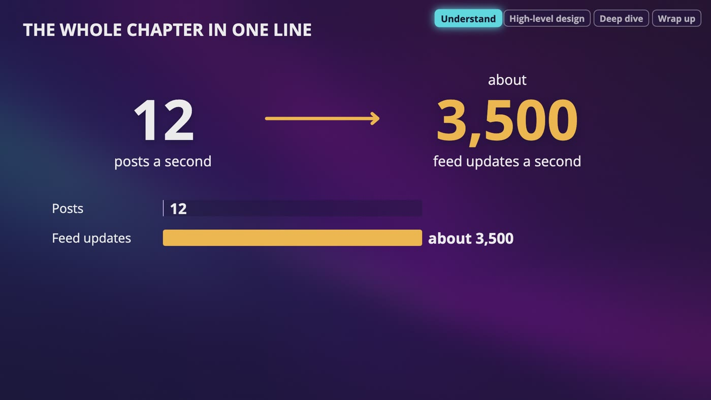
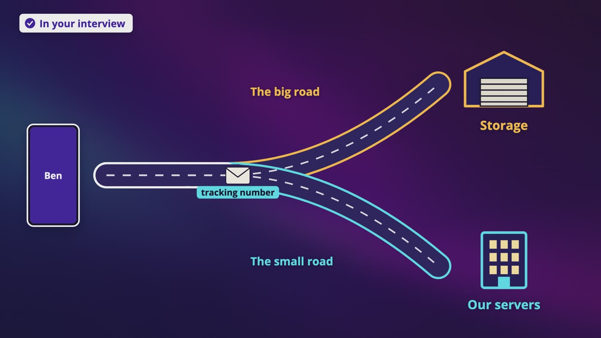
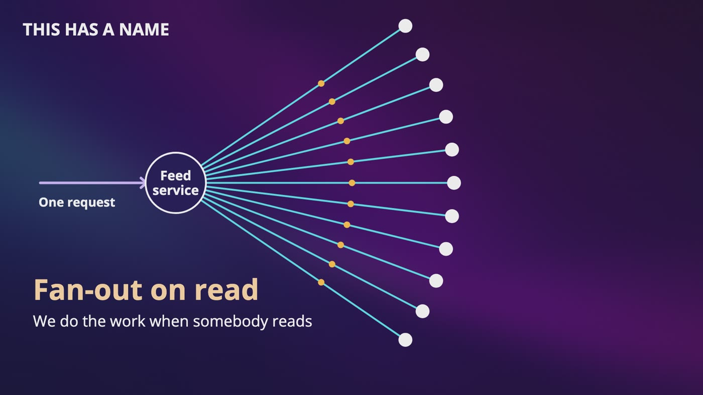
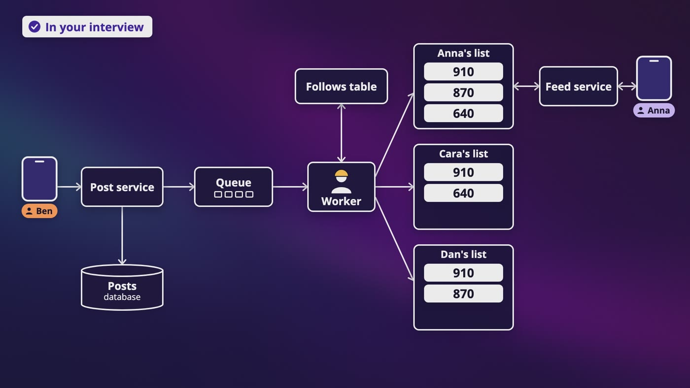
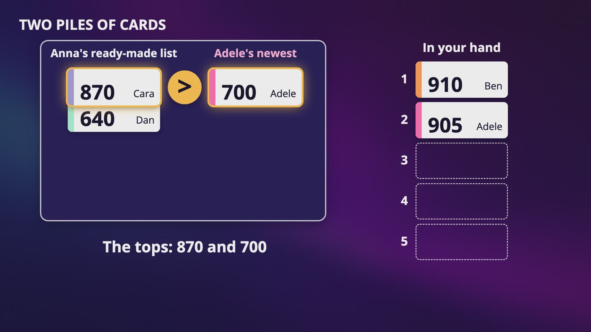
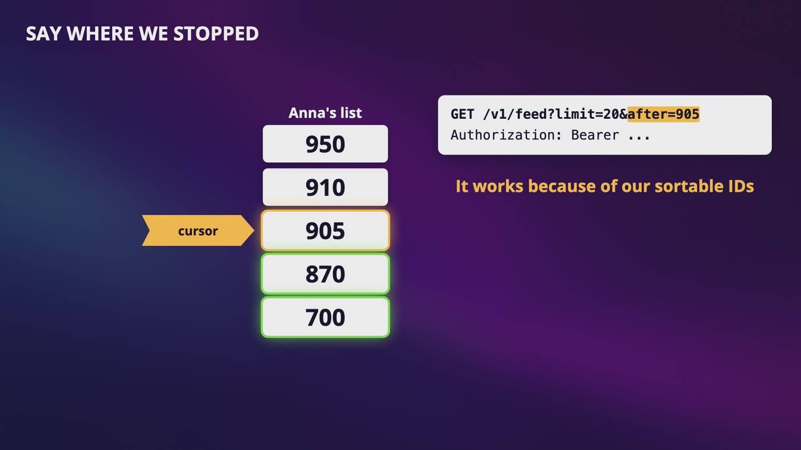
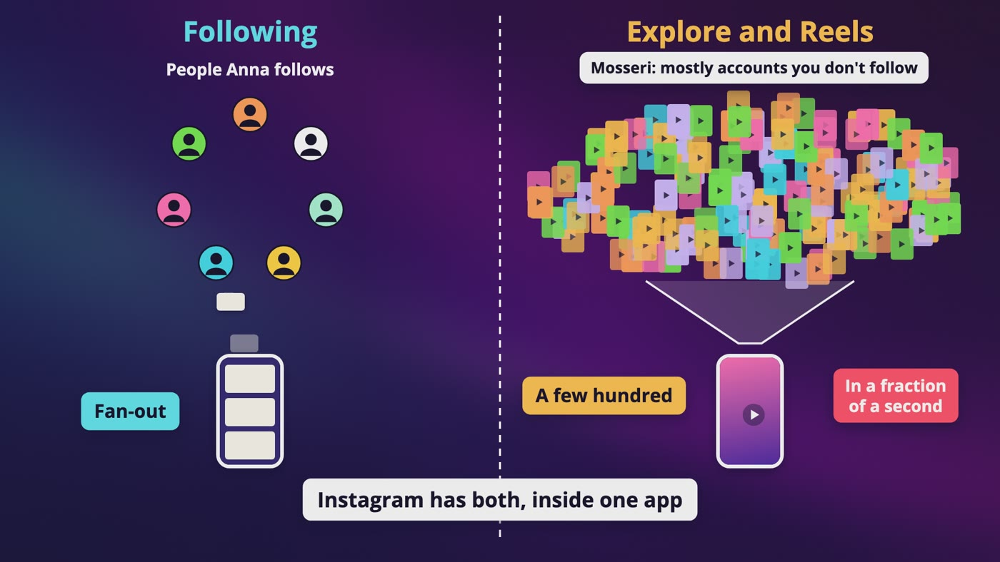
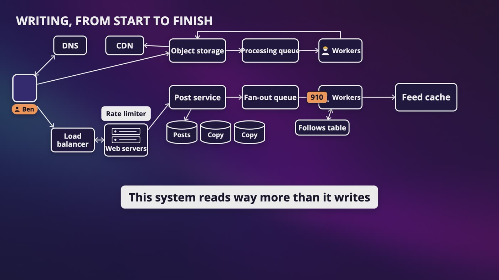

# Chapter 11: Design Instagram's Feed

_Ben posts one photo, and we work out how it reaches everyone who follows him, even when the person posting is Adele._

[Download as PDF](../pdf/System-Design-Chapter-11-Notes.pdf)

## Contents

1. [Design Instagram's Feed: What Are We Building?](#1-design-instagrams-feed-what-are-we-building)
2. [Posting a Photo](#2-posting-a-photo)
3. [Option One: Build It When You Open the App](#3-option-one-build-it-when-you-open-the-app)
4. [Option Two: Build It When Someone Posts](#4-option-two-build-it-when-someone-posts)
5. [When Adele Posts](#5-when-adele-posts)
6. [What's Actually in the Feed?](#6-whats-actually-in-the-feed)
7. [Not Just Newest First: Ranking and TikTok](#7-not-just-newest-first-ranking-and-tiktok)
8. [The Whole Instagram Feed Design, for Your Interview](#8-the-whole-instagram-feed-design-for-your-interview)

## 1. Design Instagram's Feed: What Are We Building?

> **The big idea:** One post isn't one thing. Friends or followers, and newest first or ranked, are the two answers that reshape the whole design.

_The whole chapter in one line: 12 posts a second turn into about 3,500 feed updates a second._

### The moment we're designing

- Ben takes a photo of Dune Messiah and taps post. Across town, Anna opens the app, and his photo is sitting there in front of her.
- We're designing something like Instagram, for an interview. When something is how Instagram really works, it's because the company said so itself.

### What each answer did

- **Followers** is the big one. With friends, both people say yes, so a friend list stays a human size. Following takes one tap, so it's lopsided: Instagram's follow limit is in the thousands, and the biggest accounts have hundreds of millions of followers.
- **Newest first** is a nice simple place to start, but it isn't really true anymore, and it changes the design.
- **Photos and videos** mean we have big files to deal with.
- **Phones and web** mostly means one API that both can call.

### The numbers (our own assumptions, not Instagram's)

- 10 million daily active users, and the average person has 300 followers.
- 1 in 10 people posts once a day: 1 million posts a day, or **about 12 a second**.
- Each person opens their feed 10 times a day: 100 million feed loads a day, or **about 1,160 a second**.
- Each post reaches 300 people: 300 million updates a day, or **about 3,500 a second**. And that's only the average person, before Adele.
- This is an average, and busy moments might be about double.

> **In your interview:** Don't skip these questions, even if you've seen this design 10 times. Ask friends or followers, and newest first or ranked, first. Then do that multiplication out loud, so your interviewer hears you notice that one post isn't really one post.

> **In the real world:** Instagram stopped showing a simple newest first feed in 2016, and it's a choice you have to go looking for now. Facebook used to call its version the News Feed, and renamed it to just Feed in 2022, so you might hear this question either way.

**New terms**

| Term | Meaning |
|---|---|
| **Feed** | The list you scroll when you open the app. It's different for every person, because it's built from the people they follow. |
| **Reverse chronological** | The formal name for newest first. |

## 2. Posting a Photo

> **The big idea:** A photo and a post are so different that they shouldn't travel the same way. The phone sends the photo straight to storage, and our servers only handle the note.

_The photo takes the big road to storage, and a small note with a tracking number takes the small road to our servers._

### Two very different things

- The photo is about 2 MB (our own guess), and the post is about 1 KB: who posted, the caption and the time. At 1 million posts a day, that's about 2 TB of photos and about 1 GB of posts.
- If Ben's upload takes 20 seconds, one of our servers holds on to him that whole time, mostly just waiting.
- Think of mailing a big package to a company. You drop the box at the shipping depot, and send the office a short note with the tracking number.

### First, who is this?

- When Ben logged in, our server gave his app an **auth token**, and his phone sends it with every request, in a header called Authorization.
- Don't mix it up with the device token. That one was an address for the courier, and this one is Ben's ID card.
- Don't put it in the web address. OWASP says a secret in a web address can end up in browser history and server logs, and that HTTPS doesn't fix it.
- The caption goes in the body of a POST. Our rate limiter sits at the front door, so nobody can post 1,000 times a minute.

### The big road

- The phone asks to upload a photo. Our server doesn't take it. It gives back a place to put it, in **object storage**.
- We can't give our storage password to every phone. So our server asks for a **pre-signed URL**, which allows one upload, of one file, for a limited time.
- Isn't that a secret in a web address? Yes, and Amazon's docs say anyone holding one can use it. The difference is that it only does one small thing, and it expires quickly. An auth token is Ben's whole account.

### Making it smaller

- Nobody wants to download 2 MB for a tiny picture in a list. So we drop a job in a queue, and a worker makes each size and saves it back to storage.
- When Anna looks at the photo, it comes from a CDN.

### The small road

- The phone sends a POST to our post service, with the auth token in the header, and the caption and file in the body.
- The service saves a row with a sortable ID, so a newer post has a bigger number. We pretend Ben's post is number 910.
- The row has a status, which starts as **processing** and turns to **ready** when the worker finishes. Otherwise, Anna could see a broken picture.
- A plain relational database is fine, split into shards by user, so that all of Ben's posts sit together.

> **In your interview:** Draw two roads. Interviewers could easily ask how you'd handle a big upload, and the answer is that the phone goes straight to storage with a short-lived address, then you process it, and the CDN serves it.

> **In the real world:** Instagram wrote in its early years that it looked at NoSQL options and chose to split its data across PostgreSQL servers. We can't say what it runs today, but it shows that boring can go a long way.

**New terms**

| Term | Meaning |
|---|---|
| **Auth token** | A long secret string our server gives an app at login, which basically says, this is Ben. |
| **Request body** | The part of a request that carries what you're sending. |
| **HTTPS** | The secure kind of web connection. |
| **OWASP** | A well known non-profit group for web security. |
| **Object storage** | A giant folder for files. You give it a file and a name, and later you ask for that name. An object is just a word for a file. It exists because it's way cheaper and easier than keeping billions of files in a database. |
| **Pre-signed URL** | Amazon's name for a special web address that lets someone upload without having their own credentials. |

## 3. Option One: Build It When You Open the App

> **The big idea:** Look everything up when Anna opens the app. It's simple and always fresh, but the work grows with how many people you follow.

_One request spreads out to many places, like a fan opening up. We do the work when somebody reads._

### Who does Anna follow?

- Imagine no newspaper in your town. Every morning, you walk to each friend's house and ask what's new.
- Anna and Ben are dots in a graph, with an arrow from Anna to Ben that only goes one way.
- You might read that you need a graph database, but don't overcomplicate this. We only ask who Anna follows and who follows Ben, so **a plain table with two columns** and an index on each does the job.

### Walking it (pretend post IDs)

- Anna follows Ben, Cara and Adele. The feed service looks them up.
- It asks each one for their newest posts: Ben has 910 and 610, Adele has 905 and 700, Cara has 870 and 650.
- It puts them in one pile and sorts by ID, biggest first, because a bigger ID means a newer post, roughly. Then it fills in the top few.
- So Anna sees Ben's photo on top.

### What's so nice about it

- It's simple, and always fresh because we looked just now.
- Nothing is wasted. If someone hasn't opened the app in a year, we do no work for them.
- **Adele is no problem.** When she posts, we save one row and that's it. Remember that, because it's going to save us in two videos.

### Now the math

- About 1,160 feed loads a second, times 300 accounts, is **about 350,000 lookups a second**. And we only get 12 posts a second.
- Even if you ask them all at the same moment, you can't answer until the slowest one comes back.
- Made-up example: 1 lookup in 100 is slow. With 3 lookups, the chance of hitting a slow one is about 3%. With 300, it's about 95%.
- Follow 5,000 accounts, and it's 5,000 lookups, every time you open the app.
- A cache helps, but it's still 300 trips, and you're still waiting on the slowest. We're doing the most work at the worst possible moment.

### So is it a bad design?

- No. For a small app, I'd build this and go home. The choice really depends on what you're building.

> **In your interview:** Say this one first, and then break it yourself. Say that it's simple and fresh and nothing's wasted, then say that it's slow at the wrong moment, and why. You want them to hear that you can see the cost without being told.

> **In the real world:** Facebook built TAO to answer who's connected to whom. A 2013 paper says it could handle a billion reads a second, with data stored in MySQL and a big cache in front, so even at that size, those were tables. It also says pages were so customized, with privacy checks for every viewer, that most of that work had to happen when someone looked.

**New terms**

| Term | Meaning |
|---|---|
| **Graph database** | A database built around dots and arrows. |
| **Fan-out** | One request or one thing spreading out to a lot of places, like a fan opening up. |
| **Fan-out on read** | Doing that spreading out when somebody reads. |

## 4. Option Two: Build It When Someone Posts

> **The big idea:** Do the work ahead of time, like a personal newspaper on your doorstep. Now the work grows with how many people follow you.

_Ben's post goes through a queue to a worker, which adds it to each follower's list. Anna then gets her list in 1 read._

|   | Option one: on read | Option two: on write |
|---|---|---|
| Like | Walking to each friend's house | A newspaper on your doorstep |
| Feed load | About 350,000 lookups a second | About 1,160 reads a second |
| When Ben posts | Save one row | About 3,500 writes a second |
| Work grows with | How many you follow | How many follow you |

### Anna's list

- Every person gets a waiting list of the newest posts from people they follow. We use a **sorted set**, and the score comes from the post ID.
- Anna's list has 870 and 640. We add 910, and it goes to the top. A late 700 slides in between. Add 910 again, and nothing changes.
- Each person gets one sorted set in Redis, with their newest 500 or so.
- This is a cache, so if Anna's list gets lost, we rebuild it from the database with option one.

### Walking it

- The post service saves number 910, drops one small message in a queue, and Ben is done.
- A worker asks the follows table who follows Ben (Anna, Cara and Dan), and adds 910 to each list.
- Anna opens the app, and the feed service does **one read**, with no slowest lookup to wait for.

### What it costs

- Say 30% of everybody's followers rarely open the app. That's 90 million writes a day nobody will read. So the worker skips anyone gone for over a month, and we build their list if they come back.

### When a worker crashes

- Cara has a book blog with 50,000 followers, and the worker crashes halfway. The message goes back in line and another worker takes it. That's at least once.
- Half those lists are about to get the same post again. But the post ID already is our event ID, and adding it to a sorted set again does nothing. Idempotency, for free.
- Split the job into pieces, say 1,000 followers per message, so a crash repeats one small piece.

> **In your interview:** Know this path really well: the post, the queue, the worker, each list, then that single read. Bring up the crash and the inactive followers before they do. Say that Anna might see Ben's post a few seconds late, which is fine for a feed.

> **In the real world:** A summary of a 2012 talk by an engineering leader at Twitter, which is now called X, says that only people who'd logged in within about a month had their timeline, its word for a feed, kept in memory.

**New terms**

| Term | Meaning |
|---|---|
| **Sorted set** | Like a set, so there are no duplicates, except each item has a number called a score, and everything stays in order of that number. |
| **Fan-out on write** | Doing the spreading out when somebody writes a post. |
| **Push model / pull model** | Other names for fan-out on write and fan-out on read. They have nothing to do with push notifications. |

## 5. When Adele Posts

> **The big idea:** We don't pick one, we use both. Most posts get written ahead of time, celebrity posts get fetched when you open the app, and we merge them by ID.

_Two piles with the biggest number on top. 910 and 905 are in hand, and now the tops are 870 and 700._

### The math

- Say Adele has 100 million followers. One photo is **100 million writes**.
- At 100,000 writes a second, that's 1,000 seconds, about 17 minutes. Even at 1 million a second, it's about 100 seconds, for one photo.
- And Ben posts right after her, so his post is stuck behind hers. Anna doesn't see her friend's photo because someone famous posted first.

### Doesn't consistent hashing fix this?

- No. Two different problems hide under the word celebrity.
- **One key read too much:** everyone wants Adele's post from the same place.
- **One account with too many followers to write to:** that's what we have here. Those 100 million lists are already spread out nicely, and we still have 100 million writes to do.

### Walking the hybrid

- Anna follows Ben, Cara, Dan and Adele. Adele is marked as a celebrity, one small yes or no column in our users table.
- **Writing:** Ben posts 910, and a worker puts it in Anna's list. Adele posts 905, and we save it and stop.
- **Reading:** Anna's list has 910, 870 and 640. The feed service asks which celebrities she follows, and fetches Adele's newest: 905 and 700.

### Merging two piles

- Look at the two top cards, take the bigger one, and do the same again.
- 910 beats 905. Then 905 beats 870. Then 870 beats 700. Then 700 beats 640, and 640 is last.
- If Anna wants 20 posts, we stop after 20 cards. The work grows with how many posts she wants, not how many exist.
- We can compare the numbers because of our sortable IDs. It's only roughly in order, and for a feed that's fine.

### Where do you draw the line?

- There isn't a right number, so you pick one and say what it costs. Say 100,000 followers, which is about 1 second of work.
- **Too low:** Anna might fetch from 50 accounts, and we're slowly turning back into option one.
- **Too high:** huge posts clog up our queue again.
- Start with a number, watch your queue and your reads, and move it.
- Millions asking for Adele's posts is that one popular key again, so her newest posts sit in a cache, with copies on several servers.

> **In your interview:** They are going to ask what happens when a celebrity posts. Say that one post would become millions of writes, so you don't fan out for those accounts, you fetch their posts when someone opens the app, and you merge them with the ready-made list, by ID. Then say where you'd draw the line, and what it costs on each side. Practice drawing those two piles with a pen.

> **In the real world:** That summary of the Twitter talk says a tweet from an account with about 31 million followers could take up to 5 minutes to reach everyone, and that Twitter stopped fanning out for its biggest accounts, merging them in when someone read their timeline. We haven't seen Instagram say what it does here, so don't claim that in your interview.

**New terms**

| Term | Meaning |
|---|---|
| **Hybrid** | Most people's posts get written ahead of time, and celebrity posts get fetched when you open the app. |
| **Merging** | Making two lists that are already in order into one, by repeatedly comparing the two top items. |

## 6. What's Actually in the Feed?

> **The big idea:** The list holds only IDs. We fill in the rest when someone reads, check again that each post can be shown, and scroll with a cursor.

_Anna's phone says give me posts after 905, which is the cursor. New posts on top, like 950, don't change the answer._

### Why only numbers?

- 500 posts x 8 bytes x 10 million people is 40 GB. Add who posted each one, so we can skip people Anna has blocked, and it's **80 GB**. That fits in memory.
- The whole post, at about 1 KB, would be **5 TB**. That's more than 60 times bigger, in the expensive kind of storage.
- And if Ben fixes a typo, there's only one real copy to change, not 300.

### Filling it in

- Anna's feed is a form with only IDs on it. We ask for the post (caption and file), the user (Ben's name and picture), and the counts (1,200 likes and 9 comments).
- The photo's address points at the CDN, so her phone gets the picture itself.
- Each lookup is quick because it's by exact ID, and you can ask for all 20 posts in one trip. These sit in a cache, and if something's missing, we go to the database.

### When a post is gone

- Ben deletes his post, or Anna blocks or unfollows him. It's still sitting in her list, and nobody's going to go through it.
- So **you check again when you read**. You might start with 20 IDs and end up with 18 posts, and you can grab a couple more.
- Settings are checked at fan-out to save work, and checked again here to be correct.

### Scrolling

- Pagination with an offset worked for books, so let's try it. Anna's list is 910, 905, 870, 700, and she gets 910 and 905.
- Someone posts 950, and it goes on top. Now skip 2 gives her 905 and 870, so she sees 905 for the second time.
- So we stop saying how many to skip, and say where we stopped: give me 2 posts after 905. The answer is 870 and 700, whatever landed on top.
- It works because of our sortable IDs. After 905 means every ID smaller than it.

### Different speeds

- Posts, users and counts are cached apart, because they change at really different speeds. A caption almost never changes. A like count changes every second on a popular post.
- A like count doesn't have to be exact. That's eventual consistency, so we can count likes in memory and write them down in batches.

> **In your interview:** Say cursor, and tell them why page numbers break, with that example. Your interviewer could also ask about deletes. The answer is that you check again when you fill in the post.

**New terms**

| Term | Meaning |
|---|---|
| **Hydration** | A funny word for filling in the rest. You start with something dry, only the numbers, and you add everything else. |
| **Cursor** | A little marker that says where we stopped, so that new posts on top don't shift the page. |
| **Thundering herd** | Adele's post expires from the cache, thousands of people ask for it, and they all go to the database at once. A common fix is to let one request go get it, while everyone else waits a moment. You probably won't get asked this. |

## 7. Not Just Newest First: Ranking and TikTok

> **The big idea:** Real feeds gather candidates, score them, and show the highest first. Change one word to TikTok, and fan-out barely matters.

_Following needs fan-out. Explore and Reels search a huge pool in a fraction of a second, and Instagram has both inside one app._

| Made-up score | Like | Comment | Like + 3 x comment |
|---|---|---|---|
| Adele, newest | 50% | 2% | 50 + 6 = 56 |
| Ben, this morning | 60% | 30% | 60 + 90 = 150 |
| Cara | 20% | 5% | 20 + 15 = 35 |

### Why not newest first?

- Anna follows 300 accounts, comes back to hundreds of new posts, and looks at maybe 20. Ben's photo is buried under people she barely knows. So above, Ben goes first, even though he isn't the newest.

### Two steps

- **Gather** a pile of candidates, then **score** each one and show the highest scores first. For the top 20 of 500, each new post only has to beat the lowest of your 20, like the 20 tallest people in a crowd.
- Meta's public page on Instagram's feed, updated in 2026, says a lightweight model picks about 700 potential posts, and about 500 of those get a relevance score.
- Scores come from predictions, like how likely you are to spend time on a post, share it, or visit that person's profile. Don't claim more than what they've told us.

### What changes in our design

- We keep nearly all of it. A new **ranking service** sits between gathering and filling in. It runs when Anna opens the app, because her score depends on what she's been doing lately. That adds time, and it needs its own machines.
- The feed isn't in ID order anymore, so a simple fix is to save Anna's ranked list for this session. The cursor is just where she got to in that list.

### Now change one word: TikTok

- If the next video could come from anyone, there's hardly any follower list to copy to. Adele isn't special anymore, and there's barely any fan-out.
- The hard problem moved. Now you search a huge pool of videos and find a few hundred for Anna, in a fraction of a second. It's the same two steps, but gathering is the hard part.
- We're reasoning from what they've said. So always ask whether it's who you follow, or recommended.

> **In your interview:** Be able to say that real feeds gather candidates and then score them, that this happens when someone reads, and that it adds time. Know that a recommendation feed like TikTok's barely needs fan-out. Unless it's a machine learning interview, you most probably won't be asked to design the model itself.

> **In the real world:** Adam Mosseri, who runs Instagram, wrote in 2021 that by 2016, people were missing 70% of the posts in their feed, including almost half from people close to them, and that's when they moved to ranking. In 2022, they added a Following view in time order. TikTok's newsroom said in 2020 that follower count isn't a direct factor in its feed.

**New terms**

| Term | Meaning |
|---|---|
| **Candidates** | The posts that could possibly be shown. |
| **Machine learning model** | A program that learned its rules from a huge number of examples, instead of someone writing them by hand. |
| **For You feed** | What you land on in TikTok: a stream of videos curated to your interests. |
| **Explore and Reels** | Instagram's discovery and short video sections. Mosseri says most of what you see there comes from accounts you don't follow. |

## 8. The Whole Instagram Feed Design, for Your Interview

> **The big idea:** Two flows to draw from memory, one for writing and one for reading. It's less to remember than it looks like, because each piece came in for a reason.

_The writing side: the photo goes to object storage, the post goes through the fan-out queue, and workers fill the feed cache._

| Step | Time | What you do |
|---|---|---|
| Understand | 3 to 10 min | Ask friends or followers, what order, what people can do, what media, how many users. Say that 12 posts a second becomes 3,500 writes. |
| High level | 10 to 15 min | Draw the two roads, option one and why it's slow, option two and why it's fast to read. Say the two sentences. |
| Deep dive | 10 to 25 min | Go straight to the celebrity, unless they want something else. Then the two piles, the numbers in the list, and the cursor. |
| Wrap up | 3 to 5 min | Say you'd watch the age of the oldest message in the fan-out queue. Mention ranking if it hasn't come up. |

### Writing, from start to finish

- DNS gives Ben's phone the address, and a load balancer picks a stateless web server, with the rate limiter at the front door. His auth token goes in a header.
- **The big road:** a short-lived address, straight to object storage. Workers make smaller sizes, which go out through the CDN.
- **The small road:** the post service saves a row with a sortable ID. When the photo is ready, it drops a message in the fan-out queue, and Ben is done.
- A worker gets his followers from the follows table, skips anyone gone for a month, and adds the ID to each sorted set in the feed cache. If Adele posts, it's saved, and that's where it stops.

### Reading, from start to finish

- The feed service gets Anna's ready-made list, looks up which celebrities she follows, fetches their newest posts, and merges the two piles by ID.
- If the feed is ranked, the ranking service scores those candidates.
- We fill in the top 20 with posts, users and counts from their own caches, and drop anything deleted or blocked.
- Her phone gets those 20 and a cursor, and the photos come from the CDN. If her list is empty, we build it right there with option one.

### The hints

- **A celebrity?** Don't fan out for those accounts. Fetch their posts on open, merge by ID, and say where you'd draw the line.
- **Someone follows 5,000 people?** It's still one read. Only the celebrities among them add work, so you might fetch from only the most important ones.
- **Scrolling?** A cursor: give me 20 after this ID, because page numbers shift.
- **Deletes?** Check again when you fill in the post, and drop it.
- **A worker crashes?** The message goes back in line, and adding the same ID does nothing.
- **TikTok?** This changes the whole design. There's barely any fan-out, and the hard part is searching and ranking a huge pool of videos.

### What to know

- **Really well:** why one post isn't one post. The two options, and what each one's work grows with. The hybrid and the merge. Why the list has only IDs. The cursor.
- **For a sentence:** the two roads, skipping inactive followers, retries that are safe, caching things by how fast they change, and gather and score.
- **Just to recognize:** thundering herds, Facebook's TAO, and the actual ranking signals.

### Back to Anna

- At the top of her feed is a kitchen table with a book on it. She taps the heart and types, tell me when you get to the end, I have so much to say.

> **In your interview:** Draw both flows from memory. And say the two sentences: option one grows with how many you follow, and option two grows with how many follow you.

## Recap: How Anna's feed came together

_Option one grows with how many you follow, and option two grows with how many follow you._

| Every piece solved a real problem | |
|---|---|
| **Two roads** | Big uploads held our servers |
| **Follows table** | Who does Anna follow? |
| **Fan-out on read** | The simplest thing, but slow at the worst moment |
| **Fan-out on write** | Anna shouldn't walk to 300 houses |
| **Skipping inactive followers** | 90 million wasted writes a day |
| **Hybrid** | One Adele post was 100 million writes |
| **Merging by ID** | Two lists had to become one feed |
| **Only IDs in the list** | 5 TB in memory, and 300 copies to fix |
| **Checking again on read** | Deleted and blocked posts |
| **Cursor** | Page numbers shift when posts land on top |
| **Caches by speed** | Captions and likes change differently |
| **Ranking service** | People missed posts from people close to them |

**What to know really well**

- Why one post isn't one post
- The two options, and what each one's work grows with
- The hybrid and the merge
- Why the list has only IDs
- The cursor

---

From the course **[System Design: Zero to Interview Hero](https://www.udemy.com/course/system-design-zero-to-hero/?referralCode=183D59A1EBE9E71D26FF)** by Nata Vacheishvili.
