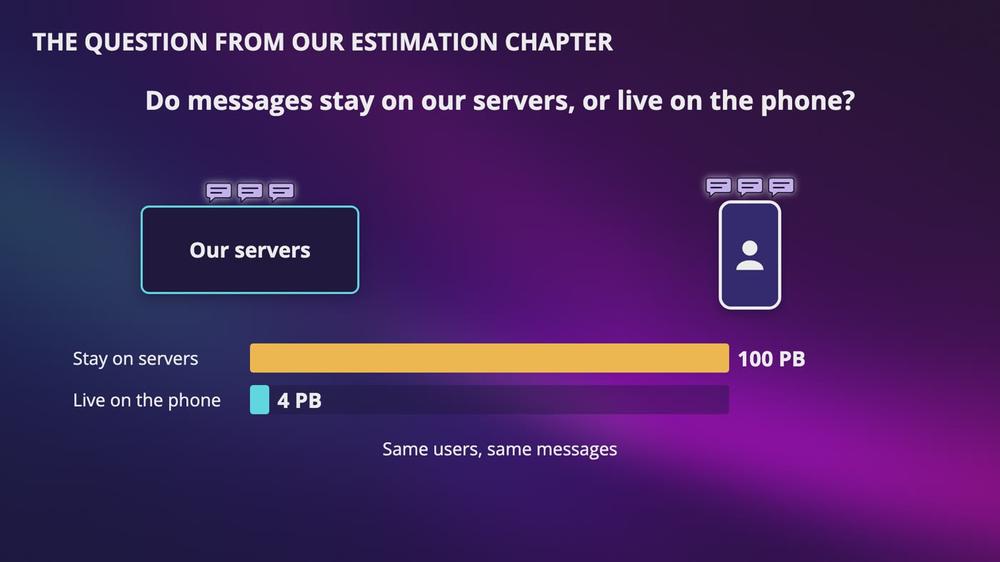
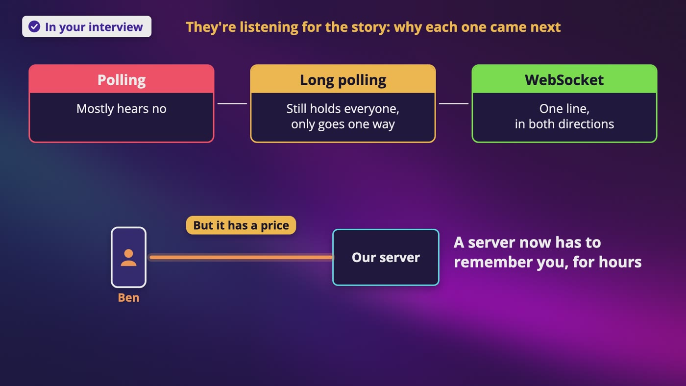
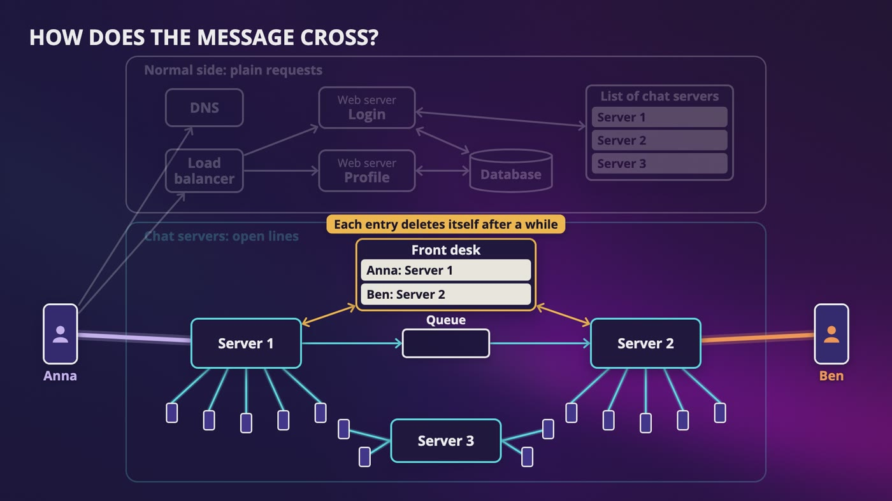
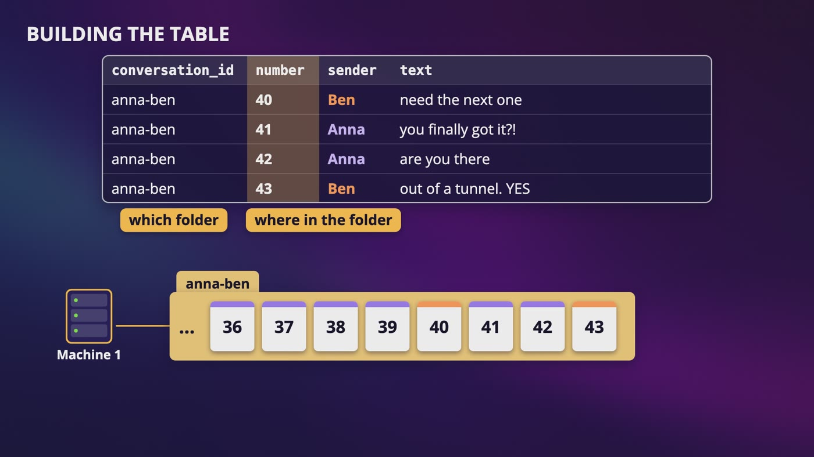
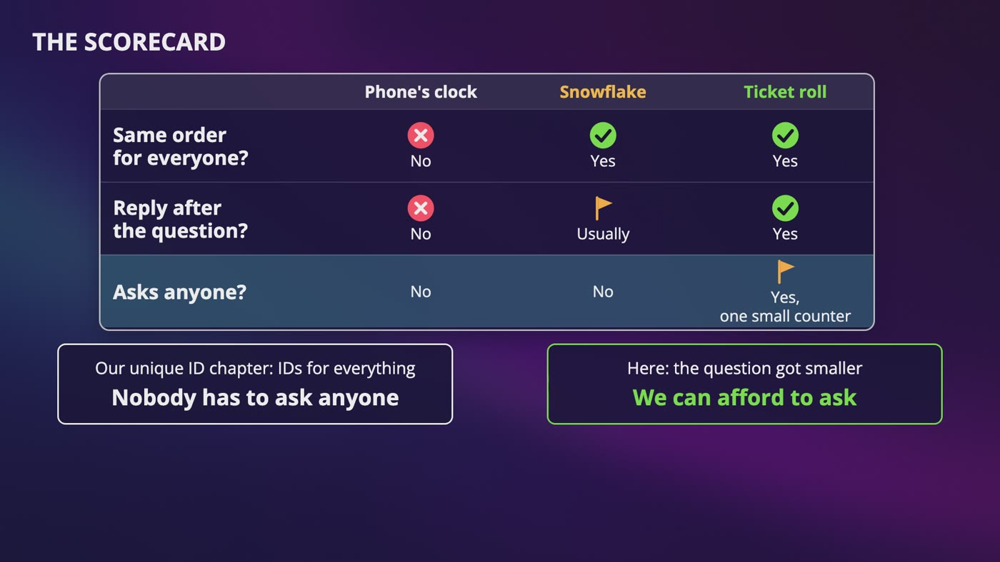
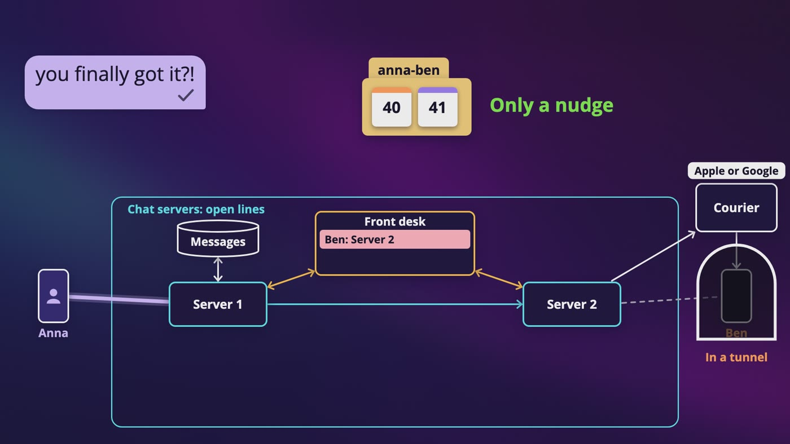
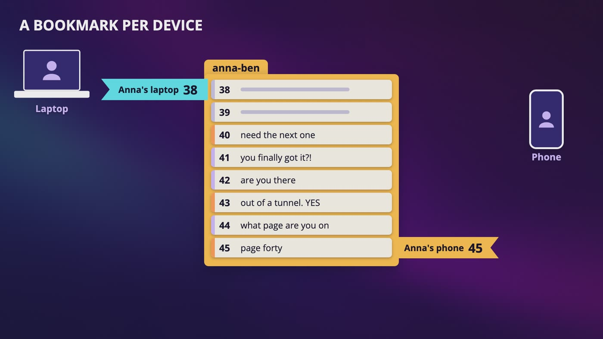
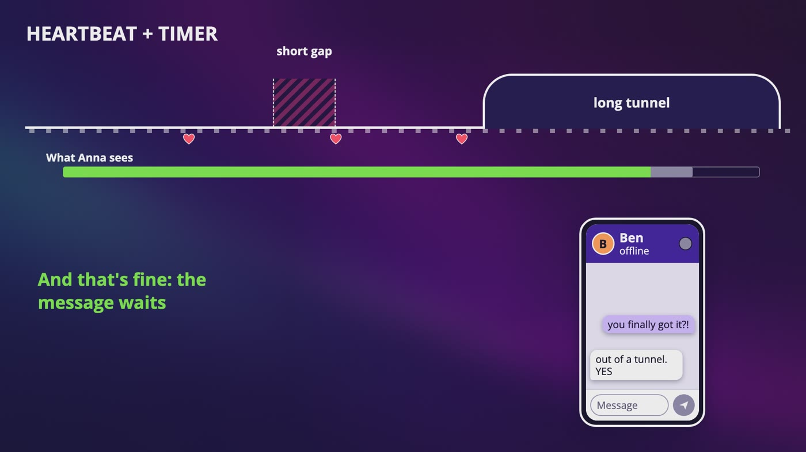
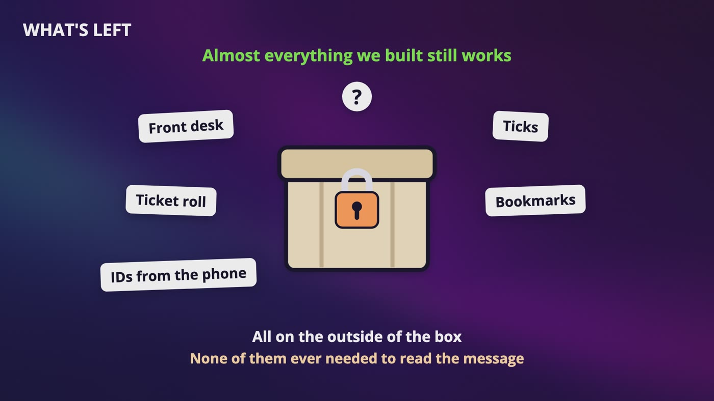
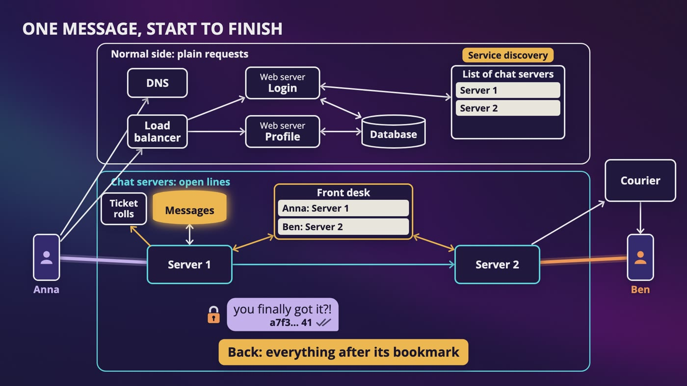

# [Chapter 12: Design WhatsApp](https://www.udemy.com/course/system-design-zero-to-hero/?referralCode=183D59A1EBE9E71D26FF)

_Anna taps send, Ben's train goes into a tunnel, and the message still has to get there, in the right order, with proof._

[Download as PDF](../pdf/System-Design-Chapter-12-Notes.pdf)

## Contents

1. [Design WhatsApp: What Are We Building?](#1-design-whatsapp-what-are-we-building)
2. [How Does the Server Reach Your Phone?](#2-how-does-the-server-reach-your-phone)
3. [Who Is Connected Where?](#3-who-is-connected-where)
4. [Where Do Messages Live?](#4-where-do-messages-live)
5. [Which Message Came First?](#5-which-message-came-first)
6. [Following One Message, Through a Tunnel](#6-following-one-message-through-a-tunnel)
7. [Your Laptop and the Book Club](#7-your-laptop-and-the-book-club)
8. [The Green Dot](#8-the-green-dot)
9. [End-to-End Encryption Changes Everything](#9-end-to-end-encryption-changes-everything)
10. [The Whole WhatsApp Design, for Your Interview](#10-the-whole-whatsapp-design-for-your-interview)

## 1. Design WhatsApp: What Are We Building?

> **The big idea:** The hard part isn't knowing who's online. It's getting one message there at the right moment, in the right order, with proof that it arrived, even when somebody's in a tunnel.

_Same users and same messages: messages that stay on our servers are 100 PB, and messages that live on the phone are 4 PB._

### Numbers from our estimation chapter (made up, not WhatsApp's)

- 500 million people a month and 350 million a day, sending 20 messages each: **7 billion messages a day**.
- That's about 81,000 a second, and 162,000 at our busiest.
- Each message reaches about 3 people, so around 240,000 deliveries a second.
- 2 million connections on one server gave us a starting point of 175 servers.
- For storage, we ended up with either 4 petabytes or 100.

### What each answer did

- **Groups up to 100:** one message isn't one delivery, and the limit caps how bad that can get.
- **Phone and laptop at once:** one person isn't one connection, and each device has to catch up on its own.
- **Arrived and read:** we need proof. That's the little ticks.
- **Online status:** a really common follow-up, so it gets a whole video.

### The question from our estimation chapter

- Do messages stay on our servers, or live on the phone? That one question changed our storage from 100 petabytes to 4.
- WhatsApp's privacy policy says that once a message is delivered, it's deleted from its servers.
- For most of this chapter, we keep history on our servers, which isn't what WhatsApp says it does. Near the end, we flip that, turn on encryption, and watch what breaks.
- It's what a lot of interviews start with, and it's way easier to see. If the server can read everything, we can follow every step.

> **In your interview:** Ask these questions, even if you use this app every day, because that's exactly how people end up skipping them. If you only get to ask one, ask where messages live and whether they're encrypted, because nothing else changes as much of your answer.

> **In the real world:** WhatsApp wrote in December 2025 that on a regular day, it handles over 100 billion messages. Meta wrote that during the World Cup final in July 2026, WhatsApp went past 30 million messages a second. So the busiest moment can be way more than double, even if we can't be sure those two numbers count messages the same way.

## 2. How Does the Server Reach Your Phone?

> **The big idea:** Nobody asked for this message, so we need a line where the server can talk first. It's our own line while the app is open, and a courier when it isn't.

_The story: polling mostly hears no, long polling still holds everyone, and WebSocket gives one line in both directions._

|   | Polling | Long polling | WebSocket |
|---|---|---|---|
| Like | Are we there yet? | Tell me when we get there | An open phone call |
| How | Ben's phone asks every 5 seconds | The server holds his request, say up to 30 seconds | One connection stays open, and either side talks |
| Problem | Almost all our work is saying no | Holds everyone, only goes one way, and a message can land in the tiny gap. And Ben's request sits on one particular server | A server has to remember you, for hours |

### Why not just use our couriers?

- Push is best effort, Apple only keeps one notification per app while a phone is offline, and a package only holds about 4 KB. That's great for a nudge, but you can't run a conversation through it.

### Polling's math

- Worst case, all 350 million connected at once, asking every 5 seconds: **70 million requests a second**.
- We only have 81,000 real messages a second, so that's about **864 requests for every real message**.

### An open phone call

- A WebSocket starts as a normal HTTP request to door 443, asking to switch. The server answers with status code **101**, switching protocols, and that same TCP connection stays open with new rules. To a lot of firewalls, it just looks like normal web traffic.
- When Ben closes the app, the line goes away, and we go back to the courier for the nudge.

### When not to use it

- Logging in, loading a profile and uploading a photo keep using normal requests.
- Server-sent events are for when only the server talks. The APIs behind AI chat, from companies like OpenAI and Anthropic, say they stream answers this way.

> **In your interview:** WebSocket is the right answer, and you can just say so. But what they're listening for is the story, so be able to say why each one came next.

> **In the real world:** Slack and Discord both say they use WebSocket. Facebook wrote in 2011 that Messenger used MQTT. WhatsApp's technical paper only describes a long-running encrypted connection.

**New terms**

| Term | Meaning |
|---|---|
| **Protocol** | A set of rules two sides agree on, like taking turns on a phone call. |
| **TCP** | Gets data across the internet reliably, with all the pieces, in the right order. |
| **Handshake** | A quick hello between two sides at the start of TCP. After that, they have a connection. |
| **Port** | Which door of a computer you're knocking on. Secure web traffic normally uses door 443. |
| **Firewall** | Like a security guard at the edge of a network, who only lets certain traffic through. |
| **Polling** | You keep asking on a schedule. |
| **Long polling** | You ask, and the server holds on to your request until something happens or time runs out. |
| **WebSocket** | A protocol built so that either side can talk whenever they want, over a connection that stays open. |
| **Bidirectional** | Two-way, so both sides can send. |
| **Keep-alive** | Normal HTTP connections staying open. The server still can't say anything until it's asked. |
| **Server-sent events** | Only the server talks, over a normal HTTP connection. |
| **MQTT** | A small protocol designed to go easy on bandwidth and batteries. |

## 3. Who Is Connected Where?

> **The big idea:** An open line is connected to one actual machine, so chat servers have to be stateful. A front desk tells every server who's on which machine.

_Anna is on server 1 and Ben is on server 2. The front desk says where Ben is, and the message crosses through a queue._

### Why we can't be stateless

- Anna's line is connected to one machine, and only that machine can send to her. The connection itself is the thing being remembered.
- So draw **two sides**. The normal side has DNS, a load balancer, stateless web servers and microservices for login and profiles. The other side has chat servers, holding open lines.

### Which server should Anna get?

- A bad choice for a normal request lasts milliseconds. Here, Anna might stay for hours.
- She logs in over the normal side. Our login service looks at the list of chat servers, picks one that's near her and not too busy, and hands her phone an address.
- The list lives in ZooKeeper. Each chat server writes itself on it when it starts, and drops off if it dies. ZooKeeper doesn't recommend a server. The choosing is our own code.

### How does the message cross?

- Think of a hotel. You don't knock on every door, you ask the front desk.
- When Ben connects, server 2 writes down that Ben is on server 2. It's one fast lookup, and Redis is great at this.
- Anna's message lands on server 1, which asks the front desk, then passes it over. That hop is a good place for a queue, so a busy server 2 doesn't slow down server 1.
- If server 2 crashes, nobody tells the front desk. So every entry gets an expiry, say 60 seconds, and server 2 keeps renewing it. If it dies, the entry cleans itself up.

### The math

- At 10 KB per connection (our own guess), 2 million connections on one server is about 20 GB. All 350 million across 175 servers is about 3.5 TB.
- The front desk, at about 100 bytes per person, is around 35 GB.
- Memory isn't the scary number. If one server dies, **2 million people get dropped at the same moment**.

### When a server dies, and restarting one

- 2 million phones reconnect right away, and that wave can knock over the next server. It's our retry storm.
- The fix is randomness. Spread over 1 minute, it's about 33,000 a second, instead of 2 million in one second.
- Restarting a chat server hangs up on 2 million people. So you tell it to stop taking new people, ask the phones to move a few at a time, and wait for it to empty.

> **In your interview:** Starting with one big chat server is fine as your first sentence, but say what's wrong with it, and split it. Know why chat servers are stateful, how a message crosses between them, and what happens when one dies. If you draw an arrow from server 1 to server 2 and you can't say how it knew, your interviewer is going to ask.

> **In the real world:** Discord's docs for developers tell apps to use a random delay on their first heartbeat, so that too many clients don't reconnect at the exact same time. Slack wrote that with one of the older programs in front of its WebSockets, it would keep the old copy running for many hours, so those connections could drain.

**New terms**

| Term | Meaning |
|---|---|
| **Service discovery** | A way of finding out which servers exist, and which one to use. |
| **Session registry** | Our front desk: one simple lookup of which chat server each person is on. |
| **Draining** | Telling a server to stop taking new people, and waiting for it to empty. |

## 4. Where Do Messages Live?

> **The big idea:** Ask what we do the most: show the latest 50 messages in this chat. One part of the key picks the folder, and the other sorts inside it.

_The conversation ID decides which folder a row goes in, and the number decides where it sits in that folder._

### Two kinds of data

- **Who people are:** names, pictures, who's in which group. It's small and has relationships, so a normal relational database is completely fine.
- **The messages:** a huge number, written all the time, mostly read when recent, and they almost never change.

### Building the table

- Think of a filing cabinet with one folder per chat, where you always open it at the back.
- Every row has a conversation ID, a message number, who sent it, and the text.
- "Show me the latest 50" means go to the anna-ben folder, open it at the back, and read 50 rows. The work only grows with how many you asked for.
- If each message's own ID were the key, those 50 messages could be anywhere. So don't do that.
- **Groups use the same table.** A one-on-one chat is just a group of 2. That one idea saves us a lot of work later.

### Which database?

- Not a plain key-value store. Anna's cart was a whole value, grabbed by an exact key. The latest 50 is a little stretch of rows inside one key.
- So people use a **wide-column store**, and the famous one is Cassandra.
- Writes go at the end of the notebook and on the desk, then get sorted into a box that never changes. Messages almost never change either, so they fit this really well. And the newest ones are probably still on the desk.
- Careful with the word partition. In our key-value chapter, it was a broken connection between servers. Here, it's a chunk of data, so one folder.

### Keeping it forever

- Keep everything for 2 years, and it's about 100 petabytes. If messages live on the phone, it's about 4. Most of that is media.
- Nobody reads old messages very often, so you can move older folders to cheaper storage.

> **In your interview:** Be able to draw this table and say what each part of the key does. If they ask why not a key-value store, say that you need a range inside a key. If they ask about a huge group, bring up the hot partition. Don't say any one database is the best. Just say what you need from it.

> **In the real world:** Discord wrote in 2023 that it started on Cassandra with 12 machines in 2017, and had 177 by 2022. A hot partition would often slow down the entire database, so it moved to ScyllaDB with 72 machines, and put a small service in front so many asks for the same row only ask the database once. Meta wrote in 2018 that it moved Messenger off HBase and onto MyRocks.

**New terms**

| Term | Meaning |
|---|---|
| **Composite key** | A key made of two parts. |
| **Wide-column store** | A database where one key can hold many rows, kept in sorted order. |
| **Partition key** | In Cassandra, the first part of the key. It decides which machine, and the second part sorts the rows on that machine. |
| **Hot partition** | Everyone is reading the same busy chunk of data, so it all lands on one partition. It's one very popular key again. |
| **ScyllaDB** | A database built to work like Cassandra. |
| **HBase** | An open source database for spreading data over many machines. |
| **MyRocks** | MySQL with a different way of storing things on disk underneath. |

## 5. Which Message Came First?

> **The big idea:** Clocks don't agree, and we only need order inside one chat. So each chat gets its own ticket roll.

_The scorecard: the phone's clock can't be trusted, Snowflake is usually right, and the ticket roll is right but has to ask a small counter._

### Why not just use the time?

- **The phone's clock:** anyone can change it. If Ben's phone is a minute behind, his answer could show up above the question.
- **The server's clock:** Anna and Ben are on different servers, and clocks don't agree perfectly. It's the same problem as last write wins.

### What about Snowflake?

- It worked great for the feed, but we always said roughly.
- If machine 5's clock is a little ahead of machine 6's, a later ID can get a smaller number. And inside 1 millisecond, IDs are ordered by machine number, not by who came first.
- Nobody can tell in a feed. In a conversation, Ben's answer "page 40" could come before Anna's question.

### One ticket roll per chat

- Nobody's ever going to compare a message in one chat with a message in a completely different chat. So we **only need order inside one chat**, and that's a way smaller problem.
- Think of a ticket roll at a deli counter. Whoever pulls next gets the next number, and it doesn't matter what anyone's watch says.
- The anna-ben roll is at 43. Server 1 gets 44 for Anna's message, and server 2 gets 45 for Ben's. What matters is that everyone sees the same order.
- Two servers can't get the same number, because it's one atomic step, like INCR in Redis. If a counter gets lost, look at the last number in the folder.
- 81,000 messages a second are spread across a huge number of chats. Only a giant group is really busy, and that's our hot key again.
- We also get something for free. If Ben's phone has 43 and gets 45, it knows it might be missing one, so it can ask.

### The opposite of our unique ID chapter

- There, the whole point was that nobody asks anyone, because we made IDs for everything. Here, the question got smaller, so we can afford to ask.

### What Anna actually sees

- Her message shows up right away, with a little clock on it and no number yet.
- If Ben's message got the roll first, hers comes back with the later number, and it moves down below his. The server's order wins.
- We can't say this is exactly how WhatsApp handles it, but it's a good design for your interview.

> **In your interview:** Don't say timestamps and move on. Say that clocks don't agree, that you only need order inside one chat, and that each chat gets its own sequence. Then say what it costs. If they push you, say Snowflake is also a fair choice, and explain what you'd give up.

> **In the real world:** Discord's post says every ID it uses is a Snowflake, so it's sorting by time. If the clocks are close, that mix-up is rare, and it's a real choice you could make.

**New terms**

| Term | Meaning |
|---|---|
| **Per-conversation sequence** | Each chat has its own count, so the next message in that chat gets the next number. |

## 6. Following One Message, Through a Tunnel

> **The big idea:** Nothing is done until someone says, got it. Save first, push second, and let each device catch up from where it left off.

_Ben is in a tunnel, but message 41 is safe in the anna-ben folder. The courier only sends him a nudge._

| Anna sees | WhatsApp's help page | In our design, who said got it |
|---|---|---|
| 1 gray check | Sent | Server 1 |
| 2 gray checks | Reached the other person's phone | Ben's phone |
| 2 blue checks | Read | Ben's phone |

### The good night

- Anna taps send. Her phone makes an ID first, which can be a UUID, so it doesn't have to ask anyone. Her bubble shows a little clock.
- The message goes up her line. Server 1 saves it, gets number 41 from the roll, and says got it. She sees 1 tick.
- The front desk says Ben's on server 2, and it goes down his line. His phone says got it, and she sees 2 ticks. When he reads it, they turn blue.
- Each tick is just one acknowledgment.

### Anna's bad connection

- Her wifi blips, and she hears nothing back. It's the parcel again: maybe it never arrived, or maybe the got it was lost.
- So her phone sends it again. If we weren't careful, Ben gets it twice, with two different numbers.
- This is why **the phone makes the ID**. The second copy has the same ID, so the server says, I've seen this one, it's number 41, got it.
- It's idempotency, with one atomic step. It's at least once, with duplicates handled.

### Ben's tunnel

- When a connection dies like this, there's no goodbye. For a little while, server 2 still thinks Ben's there.
- Server 2 writes down his line, and nothing comes back. After a few seconds, we say he isn't really there.
- **We saved it first,** so nothing's at risk. It's sitting in the folder, whether Ben ever shows up or not.
- Then we send a push through Apple or Google. It's only a nudge, and it's okay if it gets lost.

### Coming out of the tunnel

- Ben's phone opens a new line, maybe to a different server, and that server writes it down at the front desk.
- His phone keeps one number for this chat, the last one it has. Its bookmark says 40.
- It asks for everything after 40, gets 41 and 42, says got it, and the bookmark moves. Anna's single ticks turn into 2. If it gets 41 twice, it just ignores it.
- You might read about a separate queue for every user, but we don't need that. The saved messages plus Ben's bookmark already are his inbox.

> **In your interview:** Know who says got it at each step, why the phone makes the ID, why we save first and push second, and how a device catches up with a bookmark. If they ask what happens when someone's offline, don't only say you'd send a push notification, because a push can get lost.

> **In the real world:** Discord's docs for developers describe almost the same thing. A client keeps the last sequence number it got, and when it reconnects, it sends that number to pick up where it left off.

**New terms**

| Term | Meaning |
|---|---|
| **Bookmark** | Our name for one small number a device keeps for a chat: the last message number it has. |

## 7. Your Laptop and the Book Club

> **The big idea:** Store a message once, and deliver it many times. Each device keeps its own bookmark, and huge groups can switch to fan-out on read.

_One chat, with a bookmark for each device. Anna's laptop is at 38 and her phone is at 45, and each catches up on its own._

### Anna's laptop

- Unlike Anna's cart, there's nothing to merge. Messages only get added, and each one gets its own number.
- **The front desk** now holds a short list: Anna's phone is on server 1, and her laptop is on server 4. Each device says its own got it.
- **The bookmark** is now one number per chat, for each device. Her laptop asks for everything after 38, and her phone doesn't even notice.
- What she types on her laptop has to show up on her phone too. It's in the same folder, so it just works. We just remember that the sender's other devices are on the delivery list.

### The book club

- Anna makes a group with Ben, Cara and Dan. It's one more folder, with its own ticket roll, and a small list of who's in it. That list goes in our normal relational database.
- One copy of the message, or one for each person? **One copy**, with each device keeping its own bookmark.
- The storing is easy, and the delivering is where it multiplies. That's 3 people, and 6 deliveries if each has a phone and a laptop, plus Anna's own laptop.
- With 100 people, one message is 99 people, and about 198 deliveries. It's fan-out on write again.

### When the group gets huge

- For a group of 100,000, we do what we did for Adele. We save it once, and people fetch it when they open that channel, using their bookmark. That's fan-out on read.
- It costs us the same way as before, because whoever is reading has to go and ask.

### Ticks in a group

- WhatsApp's help page says you see 2 ticks once everyone has received it, and blue once everyone has read it.
- So a message to 100 people needs 99 people's acknowledgments to get to 2 ticks.

### Photos and videos

- They don't go in the folder. It's the two roads again.
- Anna's phone uploads to object storage with a short-lived address, then sends a normal message with a pointer to that file.
- Ben's phone reads the pointer and downloads the file through a CDN. A thumbnail in the message gives him something right away.

> **In your interview:** Know that each device has its own bookmark, that we store a message once but deliver it many times, and that it's fan-out again, so you can switch for huge groups. If you can say that a group limit is a design choice, that's a really nice touch.

> **In the real world:** WhatsApp's help pages say a group can have up to 1,024 members. A limit means you always know the worst case for one message, here 1,023 people. Discord has hundreds of thousands of people in one server, so different limits give you a different system to build.

**New terms**

| Term | Meaning |
|---|---|
| **Thumbnail** | A tiny, blurry version of a picture. |

## 8. The Green Dot

> **The big idea:** Make phones keep saying they're still here, let an expiring value in memory decide who's online, and only tell the people who are looking.

_Heartbeats keep Ben's timer going through a short gap, so nothing flickers. In a long tunnel the beats stop, and he goes offline._

### The easy version

- Write down online when Ben connects, and offline when he leaves.
- On a train, his signal comes and goes, so his dot flickers, and every flicker tells everyone that something changed.
- And in a tunnel, there's no goodbye, so a server can't even tell that he's gone.

### The heartbeat

- Every 30 seconds, say, Ben's phone sends a tiny message down the line that's already open.
- We keep an entry in Redis that says Ben's online, and it expires in, say, 40 seconds. Every heartbeat starts that timer over.
- **A short gap:** the timer never runs out, so nobody sees a flicker.
- **A long tunnel:** the beats stop, and about 40 seconds later the value disappears. Nobody had to detect anything.
- The cost is that someone can look online for up to 40 seconds after they're gone. That's fine, because any message for him waits in its folder.

### The math

- Worst case, 350 million people beating every 30 seconds is about **11.7 million heartbeats a second**. Every 5 seconds, it's 70 million.
- That's our polling number, so what's different? It's a few bytes on a line that's already open, with no new request and no headers. And a chat server can send one update for a whole batch of people every few seconds.
- You still wouldn't pick 5 seconds without a reason, because every beat is battery.
- Don't write each heartbeat to a database. It belongs in memory.

### How do contacts find out?

- Anna could subscribe to Ben, like a newspaper. Say he has 200 contacts, and flips 20 times a day (a made-up number).
- 350 million x 20 x 200, divided by the seconds in a day, is **about 16 million messages a second**, about 200 times our real messages.
- It's the same choice as the feed: telling everyone is fan-out on write, and looking it up when someone looks is fan-out on read.
- So **we only tell the people who are looking**. Anna's phone asks for Ben's status once, and subscribes only while he's on her screen.

### Two small lessons

- It's okay for this to be a little wrong. That's eventual consistency, and different data gets a different amount of care.
- This is private information, so before we answer Anna, we check whether Ben allows it.
- Last seen has to outlast the connection, so it goes in a real database, but only when someone leaves.

> **In your interview:** Asked how you'd build online status, say heartbeats with an expiring value in memory, that a short gap shouldn't flicker, and that you only tell who's looking. Say that this is fan-out again, because it really stands out when someone connects two different designs like that.

> **In the real world:** Slack wrote in its engineering blog that a client only gets presence updates for the people visible on screen. WhatsApp's help pages say you can choose who sees your last seen and online, and that if you hide your last seen, you can't see other people's either.

**New terms**

| Term | Meaning |
|---|---|
| **Heartbeat** | A phone keeps sending a tiny message that says, still here. As long as it keeps going, you're alive. |
| **Presence** | The word for who's online. |
| **Publish and subscribe** | You say once that you want something, and from then on, every new update just shows up, like a newspaper subscription. |

## 9. End-to-End Encryption Changes Everything

> **The big idea:** With end-to-end encryption, the server carries a locked box it can't open. Everything that needed to read the message breaks, and delivery still works.

_The front desk, ticks, ticket roll, bookmarks and IDs from the phone all sit on the outside of the locked box, so they still work._

| Breaks | What happens instead |
|---|---|
| Search | It has to happen on the phone, and so does ranking. |
| History | A new laptop has no keys for old messages. WhatsApp's answer: your phone locks up recent chats and sends them over. |
| Devices | Each device has its own keys, so Anna's phone locks the message for each one. |
| Groups | Her phone locks one special key for each device, then locks each message once, and our server copies that box out. |
| Backups | A cloud backup is a whole copy of your messages, so it has to be locked too. |
| Media | Her phone locks the photo with a new key. Our worker can't make smaller sizes. |
| Push | It goes through Apple or Google, so no readable text. It's a nudge, or it's locked. |

### Postcards and locked boxes

- HTTPS encrypts a message on the road, but when it gets to our server, we open it and read it. It's a postcard in an envelope that the post office opens.
- End-to-end is a locked box from Anna's device to Ben's, and the server can't open it.

### The padlock

- Ben has a huge bag of open padlocks and the only key. A padlock isn't a secret.
- Anna's phone asks our server for Ben's padlock and locks the message inside. All our server ever sees is scrambled letters. Ben's phone uses its private key to read it.

### What's left

- Almost everything still works. The front desk, the ticks, the ticket roll, the bookmarks and the IDs from the phone never needed to read the message.
- But the outside of the box is still visible. That's the metadata: who sent it, who it's going to, and when. So don't say end-to-end encryption hides everything.

### Back to our two numbers

- If the server can't search or rank what it's storing, a huge pile of history is way less useful, so letting go after delivery, 4 petabytes instead of 100, is a natural fit. It isn't forced, as Messenger shows.

### For the curious

- You probably won't get asked this. The real keys keep changing, so stealing today's key doesn't open yesterday's messages.

> **In your interview:** Raise this in step one. If you draw a server that reads and searches everything, and then they say it's encrypted, you have to redo half of it. Be able to go through what breaks and what's left, and know what a public key and a private key do. You don't need the math.

> **In the real world:** This is a real choice. Discord said in 2024 that its messages are not end-to-end encrypted, and Slack describes its data as encrypted at rest and in transit. Meta made end-to-end encryption the default on Messenger in December 2023, and it keeps encrypted history on its servers. WhatsApp added encrypted backups as an option in 2021.

**New terms**

| Term | Meaning |
|---|---|
| **End-to-end encryption** | A message stays locked the whole way from one device to the other, so nobody in between can get to the content. |
| **Public key / private key** | The padlock and the key. The public key is fine for everybody to have. The private key never leaves your phone. |
| **Signal Protocol** | A published design for this kind of encryption. WhatsApp's paper says it's built on it. |
| **Encrypted at rest and in transit** | Encrypted on the company's disks and on the road. |

## 10. The Whole WhatsApp Design, for Your Interview

> **The big idea:** Two sides, normal and chat, and one message from start to finish. It's less to remember than it looks like, because you saw each piece come in for a reason.

_The normal side above, the chat servers below. If Ben doesn't say got it, a courier nudges him, and he catches up from his bookmark._

| Step | Time | What you do |
|---|---|---|
| Understand | 3 to 10 min | Ask about groups, phones and laptops, what people can do, how long we keep messages, and encryption. Say 7 billion a day, 81,000 a second, and that storage could change 25 times. |
| High level | 10 to 15 min | Tell the story of polling, long polling and WebSocket. Draw the two sides, send one message across two servers, and say how it knew. |
| Deep dive | 10 to 25 min | Storage first, then order, then the slow-motion message with the ticks, unless they want something else. |
| Wrap up | 3 to 5 min | Say what you'd watch, like people connected per server and messages waiting for a got it. Say what could still break. |

### One message, from start to finish

- DNS and the load balancer get Anna to a stateless web server, where she logs in. Service discovery picks a chat server, her phone opens a WebSocket, and that server writes her name at the front desk, with an expiry.
- She taps send. Her phone makes an ID, and locks the message for each of Ben's devices if this design is encrypted.
- Server 1 checks the ID with one atomic step, gets the next number from the ticket roll, saves it in the folder, and says got it. **One tick.**
- The front desk points to server 2, which sends it down Ben's line. His phone says got it. **Two ticks.** He reads it, and they're **blue**.
- If he doesn't say got it, nothing's lost. We send a nudge through the courier, and he asks for everything after his bookmark.
- A group is the same trip with more arrows. A photo takes the big road, and the message carries a pointer. Heartbeats keep an expiring value in memory.

### The hints

- **How does it cross servers?** A front desk, with an expiry so dead entries clean themselves up.
- **They're offline?** Save first, send a nudge, and the device catches up from its bookmark.
- **How do you keep order?** Clocks don't agree, and we only need order inside one chat, so each chat gets a sequence number.
- **How do you know they got it?** The ticks are just acknowledgments. The phone makes the ID, so a retry doesn't create a double.
- **A group of 100,000?** Fan out on read, like Adele, and watch out for hot partitions.
- **Is it encrypted?** This changes the design. History and search move to the phone, and each device has its own keys. Delivery still works, and metadata is still visible.

### What to know

- **Really well:** why chat servers are stateful, and what happens when one dies. The front desk. The table. Order inside one chat. The ticks, the ID from the phone, and save first, push second. What encryption takes away.
- **For a sentence:** why polling lost, heartbeats, only telling people who are looking, each device having its own bookmark, group limits, and photos taking the big road.
- **Just to recognize:** MQTT, the names of the databases companies moved between, and how the keys in the Signal Protocol change.

### The book club

- About 2 weeks later, Anna's phone buzzes. It's Ben: okay, I got to the end. A locked box crossed between servers, a server with no idea what it says gave it the next number, and the ticks turn blue.
- On Saturday, there are four people at a table with four copies of a book, and all their phones are face down.

> **In your interview:** Your interviewer is probably going to steer you, so know the hints. In your wrap up, say what could still break, like a huge group or a server dying. Please never say that your design is perfect.

## Recap: What it takes to send one message

_Nothing is done until someone says, got it._

| Every piece solved a real problem | |
|---|---|
| **WebSocket** | Nobody asked for this message |
| **Chat servers** | An open line lives on one machine |
| **Service discovery** | Anna might stay on a server for hours |
| **Front desk** | A message had to cross between servers |
| **Folders by chat** | Show me the latest 50 |
| **Ticket roll** | Clocks don't agree |
| **ID from the phone** | A retry could make a double |
| **Save first, push second** | Ben went into a tunnel |
| **Bookmarks** | Each device has to catch up |
| **Fan-out on read** | Huge groups |
| **Heartbeats** | There's no goodbye in a tunnel |
| **Only telling who's looking** | 16 million messages a second, just for presence |
| **Locked box** | The server could read everything |

**What to know really well**

- Why chat servers are stateful, and what happens when one dies
- The front desk
- The table: the conversation decides the folder, and the number sorts inside it
- Order inside one chat
- The ticks, the ID from the phone, and save first and push second
- What encryption takes away

---

From the course **[System Design: Zero to Interview Hero](https://www.udemy.com/course/system-design-zero-to-hero/?referralCode=183D59A1EBE9E71D26FF)** by Nata Vacheishvili.
