# [Chapter 13: Design Search Autocomplete](https://www.udemy.com/course/system-design-zero-to-hero/?referralCode=183D59A1EBE9E71D26FF)

_Cara types one letter, and 5 words have to show up before her finger comes back down._

[Download as PDF](../pdf/System-Design-Chapter-13-Notes.pdf)

## Contents

1. [Design Search Autocomplete: What Are We Building?](#1-design-search-autocomplete-what-are-we-building)
2. [Big O in Plain Words](#2-big-o-in-plain-words)
3. [The Data Structures You Actually Need](#3-the-data-structures-you-actually-need)
4. [The Simple Version, and Why It Breaks](#4-the-simple-version-and-why-it-breaks)
5. [The Trie: A Tree Made of Letters](#5-the-trie-a-tree-made-of-letters)
6. [Making It Fast](#6-making-it-fast)
7. [Where Do the Counts Come From?](#7-where-do-the-counts-come-from)
8. [Serving It in a Tenth of a Second](#8-serving-it-in-a-tenth-of-a-second)
9. [What Not to Suggest](#9-what-not-to-suggest)
10. [What's Trending, and Other Languages](#10-whats-trending-and-other-languages)
11. [The Whole Search Autocomplete Design, for Your Interview](#11-the-whole-search-autocomplete-design-for-your-interview)

## 1. Design Search Autocomplete: What Are We Building?

> **The big idea:** It looks like one of the smallest features in the app, but all of the difficulty is in the speed. The list has to show up between two letters.

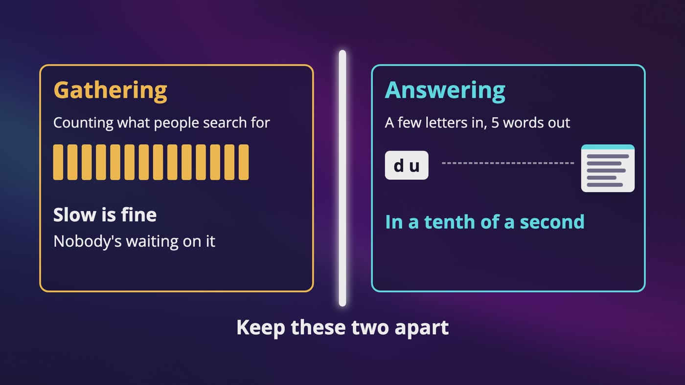

_Two jobs to keep apart: gathering can be slow, and answering has to take a few letters and give 5 words in a tenth of a second._

### We've been here before

- At the book club's table, nobody can remember the name of a short book about Dublin. So Cara opens our bookstore and types the letter D.
- Back in our interview chapter, the interviewer said we could skip suggestions. Today we don't get to skip them.
- Our target is **100 milliseconds**, a tenth of a second.

### What each answer did

- **Matching from the beginning** makes this whole problem way easier. D U is a prefix of Dune, and it isn't a prefix of Fondue.
- **Whatever people search for the most** means we have to count, so there's a number for every search.
- **No spelling help** means exact beginnings, and not things that are close, which is much harder.
- **The same list for everyone** is a really big one, because we can save an answer and hand it out again and again. Per person, a lot of what we build gets harder.

### The math

- 10 million people a day, searching 10 times each, is 100 million searches a day, or **about 1,160 a second**.
- If a search is 20 letters and every letter sends a request, that's about 23,000 QPS, and **about 46,000 at peak**. The typing multiplied our traffic by 20.
- If apps wait for a small pause and send about 4 requests (our own guess), it's about 4,600 a second. We keep planning for the bigger number, because it's safer.
- At about 20 bytes a search, that's 2 GB a day. If 1 in 5 is new, only about 0.4 GB a day is new.
- **This isn't a storage problem. It's a time problem.**

### Two jobs

- **Gathering:** counting what people search for. It can be slow, and nobody's waiting on it.
- **Answering:** taking a few letters and giving back 5 words in a tenth of a second.
- Almost every good idea in this chapter comes from keeping them apart.

> **In your interview:** Say the two jobs out loud. And remember to ask whether the list is the same for everyone, because if your interviewer says per person, a lot of what we build gets harder.

> **In the real world:** Facebook wrote in 2010 that spending more than 100 milliseconds to get a result made its own typeahead stutter. Jakob Nielsen, a well-known researcher on how people use software, has written for decades that a tenth of a second is about the limit for something to feel instant. Google's help pages say its predictions can depend on where you are and what you've searched before.

**New terms**

| Term | Meaning |
|---|---|
| **Autocomplete** | The little list under a search box. You'll also hear typeahead, and search as you type. |
| **Top K** | Give me the K most popular things. K is just a number, and for us it's 5. |
| **Prefix** | The beginning of a word. |
| **Query** | What someone typed into a search box. |

## 2. Big O in Plain Words

> **The big idea:** Big O is a short way of saying how much the work grows when the data gets bigger. You don't need any math, only a shelf of books and a phone book.

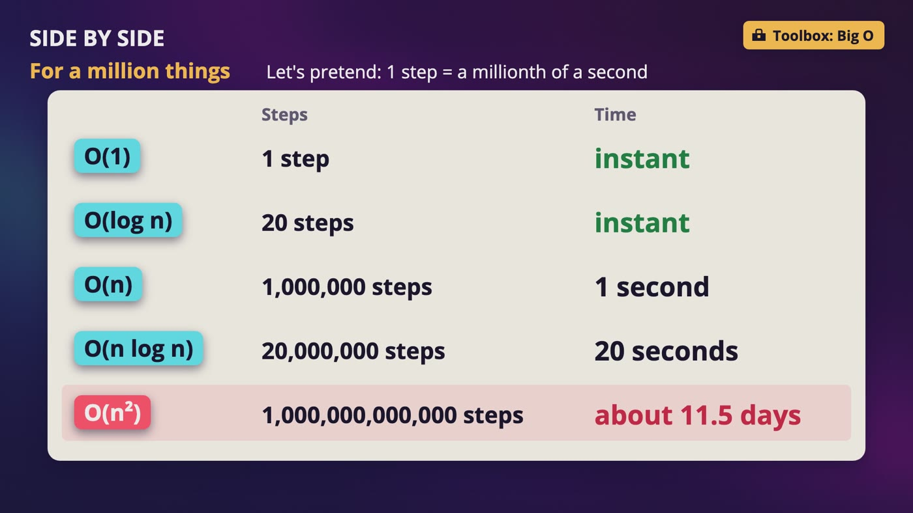

_Side by side, for a million things at a millionth of a second per step: O(n²) takes about 11.5 days._

| Big O | Think of | When the data grows |
|---|---|---|
| O(1), constant | Our wall of numbered hooks | The work doesn't grow |
| O(log n) | A phone book | Double the data, and it's only 1 more look |
| O(n), linear | A messy shelf of books | Twice the books, twice the work |
| O(n log n) | What good sorting costs | A million cards x 20 levels, about 20 million steps |
| O(n²) | Comparing everyone with everyone | 10 times the servers, about 100 times the work |

### Why anyone cares

- Two pieces of code both feel instant on your laptop with 100 names. With a billion names, one is still instant, and the other has basically stopped.
- We write the size of the data as **n**, and the O stands for order, as in the order of growth.

### The phone book

- 8 names, looking for Finn. Open the middle and land on Emma, so throw away the first half. Open the middle again and land on Grace, so 2 are gone. One more look, and it's Finn. **8 names took 3 cuts.**
- A logarithm is just this question: how many times can you cut this in half until 1 is left?
- About 1,000 takes 10 cuts. 1 million takes about 20. **A billion takes about 30.**
- The catch is that the names have to be sorted, because you can't throw away half of a messy shelf.

### That word, log

- A **log file** is the diary, a record of what happened.
- **Log n** is the halving question. These two have nothing to do with each other.

### The two slower ones

- **O(n log n):** cut a million cards in half until every card is on its own, about 20 levels. Then merge them back, touching every card on each level.
- **O(n²):** in our gossip video, 100 servers checking on each other meant 9,900 messages. With 1,000 servers, it's about 1 million.

### What it hides

- O(1) doesn't mean instant. If that one walk takes a minute, it takes a minute every time. It only means it doesn't get worse.
- Doing twice the work per item is still O(n). Big O only describes the shape of the growth.
- Looking up a key on another machine is O(1), but it's a trip across a network. Checking 10 items in memory is O(n), and way faster.
- We can also measure space this way, meaning how much memory something takes as the data grows.

> **In your interview:** You most probably won't be asked for a formal analysis in a system design round. That's more of a coding interview thing. What you need is to be able to say that this gets slower as the data grows, in this way, and here's what our n is. For example, this is O(n), and n is 200,000, on every keystroke.

**New terms**

| Term | Meaning |
|---|---|
| **Big O** | A short way of saying how much the work grows when the data gets bigger. |
| **O(1)** | Constant. The work doesn't grow with the data. |
| **O(n)** | Linear. Twice the data, twice the work. |
| **O(log n)** | The work grows with how many times you can cut the data in half. Each doubling costs 1 more look. |
| **O(n log n)** | n times log n. What good sorting costs. |
| **O(n squared)** | n times n. What comparing everyone with everyone costs. |
| **Logarithm** | How many times can you cut this in half until 1 is left? Also shortened to log. |

## 3. The Data Structures You Actually Need

> **The big idea:** A data structure is a way of arranging data so that one kind of question gets easy. Every structure makes something easy by making something else hard.

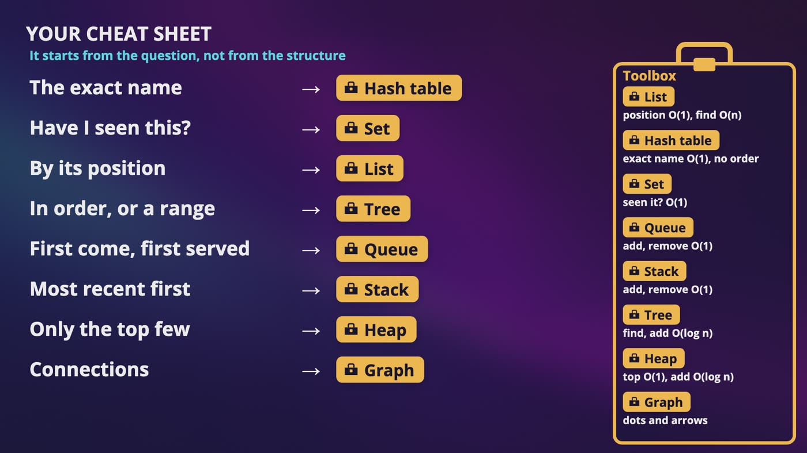

_The cheat sheet starts from the question and not from the structure, with every structure in the toolbox on the right._

### One job for each

- **List:** our top 10 bestsellers. Getting by position is O(1). Finding a value or adding in the middle is O(n).
- **Hash table:** Anna's cart. Finding by exact name is O(1). There's no order at all.
- **Set:** the addresses our crawler visited. Have I seen this? is O(1), and it can't do much else.
- **Queue and stack:** our mailbox is first come, first served, and a pile of plates is last on, first off. Adding and removing are O(1), and the middle is O(n).
- **Sorted list:** a phone book. Finding is O(log n), and adding a name is O(n).
- **Tree:** database indexes. Finding and adding are both O(log n), with extra work to keep both sides about even.
- **Heap:** the top 5. Looking at the top is O(1), and adding or removing is O(log n).

### Why a hash table isn't enough for us

- Dune and Dusk look almost the same to you, but their hashes are unrelated, so they're on hooks nowhere near each other.
- To find everything that starts with D U, you'd have to look at every hook. That's this chapter's problem.

### From a sorted list to a tree

- A sorted list has the phone book trick, but a store that's always getting new data can't keep making room in the middle.
- So take the middle name and put it at the top. Everything before it hangs to the left, everything after it to the right, and you do the same on each side.
- To find a name, go left or right, and half of what's left disappears. To add one, walk down and hang it at the bottom, without moving anybody else.
- A tree can also walk through things in order, so it can answer everything that starts with D U.

### The heap and our top 5

- Sorting a million books to get 5 is about 20 million steps, and you've ordered almost a million books you don't care about.
- A heap only promises that one specific thing is always on top, like the triage desk at an emergency room.
- Keep a heap of 5, with the smallest of the 5 on top. Each new book only has to beat that one. That's around 2 million steps. And since 5 is a small fixed number, it's O(n).

### A graph, and how to choose

- A graph is dots and arrows: web pages and their links, or followers.
- **The exact name:** hash table. **Have I seen this:** set. **By position:** list. **In order, or a range:** tree. **First come, first served:** queue. **Most recent first:** stack. **Only the top few:** heap. **Connections:** graph.

> **In your interview:** Don't start with, I'll use a heap. Start with, what do I need to ask this data? Then the structure kind of picks itself, and you can say what it costs.

**New terms**

| Term | Meaning |
|---|---|
| **Data structure** | A way of arranging data so that one kind of question gets easy. |
| **List (array)** | Like a row of numbered shelves, sitting side by side. |
| **Tree** | Things hang off each other, with the middle at the top, what comes before it to the left and what comes after it to the right, so each step cuts what's left in half. |
| **Heap** | It only promises that one specific thing is always on top. |
| **B-tree** | The common kind of tree in databases, with a lot of branches on each level. It's the default in PostgreSQL, and you most probably won't be asked how it works. |

## 4. The Simple Version, and Why It Breaks

> **The big idea:** One table with a count works, until someone types one letter. The fewer letters you've typed, the more things match, so the shortest question is the hardest one.

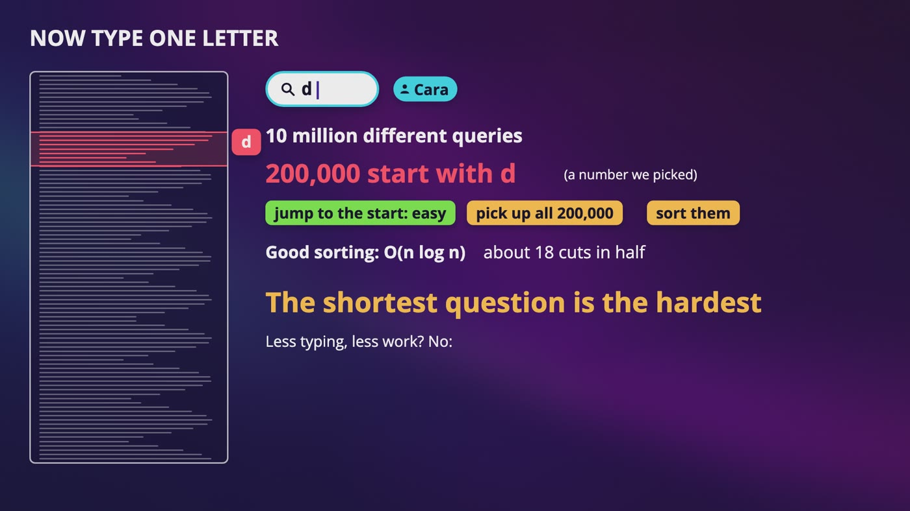

_One letter: 200,000 of our 10 million queries start with D. Jumping to the start is easy, and sorting them all is about 3.5 million steps._

### One table

- Two columns: the query, and how many times it's been searched. Each search adds a row or adds 1. That's the whole gathering job.
- Our made-up counts for the whole chapter: Dune 9,000, Emma 6,000, Dracula 5,200, Don Quixote 4,100, Dune Messiah 3,100, David Copperfield 2,800, Dubliners 2,400, Dusk 1,300, Dust 700.

### Asking for the top five

- Pick the query and its count from that table, where the query is LIKE 'du%', sort by count descending, and keep only 5.
- We get back Dune, Dune Messiah, Dubliners, Dusk and Dust. So it works, in about 5 lines.

### What an index does

- Without help, the database reads every row. That's O(n).
- With an index, words starting with D U sit next to each other, so it can jump to where they begin. That's O(log n), about **24 looks** with 10 million rows.
- PostgreSQL's docs say it can use its index when the pattern is fixed at the start. With the percent sign on the left, there's no sorted place to jump to. That's why it mattered that our interviewer said only the start.

### Now type one letter

- The database still has to gather every match and sort them, just to give you 5. For D U, that's about 300 rows, and no problem at all.
- But Cara started with D. Say 200,000 of our 10 million queries start with D (a number we picked).
- Sorting is O(n log n), about 18 cuts, so **about 3.5 million steps, to answer one letter**.
- Every search starts with one letter, about 1,160 searches a second. And we're writing to this same table all the time.

### Could we just cache it?

- That's a really good thought, so hold on to it. But right now, we'd still have to work out the answer the first time, every time the counts change, and for every beginning anyone could type.

### When this is enough

- With a few thousand books, this table with an index is a completely fine answer. Don't build what's coming next for a small store.
- There are also ready-made tools for the middle, like Elasticsearch.

### What we wish we had

- To this table, Dune, Dusk and Dubliners are three separate rows. We want a structure where sharing a beginning is the whole point, and they only split at the letter where they're different.

> **In your interview:** Say that you'd start with a table, and then say exactly when it stops working. That shows you're not over-engineering, and it's a much stronger answer than jumping right to the clever one.

**New terms**

| Term | Meaning |
|---|---|
| **LIKE** | In a database query, it means match a pattern. The percent sign means anything at all can come after this. |
| **DESC** | Short for descending, so biggest first. |
| **Elasticsearch** | A popular search engine you can add to your own system, with a built-in feature for search as you type. |

## 5. The Trie: A Tree Made of Letters

> **The big idea:** In a trie, words share their beginnings and split at the exact letter where they're different. Every beginning anyone could type now has its own place.

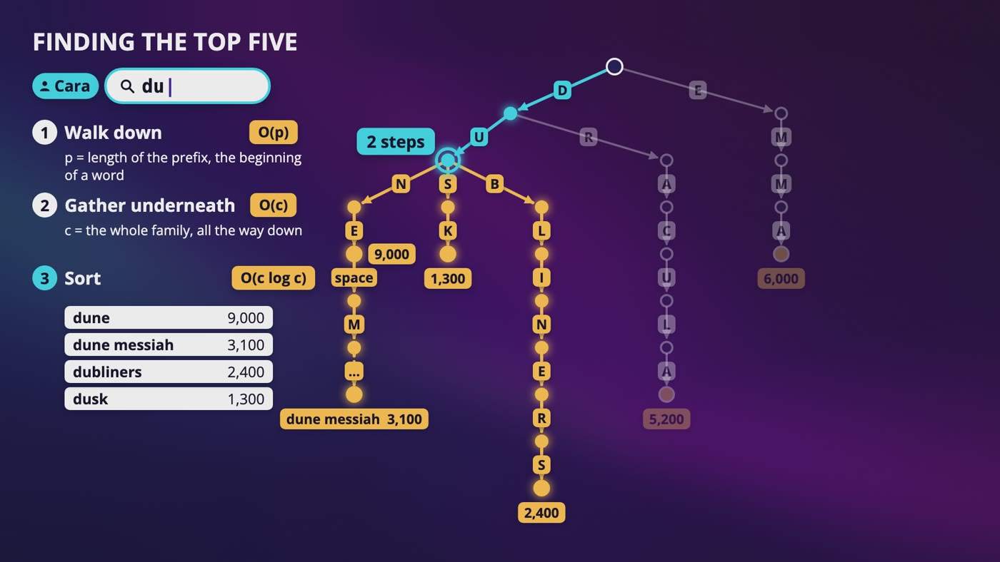

_Cara has typed du. We walk 2 steps down, gather every marked word underneath, then sort them by count._

### Your contact list

- Type A in your phone's contacts, and the list shrinks. Type N, and it shrinks again. Each letter is like a turn on a path.

### Building it

- Start with one dot, the root, which means nothing's been typed yet.
- **Dune:** draw arrows for D, U, N and E.
- **Dusk:** D and U are already there, so walk down them. Only then do we draw something new, S and K.
- **Dubliners** makes a third branch at that same dot. **Dracula** shares only the D. **Emma** shares nothing, so it starts at the root.
- Those 5 words have **28 letters** between them, and the drawing has only **23 arrows**.

### A few details

- For us, the letter is on the arrow, and a dot is just a place you've reached. Some drawings put it inside the dot, and it's the same structure.
- You might hear that every node has 26 children. That's only for small English letters, and only how many it could have. We never store the empty ones.

### Where does a word end?

- Dune Messiah keeps walking down from the E in Dune, so we can't tell from the shape whether Dune is a word by itself.
- So any dot where a real query ends gets a small mark, and that's also where the count goes. The E of Dune gets 9,000.

### Finding the top five

- **Step 1, walk:** O(p), where p is the length of the prefix. D U is 2 steps, however many words we have.
- **Step 2, gather:** O(c), where c is the whole family underneath, all the way down, not only the dots directly below.
- **Step 3, sort:** O(c log c).
- For D U, about 300 queries is about 2,500 steps. For D, 200,000 queries is **about 3.5 million steps**. A little heap needs under half a million, and that's still way too many on every keystroke.
- So we built this whole tree, and we have the same problem as our table.

### So what did we get?

- In our table, there was nowhere to put an answer for D U, because D U isn't a row. Here, it's a place, and if something's a place, you can leave something there.

> **In your interview:** Be able to draw this from memory with 4 or 5 words, and walk through finding a prefix out loud. Know that the slow steps are gathering and sorting, not walking. Writing the code for a trie is more of a coding interview thing.

> **In the real world:** The name comes from the middle of the word retrieval. Edward Fredkin, who named it in 1960, said it like tree. In a conversation about trees, nobody could tell which one you meant, so a lot of people say it like try, and I'd say try in your interview.

**New terms**

| Term | Meaning |
|---|---|
| **Trie** | A tree made out of letters, where the path from the root spells out what you've typed. Spelled T R I E. |
| **Children / parent** | The dots right below a dot are its children, and the dot right above is its parent. |

## 6. Making It Fast

> **The big idea:** The answers are ready before anyone asks. Every letter keeps its own top 5, so a request never has to gather or sort anything.

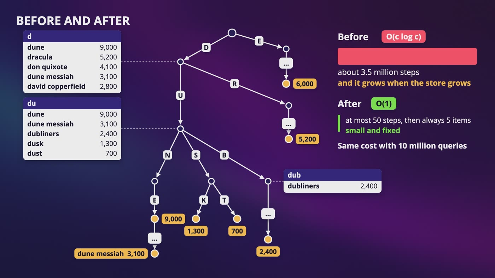

_Before, gathering and sorting took about 3.5 million steps. After, every dot has a card, so it's at most 50 steps, then always 5 items._

### Move one: limit how far people type

- We only handle the first 50 letters of anything (a number we picked). Anyone who's typed 50 letters already knows what they want.
- You'll see this written as O(1). We didn't make anything faster. But 50 doesn't grow when the data grows, and Big O only cares about growth, so we stop counting it.

### Move two: every letter keeps its own answer

- Every dot gets a little card with the top 5 of everything underneath it.
- **D:** Dune, Dracula, Don Quixote, Dune Messiah, David Copperfield.
- **D U:** Dune, Dune Messiah, Dubliners, Dusk, Dust.
- Cara types D. We take 1 step and read the card, instead of about 3.5 million steps. It costs the same with 10 million queries or a billion.
- Filling the cards isn't hard. A worker starts at the leaves and goes up, because the top 5 at any dot comes from the top 5s right below it, plus any word that ends right there.

### What it costs

- Dune is on the D card, the D U card, D U N and D U N E. One popular word gets written once for every letter.
- 50 million dots x 5 words x 30 bytes (made-up numbers) is **about 7.5 GB**, which fits in the memory of one big machine.
- It's the same trade as Anna's feed: somebody does the work once, so millions of people don't have to.

### When is it worth it?

- There are way more reads than writes.
- It's okay if the answer is a little bit old.
- Slowness is unacceptable, because a suggestion that shows up late is useless.
- It's a bad idea if every change has to show up right away, like a bank balance, or if most of those answers never get read.

### The catch

- Someone searches for Dust, and it goes up by 1. Its own dot changes, and so can every card on the way back up to the root.
- About 1,160 searches a second x 20 letters is **about 23,000 cards to check every second**, and everything starting with D goes through that same D card.
- We made reading wonderful and updating really painful. But one of our two jobs can be slow, so maybe we don't update these cards live at all.

> **In your interview:** Say the three things you'd look at: way more reads than writes, a little bit old is okay, and slowness is unacceptable. And don't say precomputing as if it's always the right answer.

**New terms**

| Term | Meaning |
|---|---|
| **Trading space for time** | We spend memory, which we can buy, and we get back time. |
| **Precomputing** | Working something out ahead of time. |
| **Ancestors** | The dots on the path above you, like your parent and your parent's parent. |

## 7. Where Do the Counts Come From?

> **The big idea:** Don't update live. Write each search in a diary, add them up in a batch, build a new trie beside the old one, and then switch.

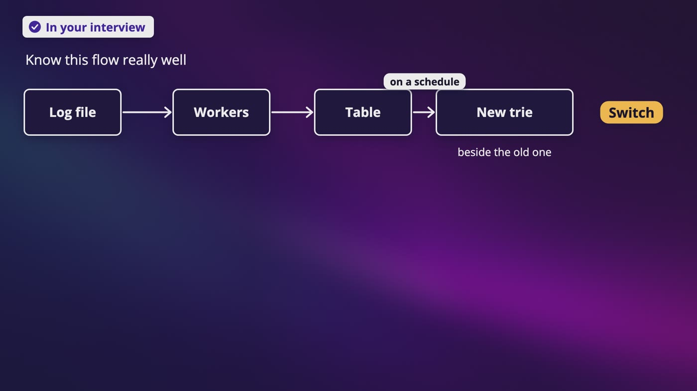

_The flow to know: log file, workers, a table, and on a schedule a new trie built beside the old one. Then switch._

### Not live

- If Dune has 9,000 searches and it's really 9,001, nobody will ever notice. So the cards can be a little bit old, and we do the updating later, in one big batch.

### The diary

- When Cara searches, we don't touch the cards. We write a line in a **log file**: what was searched, and when.
- That's the diary, and it has nothing to do with the logarithm. You only ever write on the next empty line, so there's nothing to look for.
- It doesn't slow down the search, because it's asynchronous. Our servers drop a line in our mailbox and get right back to answering.
- About 100 million searches a day at about 20 bytes each is around 2 GB a day.

### Adding it up

- Workers read the pile and add it up. They clean first: Dune with a capital, dune with an extra space, and dune all count as the same thing.
- We get a small table of query, week and count. Week of October 5, dune has 8,700. Week of October 12, dune has 9,000 and dubliners has 2,400.
- We keep it per week so we can choose how far back to look, and a book everyone searched for 3 years ago doesn't sit on top forever.

### How often?

- It depends entirely on what we're building, so it's a really nice thing to ask. For a bookstore, once a week is probably fine, so let's say every Sunday.

### Build beside it, then switch

- If we change the live trie in place, some cards are from this week and some from last week, and a crash leaves you stuck with half of each.
- Think of a store printing its catalog. You print the whole new one in the back, check it, swap them on the counter, and keep the old one for a bit.
- We build version 42 right beside version 41, check that it looks sane, and flip one small setting that says which version is live. If it's bad, we flip it back.
- We also save a copy to object storage, as a file.

### Do we need every line?

- Write down only 1 search in 10, picked at random. Dune's 9,000 becomes about 900 lines, and times 10 it's still about 9,000. The diary is 10 times smaller.
- Rare things can vanish. Something searched 3 times has about a 73% chance of never being written down. For a top 5, that's okay.
- At 2 GB a day we don't need this yet. If someone asks what you'd do when the logs get too big, it's a really good answer, as long as you say what you lose.

> **In your interview:** Know this flow really well. If they ask why you don't update live, say that one search touches every dot on the way up, and that a slightly old list is fine here. And do ask how fresh it has to be.

**New terms**

| Term | Meaning |
|---|---|
| **Batch** | A pile of work that you do all at once. |
| **Aggregating** | A fancier word for adding things up. |
| **Snapshot** | A picture of everything at one moment, like a saved copy of a trie. |
| **Sampling** | Only writing down some of the data, picked at random, like 1 search in 10. |

## 8. Serving It in a Tenth of a Second

> **The big idea:** Once every beginning has its list, it's just a key-value lookup by exact key. The trie didn't go away, it just moved to the workers.

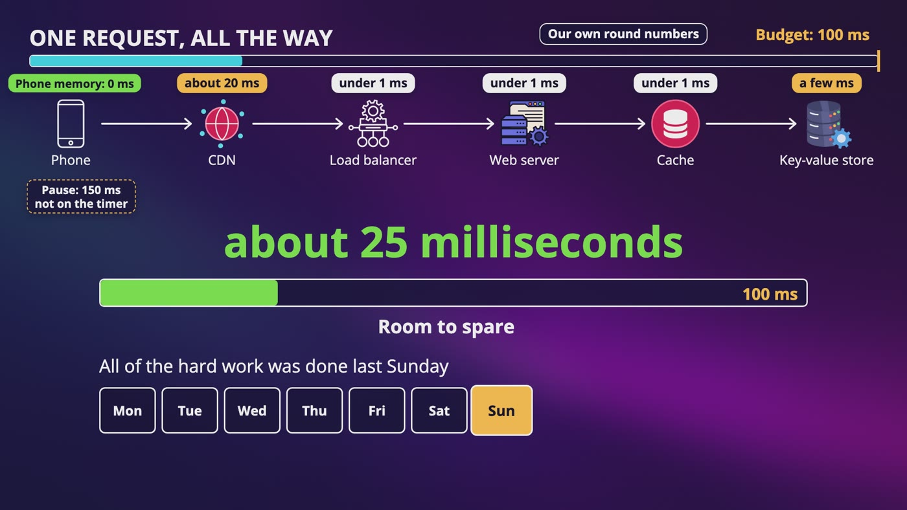

_One request with round numbers: phone, CDN, load balancer, web server, cache, key-value store, in about 25 of our 100 milliseconds._

| Stop | What happens | Time |
|---|---|---|
| Phone | Cache-Control: private, max age 3600. Only her own browser keeps it, for an hour | 0 ms |
| Pause | Debouncing waits until she stops typing, say 150 ms | Not on the timer |
| CDN | Popular short answers can be saved close to her | About 20 ms |
| Load balancer, web server, cache | Each hop inside one data center | Well under 1 ms each |
| Key-value store | If we miss all of that | A few ms |

### The reveal

- We start at the root, walk D, walk U, and read the card. The only thing the walk did was find the card.
- So write all the cards down flat: the key is D U, and the value is that list of 5. That's **a key-value store**, with an exact name, so it's O(1).
- The workers use the trie once a week to build the answers, then write out the cards, and our servers never touch a tree.
- About 7.5 GB of cards can sit in Redis, with a few copies so we can lose a machine.
- This is our own reasoning. We're not claiming any one company does exactly this.

### Do we need to split it?

- Split by first letter, and one machine is packed while another's bored, because way more words start with C than X.
- But neighbors don't need to stay together anymore, because every key is its own exact lookup. So we use our ring from consistent hashing.
- D is going to be way busier than any other key, and one key lands in one place. That's Adele again, so we protect it with a cache.

### A few details on the way

- A packet takes about 150 ms across the world and back, more than our whole budget, so we can't serve Cara from far away.
- Private means a CDN isn't allowed to keep it, so for popular short answers the header has to say public.
- Our rate limiter said 100 searches a minute. If every letter counted as a search, a 20-letter search would hit the limit after 5 searches, so these requests need their own limit.
- Answers can arrive out of order. If the answer for D lands after the answer for D U, her screen shows the wrong list. So the phone ignores any answer that isn't for what's currently typed.
- Add it all up, and it's about 25 ms. All of the hard work was done last Sunday. Someone who has stopped typing also feels that pause, so keep it short.

> **In your interview:** Say the reveal out loud: once every prefix has its list, it's just a key-value lookup. A lot of people stop at the trie. Then go through the layers, starting with the browser, because people always forget about that one. Debouncing and out of order answers are small things that show you've thought about a real person typing.

**New terms**

| Term | Meaning |
|---|---|
| **Debouncing** | Only sending a request once someone has stopped typing for a moment. Like an elevator door, which only closes when nobody's come in for a little while. |
| **AJAX** | An old name for a page asking for something in the background, without reloading. |

## 9. What Not to Suggest

> **The big idea:** Popular doesn't mean it's okay to show. A suggestion on our page looks like the company's own words, so this stops being a math problem and starts being about people.

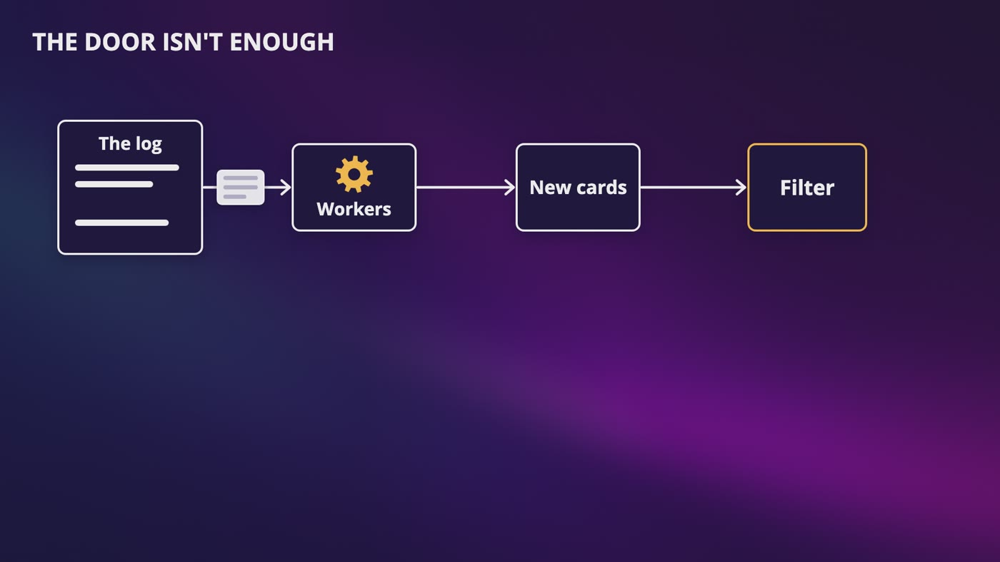

_A filter at the door isn't enough. The bad item also has to go from the source, or the workers bring it back in the next new cards._

### A filter in front

- If you type something awful, that's you. If our store puts it under the box, in our font, it looks like us saying it.
- A filter sits between our cards and Cara, and it's the part that lets us remove something right now, instead of next week.
- **Remove it from the source too,** or it's still in the counts, and the next rebuild brings it right back.
- **Think about what's cached.** A list we just blocked can sit on Cara's phone for up to an hour. We can invalidate it on a CDN, but we can't reach into her phone.
- **Who decides?** We'd want rules, people, and a way to report.
- **Filters can be too eager.** Block the word kill, and you've blocked To Kill a Mockingbird.

### Fake popularity

- Someone writes a script that searches for their unknown book 10,000 times a day. Our counters can't tell the difference, so now it's on the list.
- A rate limit helps, but a script can use a lot of accounts.
- So change what we count, from how many searches to **how many different people**. 10,000 searches from one person is one vote. Have I seen this person before is just our set again.
- We can also watch for something that shows up from nowhere, mostly from brand new accounts. None of this catches everything.

### Privacy

- Someone searches for their own phone number 100 times this week. In a small prefix, there's not much competition, so it could end up on a card, and someone else could see it.
- So our rule is that we only suggest something if enough different people searched for it, say at least 50 in a week (a number we picked). That one idea solves two problems.
- Keep the raw log for as short a time as you can, and when the counting's done, keep only the count.
- Sampling isn't a privacy tool, because if yours is the 1 in 10, it's still written down.
- If we show someone their own past searches, that's a separate, private list, and it never goes in a shared cache.

> **In your interview:** If you're asked how you'd remove a bad suggestion, say the filter in front, then removing it from the source, and then what's still cached. And bring up fake popularity and privacy, even if nobody asks. You just need one sentence each.

> **In the real world:** Google calls these predictions, publishes a list of what it blocks, and makes exceptions for things like educational and scientific content. A 2018 paper looked at about 114 million Google suggestions, and found about half a percent had been manipulated. In August 2006, AOL released about 20 million searches from over 650,000 users, with only a number for each person. The New York Times worked out who one of them was. AOL took the file down within days, and its chief technology officer resigned that same month.

**New terms**

| Term | Meaning |
|---|---|
| **Filter** | A short list of things we never show. Every answer goes past it on the way out. |

## 10. What's Trending, and Other Languages

> **The big idea:** A weekly batch can't see what's happening today. Add a running count, and merge it with the weekly card when a request comes in. Other languages barely change the design.

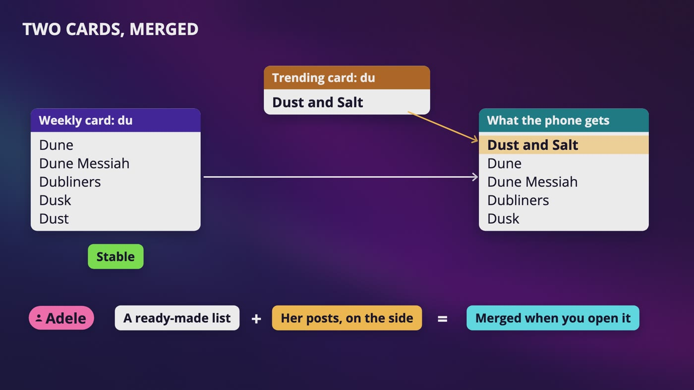

_For D U, the weekly card is stable, a tiny trending card adds Dust and Salt, and the phone gets the 2 merged. It's like Adele's posts._

### Thursday morning

- A big book prize goes to a made-up novel, Dust and Salt. Everyone types D U and sees last week's list, and our next rebuild is 3 days away. Rebuilding more often is a big job, so we use two ways of counting.

### Batch and stream

- **Batch:** let everything pile up and add it at the end, like counting the money in a shop's till when it closes.
- **Stream:** keep a running count, like someone at the door with a clicker. It's more work to keep going.

### Counting what's happening now (made-up numbers)

- Every hour, cut each query's score in half, and add that hour's searches. Recent searches count for more.
- Dune gets about 54 an hour, so its score settles at around 108.
- Dust and Salt had 12,000 in the last hour, so its score is 12,000. When people lose interest, it keeps halving, so it fades by itself.

### Getting it on the card

- We only change a short trending list when something gets onto it. Dust and Salt is 13 characters, so that's 13 cards, one time, and not once per search.
- For D U, we merge the weekly card and the trending card when a request comes in, like Adele's posts. This is our own design.
- The trending card goes past that same filter and counts different people.
- Phones keep answers for an hour, so for a popular short prefix, make it a few minutes.

### Countries and languages

- The country becomes part of the key, like Japan:du. That's a lot more cards, which is why we needed the ring. Those lists are good to keep on a CDN near people.
- Unicode doesn't change much. We never stored empty arrows, and our key-value store doesn't care what the key looks like.
- The harder one is typing. With an input method editor, what counts as a prefix while someone's still choosing? Say you'd handle that language separately.

> **In your interview:** If you get asked about trending, say that a weekly batch can't see it, that you'd add a running count with recent searches counting for more, and that your caches have to expire sooner. If you hear languages, say Unicode, and say that the design barely changes.

> **In the real world:** Google's help page says its predictions depend on language and location, among other things, and that signed in users can get predictions based on past searches. In May 2026, it announced a new search box, with AI-powered suggestions that go beyond autocomplete. We don't know how that's built. But a personal list can't sit on a CDN, so we'd lose a lot of what made our design so cheap.

**New terms**

| Term | Meaning |
|---|---|
| **Stream** | Data that keeps arriving and doesn't really have an end. |
| **Hadoop and Spark** | Open source tools for running big jobs across a lot of machines, so you don't have to write all that splitting up yourself. |
| **Kafka** | Carries a huge stream of events from the programs that write them to the programs that read them, kind of like a giant shared diary. |
| **Flink** | Keeps running counts on a stream as it goes by. |
| **ASCII** | An old table where every character is a number, so capital A is 65. It only has 128 characters, so each fits in 1 byte. |
| **Unicode** | The standard that gives a number to the characters of all the world's writing systems, with room for over a million. |
| **UTF-8** | The usual way of storing Unicode, taking between 1 and 4 bytes for each character. |
| **Input method editor** | You type on a normal keyboard with letters, then choose the characters you meant. Often used in languages like Chinese and Japanese. |

## 11. The Whole Search Autocomplete Design, for Your Interview

> **The big idea:** Two flows to draw from memory. What connects them is that all of the hard work happens before anyone asks.

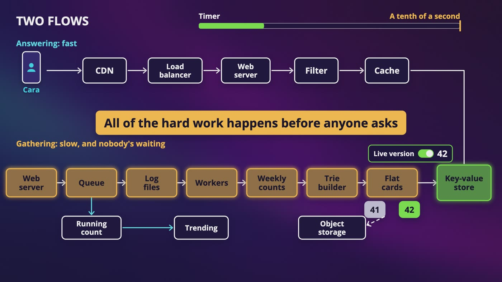

_Two flows: answering on top is fast, gathering below is slow, and all of the hard work happens before anyone asks._

| Step | Time | What you do |
|---|---|---|
| Understand | 3 to 10 min | Ask if it's only the start of what's typed, how many suggestions, chosen how, spelling, languages, how many people, whether it's the same for everyone, and how fresh. Do the math, up to about 46,000 requests a second. |
| High level | 10 to 15 min | Start with the plain table, and say it breaks when someone types one letter. Split it into two jobs, and draw both flows. |
| Deep dive | 10 to 25 min | Build up the trie, then the cards on every dot, then the reveal. If there's time, the layers. |
| Wrap up | 3 to 5 min | Say what you'd watch: how long answers take, how often people pick a suggestion, whether the weekly job finished. Say what could still break. |

### The gathering flow

- A search drops one line in the queue, and those lines end up in log files.
- Workers clean them and add them into a weekly table of counts, only counting something if enough different people searched for it.
- Once a week, a worker builds a new trie with the top 5 on every dot, and writes flat keys and values, version 42 beside version 41, with a copy in object storage.
- We check it and flip one small setting. A running count keeps a tiny list of what's trending.

### The answering flow

- Cara's phone checks its own memory. If it isn't there, it waits for a small pause, asks in the background, and ignores any answer that isn't for what's currently typed.
- A CDN nearby might have the popular short ones. If not, it goes through the load balancer to a web server, which checks a cache, then the key-value store by exact key.
- It merges in anything trending, goes past the filter, and 5 words go back, within a tenth of a second.

### The hints

- **Why not just the database?** You can, for a small store. For one letter, you gather and sort a huge number of rows.
- **Time complexity?** Finding a prefix is O(p), and with a limit on typing, we treat that as O(1). Gathering and sorting would be O(c log c), so we save the answer on every dot.
- **Trending?** A running count, merged with the weekly list, and caches that expire sooner.
- **A bad suggestion?** A filter for right now, remove it from the source, then think about what's still cached.
- **Other languages?** Unicode, the country in the key, and the design barely changes.
- **Splitting it up?** Every prefix is its own key, so use the ring, and cache the very busy ones.

### What to know

- **Really well:** the two jobs. How a trie is built, and which of its 3 steps is slow. Saving the answer on every dot, and what that costs. That it turns into a key-value lookup. Building beside and switching.
- **For a sentence:** debouncing, answers arriving out of order, the browser and CDN caches, the filter, counting different people, sampling, and batch against stream.
- **Just to recognize:** B-tree, the names Kafka, Flink and Spark, Unicode's byte details, and the Top K structure in Redis.

### The café table

- Cara's finger comes back down, and it's a U. Something close by looks up one short key, because all the work was done on Sunday. She reads down the list, and stops at the third one. Dubliners. That's the one, says Ben.

> **In your interview:** Be able to draw those two flows from memory. Keep the words from the start of this chapter, because you can say what a design's work grows with in every other interview too. And please never say that your design is perfect.

## Recap: How Cara got her 5 words

_The answers are ready before anyone asks._

| Every piece solved a real problem | |
|---|---|
| **One table** | The simplest thing, until someone types one letter |
| **Trie** | Every beginning needed its own place |
| **A limit on typing** | The walk could keep growing |
| **A card on every dot** | Gathering and sorting on every keystroke |
| **Log file and workers** | One search touched every dot on the way up |
| **Build beside, then switch** | Readers should never see a half-built version |
| **Flat keys and values** | The walk only found the card |
| **Debouncing** | One request for every letter |
| **Filter** | Popular doesn't mean okay to show |
| **Counting different people** | Fake popularity, and private searches |
| **Running count** | Cards were only as fresh as last Sunday |
| **Country in the key** | People in different countries search for different things |

**What to know really well**

- The two jobs, and why they're separate
- How a trie is built, and which of its 3 steps is slow
- Saving the answer on every dot, and what that costs
- That it turns into a key-value lookup
- Building beside and switching, and why you don't update live

---

From the course **[System Design: Zero to Interview Hero](https://www.udemy.com/course/system-design-zero-to-hero/?referralCode=183D59A1EBE9E71D26FF)** by Nata Vacheishvili.
