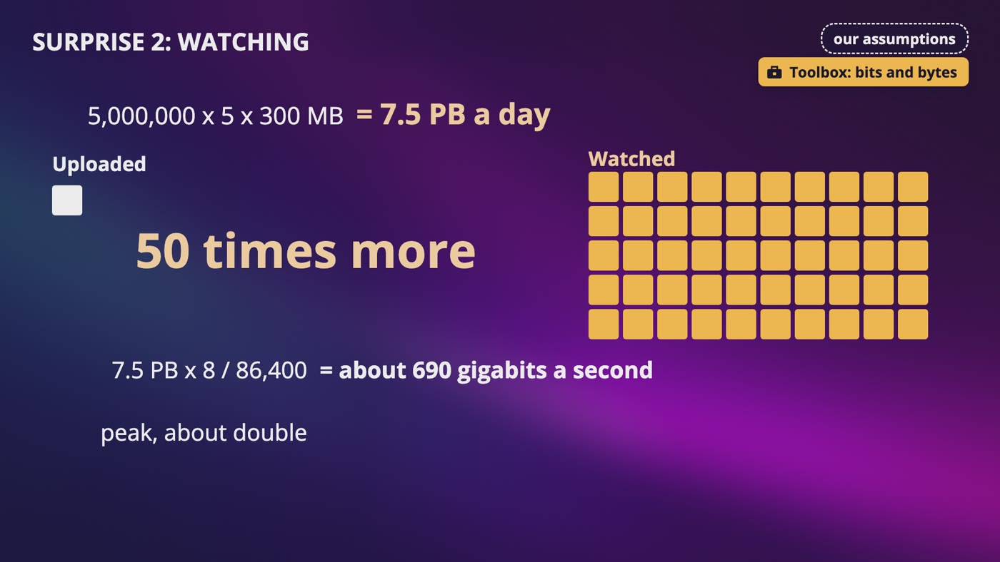
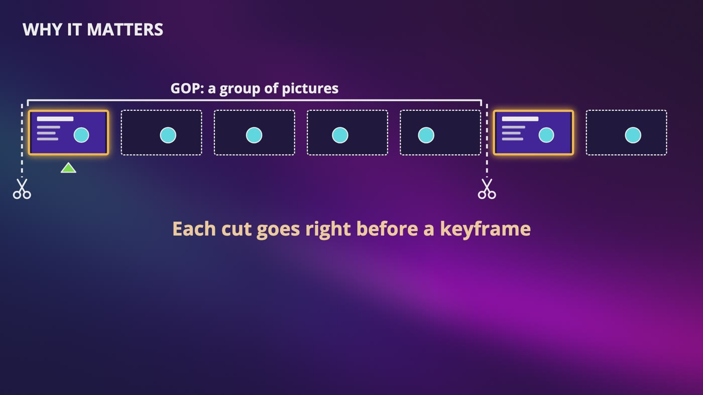
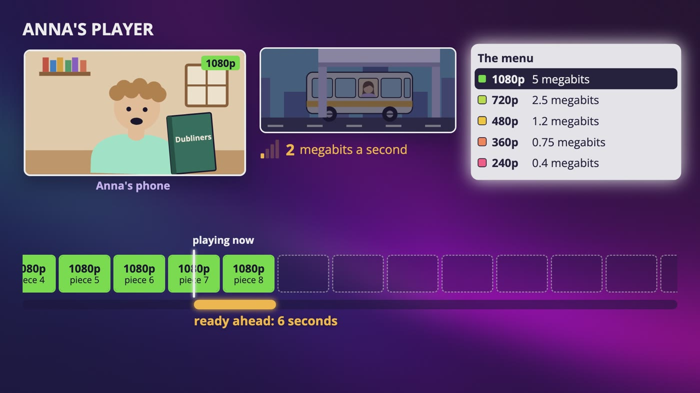
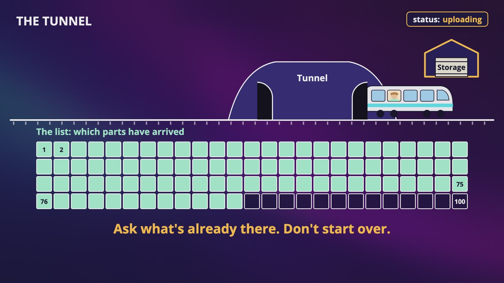
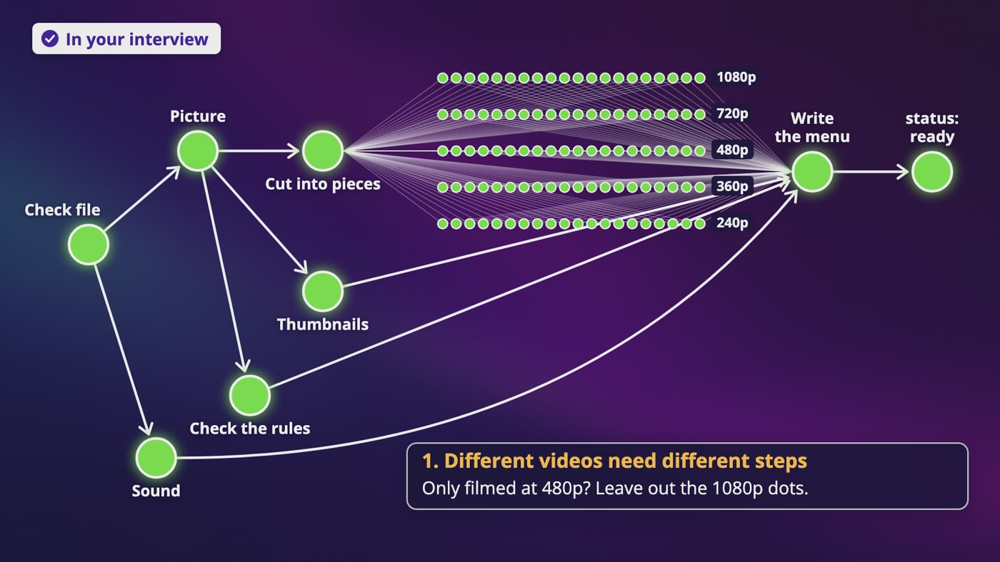
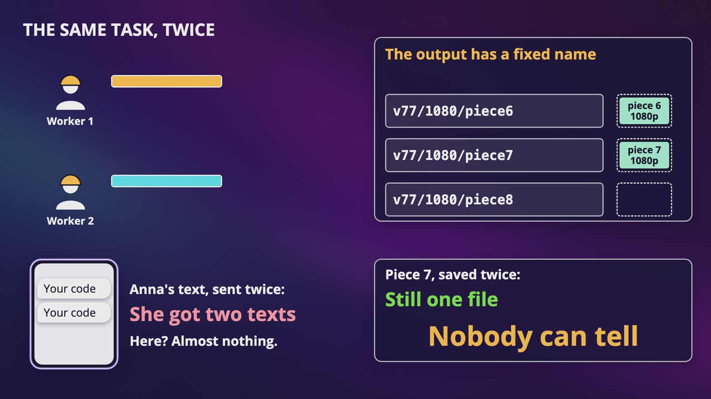
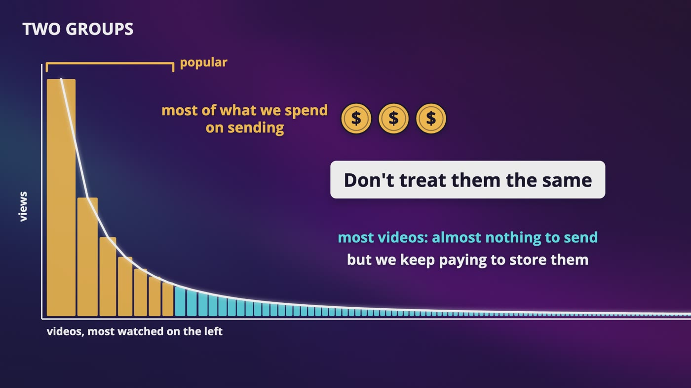
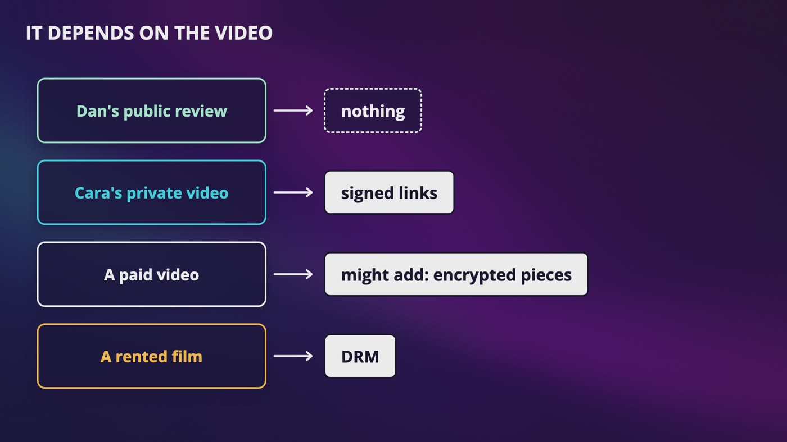
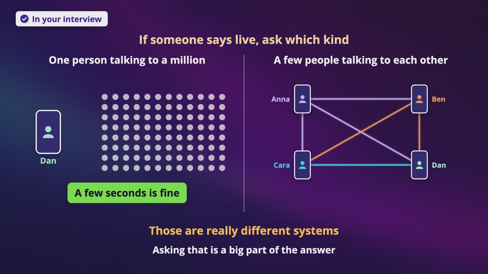
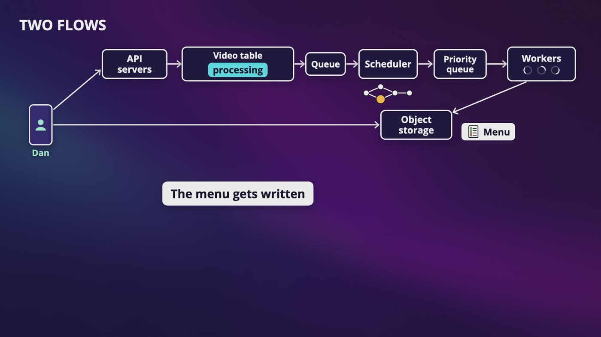

# Chapter 14: Design YouTube

_One video, three devices and three very different connections, and what's really behind the word Processing._

[Download as PDF](../pdf/System-Design-Chapter-14-Notes.pdf)

## Contents

1. [Design YouTube: What Are We Building?](#1-design-youtube-what-are-we-building)
2. [What Is a Video File, Really?](#2-what-is-a-video-file-really)
3. [How Streaming Really Works](#3-how-streaming-really-works)
4. [Uploading on a Train](#4-uploading-on-a-train)
5. [Processing Is a Graph](#5-processing-is-a-graph)
6. [Running Thousands of Tasks](#6-running-thousands-of-tasks)
7. [The Bill: Why a Few Videos Change Everything](#7-the-bill-why-a-few-videos-change-everything)
8. [Who Gets to Watch?](#8-who-gets-to-watch)
9. [Going Live, and Taking Videos Down](#9-going-live-and-taking-videos-down)
10. [The Whole YouTube Design, for Your Interview](#10-the-whole-youtube-design-for-your-interview)

## 1. Design YouTube: What Are We Building?

> **The big idea:** On the screen, YouTube is basically two buttons, upload and play. Do the math out loud and you find out that this whole design is really about money.

_Uploaded against watched: 7.5 PB a day is 50 times more than what gets uploaded, and about 690 gigabits a second._

### One video, three devices

- **Dan** uploads his review on the train, right as it goes into a tunnel.
- **Anna** watches on the bus, where the signal comes and goes.
- **Ben** watches at home, on his big TV.
- Every problem in this chapter belongs to one of them.

### Step one: what we asked

- **Only uploading and watching.** Leaving out recommendations removes a whole separate system.
- **Phones, browsers and TVs.** An older TV might not be able to play what a brand new phone can.
- **5 million people a day,** and an average upload is 300 MB.
- **Most videos are public,** but keep private ones in mind.
- **Use what already exists** for storage and the CDN.

### The math, and three surprises

- Each person watches 5 videos a day, and 1 person in 10 uploads one. That's 500,000 uploads, times 300 MB, which is **150 TB a day** and about 55 PB a year. These numbers are just for this exercise.
- **Only the originals:** with 5 versions of every video, the extra copies add about 2 more originals, so it's really about 450 TB a day.
- **Watching:** 7.5 PB a day is **50 times** what gets uploaded. That's about 690 gigabits every second, and about 1.4 terabits at the peak.
- **The bill:** 7.5 million GB at 2 cents is $150,000 a day, about **$55 million a year**, just to send the video.

### Two flows

- **Uploading** is Dan on the train. It's slow, and it's allowed to take a while.
- **Watching** is Anna and Ben. It has to start quickly and keep playing.
- A few videos are going to get nearly all of the views, and that one fact changes a lot of decisions later.

> **In your interview:** Say out loud that this splits into two flows. And saying "I'd use existing storage and an existing CDN, and here's what it would cost" shows way more judgment than pretending that you'd build everything yourself.

> **In the real world:** YouTube's own press page says that over 20 million videos get uploaded every day. We're not building all of that, we're designing something like it for an interview.

**New terms**

| Term | Meaning |
|---|---|
| **CloudFront** | Amazon's CDN. Its public price page for the United States starts at about 8.5 cents a gigabyte, and goes down to 2 cents past 5 petabytes in a month. |

## 2. What Is a Video File, Really?

> **The big idea:** A video is a flipbook. Most of a frame is the same as the last one, so we save one whole picture, and then only what changed.

_A keyframe and the changes after it make a group of pictures, and each cut goes right before a keyframe._

### The raw math

- One hour of 1080p at 60 frames per second: 1,920 x 1,080 is about 2 million dots. At about 1.5 bytes a dot, that's about 3 MB for one picture, and about 187 MB every second.
- Over 3,600 seconds, it's about **670 GB**. That wouldn't fit on most phones.

### Why the keyframe matters

- Instead of the whole picture, the next frames only say what changed, like "this little patch moved a bit to the left".
- **You can only start playing from a keyframe.** In the middle of a group, you get a change with nothing to apply it to, like hearing "and then she moved two steps to the left" with no idea who she is.
- Same resolution, different sizes: someone talking in front of a wall barely changes, and a soccer match changes in every frame.
- Our ring video is 1080p and only about 80 MB for more than 6 minutes, because slides barely change.

### Smaller is harder to make

- Newer codecs make the file smaller, and they cost much more computing to make.
- Some devices can't play the new ones, so we always keep a plain version too, and the player picks what it can play.

### Megabits and megabytes

- Bitrates and internet speeds are in **megabits**. File sizes are in **megabytes**. A byte is 8 bits.
- Check it: 8 minutes is 480 seconds, times 5 megabits is 2,400 megabits, and divided by 8 it's 300 MB.

### Why transcode Dan's video?

- His file is big, that older TV might not play it, and Anna's bus can't carry it.

> **In your interview:** You won't get asked how a codec does its math. Be able to say what a keyframe is, the difference between a codec and a container, and that better compression costs more computing.

> **In the real world:** YouTube wrote in 2021 that VP9 takes about 5 times the computing of H.264 to make, and that AV1 takes even more. That cost is a big part of why it designed its own chip.

**New terms**

| Term | Meaning |
|---|---|
| **Frame** | One still picture in a video, like one page of a flipbook. |
| **Frame rate** | How fast you flip, in frames per second. 30 or 60 is normal. |
| **Pixel** | One of the tiny colored dots that a picture is made of. |
| **Resolution** | How many dots a picture has. 1080p is 1,080 rows, each 1,920 dots wide. 4K has about 4 times the dots. |
| **Keyframe** | A whole picture. Everything after it is just a list of changes. |
| **Group of pictures (GOP)** | A keyframe and the changes that follow it. |
| **Codec** | The method for squeezing a video, from coder and decoder. Some detail is thrown away for good. |
| **H.264** | The older codec that almost everything can play. |
| **HEVC** | A newer codec, also called H.265, with licensing fees. |
| **VP9** | A newer codec from Google, free to use. |
| **AV1** | A newer codec from the Alliance for Open Media, free to use. |
| **Container** | The box that holds the video, the sound and maybe subtitles. That's what .mp4 is, so it doesn't tell you the codec. |
| **Bitrate** | How much data a video uses for each second. Like water going through a pipe. |
| **Encoding** | Squeezing a video with a codec. |
| **Transcoding** | Turning one encoded video into a different one: a different codec, resolution or bitrate. |
| **FFmpeg** | A free tool for pretty much any job with video and sound files. |

## 3. How Streaming Really Works

> **The big idea:** Streaming is mostly just downloading lots of tiny files. The player asks for one at a time, checks how long it took, and picks the quality of the next one.

_Under the bridge, Anna's speed falls to 2 megabits a second, and her stock of ready video drops to 6 seconds._

### Why not just download the file?

- Waiting for all 300 MB could take minutes on a bus, and if the connection drops halfway, Anna has nothing.
- If she watches while it downloads and stops after 1 minute, we paid to send video that nobody sees. And in one fixed quality, a worse signal means the video stops and spins.

### Lots of tiny files

- Cut the video into **pieces** a few seconds long. Each one has to start with a keyframe, or it can't be played by itself.
- We use 4 seconds because the math is easier, so Dan's 8 minutes is 120 pieces.
- Make those pieces in several qualities, and write a small **menu** that lists what we have.

### Watching Anna's player

- It asks for the menu, then piece 1 at 1080p, which is 20 megabits. **It checks how long that took.** At 20 megabits a second, it took 1 second, so she's way ahead, and it keeps about 12 seconds of stock.
- Under a bridge, her speed falls to 2 megabits a second. The next piece takes 10 seconds, and her stock drops to 6.
- So it picks 360p, only 3 megabits, which takes 1.5 seconds. The picture gets a bit blurry, and the video doesn't stop.
- When the bus comes out, the player climbs back up, one step at a time. **No server decided this.**
- Ben's TV has a fast and steady connection, so it stays at the top of the menu. Same menu, same pieces, different choices.
- It's like a waiter who brings small plates instead of one huge tray.

### Why this design took over

- There's no special server. A piece is a small file at a normal web address, and the player uses a normal GET request.
- The first person near Anna who asks for a piece causes a miss. Everyone after that gets it from nearby, and a finished piece never changes, so it can be saved for a really long time.

### Nobody watches to the end

- Cara stops after 1 minute. At 1080p, that's about 37.5 MB, plus 7.5 MB of stock. So we sent about 45 MB instead of 300, and you only pay for what got sent.

> **In your interview:** Be able to say this: the video is cut into small pieces, in several qualities, with a menu. The player asks for one piece at a time over normal HTTP, it measures how that went, and it picks the quality for the next one. That's why a CDN works so well here.

> **In the real world:** Apple publishes a guide that suggests pieces of about 6 seconds. YouTube's help page describes its Auto setting as changing to give you the best experience for your conditions, and that's about all it says.

**New terms**

| Term | Meaning |
|---|---|
| **Menu** | A small text file that lists the qualities we have, and the small files for each one. |
| **Buffer** | The little stock of video that the player keeps ready to play. |
| **Adaptive bitrate streaming** | The quality adapts to your connection, one small request at a time. |
| **HLS** | HTTP Live Streaming, which came from Apple. A menu and pieces. |
| **DASH** | An international standard that no single company owns, and it became a standard in 2012. It does the same job as HLS, and its menu just looks different. |
| **CMAF** | A format that lets both menus point at one set of files. You probably won't get asked about it. |

## 4. Uploading on a Train

> **The big idea:** The file goes straight to storage with a short-lived link, in small parts. If the connection drops, the phone asks what arrived, and it only resends what's missing.

_The list shows which parts have arrived, so after the tunnel, the phone asks what's already there and carries on from part 76._

### The obvious way

- Dan's 8 minute review is 1 GB on his phone, and his connection is 20 megabits a second. That's 8,000 megabits, or 400 seconds, almost 7 minutes.
- One of our servers would be stuck with Dan for 7 minutes, and now picture thousands of Dans.
- So it's our **two roads**: the file goes one way, and the facts about it go another way.

### The note goes first

- Before a single byte of video moves, his phone sends a small request with the title.
- Our server creates a row with an ID, who it belongs to, and a **status**: uploading, then processing, then ready or failed. Nobody can watch a video unless it says ready.
- Our server gets a place in object storage, and a pre-signed URL. It's a key card at a hotel that opens one room, and it stops working at noon.

### The tunnel

- With one long upload, you might have to start over, and that's another 7 minutes.
- So cut the file into parts of 10 MB. 1 GB is 100 parts, and each takes about 4 seconds.
- The train goes into the tunnel during part 76, so we lose part 76, and that's it.
- The phone asks, "what do you have?" Storage says 1 to 75, and the phone carries on.

### Two kinds of cutting

- **The phone cuts by bytes.** A part is just the next 10 MB, and the phone doesn't need to understand video at all.
- **Cutting along keyframes** is a different job, and it happens later, on our side.

### Finishing up

- The phone says "I'm done". The status flips to processing, and a job goes in a queue.
- We keep the original, because compression throws detail away for good. If a better codec comes along in 5 years, you want the best copy you've got, not a copy of a copy.

> **In your interview:** If they ask what happens when the upload fails, say that the phone uploads directly to storage with a short-lived link, in small parts, and it only resends what's missing, and that there's a status on the video's row. Keep the two kinds of cutting apart. You can also say, I'd let people upload to somewhere close to them.

> **In the real world:** Amazon S3's docs recommend multipart upload for anything over 100 MB. Google's documentation for uploading to YouTube describes a resumable upload.

**New terms**

| Term | Meaning |
|---|---|
| **Blob storage** | Another name for object storage, used by Microsoft's cloud. A blob is just a big file. |
| **Shared access signature** | Microsoft's name for its version of a pre-signed URL. |
| **Multipart upload** | Amazon S3's built-in way to upload in parts, where you only retry the parts that failed. |
| **Resumable upload** | After an interruption, the client asks how many bytes have arrived, and continues from the next one. |
| **tus** | An open protocol that exists so that any app can have resumable uploads over normal HTTP, without building its own. |
| **Transfer Acceleration** | An Amazon feature where data goes in at a nearby CDN location, then travels over a better path to storage. Kind of a CDN in reverse. |

## 5. Processing Is a Graph

> **The big idea:** Write down which steps really have to wait for which other steps. Any step can start once everything pointing at it has finished.

_Dan's video as a graph: everything waits for the file check, the picture fans out into many small tasks, and the arrows come back together to write the menu._

### What's behind the word Processing

- Check the file, separate the picture from the sound, cut the picture into pieces at keyframes, and make 5 versions of each piece.
- Do the sound, make thumbnails, check the video against the rules, and write the menu.
- You could run this one thing at a time, but thumbnails have nothing to do with sound. We'd just be standing in line for no reason.

### A cake

- You can preheat the oven and chop the nuts at the same time. You can't bake before you've mixed, or frost before it's baked.
- Each step is a dot, and if one step has to wait for another, we draw an arrow. **The arrows are the order.**
- A circle would never finish. If baking waits for frosting and frosting waits for baking, you stand in that kitchen forever.

### Why draw it like this?

- **Different videos need different steps.** Only filmed at 480p? Leave out the 1080p dots. It's a different drawing, instead of different code.
- **Separate tasks** can spread out over a lot of machines.

### How much faster?

- 120 pieces, times 5 versions, is **600 tasks** for one video.
- With a made-up speed of 20 seconds a task, one machine takes 12,000 seconds, about 3 hours and 20 minutes.
- A hundred machines take 120 seconds, about 2 minutes. That's less than the length of the video.

### Ready, and telling Dan

- In our design, a video is ready as soon as a couple of versions are done, and the menu grows as the others finish.
- Dan's request ended a long time ago, so our notification system tells him. The courier is best effort, so the app should also show the status.

> **In your interview:** Say both reasons for drawing it as a graph: different videos need different steps, and once you've got separate tasks, you can spread them out over a lot of machines.

> **In the real world:** YouTube wrote in 2011, on its own blog, about a system called Hydra that splits one video into small chunks and processes each chunk at the same time on different machines. Its help page says that a new upload is first processed in low quality, and that a 60 minute 4K video can take up to 4 hours to finish its high resolution processing.

**New terms**

| Term | Meaning |
|---|---|
| **Directed acyclic graph (DAG)** | Dots and arrows where the arrows go one way (directed), and you can't follow them back to where you started (acyclic). |

## 6. Running Thousands of Tasks

> **The big idea:** A scheduler puts each task that's ready into a priority queue, workers take tasks and save the results under fixed names, and if a worker doesn't finish in time, the task goes back in line.

_Two workers both did piece 7, but the output has a fixed name, so there's still one file, and nobody can tell._

### How many tasks?

- 500,000 uploads a day is a bit under 6 every second. At 600 tasks each, for an 8 minute video like Dan's, that's about 300 million tasks a day, or about **3,500 every second**.

### A line, with priority

- A creator's premiere shouldn't sit behind a huge batch of old videos that we're re-encoding overnight. It's Anna's password code behind 5 million spring sale emails all over again.
- Not all machines are the same. A thumbnail can go to pretty much anyone, and an expensive encode goes to a machine that's good at it.
- Workers are stateless. Everything they make goes to storage, so if we need more, we add more.

### When a worker dies

- A worker only borrows a task, and it says done when it's finished.
- We keep a list of what's running, who has it, and when they started. If it never says done, the task goes back in line.
- If the wait is too short, a slow worker looks like a dead one, so a worker can check in regularly with a heartbeat.

### The same task twice

- The output has a fixed name, like v77/1080/piece7, so the second worker just writes the same piece over the first.
- That's idempotency, and we got it by choosing a good name. The only cost is that we paid for one encode twice.
- **Make your tasks safe to run twice,** and you can stop worrying about whether they ran twice.

### When a task fails: is it worth trying again?

- **Yes** if a machine is too busy, or the network had a bad moment. Try again with exponential backoff, and with a limit.
- **No** if Dan's file is corrupt. It fails on every worker, forever. Flip the status to failed, and ask him to upload it again.
- Anything that keeps failing goes to a dead letter queue, so that a person can look at it.

### Two more small things

- **A queue between the steps.** Each step runs at its own speed, and if one falls behind, the line just gets longer.
- **Save your work as you go.** If everything crashes at task 400, you already have 400 finished files, and you only need the other 200.

> **In your interview:** You don't need to go deep on this. Say the one sentence from the big idea, then move on, because you only have so much time. You can also say that you wouldn't write this from scratch, because there are ready-made tools for it.

**New terms**

| Term | Meaning |
|---|---|
| **Scheduler** | A small program that watches the graphs, and puts a task in line when it's free to start. |
| **Priority queue** | A line where the most urgent thing goes next, instead of the oldest thing. |
| **Premiere** | A video's first public showing. |
| **Chip** | The piece of hardware that does the actual computing. |
| **Visibility timeout** | How Amazon's ready-made queue service, SQS, hides a message from everyone else for a while. It shows up again if the worker didn't finish. |
| **Corrupt** | Damaged. A corrupt file fails on every worker. |
| **Temporal** | An open source platform that exists so that a long-running job can keep its progress when something fails. |

## 7. The Bill: Why a Few Videos Change Everything

> **The big idea:** A few videos get most of the views, and most videos get almost nothing. Those two groups shouldn't be treated the same.

_The popular videos on the left take most of what we spend on sending. The long tail costs almost nothing to send, but we keep paying to store it._

|   | 10 views | 10 million views |
|---|---|---|
| Data sent | 3 GB | 3 PB |
| Cost to send | 6 cents, at 2 cents a GB | $60,000, at 2 cents a GB |
| Saved if 1/3 smaller | 2 cents | $20,000 |

### The shape

- In a common pattern called Zipf, simulated over 1 million videos, the top 1,000 get about **52%** of the views, and the top 10,000, so 1%, get about **68%**. That's a simulation, so please don't quote it as YouTube's real numbers.

### Move 1: what goes on the CDN

- Keep only the top 1% on the CDN, and about 2/3 of traffic can still come from close by. This only saves money if sending from your own servers is really cheaper, so measure it.

### Move 2: don't make what nobody will watch

- Dan's review might end up with 30 views, all friends. So make a couple of versions, and the rest once it gets watched.
- With encoding on demand, the first person might wait, or get a lower quality for a while. This is our own design choice.

### Move 3: spend compression where it pays

- In the table, a 300 MB video gets a new codec that makes it 1/3 smaller, a number we picked. It's the exact same encode. So encode everything cheaply first, and spend more when a video starts getting popular.

### Move 4: copy it only where it's watched

- A video in Portuguese is probably watched mostly in Brazil and Portugal, so it doesn't need every CDN location on Earth. Copy ahead of time in the quiet hours, when the network is less busy. Netflix says it does this.

### Build or buy

- **Buy it when you're small, and build it when the bill is bigger than the cost of building it.** All of this starts with measuring views per video and per region.

> **In your interview:** If they ask how you'd reduce the cost, start with the shape: a few videos get most of the views, so treat them differently. Then talk about the CDN, versions, expensive encoding only where it pays, and build or buy.

> **In the real world:** A paper from 2007 looked at 2 categories of YouTube videos, and the top 10% got nearly 80% of the views. Netflix's app runs in Amazon's cloud, but when you press play, the video comes from Open Connect, so "Netflix uses Amazon for its videos" is only half true. Meta has written that it runs hundreds of its own locations around the world.

**New terms**

| Term | Meaning |
|---|---|
| **Long tail** | The thin part of the chart, with the very long list of things that hardly anyone wants. |
| **Zipf** | A common pattern where number 2 is half as popular as number 1, number 3 gets a third, and so on. |
| **Encoding on demand** | Making a version only when someone asks for it and it isn't there. |
| **ISP** | Internet service provider. A company that sells people their internet connection. |

## 8. Who Gets to Watch?

> **The big idea:** Each kind of protection stops something different. Ask what you're protecting, and from whom, then say which tool stops that, and what it costs.

_The answer depends on the video: nothing for Dan's review, signed links for Cara's private video, maybe encrypted pieces for a paid one, and DRM for a rented film._

| Tool | What it stops | What it doesn't stop |
|---|---|---|
| Signed links | Strangers who found the address, or who are guessing | Ben sending his link to a friend, or saving the pieces |
| Encrypted pieces | Someone copying the files and playing them | A viewer taking the key and keeping the film |
| DRM | Someone allowed to watch keeping a copy, at least in the normal way | A camera pointed at the screen |
| Watermark | Nothing. It identifies whose copy it is | Copying. They still can |

### Tool 1: the key card

- Our server checks that this person is really in the book club, and gives them a signed address that expires soon.
- A video is a menu and 600 pieces, and we don't want to sign 600 addresses. So the player gets one signed cookie that covers all of them for the next few hours.
- For Cara's video, stop right here. This is enough for almost every private video.

### Tool 2: encrypted pieces

- We encrypt every piece, and the menu tells the player where to get the key.
- HTTPS only protects it on the road. Here, the file itself stays locked, even when it's sitting on a CDN.

### Tool 3: DRM

- When Anna presses play on a rented film, her player asks a license server, which checks that she paid.
- The license holds the key and the rules, like "this expires in 2 days". It goes to a protected part of her device, and **the app never really gets to hold the key.**
- It costs license servers and an extra step on every play. Only do this when the content itself is what you're selling.

### Tool 4: a watermark

- It works by making people think twice. If a copy of a film shows up online, you can find out whose account it came from.

### What nothing stops

- If a person can see it, a person can record it. The goal is to make copying hard enough for what this content is worth.

> **In your interview:** Please don't just list these. Ask what you're protecting, and from whom. Then say which tool stops that, and what it costs. And say that none of them stops someone from pointing a camera at their screen, because that shows good judgment.

> **In the real world:** Amazon's CDN offers signed cookies, and Apple's HLS has encrypted pieces built in, as a line in the menu.

**New terms**

| Term | Meaning |
|---|---|
| **Signed link** | A special address that can't be changed without us noticing, and that expires soon. |
| **Signed cookie** | A cookie is a small note your browser keeps, and sends with every request to that site. A signed one can cover all of a video's pieces. |
| **AES** | The Advanced Encryption Standard, published by the United States government in 2001, a strong and well-tested way of scrambling data. |
| **DRM** | Digital rights management. How paid films usually work. |
| **License server** | Checks that you're allowed to watch, and sends back the key and the rules. |
| **Widevine / FairPlay / PlayReady** | The DRM systems from Google, Apple and Microsoft. To reach every device, you often need more than one. |
| **Watermark** | A mark inside the video that says whose it is: a logo you see, or a hidden pattern that's different for each customer. |

## 9. Going Live, and Taking Videos Down

> **The big idea:** Live still uses pieces, but each piece has a deadline, and the length of a piece sets the delay. Taking a video down is just another step in the graph.

_If someone says live, ask which kind: 1 person talking to a million, where a few seconds is fine, or a few people talking to each other._

### There's no file

- Dan's phone sends a steady stream to one of our servers. It collects 4 seconds, which is one piece, makes our 5 versions, and adds it to the menu.
- **The clock:** a 4 second piece has to be fully encoded in less than 4 seconds, because the next one is already coming.
- **The menu** keeps growing, so the player has to keep asking for it again.

### The delay

- The HLS spec says that a player shouldn't start closer than 3 pieces from the end. 3 pieces at 4 seconds is **at least 12 seconds behind**.
- 2 second pieces get us to about 6 seconds, but that's twice as many files and requests, and a thinner stock.
- Smaller pieces mean a smaller delay, more load, and more stopping.

### The other extreme

- A video call can't use any of this, because you can't have a conversation with a delay of even a few seconds. There are no pieces, no menu and no CDN.

### Taking videos down

- It's that dot in the graph that said check the rules, and it decides whether the status can go to ready.
- If a video is already published, someone has to be able to flip that status, and remove it from the CDN.
- **Matching** against a library, **automatic detection** for things never seen before, and **people** to check what got flagged.
- All of these make mistakes, so you need **appeals**. Machines sort out what's obvious, people handle what's hard, and there's always a way to ask again.

### Videos that look real

- In your design, that's one more piece of metadata on the video's row, and one more thing the player shows.

> **In your interview:** For live, say that the pieces still work, each one has a deadline, and the delay comes from how long they are. Ask whether it's one person talking to a million people, or a few people talking to each other. For takedowns, say that it's a step in the graph, with matching, machines, people and appeals, and keep it short.

> **In the real world:** YouTube's low latency setting says that most viewers are behind by less than 10 seconds, and ultra low latency says less than 5, with more buffering and no 4K. With Content ID, the owner chooses whether to block a video, make money from it with ads, or just track the numbers. YouTube also requires creators to say so when a realistic video was made or changed with AI, and then it adds a label.

**New terms**

| Term | Meaning |
|---|---|
| **Low-Latency HLS** | An extension of HLS where the player can get small parts of a piece before the piece has finished. You probably won't get asked how it works. |
| **WebRTC** | Web real-time communication. It exists so that browsers and apps can send live sound and video directly to each other, often without a server in the middle. |
| **Content ID** | YouTube's system for finding copies of other people's work. Copyright owners submit their files to a database, and new uploads are compared to it. |
| **Appeal** | Someone can ask for another look. |

## 10. The Whole YouTube Design, for Your Interview

> **The big idea:** One side does a huge amount of work once, so that the other side can be simple, cheap and fast, millions of times.

_The upload flow: the file goes straight to object storage, a scheduler and workers do the processing, and the menu gets written._

| If they ask | You say |
|---|---|
| Changing quality | The player does that, not the server. It asks for one small piece at a time, measures how long that took, and chooses the next quality. |
| An upload fails | The phone sends small parts straight to storage, asks what arrived, and only resends what's missing. |
| Reducing cost | Start with the shape. Spend your CDN and expensive encoding on the few videos with most of the views, and at a huge size, think about build or buy. |
| The CDN | It holds copies of pieces close to viewers. The real files live in object storage. |
| Live | Pieces still work, each has a deadline, and its length sets the delay. Ask if it's one person talking to a million, or a few people talking. |

### The upload flow

- Dan taps upload. Our servers write a row with the status uploading, and hand back a short-lived link.
- His phone sends the file straight to object storage in small parts. After a tunnel, it asks what arrived and carries on.
- The status flips to processing, and a job goes in a queue. We build a graph, a scheduler puts ready tasks in a priority queue, and workers save each result under a fixed name.
- The menu gets written, the status flips to ready, and our notification system tells Dan.

### The watching flow

- Anna's app asks our servers about this video, and gets the title and where the menu is. For a private video, this is where the signed link comes in.
- Her player asks the CDN for the menu and for piece 1, and from there, it never needs our web servers again.
- If the CDN doesn't have a piece, it gets it from storage, and keeps a copy for the next person.

### Your 45 minutes

- **The problem, 3 to 10 minutes:** ask your questions, do the math, and say your 3 surprises out loud.
- **High level design, 10 to 15:** draw your 2 flows, and explain why the file doesn't go through your web servers.
- **Deep dive, 10 to 25:** streaming first, then resumable uploads or the graph, then cost if there's time.
- **Wrap up, 3 to 5:** say what you'd watch, like how often the video stops to buffer, how long it takes to start, how long processing is taking, and how many tasks are failing.

### Answers of one line

- **Recommendations** are a separate system, from our feed chapter.
- **View counts** are counted on the side, with a log and a counter, and not by writing to the video's row on every view.
- **Short videos:** you could send the first piece before anyone taps. That's our own suggestion.

### The end of the review

- Anna's review went a bit blurry under that bridge, and she didn't even really notice. Her stop comes up right as the video ends, and the whole time, her phone was just asking for one small file after another.

> **In your interview:** Please be able to draw both flows from memory. Go deep on streaming first, because that's what most people can't explain. Say what could still break, and please never say that your design is perfect.

## Recap: How Dan's video reached Anna

_Streaming is mostly just downloading lots of tiny files._

| Every piece solved a real problem | |
|---|---|
| **Pieces and a menu** | One big file in one fixed quality |
| **A player that adapts** | A signal that comes and goes |
| **Short-lived link** | Servers stuck holding on to Dan |
| **Small parts** | A tunnel in the middle of an upload |
| **A graph of tasks** | Standing in line for no reason |
| **Priority queue** | A premiere behind old videos |
| **Fixed names** | The same task running twice |
| **Treating popular videos differently** | A $55 million bill |
| **Signed links, encryption and DRM** | Videos that aren't for everyone |
| **A deadline on each piece** | Live has no finished file |
| **A step that checks the rules** | Videos that have to come down |

**What to know really well**

- How streaming works, with pieces, a menu and a player that adapts
- The two roads, a short-lived link, and uploads that can resume
- What a keyframe is, and why pieces have to start with one
- Why the graph exists, and that tasks are safe to run twice
- The shape of the long tail, and what you do differently because of it

---

From the course **[System Design: Zero to Interview Hero](https://www.udemy.com/course/system-design-zero-to-hero/?referralCode=183D59A1EBE9E71D26FF)** by Nata Vacheishvili.
