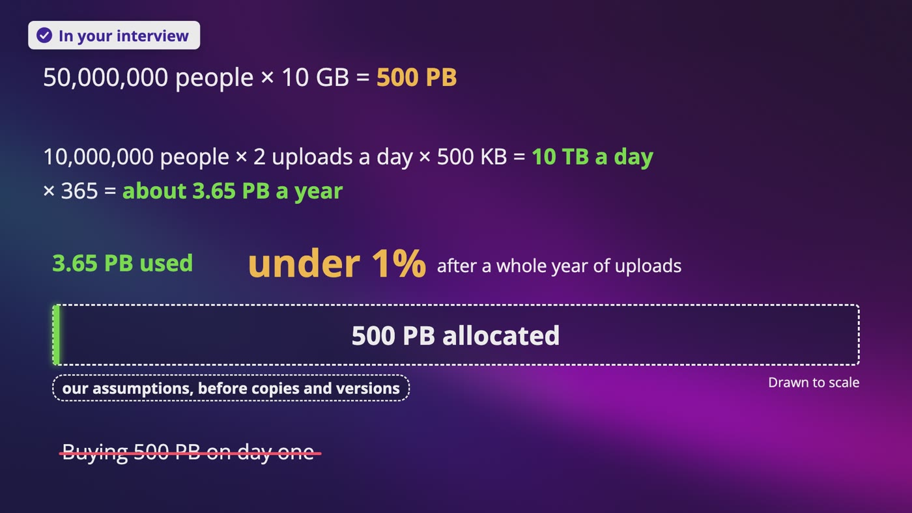
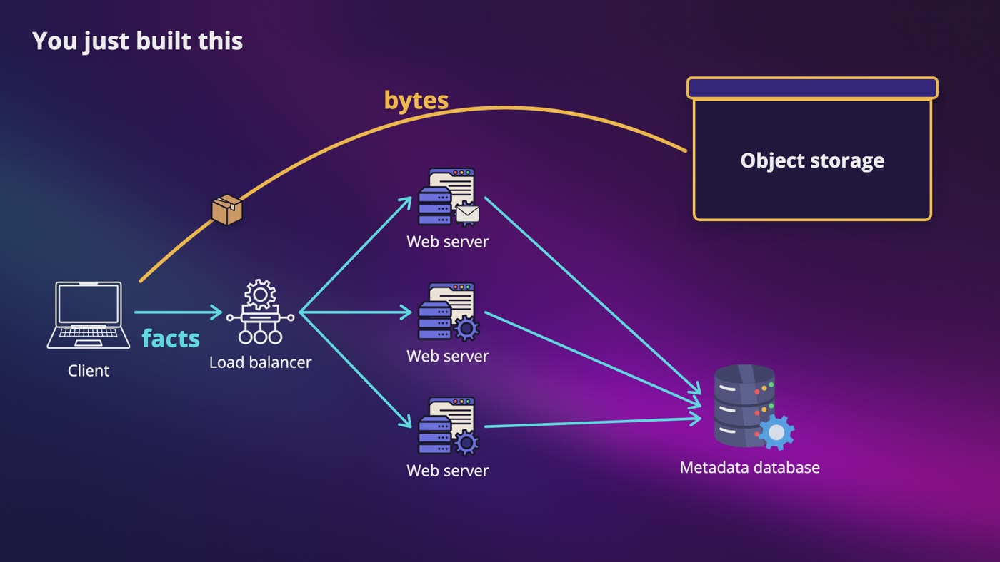
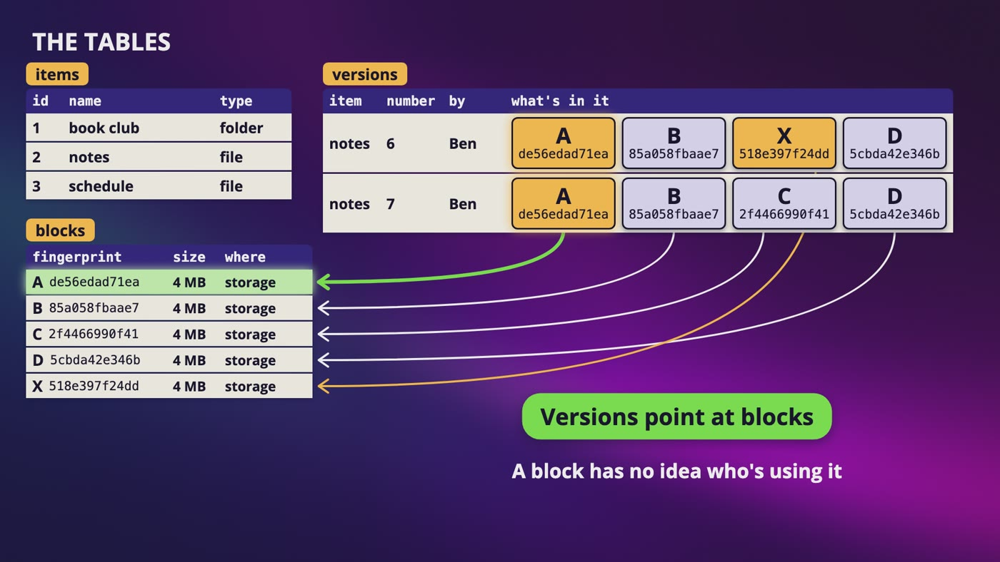
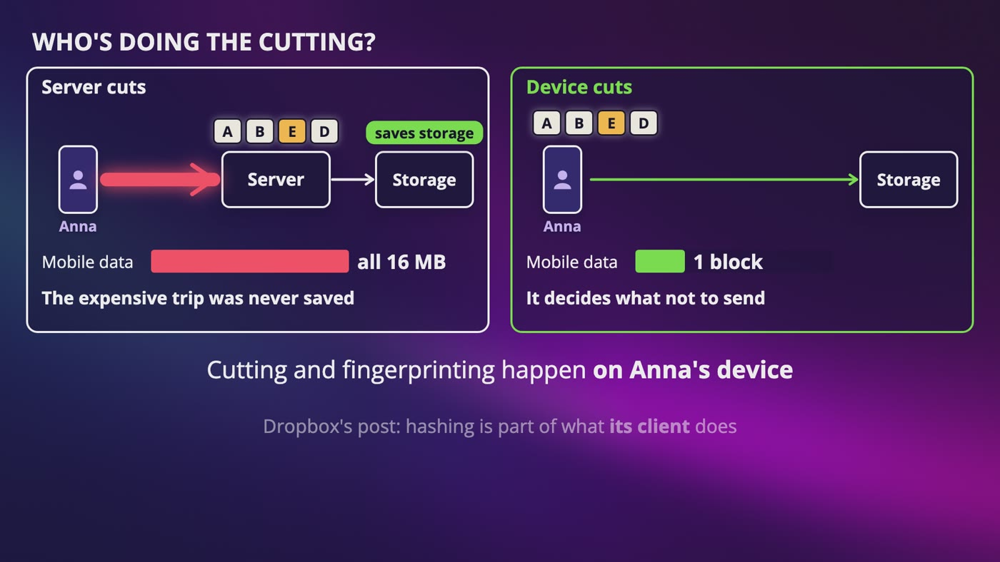
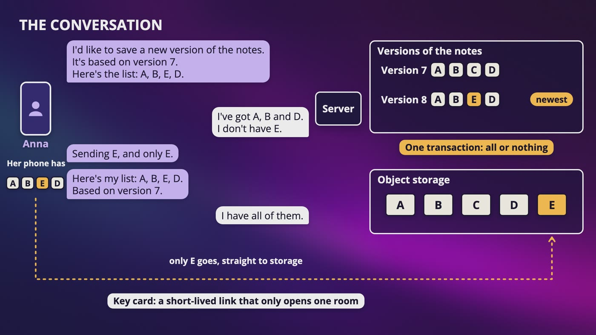
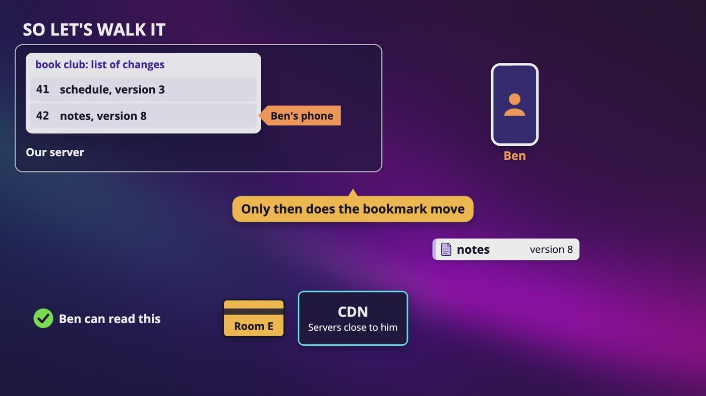
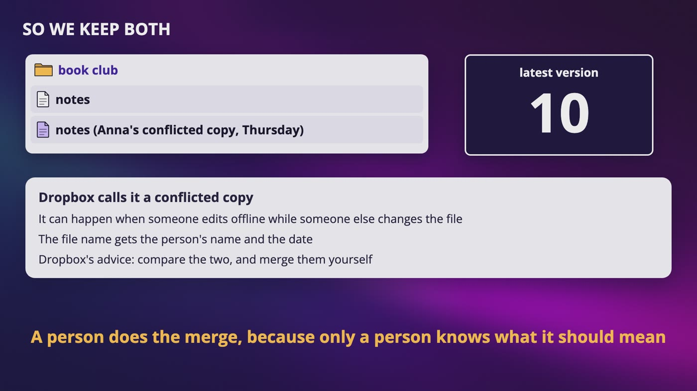
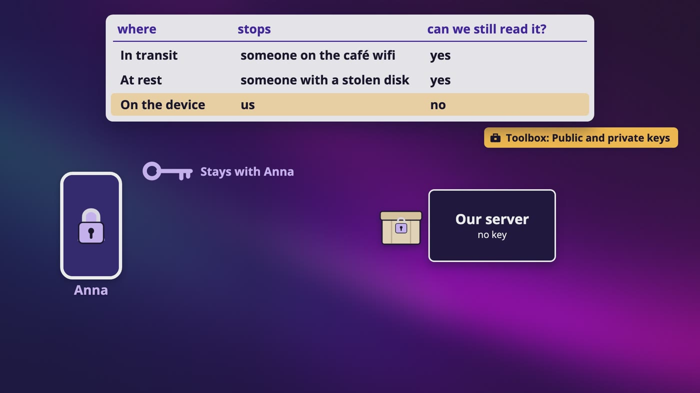
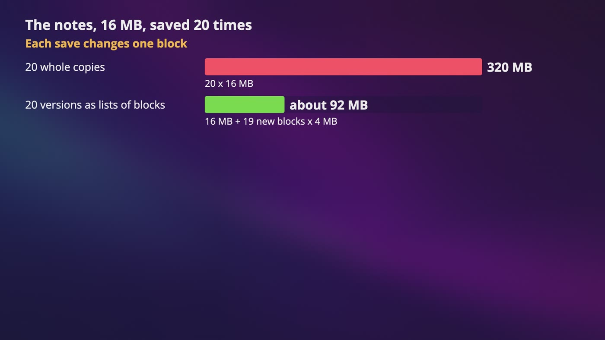
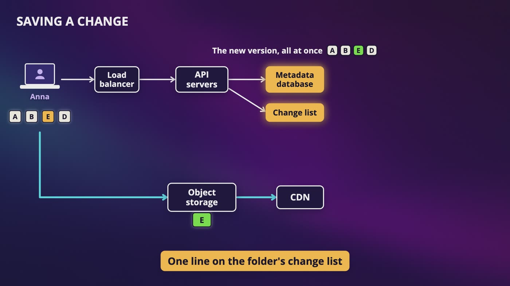

# [Chapter 15: Design Google Drive](https://www.udemy.com/course/system-design-zero-to-hero/?referralCode=183D59A1EBE9E71D26FF)

_One shared folder, one short question, and why the hard part was never storing a file._

[Download as PDF](../pdf/System-Design-Chapter-15-Notes.pdf)

## Contents

1. [Design Google Drive: What Are We Building?](#1-design-google-drive-what-are-we-building)
2. [From One Server to Many](#2-from-one-server-to-many)
3. [Files and Folders Are Just Data](#3-files-and-folders-are-just-data)
4. [Cutting Files Into Blocks](#4-cutting-files-into-blocks)
5. ["Which Blocks Do You Need?"](#5-which-blocks-do-you-need)
6. [Telling Your Other Devices](#6-telling-your-other-devices)
7. [When Two People Edit the Same File](#7-when-two-people-edit-the-same-file)
8. [Sharing, and Keeping It Safe](#8-sharing-and-keeping-it-safe)
9. [Paying for All Those Versions](#9-paying-for-all-those-versions)
10. [The Whole Google Drive Design, for Your Interview](#10-the-whole-google-drive-design-for-your-interview)

## 1. Design Google Drive: What Are We Building?

> **The big idea:** This question looks like file upload, but the hard part was never storing a file. The hard part is sync, and losing someone's file is the one thing we can't do.

_We've promised 500 PB, and a whole year of uploads is only about 3.65 PB, which is under 1%._

### Where this starts

- Anna makes a shared folder for the book club, with notes, a reading schedule, and Dan's whole 80 minute review, about 10 GB.
- Later that week, Anna opens the notes on the bus with no signal, and adds a few lines. Ben changes something at home. They both think they've saved.

### Step one: what we asked

- **Sync is the main thing,** along with uploading and downloading.
- **Phones, laptops and a website.** 50 million people have signed up, 10 million are active on a normal day, and everyone gets 10 GB for free.
- **Sharing and old versions: yes.** Old versions mean that a file is more than one thing.
- **Typing in the same document at the same time: no.** That removes a completely different system.

### Two more things to ask

- **Mobile data:** let's say it matters, because people are on the bus with a small plan. We'll use this later to check our own design.
- **What we rank first:** a slow sync is annoying, and someone's only copy of their thesis being gone is something they never forgive. So durability goes above everything else.

### The math

- 50 million people, times 10 GB each, is **500 PB**. But that's what we've promised, not what we're using.
- 10 million people, times 2 files a day, times 500 KB, is **10 TB a day**, and about 3.65 PB a year. That's before copies and old versions.
- People don't fill up their free space, and that's how anyone can afford to give it away.
- 20 million uploads a day, divided by about 86,000 seconds, is about 230 a second, and about 460 at the peak.
- Dan's review is 20,000 times bigger than the average file. We're designing for a huge number of tiny files, and a few enormous ones.

> **In your interview:** Design Google Drive and design Dropbox are the same question. Say out loud that you rank not losing files first. And notice that 500 PB is what you've promised, and not what arrives. I'd love to hear someone notice that in an interview.

> **In the real world:** Most of the public engineering detail in this chapter comes from Dropbox, which has written a lot about how it does this.

**New terms**

| Term | Meaning |
|---|---|
| **Sync** | Keeping copies in different places the same. |
| **Durability** | Once it's saved, we don't lose it. |
| **Allocated** | How much space we've promised, which isn't how much is being used. |
| **Google Drive / Dropbox** | Google's service for keeping your files online, and a company built around the same idea. |

## 2. From One Server to Many

> **The big idea:** Watch it break, and you know what comes next. We end up with two kinds of data: bytes go in object storage, and facts go in a database.

_Bytes go straight to object storage, and facts go through the load balancer and web servers to a metadata database._

| What breaks | What happens, and what we do |
|---|---|
| The disk | At 10 TB a day, a 20 TB disk is full in 2 days. Add more servers, and use the user's ID to pick one. |
| A 4th server | User 7 with 3 servers leaves 1, and with 4 it leaves 3, so their files move. Use the ring from our consistent hashing chapter. |
| A dead disk | Keep 3 copies, not all in the same building, and repair in the background with fingerprints and Merkle trees. |
| Web server | One is a single point of failure, so a few stateless ones go behind a load balancer. |
| A 10 GB file | It would hold a server for over an hour, so files go straight to object storage, with a short-lived link. |

### Why moving is worse here

- In our consistent hashing chapter, a moved customer meant a cache miss, so one extra trip to the database.
- Here, moved means that somebody's actual files have to be copied across the network, and that's terabytes.

### Somebody already built this

- A ring, 3 copies and repair in the background: we just built our key-value store again. So all of that goes behind one box, **object storage**.

### Two kinds of data

- **Bytes:** huge, and they almost never change once they're written. Object storage is great at those.
- **Facts:** what it's called, which folder it's in, who owns it, and which version is the newest. They're tiny, they change all the time, and they have to be right. Those go in a database.

> **In your interview:** Treating object storage as a black box is the right call, unless they specifically ask you to design the storage. You don't memorize a Google Drive diagram. You watch something break, and you know what comes next.

**New terms**

| Term | Meaning |
|---|---|
| **Black box** | Something we use from the outside, and we don't care what's inside. |

## 3. Files and Folders Are Just Data

> **The big idea:** An item has a parent, a version is just an ordered list of fingerprints, and each block lives once.

_Both versions point at blocks, and each block lives just once. A block has no idea who's using it._

### The tables

- **Items:** an ID, a name, and whether it's a file or a folder.
- **Versions:** which item, a number, who made it, and an ordered list of fingerprints.
- **Blocks:** one row for each fingerprint, with its size and where it's stored.

### The arrow goes one way

- If a block row pointed at one version, versions 6 and 7 couldn't share block A, and the whole reason for blocks is gone.
- **Versions point at blocks.** Ben wants version 6 back? We copy nothing, and we write one more version that says A, B, X, D.

### Renaming a folder

- Store the whole path on each file, and renaming a folder with 200,000 files is 200,000 writes for one click.
- Folders are a tree, so **every item only stores its parent's ID**. Now a rename or a move is one change to one row.
- The cost: to find a file from its path, you walk down one level at a time.
- **The trap:** someone moves a folder inside itself. Before a move, walk up from the destination, and if you run into the folder being moved, say no.

### Why a relational database

- A new version adds a row and updates which one is the newest, and those writes have to happen together. That's the real reason, not the label, because some NoSQL databases offer transactions now too.
- A replica can be behind, so the newest version comes from the primary. A transaction across 2 shards stops being easy, so we'd shard by shared folder.

### ACID, with Anna buying the last copy

- **Atomic:** all or nothing, so she can't get charged with no order.
- **Consistent:** the rules always hold, so stock can't go below zero.
- **Isolated:** 2 people buying at the same time don't trip over each other.
- **Durable:** once it's saved, it stays saved.
- **The C in ACID isn't the C in CAP.** In CAP, it meant that everyone sees the latest data.

> **In your interview:** Be able to draw this: an item has a parent, a version is a list of fingerprints, and blocks live once. And bring up the folder-inside-itself trap without being asked.

> **In the real world:** Dropbox wrote in 2020 that in its old sync engine, files had no stable ID across a move, so a move looked like a delete and an add. In the new one, a move is one step, no matter how much is underneath. Amazon's DynamoDB and MongoDB, a popular document database, both offer transactions now.

**New terms**

| Term | Meaning |
|---|---|
| **Item** | The things you see in a folder. A file and a folder are both items. |
| **Path** | The address of a file, like book club/week one/notes. |
| **ACID / transaction** | Atomic, consistent, isolated and durable. A group of steps that works like this is called a transaction. |
| **Namespace** | A named space that things live in. Dropbox's post uses the word for a space like a shared folder. |

## 4. Cutting Files Into Blocks

> **The big idea:** Cut files into blocks, fingerprint each one, and send only what changed. To save mobile data, the cutting has to happen on the device.

_If the server does the cutting, Anna's phone still sends all 16 MB. If her device does it, it sends 1 block._

### Send the whole thing?

- Anna's notes are 16 MB, which is 128 megabits. Under the bridge at 2 megabits a second, that's more than a minute of her data plan, to change one line.
- Dan's 10 GB, at 20 megabits a second, is over an hour of uploading.

### Blocks

- Anna's 16 MB is 4 blocks, and Dan's 10 GB is about 2,500. Our average 500 KB file just fits in one, so blocks do nothing for most files, and a huge amount for the big ones.
- Her file is A, B, C, D. She changes a line in the third block, and now it's A, B, E, D.
- One is different, so we send that one block: 4 MB, **16 seconds** instead of more than a minute.

### Who does the cutting?

- If the phone sends the file to a server that cuts it, it saves storage, but the expensive trip on the bus was never saved.
- **The device is the only one who can decide what not to send.**
- That isn't free. It's the same logic in your Windows, Mac, iPhone and Android apps, they all have to cut in exactly the same way, and a bug in an old version can sit on someone's phone for years.

### Compress first, then encrypt

- Compression finds patterns, and encrypted data looks completely random.
- Simulated with 1 MB of text, compressing and then encrypting gives about 28% of the size. Encrypting first gives 100%, so no savings at all.

### The one-letter trap

- Add one word to a book cut every 100 words, and every cut after it lands somewhere new.
- Simulated with a 40 MB file in 4 MB blocks, overwriting one byte changes 1 block out of 10. Inserting one byte near the start gives 11 new blocks out of 11.
- **The fix:** cut by what's in the content, like always cutting right after a chapter heading. For a file, slide a small window along the bytes, hash it, and cut when the hash ends in a certain pattern.
- On the same file, with the same inserted byte, 1 chunk out of 26 is new.

> **In your interview:** Say the costs of cutting on the device out loud, because that's the price of the requirement. Fixed blocks are fine to start with. Just say the trap without being asked, and say that you could cut by content if inserts turn out to be common.

> **In the real world:** Dropbox wrote in 2014 that it uses blocks of 4 MB, and its post describes hashing as part of what its client does. It wrote in 2020 that compression saved about 30% on uploads, and it described its blocks as aligned chunks of up to 4 MB.

**New terms**

| Term | Meaning |
|---|---|
| **Block** | A piece of a file. Each piece is the same size, and each one gets a fingerprint. |
| **Delta sync** | You only send the difference. Delta is a word for the difference between 2 things. |
| **Content-defined chunking** | Cutting a file by what's in the content, instead of by position. |
| **LBFS** | A research file system built for slow networks, which described this idea in 2001. You probably won't get asked this. |
| **rsync** | A free tool that exists to update a file on another machine by only sending what's different. |
| **Rolling checksum** | What rsync uses. A checksum is just a short number used to check data. |

## 5. "Which Blocks Do You Need?"

> **The big idea:** Which ones do you need? Here they are. Okay, make it official. That one short conversation does 3 different jobs.

_Anna's phone sends its list, the server only needs E, E goes straight to storage, and one transaction makes version 8 official._

| Job | What happens |
|---|---|
| Delta sync | Anna changed one line. The answer was 1 block, so we sent 1 block. |
| Deduplication | Anna copies the notes into another folder. The server has all of those, so not one byte moves, and it takes no extra space. |
| Resuming | Dan loses signal at block 1,800 of 2,500. He asks the same question, and the server says, I still need these 700. |

### The conversation

- Anna's phone: I'd like to save a new version, based on version 7, and here's the list. A, B, E, D.
- Our server: I've got A, B and D. I don't have E.
- Her phone sends E, and only E, straight to object storage with our key card.
- Her phone says the same thing again. Now the server has all of them, so one transaction adds version 8 and makes it the newest.

### Sending a block twice

- Nothing happens. A block is stored under its fingerprint, so the second one lands on the same name with the same bytes. That's idempotency.

### Why nothing shows until commit

- While Dan's blocks arrive, Ben sees nothing, because there's no new version yet.
- If you tell other devices while a file is still uploading, Ben goes to download it, only half of the blocks exist, and he gets a broken file.
- The commit is one transaction, so Ben either sees the old version or the new one, and only after that do we tell anybody.

### Who holds the blocks?

- **Direct:** we don't pay for servers to hold on to slow phones. I'd start here, and a worker can scan a file after it arrives.
- **A block server** gives you one place to check things, but that's more machines to run and scale.

> **In your interview:** A list of features sounds like you memorized them, and one idea that does 3 jobs sounds like you understand it. Direct or block server is fine either way, as long as you say what it costs.

> **In the real world:** Dropbox wrote in 2014 that the client tries to commit the list, the server answers with which blocks it needs, the client sends those, and then it tries the commit again. Its post has a block server too.

**New terms**

| Term | Meaning |
|---|---|
| **Commit** | The last step of the conversation, which means that it's now real. |
| **Deduplication** | Keeping one copy of something that shows up many times. Also called dedupe. |
| **Block server** | One of our own servers that sits in the middle and takes the blocks. |

## 6. Telling Your Other Devices

> **The big idea:** A small nudge says that something changed, each folder has a change list, and each device has a bookmark. A nudge can get lost, and nothing breaks.

_Ben's phone gets a key card for block E, the block comes through the CDN, and only then does the bookmark move._

### Which line do we need?

- WhatsApp needed the open phone call, because a chat goes both ways, all the time.
- Ben's phone only needs one sentence from us, and 3 seconds late is fine. So long polling or server-sent events will do. **Requirements decide.**
- With long polling, the server answers when there's something to say, that ends the request, and the client asks again.

### The nudge

- It only says, something changed in this folder.
- If Ben's app is closed, it goes through our courier, Apple or Google, and that's best effort. If the nudge were the only way Ben learned anything, one lost nudge would mean his notes are wrong forever.

### The bookmark

- Anna's commit goes in as line 42 on the folder's change list, and each device in the folder gets a nudge.
- Ben's phone asks, what changed after 41? The answer is, line 42, the notes are now version 8, and the list is A, B, E, D.
- It has A, B and D, so it only needs E. The server checks that he's allowed to read this, and block E comes through the CDN.
- His phone puts the file back together, and only then does it move the bookmark. If the connection drops, he asks the same question again.
- A phone can update its list of what exists, and only download the blocks when he taps on the file. That's our own design choice, from the mobile data requirement.

### Closed for a week

- Ben's laptop has a bookmark at 35. It asks what changed after 35, and gets a longer answer. If the notes changed 10 times, it doesn't care about the first 9.
- An offline queue for every device isn't needed. Ben's old tablet is in a drawer, its queue just keeps growing, and there are millions of those drawers. The change list plus his bookmark already is the queue.

### When the nudge server dies

- 2 million phones try to reconnect right away, and that wave can knock over the next server.
- The fix is randomness. If each phone waits a random time, spread over a minute, that's about 33,000 a second.
- Every phone still has its bookmark, and every change is still in the list, so nothing is lost.

> **In your interview:** Know this well: a small nudge, a change list for each folder, and a bookmark for each device. Offline for a week? You ask the same question, and you get a longer answer. Why not WebSocket? One way and a few seconds late is fine. If the notification server dies, nothing is lost, because notifications were never the source of truth.

> **In the real world:** Dropbox's public API has a cursor, and a long polling call that only tells you that something changed. Google Drive's docs say that its notifications don't include the change itself, and that there's one entry per file in the change log. We can't tell what their own apps do inside, but it's the same shape.

**New terms**

| Term | Meaning |
|---|---|
| **Nudge** | A small message that only says something changed, so that the device goes and asks. |
| **Change list** | A list for each shared folder, where every commit adds one line with the next number. |
| **Page token** | What Google Drive's public API gives you to save for next time. It's the same shape as a bookmark. |

## 7. When Two People Edit the Same File

> **The big idea:** Every save says which version it's based on. One atomic step checks it, and the loser gets kept as a conflicted copy, so nobody's work disappears.

_Anna's paragraph gets saved as a conflicted copy right next to the notes, and a person does the merge._

### Slow motion

- The notes are on version 9. Anna's on the bus with no signal, and she writes a long paragraph about the ending of The Dead.
- Ben changes the date of Saturday's meeting. His save is based on 9, that's a match, so the server makes version 10.
- The bus comes out into the signal, and Anna's phone says, based on version 9.
- The server says no. The latest is 10, so she never saw Ben's change, and accepting this would make it disappear.

### How the server knows

- If the latest is still the number you're based on, you get the next one. If it isn't, that's a conflict.
- In the exact same millisecond, we don't check and then write. One step does it: set the latest to 10, only if it's still 9.
- Why not vector clocks? That design had no boss. Here, one place decides, the primary database for this folder, so one number is enough, and the check can't go to a replica.

### So now what?

- **Last write wins:** somebody's work is gone, and that's what we ranked first, so no.
- **Merge:** easy for a cart, but our system only sees blocks. It could be a photo, a spreadsheet or Dan's video, so there's no general way.
- **Keep both:** Anna's phone downloads version 10, and her paragraph gets saved as a new file right next to it.

### What strong really means

- "A file should never look different on 2 devices" is impossible. Anna's phone is showing an old version right now, on this bus.
- The server's record of the latest version has one answer, and every commit goes through it. **It's strong in the middle, and eventual around the edges.**
- The cost: if the primary can't be reached, nobody can commit. Anna can keep typing, but it isn't official until it gets through.

### Fewer conflicts

- The faster a nudge arrives, the smaller the window. "Ben is editing this" is only a hint, and it does nothing for someone on a bus.
- Google Docs is a different problem. It has to combine small edits as they happen, and that only works if it understands what's in the document.

> **In your interview:** Please don't just say that the last one wins. Every save says which version it's based on, one atomic step checks it, the loser gets kept as a conflicted copy, and you can't merge because you don't know what's in the file. Then say what strong means here. This is where they're most likely to push you.

> **In the real world:** Dropbox's help page says a conflicted copy can happen when someone edits offline while someone else changes the file. The file name gets the person's name and the date, and its advice is to compare the two and merge them yourself. Dropbox also wrote in 2020 that it redesigned its sync protocol to have strong consistency.

**New terms**

| Term | Meaning |
|---|---|
| **Compare-and-set** | One step that nothing can interrupt: set the latest to 10, only if it's still 9. One wins, and the other gets told no. |
| **Conflicted copy** | Dropbox's name for the file that keeps the loser's work, right next to the original. |
| **Operational transformation / CRDTs** | 2 names for how tools like Google Docs combine small edits. You most probably won't be asked how they work in this question. |

## 8. Sharing, and Keeping It Safe

> **The big idea:** One table says who can do what, and the server checks it on every request. With encryption, the question to ask each time is who's able to read this.

_3 places to encrypt. On the device, the key stays with Anna, and our server has no key, so we can't read the file._

| Where | What it stops | Can we still read it? |
|---|---|---|
| In transit | On the road. Someone on the café wifi | Yes |
| At rest | On the disks. Someone with a stolen disk | Yes |
| On the device | Locked before it leaves. Us | No |

### Who can do what

- Anna owns the folder, Ben and Dan can edit, and Cara can only read. One table: which item, which person, and what they can do.
- Check it **on the server, on every request**, because hiding a button doesn't stop someone from sending the request directly.
- Cara has no row on the notes, so we walk up to the parent, the book club folder, and there she is. That's why one row can share a whole folder.
- You might cache these answers, but if you remove Ben, a cached answer can still say he's an editor for a while. So keep those short.

### The key card

- Check first, then hand over the card. If Ben gets removed, a link he already has works until it expires, so that's another reason to keep them short.

### Share links

- For a friend with no account, add one more row, where the person is anyone who holds this secret.
- A short link isn't a password. It has to be long and random, and the owner should be able to expire it or turn it off.
- A leaked link looks like somebody using the link, so make specific people the default.
- A shared folder can spread a virus, so you can check files after they've arrived.

### What you give up on the device

- The server can't preview, search or scan what it can't read.
- People locking the same file get different scrambled blocks, so dedupe stops working across them.
- If someone loses their key, nobody can help them.

> **In your interview:** This is the first thing I'd ask about. Ask about encryption in step one, because it changes the design. You could say, I'll encrypt in transit and at rest, and we keep the keys, so we can still dedupe and search. If you need us not to be able to read it, I can do that, and here's what we'd lose.

> **In the real world:** Google says that files in Drive are encrypted in transit and at rest, and Dropbox says the same. Apple's optional Advanced Data Protection for iCloud keeps the keys for your iCloud Drive files only on your own trusted devices, and Apple can't help you recover that data. Google offers client-side encryption for Drive, with a Workspace account, if your administrator turns it on.

**New terms**

| Term | Meaning |
|---|---|
| **Access control list (ACL)** | A list of who can do what. |
| **Encryption in transit** | Encrypted on the road. That's HTTPS, and it stops anyone on the café wifi. |
| **TLS** | The technology underneath HTTPS. SSL is the old name, and its last version was officially ruled out in 2015, so please say TLS. |
| **Encryption at rest** | Each block gets scrambled before it's stored. The company holds the key, so it can still make previews, search and dedupe. |
| **Encryption on the device** | The file gets locked before it leaves Anna's phone, and the company never gets the key. |
| **Zanzibar** | A system Google published in 2019, so that its products can share one way of storing and checking these lists. You probably won't get asked this. |

## 9. Paying for All Those Versions

> **The big idea:** Blocks make old versions cheap, but they still grow forever. So thin them out, be careful how far dedupe goes, move what's cold, and don't delete without counting.

_The 16 MB notes, saved 20 times: 320 MB as whole copies, and about 92 MB as lists of blocks._

### Durable against available

- **Durability:** the data isn't lost. **Availability:** you can reach it right now.
- A power cut might make your file unreachable for an hour. That's an availability problem. It's only a durability problem if it's gone for good.

### Versions

- 20 whole copies is 320 MB. With blocks, it's the first 16 MB plus 19 new blocks at 4 MB each, so about 92 MB.
- A rule we made up: keep every version from the last day, one a day for the last month, and nothing older. We keep them to recover from a bad edit, and from ransomware.

### How far should dedupe go?

- **Across accounts** dedupe saves way more than inside one account, but the conversation gives things away. A stranger can upload a document to learn whether anyone has it, or try every possible salary on a form until one uploads instantly.
- So dedupe within an account, or do the check across accounts on our side after the file has arrived, which costs you the bandwidth.
- Knowing a fingerprint is never proof that you're allowed to have something, and a collision could hand someone a stranger's block, so use a long and strong hash.

### Cold storage

- Like a storage unit across town: cheap and safe, and you can't get to it right away. Moving an old version there is fine. A tax file that someone opens in a panic the night before it's due, think about it first.

### Deleting is a trap

- A block might belong to 1,000 other files, so deleting a file can't just delete its blocks.
- Keep a count of how many versions use each block, or every so often, find the blocks that nothing points to.
- A deleted file goes to a trash folder first, because people make mistakes.

> **In your interview:** Buy it when you're small, and build it when the bill is bigger than the cost of building it. Please don't draw your own storage system for a company that just started.

> **In the real world:** Amazon says that S3's normal storage is designed for 11 nines of durability and 4 nines of availability. Researchers showed in 2011 that on Dropbox at that time, knowing a file's fingerprints could get you the file. Dropbox wrote in 2016 that it had gone from about 40 PB in 2012 to about 500, and had moved over 90% of its users' data onto its own custom-built storage.

**New terms**

| Term | Meaning |
|---|---|
| **Ransomware** | A kind of attack that scrambles your files and asks for money. |
| **SHA-256** | A long and strong hash, which Dropbox's posts say it uses. |
| **Cold storage** | Cheaper storage that's slower to get back. Cold just means rarely touched. |
| **Glacier** | Amazon's cold storage. The slowest one, Deep Archive, can take 12 hours to get something back, or up to 48 on its cheapest setting. |
| **Garbage collection** | Sweeping up what nobody's using anymore, like the blocks from when Dan gave up in the tunnel. |
| **Magic Pocket** | Dropbox's own custom-built storage. |

## 10. The Whole Google Drive Design, for Your Interview

> **The big idea:** Facts and bytes travel separately, and nothing is official until the commit.

_Saving a change: blocks go straight to object storage, and the commit adds the new version and one line on the folder's change list._

| If they ask | You say |
|---|---|
| Syncing changes | The device cuts the file into blocks, fingerprints them, and only sends what's missing. Mention the one-letter trap yourself. |
| 2 people edit | Every save says what it's based on, one atomic step checks that, and the loser becomes a conflicted copy. |
| Offline a week | The device has a bookmark, it asks what changed, and it gets a longer answer. There's no queue for each device. |
| Sharing | A table of who can do what, checked on the server on every request. Walk up the tree, then hand over a short-lived link. |
| The same file twice | The server already has those fingerprints, so nothing gets sent. Add that across accounts, that can leak. |

### Saving a change

- Anna's device cuts the file into blocks, works out a fingerprint for each one, and compresses them.
- It sends the list and the version it's based on. Our servers check that she's allowed to edit, and answer with what's missing.
- Her device sends only those, straight to object storage, each with a short-lived key card, and then it says commit.
- In one transaction on the primary database, the new version exists all at once, and one line goes on the change list. If the version check fails, her work becomes a conflicted copy.

### Getting a change

- The notification servers nudge each device in the folder. If Ben's app is closed, that goes through our courier.
- Ben's device asks what changed after its bookmark, and works out which blocks it doesn't have.
- Our servers check that he's allowed to read, and the blocks come from the CDN. His device puts the file back together, and only then does the bookmark move.

### What if something dies?

- **An upload:** the device asks again, and gets told what's missing.
- **A notification server:** phones reconnect with a random delay, and nothing's lost.
- **The primary database:** we promote a replica, and one that's behind could lose the last commit. So we wait until a replica has also said got it before we tell Anna it's done. That's W from our quorum video, and it costs a little time on every save.

### Your 45 minutes

- **The problem, 3 to 10 minutes:** ask about sync, devices, how many people, sharing, versions, encryption and typing together, and rank not losing files first. Say that 500 PB is what we promised, and about 3.5 PB a year is what arrives.
- **High level design, 10 to 15:** object storage as a black box, split bytes from facts, and draw the tables.
- **Deep dive, 10 to 25:** blocks and that conversation first, then conflicts. Check your design against your own requirement.
- **Wrap up, 3 to 5:** say what you'd watch, like how long a change takes to reach another device, and how often conflicts happen.

### The book club

- On Friday night, Cara finally finishes Dubliners. Her phone only has to ask what changed. She reads the notes, then Anna's conflicted copy, and nothing got lost.

> **In your interview:** Please be able to draw both directions from memory. If you said that mobile data matters, say why the cutting happens on the device. And please never say that your design is perfect.

## Recap: How one folder stays in sync

_The only really new thing was one question: which blocks do you need?_

| Every piece solved a real problem | |
|---|---|
| **Object storage** | Disks fill up, and disks die |
| **Bytes and facts apart** | Huge files, and tiny facts that change |
| **A parent ID on each item** | One rename meant 200,000 writes |
| **Blocks** | One changed line sent the whole file |
| **Cutting on the device** | The bus trip was never saved |
| **One short conversation** | Delta sync, dedupe and resuming |
| **Commit** | Half-uploaded files showing up |
| **A nudge and a bookmark** | Telling devices, even a week later |
| **Version numbers** | 2 people saving at once |
| **Conflicted copy** | Somebody's work disappearing |
| **Access control list** | Strangers reading the folder |
| **Thinning, cold storage and sweeping up** | A bill that grows forever |

**What to know really well**

- Why the cutting happens on the device
- That conversation, and its 3 jobs
- Version numbers, conflicted copies, and what strong means here
- The nudge and the bookmark
- A version as a list of fingerprints, with items that have a parent

---

From the course **[System Design: Zero to Interview Hero](https://www.udemy.com/course/system-design-zero-to-hero/?referralCode=183D59A1EBE9E71D26FF)** by Nata Vacheishvili.
