# [Chapter 16: Design What's Near Me](https://www.udemy.com/course/system-design-zero-to-hero/?referralCode=183D59A1EBE9E71D26FF)

_One phone at 4%, one pair of scissors, and how to find what's close among 200 million places._

[Download as PDF](../pdf/System-Design-Chapter-16-Notes.pdf)

## Contents

1. [What's Near Me?](#1-whats-near-me)
2. [Two Simple Services](#2-two-simple-services)
3. [Why a Database Index Isn't Enough](#3-why-a-database-index-isnt-enough)
4. [Cutting the Map Into Squares](#4-cutting-the-map-into-squares)
5. [Geohash: An Address for a Square](#5-geohash-an-address-for-a-square)
6. [The Greenwich Problem](#6-the-greenwich-problem)
7. [Quadtree: Cut Only Where It's Crowded](#7-quadtree-cut-only-where-its-crowded)
8. [Quadtree in Real Life](#8-quadtree-in-real-life)
9. [Beyond Squares: S2 and Hexagons](#9-beyond-squares-s2-and-hexagons)
10. [Do We Even Need a Cache?](#10-do-we-even-need-a-cache)
11. [Your Location Is Private](#11-your-location-is-private)
12. [The Whole What's Near Me Design, for Your Interview](#12-the-whole-whats-near-me-design-for-your-interview)

## 1. What's Near Me?

> **The big idea:** Find what's close to you, for places that stay still, all over the world. Almost nobody writes anything, so the hard work can happen ahead of time.

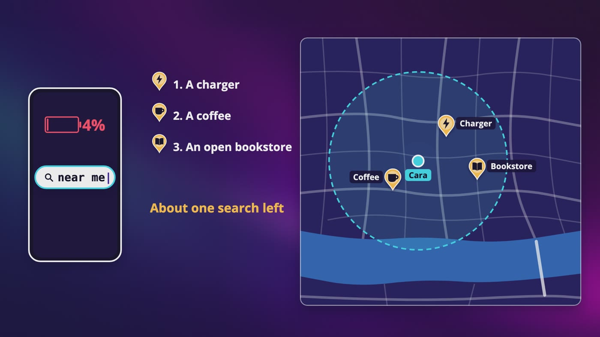

_Cara's phone is at 4%, she has about one search left, and she needs a charger, a coffee and an open bookstore._

| What we asked | The answer | What it did |
|---|---|---|
| Still or moving? | Places that stay still | They can be organized ahead of time. Ask this first. |
| How far? | 500 meters up to 20 km | Whatever we build has to handle both. |
| Nothing in range? | Show something anyway | Real trouble, like in the middle of the Pacific. |
| New hours? | The next day is fine | A whole lot of hard work goes away. |
| Where? | The whole world | We can't ignore anything strange about the planet. |
| Sorted how? | By distance, for now | We have to measure real distances. |

### Cara lands in Lisbon

- The book club is going to a festival in Lisbon. Cara lands at 11 at night, on her own. Her bag didn't make it, and her charger's in the bag.
- She needs a charger, then a coffee, and then the nearest bookstore that's still open.

### The math

- 100 million people a day, times 5 searches, is 500 million searches a day. These numbers are just for this exercise.
- A day has about 100,000 seconds if we round it, so that's about **5,000 searches a second**, and the exact answer is closer to 5,800. At a peak of about double, say **10,000**.
- Let's say that 100,000 places change something on a normal day, a number we made up. That's about **1 write a second**.
- Thousands of reads to 1 write. When something's almost never written, you can do all of the hard work ahead of time.
- At 1 KB for each of 200 million places, it's **200 GB**. The kilobyte is our own guess.

> **In your interview:** Ask first whether it's places that stay still, or things that move. If you design for cafés and your interviewer meant cars, you've designed the wrong thing.

> **In the real world:** You've used this question a lot. Uber has to know which cars are close to you, Pokémon GO has to know what's around you, Tinder shows you people nearby, and Google Maps does it every time you type coffee.

**New terms**

| Term | Meaning |
|---|---|
| **Proximity service** | A service that finds what's close to you. |
| **Radius** | How far you're searching from the middle. |
| **Read-heavy** | Way more reads than writes. |

## 2. Two Simple Services

> **The big idea:** Two questions, two services. Search answers what's around me, and the place service answers tell me about this one. The search box is the only part that's actually hard.

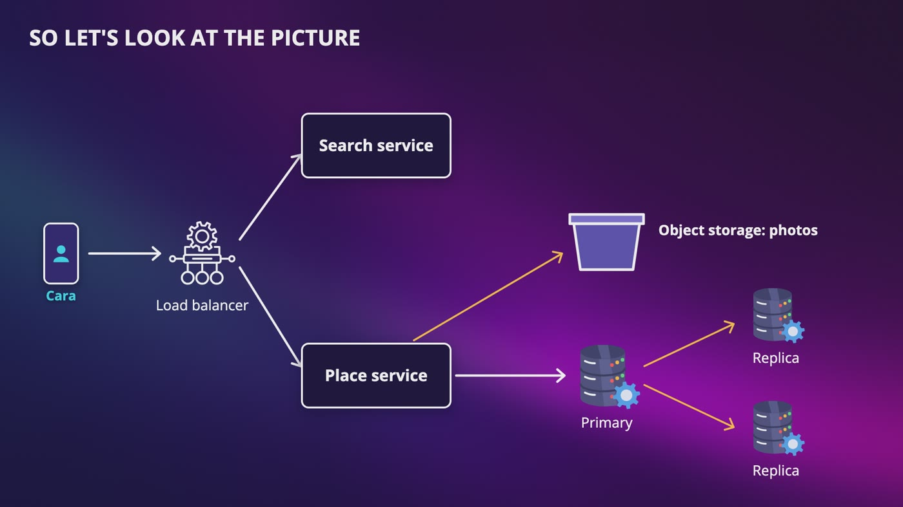

_The easy part: a load balancer, a search service, a place service, a primary with its replicas, and object storage for the photos._

### Two questions

- **The search service** gets a location and a radius, and gives back a short list of place IDs, each with how far away it is, and that's it.
- **The place service** answers tell me about this one. It's also where owners add a place, change their hours, or remove it.
- After the search comes back, her phone asks the place service for those places, all in one request.

### Why split them?

- Search is a huge number of very small reads. The place service answers bigger questions, and it's the only one that takes writes.
- We can add more search without touching anything else.
- If a bug in the owners' screen takes the place service down, Cara can still get her list.

### The table

- Each row has an ID, a name, an address, a category, a latitude, a longitude and the opening hours.
- **Opening hours** look like one number, and they aren't. A place might close for lunch, stay open past midnight on Fridays, and it's in its own time zone. So is this open right now has to use the place's own clock.
- Photos go straight to object storage, and the table only keeps a pointer.

### Copies

- One primary database takes all of the writes, and a few read replicas answer the reads. A replica can be a few seconds behind, and nobody's hurt.
- **The next day is fine** is a business decision, and it does a huge amount of engineering work for free.
- Slightly old is fine, until it isn't. Cara walks 20 minutes at midnight to a bookstore that closed for good. So people can report a place as closed, and the place service hides it right away.

### Stateless

- Cara's location comes in, an answer goes back, and the server can forget that she ever asked.

> **In your interview:** Say out loud that the next day is fine. Noticing that a sentence from the product side just removed a whole problem is a really good habit.

**New terms**

| Term | Meaning |
|---|---|
| **Location-based service (LBS)** | A name for anything that answers based on where you are. |

## 3. Why a Database Index Isn't Enough

> **The big idea:** A sorted list only has one direction, and the map has neighbors in every direction. So a normal index can't keep close places next to each other.

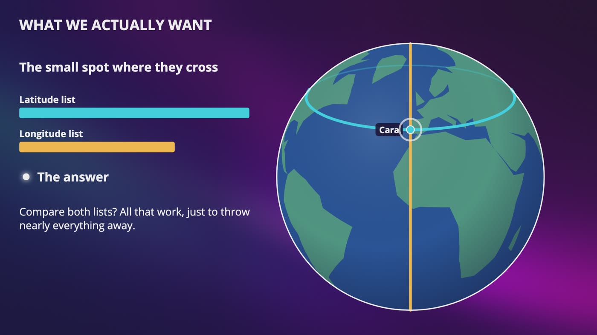

_An index on latitude gives a ring around the planet, and an index on longitude gives a slice from pole to pole. The answer is the small spot where they cross._

### A giant grid

- Every place on Earth is just 2 numbers. Cara's at about 38.7 north and 9.1 west.
- In a computer, north and east are usually positive, and south and west are negative, so that's 38.7 and -9.1.
- One degree of latitude is about 111 km on the ground.

### Read everything

- 200 million rows for one search is O(n), at about 5,000 searches a second. That's not going to work.

### Add an index on latitude

- The index jumps right there, in O(log n). 5 km is about 0.045 degrees, so we ask for every place between about 38.66 and 38.75.
- **Careful:** you might see a query that subtracts meters straight from degrees. Those are different units, so convert first.
- That range is a thin ring all the way around the planet, 10 km wide. It crosses the whole Atlantic, passes just north of Saint Louis, and crosses the whole Pacific.
- If places were spread evenly, about 120,000 would be in it. That's over 100,000 rows for every search, about 600 million rows a second.
- An index on longitude is a slice from pole to pole, with tens of thousands of places, and nearly all are nowhere near Cara.

### What about both at once?

- A phone book is sorted by last name, then by first name. Anna Silva is great. Everyone named Anna means reading the entire thing.
- Anyone from Santos to Silva whose first name is Anna means going through everyone from Santos to Silva.
- An index on latitude and then longitude is exactly that. Latitude is a range, so it still has to walk that whole ring.

### When this is enough

- For a few thousand places in one city, a plain index is completely fine, and I'd honestly start there.
- Those 2 ranges draw a square around Cara, not a circle, so the corners are farther than 5 km. You'd measure the real distance at the end anyway.

> **In your interview:** If your interviewer asks why you can't just index latitude, say that a latitude range is a ring around the whole planet, and that a sorted list only has one direction.

**New terms**

| Term | Meaning |
|---|---|
| **Latitude** | How far north or south you are. The equator is zero, and the poles are 90 degrees north and 90 degrees south. |
| **Equator** | The ring around the very middle of the Earth. |
| **Longitude** | How far east or west you are, up to 180 degrees east and 180 degrees west, which meet on the other side of the world. |
| **Prime meridian** | The line through Greenwich, in London, where longitude is zero. People had to agree on one. |
| **Two-dimensional** | You need 2 numbers to say where something is, like a row and a column to find a seat. |

## 4. Cutting the Map Into Squares

> **The big idea:** Keep cutting the map into 4. Write down the path and you've got a geohash. Draw it as a tree that only cuts where it's crowded and you've got a quadtree.

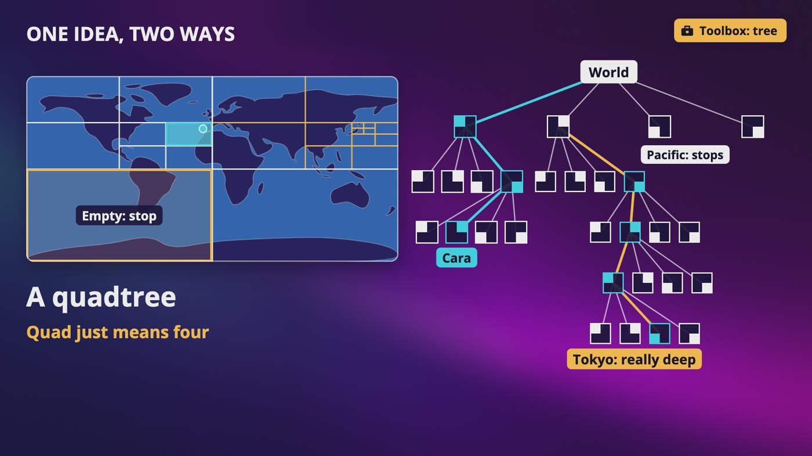

_The same cutting drawn as a tree: it goes really deep over Tokyo, and it stops almost immediately over the Pacific._

### Even squares

- Draw squares of 1 km on each side. The planet's surface is about 510 million square kilometers, so that's about 510 million squares.
- A place used to be 2 numbers, and now it's in one square with one number, which is exactly what a database is good at.
- Finding Cara's square is a bit of division, and we only read one tiny patch. This works.

### Tokyo and the Pacific

- A square in downtown Tokyo could hold thousands of places. A square in the middle of the Pacific holds nothing.
- It's Adele and the Kardashians again: the crowded squares get hammered, and most squares are empty.
- Smaller squares help Tokyo, and someone in the countryside has to search through a huge number of squares. Bigger squares make Tokyo worse.
- **There's no right size if every square has to be the same size.**

### Keep cutting into 4

- Cut the world from top to bottom and from side to side. Pick up the piece Cara's in, and do it again.
- The only 2 questions are east or west of the middle, and north or south of the middle.
- The world is about 40,000 km around. Halve it, and after **15 cuts** you're at about 1.2 km, the size of a neighborhood.
- That's the halving question from our Big O video. It's a logarithm, and you just used one on a map.

### One idea, two ways

- **Name every piece:** write down which piece you went into at each cut. It's one piece of text, so it fits in one database column.
- **Draw the cutting as a tree:** keep cutting only where it's crowded.
- You've seen this tree. A trie narrows down with letters, and this narrows down with directions. A place on Earth is like a word, and its neighbors are like words that start the same way.

> **In your interview:** If they ask about either one, start by saying that it's the same idea. That tells them that you understand what's going on, and not just the name of a technique.

**New terms**

| Term | Meaning |
|---|---|
| **Geohash** | An address for a square. Each cut writes down which piece you went into. |
| **Quadtree** | A tree where each square has 4 children, and you only keep cutting where it's crowded. Quad just means four. |

## 5. Geohash: An Address for a Square

> **The big idea:** One switch for each cut, and 5 switches for each character. Nearby places get nearly the same code, on purpose.

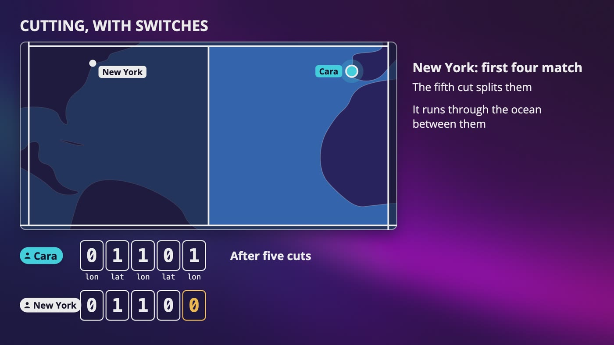

_After 5 cuts, Cara is 0 1 1 0 1. New York matches the first 4, and the fifth cut runs through the ocean between them._

| Characters | Size at the equator | About the size of |
|---|---|---|
| 1 | About 5,000 km on each side | 1 of 32 pieces of the world |
| 4 | About 39 by 20 km | A big city |
| 5 | About 5 by 5 km |  |
| 6 | About 1.2 km by 610 meters | A neighborhood |

### A terrible name

- A hash scrambles things, and a geohash is the opposite. There's no scrambling at all, and it's more like a postal code.

### Cutting, with switches

- **Switch 1, longitude:** the middle is Greenwich. West is 0, and Cara's at 9.1 west, so 0.
- **Switch 2, latitude:** the middle is the equator. North is 1, so 1.
- **Switch 3, longitude:** the middle is now 90 west. She's on the east side, so 1.
- **Switch 4, latitude:** the middle is now 45. She's at 38.7, south of it, so 0.
- **Switch 5, longitude:** the middle is now 45 west, out in the Atlantic. She's on the east side, so 1.

### Five switches make a character

- 5 switches give us 32 patterns, so one character for each pattern, using the digits 0 to 9 and most of the alphabet. It leaves out a, i, l and o.
- 0 1 1 0 1 is the number 13, and in this alphabet, that's the letter e.
- Keep going, and Cara's square is **eycs0p**. It looks random, but every character is a set of directions.

### What the code tells you

- Cara is eycs0p8u. Anna's made-up hotel, about 116 meters away, is eycs0pb0. New York starts with dr5.
- **If 2 codes share a beginning, they're in the same bigger square.** The longer it is, the closer they have to be.
- Each character divides the area by 32, and 6 characters give about a billion squares.

### Why the database loves this

- It's text, and sorted text is what an index is good at. All of the codes that start with eycs0p sit right next to each other.
- It's the same query as autocomplete: eycs0p% means anything that starts with eycs0p, and it's fast because the beginning is fixed.
- Keep one row for each place, not each square, so nobody waits to edit one long list. The key is the code and the place ID together.

> **In your interview:** Be able to do this cut by cut on a whiteboard, even just for 4 or 5 bits, and to say that a shared beginning means the same bigger square.

**New terms**

| Term | Meaning |
|---|---|
| **Base 32** | 32 symbols on each wheel of our odometer. Each character is 5 switches. |

## 6. The Greenwich Problem

> **The big idea:** A shared beginning means you're close, but being close doesn't mean a shared beginning. So always read 9 squares, and measure real distances.

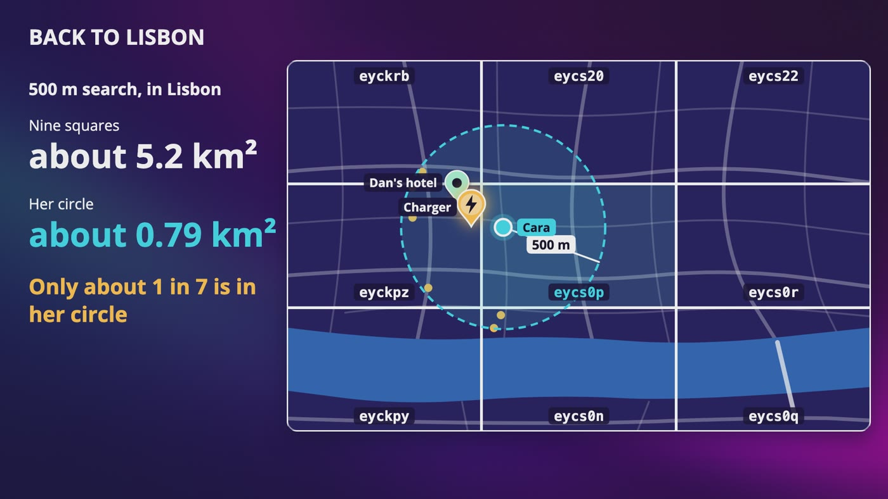

_Read Cara's square and the 8 around it, then measure. For 500 meters in Lisbon, only about 1 in 7 of the places we read are in her circle._

### One step apart

- Ben stands on the west side of the line at Greenwich, and his code is gcpuzgr. Anna's on the east side, and hers is u10hb52. **Not one character in common.**
- The very first cut goes through this line. After that, all of his longitude switches say go east, and all of hers say go west, and those are mixed into every character.
- You'll also see this at the equator, and where 180 east meets 180 west.

### Not only at Greenwich

- Every square has an edge, and somebody's standing on the other side of it.
- Cara is about 100 meters from an edge. A made-up charger shop, 156 meters from her, is in eyckpz. They share only eyc, a square more than 100 km across.
- If we only read her own square, the charger doesn't show up, and she's at 4%.

### Always check 9

- Take the middle of her square, step one square to the west, and build the code for that spot. Do that in each direction, and ask for all 9.
- Measure the real distance to each place, throw away anything outside her radius, and sort what's left.
- For 500 meters in Lisbon, the 9 squares cover about 5.2 square km, and her circle is only about 0.79. So you can't skip this step.

### How big should the squares be?

- She could be right on the edge of the middle square, so a square has to be at least as big as your radius, on both of its sides.
- 20 km with 4 characters misses a tiny sliver, because those squares are only about 19.5 km tall. You'd need 3 characters.
- 500 meters with 6 characters is fine in Lisbon. At 60 degrees north, squares are half as wide as at the equator, and at 70 degrees, they're only about 420 meters wide.

### What if there aren't enough?

- Remove one character for a square 32 times bigger, so 5.2 square km becomes about 167. You could go from a few places to tens of thousands in one jump.
- Or read more neighbors at the same length, which grows more gently.
- Filtering makes it worse. Near midnight, open right now can take a list of 20 down to nothing, so check how many are left after filtering.

> **In your interview:** This is the thing they're going to push on. If they ask what happens on either side of a line, say that close doesn't mean a shared beginning, and that you always read 9 squares and measure real distances.

> **In the real world:** At the Royal Observatory in Greenwich, a line on the ground marks the prime meridian, and tourists line up to stand with one foot on each side. Royal Museums Greenwich says that the zero line that satellite navigation uses is about 102 meters east of the famous one.

## 7. Quadtree: Cut Only Where It's Crowded

> **The big idea:** A square either holds places, or it gets cut into 4. Nobody decides on a square size, because the data decides that for us.

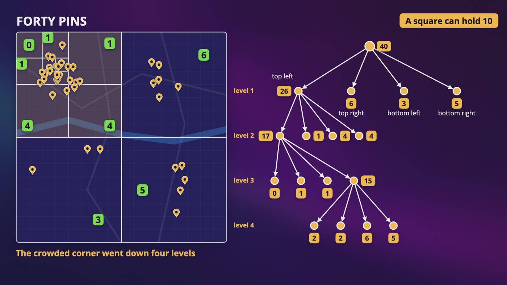

_40 pins, and a square can hold 10. 3 quarters of the map stopped after one cut, and the crowded corner went down 4 levels._

### Forty pins

- 40 is over 10, so we cut: 26, 6, 3 and 5.
- 26 is cut: 17, 1, 4 and 4. Then 17 is cut: 0, 1, 1 and 15. Then 15 is cut: 2, 2, 6 and 5. Now they're all 10 or less.
- A square can have nothing in it, and that's fine.

### Finding Cara

- Start at the top and ask which of the 4 she's in: top left, top left, bottom right, bottom left. That's 4 steps, and 6 pins to look at, out of 40.
- Each step throws away about 3/4 of the map, so it's O(log n), as long as the tree isn't too lopsided.
- One leaf isn't the whole answer, because somebody could be right across the edge. Check the neighboring leaves, and measure real distances.

### How much memory?

- **A leaf:** 4 corners at 8 bytes is 32 bytes, plus up to 100 place IDs at 8 bytes. That's 832 bytes.
- **An internal node:** 32 bytes of corners, and 4 pointers to its children. That's 64 bytes.
- The usual math: 200 million places, 100 to a leaf, is 2 million leaves, about 1.7 GB.
- **But leaves are almost never full.** A square with 101 places gets cut into 4 squares of about 25. Simulated with 2 million places clustered like cities, the average leaf holds about 43.
- So it's about 4.7 million leaves. That's about 4 GB with room for 100 IDs in each, or about 1.9 GB storing only what's there.
- Latitude and longitude add about 3 GB, so call it **about 5 GB**. That still fits in one normal server's memory.

### Why one third?

- Internal nodes are about one third of the leaves. Every cut gives one more internal node, and 3 more leaves.
- Check our drawing: 4 cuts, 4 internal nodes, and 1 + 3 x 4 is 13 leaves. You probably won't get asked why.

### Where it lives

- The tree isn't a table in a database. It's in the memory of each search server, and each server builds its own copy when it starts up.

> **In your interview:** You can say where the tree lives, along with roughly how big it is. And I'd love for you to be able to say that leaves aren't usually full.

**New terms**

| Term | Meaning |
|---|---|
| **Capacity** | How many places a square can hold. It's a number we pick when we build the tree. |
| **Recursion** | When a program does the same thing to each smaller piece, again and again. |
| **Internal node** | A dot with children. It only holds directions. |
| **Pointer** | Where something is in memory. |

## 8. Quadtree in Real Life

> **The big idea:** A quadtree adapts to crowds, and it's more work to run. In an interview, I'd usually go with geohash, and say when I'd reach for a quadtree.

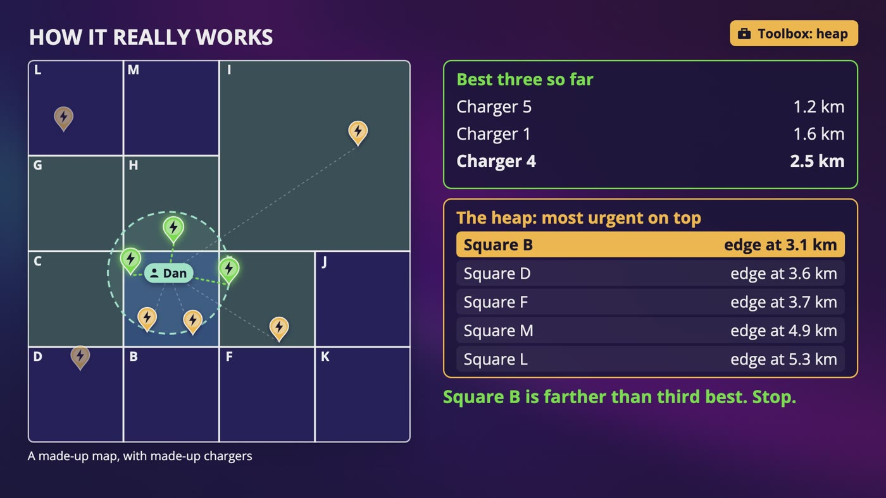

_Nearest 3 for Dan: a heap keeps the closest unopened square on top, and the search stops when square B is farther than his third best charger._

|   | Geohash | Quadtree |
|---|---|---|
| To build | A column and an index | A structure you write and run yourself |
| Crowded places | Same square size everywhere, at one length | Adapts naturally |
| Updates | Add a row | A lock or a rebuild |
| Starting up | Already in the database | Built or loaded |
| The nearest few | Can do it | Can do it |

### Building and releasing

- Each place passes through around 10 levels, so 200 million places is about 2 billion small steps. That might be a few minutes, and it's an estimate you'd measure.
- Restart all 20 search servers at once, and for those few minutes, nobody can search.
- A rolling release takes a long time, and all of those servers read every row from the database.
- **A simple improvement:** build the tree once, somewhere else, and save a snapshot in object storage. A new server just downloads it.

### What about updates?

- The next day is fine, so a job builds a fresh tree every night, and the servers move to it with a rolling release.
- If it has to be live, you're changing a tree while thousands of people a second read it. A lock on the whole tree puts all of those searches in line behind one edit.
- You can lock only the part you're changing, but that's a lot harder to get right.

### Dan, on 3 percent

- He doesn't care about a radius, he just wants the closest 3 chargers.
- A quadtree doesn't split based on K. The capacity was picked once, and K arrives with each search.
- Go down to his leaf, measure everything, and keep your best 3. Then keep opening the closest unopened square, using a heap.
- Stop when the next square is farther away than your third best. Geohash can do this too, by growing outward.

### Be honest about distance

- All of this is a straight line. Lisbon's on a wide river, so the closest charger might be across the water, and the bridge a long way away. Real driving distance is a different, much harder problem.

> **In your interview:** I'd usually go with geohash, because it's easiest to explain and you get to use a normal database. Then say that you'd reach for a quadtree if crowded areas turned into a real problem, and what that costs. It doesn't matter that much which one you pick, as long as you can say why.

**New terms**

| Term | Meaning |
|---|---|
| **Release** | Putting a new version of our code on the servers. |
| **Rolling release** | Restarting a few servers at a time. |
| **Blue green** | You build a whole new set right beside the old one, check it, and then switch people over. |
| **K nearest** | Finding the closest K of something, however far away. K is just a number. |
| **As the crow flies** | Straight line distance. |

## 9. Beyond Squares: S2 and Hexagons

> **The big idea:** The Earth isn't flat, and real companies chose different answers. You don't have to memorize these. Just recognize the names, and know why each one exists.

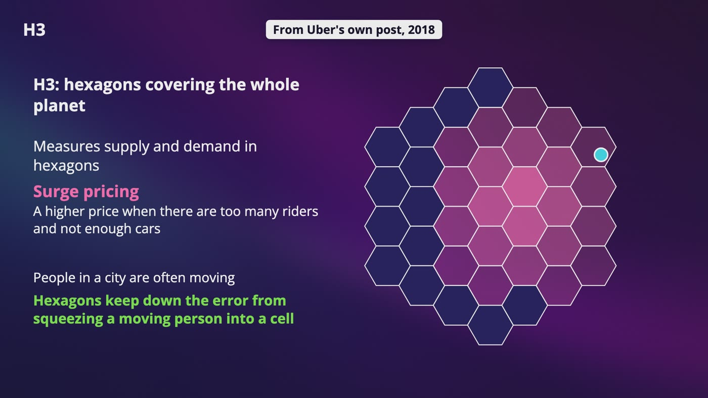

_H3 covers the planet in hexagons. Uber's post says that it measures supply and demand in them to work out surge pricing._

### The Earth isn't flat

- Longitude lines all meet at the poles. A square at 60 degrees north is half as wide as one at the equator, and it keeps getting narrower. For most cities that's fine, but it's a real weakness.

### A line through the map

- A sorted list of geohashes is a walk across the map, zig-zagging like the letter Z, and every so often it jumps a long way.
- A **Hilbert curve** has no jumps. Close on the line usually means close on the map.
- But close on the map doesn't always mean close on the line, so you still check your neighbors.

### S2

- Imagine a cube around the Earth, with the map projected onto its 6 faces, so the poles aren't special anymore.
- Each face gets cut into 4, up to 30 levels, where a square is about a centimeter across. It's our same cutting, on a cube.
- For a strange shape like an airport, S2 can cover it with a set of cells, so asking if you're inside just means asking if your cell is on that list.

### Hexagons

- A square's neighbors at the corners are about 1.4 times as far as the ones on its sides. A hexagon has 6 neighbors, all the exact same distance away.
- **The catch:** each level in H3 has cells with 1/7 of the area, and they don't fit exactly inside the bigger one. You lose the idea that a shared beginning means the same bigger shape.
- Requirements decide. Hexagons suit a city full of moving cars, and a geohash suits a simple prefix search in a normal database.

### Just use PostGIS

- An R-tree draws a box around a few places, then a bigger box around a few of those boxes. To search, you only look inside the boxes that touch your search area.
- The index only holds boxes, so PostGIS still has to check the exact distance at the end.
- A very fair answer is, I'd use PostGIS, or a database with location built in. But just naming a database isn't an answer. You have to say how it works, and what it costs.

> **In your interview:** Know one of these deeply, and I'd pick geohash. Be able to explain the quadtree. For S2, H3 and R-trees, one sentence each is plenty.

> **In the real world:** Google says that its global geographic database is built on S2. Uber wrote about H3 in 2018, and it says hexagons keep down the error from squeezing a moving person into a cell. Bing Maps, Microsoft's map service that's being retired, names its map tiles with quadkeys. PostGIS's manual says that it uses an R-tree index.

**New terms**

| Term | Meaning |
|---|---|
| **Hilbert curve** | A line you can draw without lifting your pen. It goes through every square once, and every step goes to a square that touches the last one. |
| **S2** | Google's library for working with data on the real, round planet. |
| **Library** | Code that someone wrote so that you don't have to. |
| **Geofence** | A shape on a map with a rule attached, so that something happens when you go in or come out. |
| **H3** | Uber's grid of hexagons covering the whole planet. |
| **Surge pricing** | The higher price when there are too many riders and not enough cars. |
| **PostGIS** | An add-on for PostgreSQL, so that a normal database can understand locations and shapes. |
| **R-tree** | A tree of boxes around places. Instead of cutting up the map ahead of time, the boxes follow the data. |
| **Quadkey** | A kind of address where each digit says which of the 4 you went into. |
| **GEOSEARCH** | A Redis command. Places are kept in a sorted set, a list in order by a score, with a geohash as that score. |

## 10. Do We Even Need a Cache?

> **The big idea:** Do the math before you reach for sharding or a cache. The whole index fits in memory on one machine, so our real answer is read replicas.

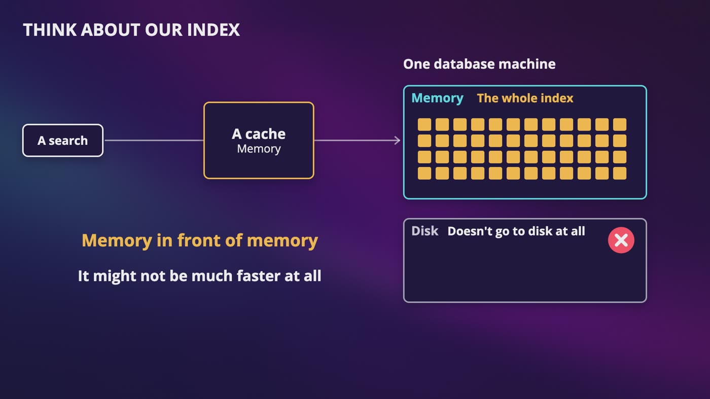

_The whole index sits in the database's memory, and the search doesn't go to disk at all, so a cache in front of it is memory in front of memory._

### The first instinct

- Sharding by geohash or city is a lot of pain: a shard that's all of Tokyo next to one that's the middle of the ocean, and a search near an edge has to ask 2 shards.

### It fits

- A 6 character code and an 8 byte place ID is 14 bytes. Times 200 million rows, that's 2.8 GB.
- Add latitude and longitude, 16 more bytes, and it's **about 6 GB**, plus some extra for the index.
- You shard when the data doesn't fit, or when writes are too much for one machine. Neither is true here, with about 1 write a second.
- Our problem is reads, about 10,000 a second at the peak, and the answer is copies. If one replica handles a few thousand, a guess you'd measure, we need a handful and a few spares.
- All of them hold the entire index, so a search near an edge has nothing special to do.

### The place table

- 200 GB fits on a large server today, as long as the photos aren't in it.
- If you really need to shard, split by place ID using our ring. You only ever look up a place by its ID.

### Do we need a cache?

- A cache could take some load off for very busy squares, but so could another replica, and that's simpler.
- So not on day one. Measure how long the query takes, how busy the database is at the peak, and how often the same square gets asked for.
- If you do cache, **the key has to be the square**, not her exact location, because that would almost never match twice.
- 8 bytes per ID, 200 million places, kept for 3 square sizes, is about 4.8 GB.

### What's really worth caching

- **The place details.** A row is about a kilobyte, it's read all of the time, and it hardly ever changes.
- If the nightly job clears every cached place at once, every miss lands on the database. That's the thundering herd.
- Add a little randomness, so that each key expires at a slightly different time, spread out across an hour.

### People search near themselves

- GeoDNS sends someone in Lisbon to a region in Europe, and someone in Tokyo to one in Asia. Each region could hold mostly its own places.
- That's faster, and it's useful when a country's rules say that data has to stay inside its borders.

> **In your interview:** If they ask how you'd scale this, do the math first, and say that the index fits in memory. Add read replicas, and leave sharding for the place table, if it ever needs it. Then say what you'd measure before adding a cache. Anyone can say shard it. Not everyone can do the math, and then say, we don't need to.

> **In the real world:** Amazon's database service lists servers with up to 4 TB of memory. The US government's GPS site says that phones are typically accurate to about 5 meters under open sky, so Cara's own position wobbles from one second to the next.

## 11. Your Location Is Private

> **The big idea:** Treat location with more care than almost anything else we've stored. This service doesn't need to keep it at all, and the safest data is data that you don't have.

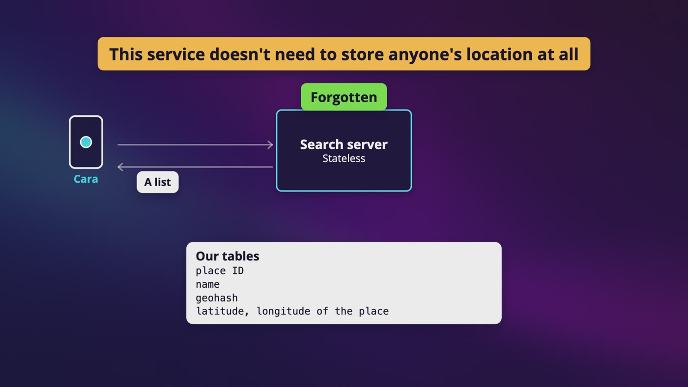

_Cara's location goes to a stateless search server, a list comes back, and it's forgotten. Our tables only hold places._

### Why location is special

- Kept for a while, it says where you sleep, where you work, which doctor you visit, and who you spend your nights with. You can't really change that like a password.
- Removing the name doesn't make something safe, and sometimes the danger only appears when it's all added up.

### Three distances

- A distance is a circle around you, and someone is somewhere on it. From 3 different spots, there's only one place where those 3 circles meet.
- Rounding the number isn't enough, because someone who keeps moving and asking can still narrow it down. What works is snapping people onto a grid, so every location in a square moves to the same spot.
- For Cara, an exact distance to a café is fine, because a café has no secrets.

### Designing for blurry

- Since iOS 14 and Android 12, people can give an app only their approximate location. A blurry circle isn't an error, and your app should still work.
- A 500 meter search doesn't mean much if you only know where she is to within a kilometer or 2, so search wider. The middle of that blurry circle isn't where she is.

### Keep it out of your logs

- Her latitude and longitude sit in the search address, so every load balancer or web server might write them in a log, with a time and an account. You've got a location history that nobody decided to build.
- Send the location in the body of a POST request, or round it before it reaches your servers, and make sure your logs don't keep it.

### Don't keep what you don't need

- Cara's location comes in, we work out 9 squares, we send back a list, and we forget it. Our tables only hold places.
- You can't leak it, nobody can steal it, and nobody can ask you to hand it over. Search history later is a real decision, with its own storage, time limit and way to delete it.

> **In your interview:** Bring this up in step one, even if nobody asks. Are we keeping locations, for how long, and do we have to work with approximate? And say out loud that this service doesn't need to store anyone's location at all.

> **In the real world:** In November 2017, Strava published a global heatmap from about 1 billion activities. In January 2018, a student named Nathan Ruser pointed out that in places like Syria, the bright lines came from foreign soldiers jogging around their bases. In 2014, Include Security wrote that Tinder's precise distances could find someone to within about 100 feet. In 2024, researchers at KU Leuven found that 6 of 15 dating apps allowed someone's exact location to be pinpointed, and they report that it led to fixes.

**New terms**

| Term | Meaning |
|---|---|
| **Heatmap** | A map of where people have been active, with busy places glowing brighter. |
| **Aggregated and anonymized** | Only totals, with no names on it. |
| **Trilateration** | Finding someone from their distance to 3 different spots. |
| **Approximate location** | A blurry location. Android's docs say it's within about 3 square km, and Apple has said a typical value is around 5 km. |
| **GDPR** | The European Union's privacy law, which names location data in its definition of personal data. Nothing here is legal advice. |

## 12. The Whole What's Near Me Design, for Your Interview

> **The big idea:** Pick a length, read 9 squares, measure, sort, send back IDs, and forget. Then the phone asks for the names.

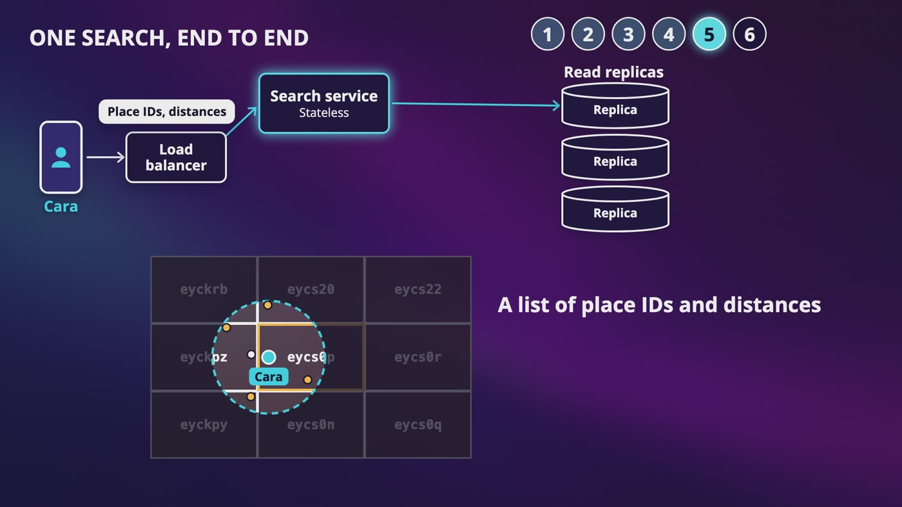

_Step 5 of Cara's search: after reading 9 squares and measuring real distances, the search service sends back place IDs and distances._

| If they ask | You say |
|---|---|
| Just index latitude? | A latitude range is a ring around the whole planet, with over 100,000 rows, and a sorted list only has one direction. |
| Across a line? | A shared beginning means close, but close doesn't mean a shared beginning. Always read 9 squares and measure. |
| Too few results? | Remove a character, for 32 times the area, then fetch, measure and keep the nearest. Or read more neighbors. |
| The nearest 5? | A radius doesn't help. Keep opening the closest leaf or square until nothing closer is possible. |
| A cache? | The index fits in memory, so measure first. The key is the square. Cache the place details first, with randomness in the expiry. |
| Sharding? | Do the math: about 6 GB fits on one machine, so add replicas. Keep sharding for the place table. |

### One search, end to end

- **Step 1:** her phone sends her location and a radius of 500 meters to the load balancer, which picks a search server.
- **Step 2:** the server picks a length that's big enough on both sides, 6 characters here, and works out eycs0p and the 8 squares around it.
- **Step 3:** it asks a read replica for every place in those 9 squares. That's fast, because it's one sorted column, and the whole index is in memory.
- **Step 4:** it measures, throws away anything outside her circle, and sorts. If there are too few, it widens the search.
- **Step 5:** it sends back place IDs and distances, and it forgets where she was.
- **Step 6:** her phone asks the place service for those places, all at once, probably from a cache.
- **The slow side:** an owner changes something, that goes to the primary database, and a nightly job makes it live.

### Your 45 minutes

- **The problem, 3 to 10 minutes:** first ask if these are places that stay still, then the radius, nothing nearby, freshness, worldwide and sorting. Ask about location privacy here too. Do the math up to about 10,000 searches a second.
- **High level design, 10 to 15:** the 2 services and why they're separate, replicas, and that the next day is fine.
- **Deep dive, 10 to 25:** why a plain index fails, cut the map, build a geohash, then 9 squares and real distance. If there's time, the quadtree.
- **Wrap up, 3 to 5:** say what you'd watch, like how long a search takes and how often it comes back with too few results.

### Back on the street

- Cara types charger. A server works out 6 characters and their 8 neighbors, and the shop across the edge shows up at the top, 156 meters away. Then the server forgets that she ever asked.
- She gets there at 2%. By 20%, she's asked what's still open, and a very small bookstore, 4 streets over, has a light on.

> **In your interview:** Please be able to draw both the search and the slow side from memory. Say what could still break, and please never say that your design is perfect.

## Recap: How Cara found a charger

_The only really new thing was a pair of scissors._

| Every piece solved a real problem | |
|---|---|
| **Two services** | Two very different questions |
| **Read replicas** | Thousands of reads to 1 write |
| **Cutting the map** | A sorted list only has one direction |
| **Geohash** | Turning 2 numbers into one sorted column |
| **9 squares** | Close places with nothing in common |
| **Measuring real distances** | Squares aren't circles |
| **Quadtree** | Tokyo and the Pacific needing different sizes |
| **Snapshot and rolling release** | Every server restarting at once |
| **Doing the math first** | Sharding and a cache we didn't need |
| **Randomness in the expiry** | Everything missing the cache at once |
| **Forgetting her location** | Data that could leak |

**What to know really well**

- Why a plain index on latitude fails
- How to build a geohash, and what a shared beginning means
- The Greenwich problem, 9 squares and real distances
- How a quadtree gets built and searched
- Why this doesn't need sharding

---

From the course **[System Design: Zero to Interview Hero](https://www.udemy.com/course/system-design-zero-to-hero/?referralCode=183D59A1EBE9E71D26FF)** by Nata Vacheishvili.
