# Chapter 17: Design Live Location

_Four dots at a book festival in Lisbon, and the one idea that makes 13 million forwards a second possible._

[Download as PDF](../pdf/System-Design-Chapter-17-Notes.pdf)

## Contents

1. [Design Live Location: Where Are You?](#1-design-live-location-where-are-you)
2. [Why Not Just Phone to Phone?](#2-why-not-just-phone-to-phone)
3. [It's Okay to Lose This](#3-its-okay-to-lose-this)
4. [One Channel Per Person](#4-one-channel-per-person)
5. [Opening the App](#5-opening-the-app)
6. [How Many Servers, Really?](#6-how-many-servers-really)
7. [Growing Without Breaking](#7-growing-without-breaking)
8. [The Phone Is the Hard Part](#8-the-phone-is-the-hard-part)
9. [Who Else Is Here?](#9-who-else-is-here)
10. [How Can It Find Something With No Internet?](#10-how-can-it-find-something-with-no-internet)
11. [Who Can See You?](#11-who-can-see-you)
12. [The Whole Live Location Design, for Your Interview](#12-the-whole-live-location-design-for-your-interview)

## 1. Design Live Location: Where Are You?

> **The big idea:** Last chapter's places stayed still. A friend's dot keeps moving, so there's nothing to prepare ahead of time, and writing is the main job.

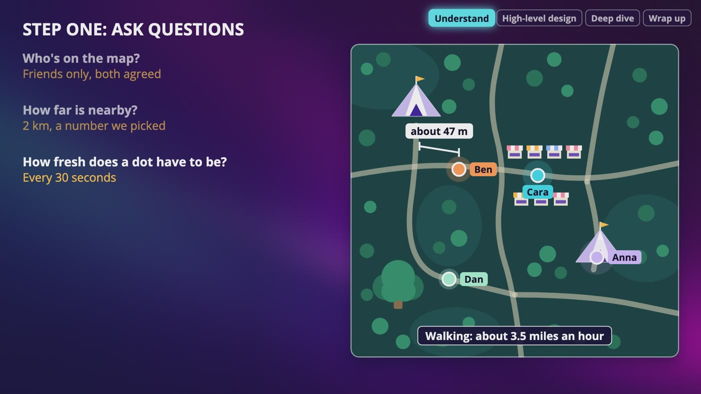

_Step one on the festival map: who's on it, how far is nearby, and how fresh a dot has to be. Walking, that's about 47 meters between updates._

### How a phone knows where it is

- **GPS** satellites keep broadcasting where they are and what time it is. Your phone listens to several and works out where it is from how long each signal took.
- The phone only listens. Nobody knows where you are until your phone tells someone, and in this chapter, that someone is us.
- The US government's GPS site says a phone is typically accurate to about 5 meters under open sky. It gets worse near buildings, bridges and trees, and indoors it can be really bad.
- So phones also use wifi networks and cell towers. A location is really **a guess with a blurry edge**, and every time you ask for one, it costs battery.

### Step one: the answers we picked

- **Who's on the map:** friends only, where both people agreed.
- **Nearby:** 2 km, a number we picked.
- **Fresh:** every 30 seconds. Every 5 seconds would be 6 times the traffic.
- **Someone goes quiet:** show how old the dot is, and after a while it goes away.
- **History and privacy:** no history, and only friends you picked can see you.
- **Size:** 100 million people a day, 1 in 10 connected at any moment, 400 friends each.

### The math

- 1 in 10 of 100 million is 10 million connected. 10 million divided by 30 is **about 333,000 updates a second**.
- Our last chapter had about 1 write a second, and WhatsApp had about 81,000 messages a second. This little dot is about 4 times WhatsApp, and nobody even typed anything.

> **In your interview:** You might hear this question as Nearby Friends. Please ask how fresh a dot has to be, and keep that number in your math. Say plainly that writes are the main job, they never stop, and most of them are out of date within 30 seconds. If you're told to skip privacy, that's fine, but say one sentence about it first.

> **In the real world:** Snapchat has Snap Map, and its help pages say that it's off by default. Facebook ended its Nearby Friends feature at the end of May 2022, and said that it was because of low usage.

**New terms**

| Term | Meaning |
|---|---|
| **GPS** | Global Positioning System. A group of satellites run by the US government, each one broadcasting where it is and what time it is. |
| **Cell tower** | The antenna that your phone connects to for calls and data. |

## 2. Why Not Just Phone to Phone?

> **The big idea:** Phones can't really talk to each other directly, so we put one server in the middle. That saves the phone, and it leaves us with about 13 million forwards a second.

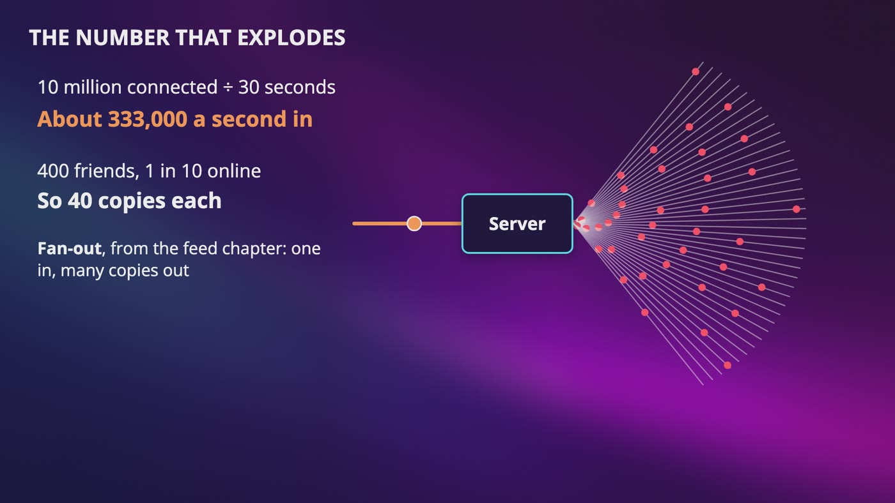

_About 333,000 updates a second come in, and each one goes out to about 40 friends. That's fan-out from the feed chapter._

### Why phone to phone fails

- **The math:** 400 friends, 1 in 10 online, so Ben's phone sends 40 copies every 30 seconds and hears from 40 people. It's O(n²), everyone with everyone.
- **Hard to reach:** phones usually have private addresses and sit behind firewalls, so there's no address Ben can simply send to.
- **Always moving:** Ben walks from wifi onto his mobile network, and whatever Anna had for him is now wrong.
- **Battery:** each copy means waking up the radio, so 40 copies is 40 times the work.
- **Who keeps the list?** Somebody has to know who's online, where to find them, and who's still a friend. So you need a server anyway, and now you've got a server and a tangle.

### One server in the middle

- Ben's phone keeps one open line, a WebSocket, and sends his spot once. It went from 40 sends to 1.
- The server takes his spot, finds his friends who are online, and sends it on. All that work moves to a machine that's plugged into a wall.
- It's also where we check whether someone's still allowed to see you.
- **The cost:** everybody's location now goes through us, and that's a real responsibility.

### The number that explodes

- About 333,000 updates a second, times 40 friends, is **about 13 million forwards a second**. That's about 55 times WhatsApp's 240,000 deliveries a second.
- Please be a little suspicious of it. Those friends are online, and nobody's said that they're nearby.

> **In your interview:** If your interviewer asks about peer to peer, say that you thought about it and give these reasons. The one I'd say first is who keeps the list. It's a good sign when someone considers the simple thing first and can say why it doesn't fit.

**New terms**

| Term | Meaning |
|---|---|
| **Peer to peer** | Devices talking straight to each other, with nothing in the middle. A peer just means an equal. |
| **Radio** | The part of the phone that talks to the network. |
| **Forward** | One update being passed along to one friend's connection. |

## 3. It's Okay to Lose This

> **The big idea:** The newest value makes the old one worthless. If we lose a dot, it fixes itself 30 seconds later, so we don't save it, retry it or acknowledge it.

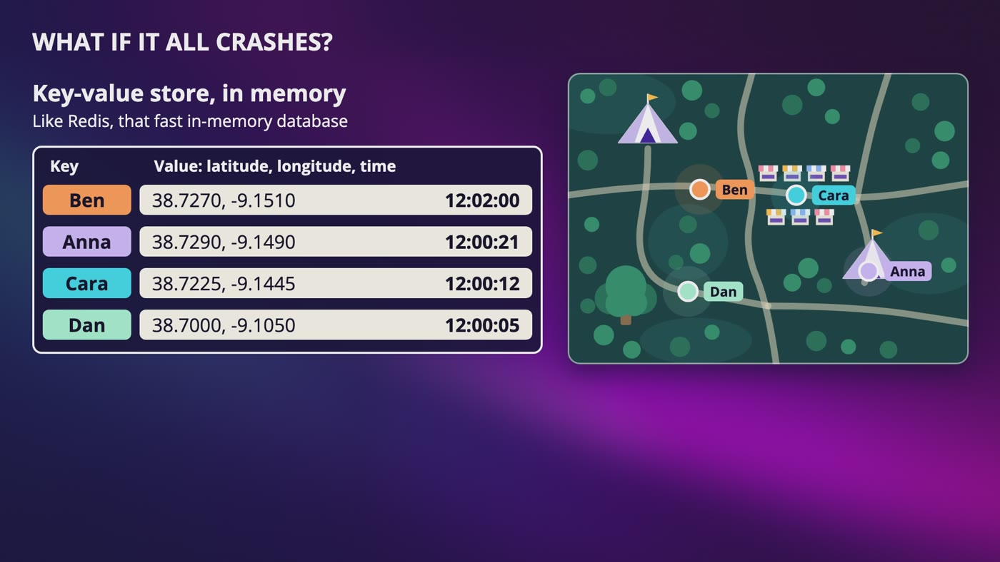

_All we keep is one small value for each person, in memory. If the whole store crashes, every phone sends an update in the next 30 seconds._

|   | Anna's WhatsApp message | Ben's dot |
|---|---|---|
| If it's lost | We broke a promise | It fixes itself in 30 seconds |
| A new one | Adds to the old ones | Replaces the old one |
| Acknowledgments | Every step says got it | None |
| Retries | Yes | None. A retry could move his dot backward |
| What we keep | A folder and a bookmark | One small value per person |

### Why retries make it worse

- If Ben's phone resends an old spot and it arrives after his new one, his dot could move backward.
- So every update carries a time, and we ignore anything older than what we've already got.

### Where the value lives

- A database writes to disk, and we'd be asking it to do that 333,000 times a second, for a value that's old in 30 seconds.
- So we use a key-value store in memory, like Redis. The key is the person, and the value is a latitude, a longitude and a time.
- It's a self-deleting value with a TTL. Every update starts the timer over, and if the updates stop, the value goes away.
- About 100 bytes each, our own guess, times 10 million people is about 1 GB. The memory is nothing, and it's the writes that keep it busy.

### What we can't lose

- Who your friends are, and whether you've agreed to share, go in a real database on the normal side, with plain requests.
- If Cara taps **stop sharing** and we drop it, someone keeps seeing her after she thought they couldn't. That tap isn't a dot, and it can never be lost.

> **In your interview:** Say this before you draw anything else. The location is only useful while it's fresh, and a new one fully replaces an old one, so we don't need to save it, retry it or acknowledge it. That one sentence justifies everything after it.

## 4. One Channel Per Person

> **The big idea:** Every person gets their own tiny radio station. Ben broadcasts once, his friends' helpers are tuned in, and each helper decides whether its person needs to hear it.

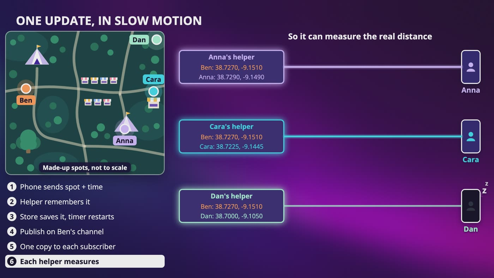

_Step 6: each helper has Ben's new spot and its own person's spot, so it can measure. Anna and Cara are close enough, and Dan is too far._

### Channels, not mailboxes

- **Publish and subscribe** is the newspaper subscription from the green dot video. One person gets one channel, and its name can just be their user ID.
- A mailbox keeps your letter until somebody picks it up. A channel like this keeps nothing, so if nobody's listening, the update is gone. After our last video, you know that's fine.
- Redis has pub-sub built in. Its docs say a message is delivered once if at all, and it can be lost forever. For us, that's exactly what we asked for.
- Kafka keeps events, so we'd be paying to save something that's worthless in 30 seconds. I wouldn't use it for the dots.

### One update, in slow motion

- **1.** Ben's phone adds the time to his new spot and sends it up his open line.
- **2.** His helper updates what it remembers about him.
- **3.** His helper saves it in the key-value store, which restarts the timer. That lets someone who opens the app later find him without waiting.
- **4.** His helper publishes on Ben's channel. That's 1 send, no matter who's listening.
- **5.** The pub-sub server sends 1 copy to each subscribed helper: Anna's, Cara's and Dan's. Those are 3 forwards.
- **6.** Each helper measures the distance. Anna is about 280 meters away and Cara about 750 meters, so it goes down their lines. Dan is about 5 km away, so his helper drops it, and his phone never wakes up.

### Why check on the server?

- Dan's phone would get 40 updates every 30 seconds and throw most of them away, on a battery. So we throw them away on a machine that's plugged in.
- If nobody's subscribed at 7 in the morning, publishing does nothing, and that costs almost nothing.

> **In your interview:** Practice this with a pen. Draw one person's phone, their connection server, the store, the channel and 3 friends' helpers, and walk one update through. Be ready to say why each person has a channel, and why a lost update doesn't matter.

**New terms**

| Term | Meaning |
|---|---|
| **Publish and subscribe** | Publishing means sending something out, and subscribing means asking to receive it. People usually shorten it to pub-sub. |
| **Channel (pub-sub)** | The station in pub-sub. Anyone tuned in hears what's sent, and it doesn't keep anything. |
| **Connection server** | Our name here for the servers that hold everybody's open lines, like WhatsApp's chat servers. |
| **Helper** | A small piece of code for each open line. It holds the line, remembers that person's newest spot, and subscribes to their friends' channels. Also called a connection handler. |

## 5. Opening the App

> **The big idea:** Opening the app is 7 steps in order, and a phone that dies never says goodbye. So our side uses a self-deleting value, and the other phone uses a timestamp.

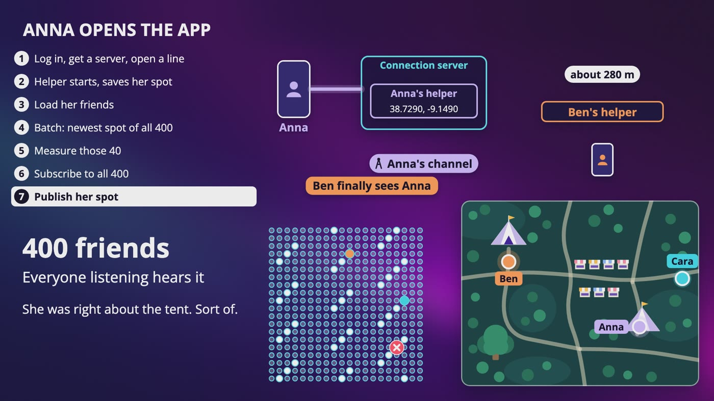

_Anna's 7 steps when she opens the app. Her helper is subscribed to all 400 friends, and about 40 of them are online._

### Anna opens the app

- **1.** She logs in with plain requests, service discovery picks a connection server, and her phone opens a WebSocket.
- **2.** Her helper starts, and her spot goes into its memory and the key-value store.
- **3.** Her helper loads her 400 friends from a normal database.
- **4.** It asks the store for all 400 newest spots in one **batch**. Most come back empty, and about 40 have a value, so she doesn't wait 30 seconds to see anyone.
- **5.** It measures those 40. Ben and Cara show up on her map, and Dan doesn't.
- **6.** It subscribes to all 400 channels.
- **7.** It publishes her spot, so everyone listening hears that she's here.

### Why subscribe to offline friends?

- Otherwise, when an old friend opens the app, someone has to tell Anna's helper, and we'd be building a second system just to say who came online.
- A subscription is a small entry. Say 20 bytes, our guess, so 400 is 8 KB for one person. That's a tiny amount of memory for a much simpler design.

### Adding and removing a friend

- It goes over the normal side and is saved in the database first. Then the 2 helpers subscribe to each other's channels, if those people are connected.
- Removing is the same in reverse, and the unsubscribe really has to happen. If a helper can't be reached, retry, or hang up that line and make it start over. This isn't a dot.

### Dan's battery dies

- There's no goodbye. A phone with no battery just stops talking.
- **Our side:** his value stops getting refreshed and deletes itself. Say the timer is 10 minutes, a number we picked.
- **Anna's side:** nobody tells her phone, so it works it out from the time on his last update. At 2 minutes old it turns the dot grey and says last seen. After 10 minutes the dot goes away.
- A map that shows an old spot as if it's live is lying to you, so a dot should always be honest about how old it is.

> **In your interview:** Be able to walk through the opening sequence in order, and say why you subscribe to everyone. If they ask what happens when someone disappears, say there's no goodbye, so it's a self-deleting value on our side, and a timestamp on the phone's side.

## 6. How Many Servers, Really?

> **The big idea:** Do both calculations. Memory says a couple of machines, CPU says about 130, and most of what those 130 do gets thrown away.

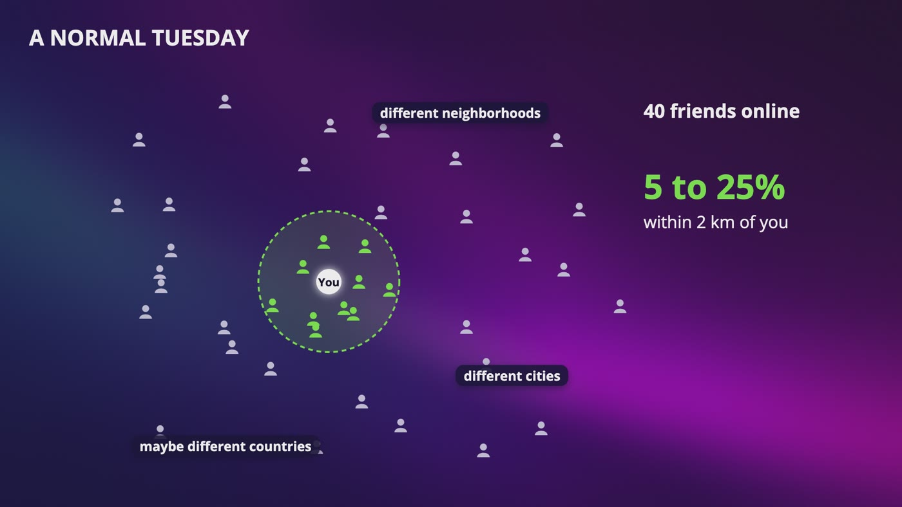

_On a normal Tuesday, your 40 friends online are spread out, and maybe 5 to 25% are within 2 km. That range is made up._

### Memory

- A pub-sub server only remembers who's subscribed to what. 10 million connected times 400 friends is 4 billion subscriptions, and at 20 bytes each that's about **80 GB**.
- Please count connected people. Multiplying by everyone who uses the app in a day gives 800 GB, but only connected people have a helper.

### CPU

- 13 million forwards a second, divided by 100,000 a second per server, is **about 130 servers**. The 100,000 is a round number we made up, and you'd measure it.
- CPU decides. At 130 servers, those 80 GB are only about 600 MB on each one.

### What are those 13 million?

- If 5 to 25% of friends are nearby, then 75 to 95% of forwards get thrown away at the helper. That's between 10 and almost 13 million a second.
- **An idea, and it's only reasoning:** subscribe to friends who are close. For friends far away, check their spot in the store every few minutes with a batch, and start following them if they get close.
- It's more complicated, and someone could take a few minutes to show up, so you shouldn't start here.

### Which channel lives where?

- We use the ring from consistent hashing. Hash Ben's channel name and walk clockwise, and every helper gets the same answer. With remainders, one new server would move almost every channel.
- ZooKeeper keeps the list of pub-sub servers, and every connection server keeps its own copy of the ring in memory.
- For the curious: Redis docs say plain cluster pub-sub sends each message to every node. Since version 7, sharded pub-sub keeps a message inside one shard.

> **In your interview:** Say that you did both calculations and one of them turned out not to matter. Then say, I've noticed that most of this work is thrown away, and here's what I'd look at if it got expensive.

**New terms**

| Term | Meaning |
|---|---|
| **CPU bound** | When the thing that limits you is how fast the machine can work, and not how much it can hold. |

## 7. Growing Without Breaking

> **The big idea:** Our boxes aren't all equally hard to grow. Pub-sub servers look stateless, but they keep the list of subscribers, so resizing them takes care.

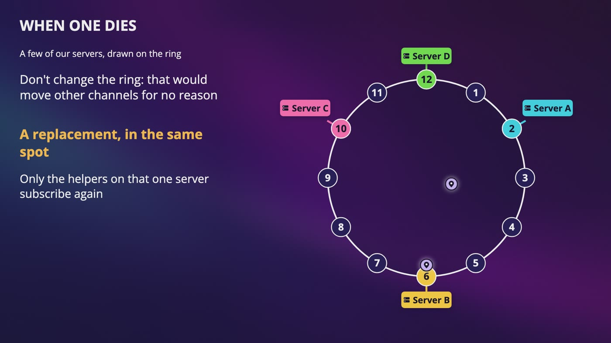

_When a pub-sub server dies, we don't change the ring. A replacement goes in the same spot, and only that server's helpers subscribe again._

### Box by box

- **Normal side:** stateless web servers, so add more behind the load balancer.
- **Connection servers:** stateful, so we drain them, moving phones off a few at a time.
- **Key-value store:** about 1 GB, but 333,000 writes a second is a lot for one machine. Split it by user, and keep a standby for each. A failure only means a short gap.
- **Pub-sub:** a real radio station has no idea who's listening, and ours has to know. It's closer to a phone tree. The updates aren't kept, and the subscribers are.

### Resizing, with real numbers

- Going from 130 to 132 servers moves about 1.5% of channels. Going from 4 to 6 would move a third, so bigger is gentler here.
- 1.5% of 4 billion subscriptions is about **60 million changes**, because data doesn't teleport.
- So update ZooKeeper, and each helper changes at a slightly random moment. Over 10 minutes that's about 100,000 changes a second, which is manageable.
- Some updates get lost while this happens, and the next one fixes it.

### When one dies

- Changing the ring would move other channels for no reason, so bring up a replacement in the same spot. Only its helpers subscribe again, about 1 in 130, or about 30 million subscriptions.
- It doesn't have to wait for a person. Redis has a tool called Sentinel that can promote a copy automatically.

### Why friends aren't Adele

- With a limit of 5,000 friends, all online, one update every 30 seconds is about 167 forwards a second. That's a tiny part of one server.
- Adele's 100 million followers would be about 3,300,000 forwards a second from one person, more than 30 of our servers.
- Friends have a limit, and they have to accept you. A follower count has no limit at all.

> **In your interview:** Please don't say stateless about pub-sub without saying what you mean. And say that our requirements saved us from the Adele problem. Erlang and Elixir are only for the curious, and I wouldn't bring them up first.

> **In the real world:** Erlang's guide says one process takes 338 words when it starts, about 2.7 KB on a normal 64-bit machine. Discord wrote that each connected user gets a process, with up to 500,000 on one running copy of the engine. WhatsApp wrote in 2011 that it ran on Erlang, with about a million connections on one server. The catch is that fewer engineers know these languages.

**New terms**

| Term | Meaning |
|---|---|
| **Standby** | A copy that's kept up to date and ready to take over. |
| **Sentinel** | A Redis tool that watches its servers and can promote a copy automatically. |
| **Erlang** | A programming language made for running a huge number of small things at the same time. |
| **Elixir** | A newer language that runs on the same engine as Erlang. |

## 8. The Phone Is the Hard Part

> **The big idea:** Real phones can't report every 30 seconds all day. Being kind to the phone cuts our traffic by more than half, and it saves a lot of servers too.

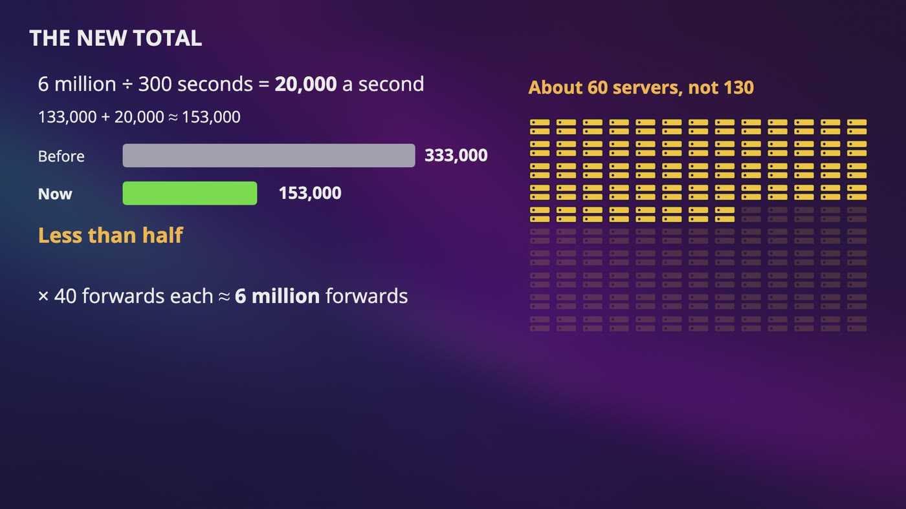

_6 million still phones at 1 message every 300 seconds is 20,000 a second. The new total is about 153,000, which means about 60 servers instead of 130._

### What it costs

- Reporting every 30 seconds is 2,880 reports a day, and each has 2 costs.
- **Working out where you are:** Android's docs say higher accuracy and asking more often use more battery.
- **Sending it:** the radio uses power to turn on and stay awake. Android's docs say 1 request every 15 seconds can keep the mobile radio on all the time. It's how often we send that hurts.

### Your app isn't allowed to do this

- Android's docs say that since Android 8, a background app gets location updates only a few times an hour. To get more, it runs a **foreground service**.
- iPhones let an app ask for your location always, or only while you're using it, and Apple has a low-power option for big moves.
- A **silent push** is a nudge at best. Apple's older push guide says these are low priority, can be throttled, and to try not to send more than a few an hour.

### So what do we do?

- **Send only when you've moved,** say 50 meters.
- **Check less often when you're still,** because phones can tell.
- **Think about speed.** 30 seconds is about 47 meters walking, and about 800 meters in Dan's car at 60 miles an hour.
- **Go fast when someone's looking,** like the green dot, and slow when nobody has the map open.
- **On bad signal, send only the newest spot,** and ride along if the app already has something to send.

### What this does to our numbers

- A made-up split: 4 million moving at 1 update per 30 seconds is about 133,000 a second.
- Not moving must not look like being gone. So still phones send a small **still here** heartbeat every 5 minutes, which gives 2 chances before the 10 minute timer runs out. That's 20,000 a second.
- The total is about 153,000 instead of 333,000. At 40 forwards each that's about 6 million forwards, and about 60 servers.
- Now silence is normal, so every update should also say when to expect the next one. That's our own suggestion.

> **In your interview:** Please bring this up, even in a single sentence. Honestly, it's one of the best things you can bring up, and you might see whole designs that never mention it.

> **In the real world:** Snapchat's help pages show what this looks like. If you share only while using the app, your friends see the last place you were while it was open, until you open it again. So a dot that stops moving when the phone goes into a pocket is normal to design for.

**New terms**

| Term | Meaning |
|---|---|
| **Operating system** | The software in charge of the whole phone. |
| **Background** | You're not looking at the app, so it's in your pocket. |
| **Foreground service** | What an app runs to get more location updates. It shows a notification on the screen the whole time, so you know it's happening. |
| **Silent push** | A kind of push with nothing to show, which wakes your app up for a moment. |

## 9. Who Else Is Here?

> **The big idea:** Strangers have no channel to subscribe to, so you subscribe to a place. It works, but it's the riskiest idea in this chapter, so ask whether you should build it.

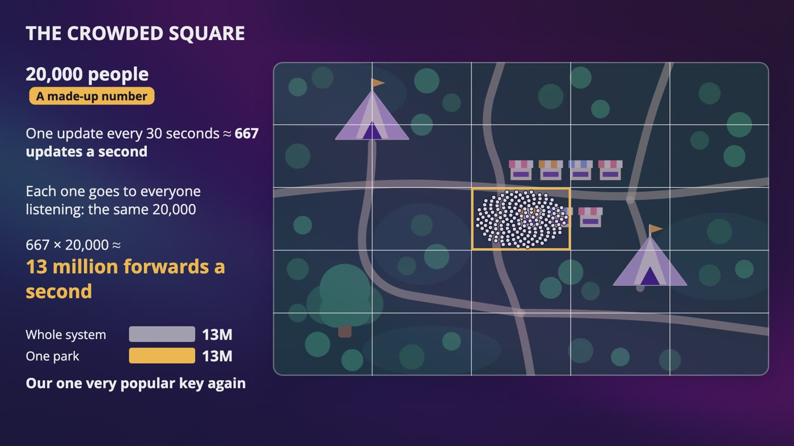

_20,000 people around one square, a made-up number, send about 667 updates a second to the same 20,000. That's about 13 million forwards from one park._

### One channel per square

- Make one channel for each 6 character geohash, about 950 by 600 meters in Lisbon.
- People who've opted in publish to the 1 square they're standing in.
- Cara subscribes to her square and the 8 around it, because of the Greenwich problem. Her helper measures, keeps anyone within say 500 meters, and skips her own update.
- When she walks straight across a line, she unsubscribes from 3 squares and subscribes to 3 new ones. Friends never needed that.

### The crowded square

- Strangers in a square have no limit. 20,000 people send about 667 updates a second, to the same 20,000 people. That's about 13 million forwards a second, the size of our entire system.
- That's our very popular key again, and this time it's a square. So you might only show a count, or a small sample. It's the Tokyo problem again.

### The real problem

- We just built a map of strangers with live positions. Someone could watch one person's dot move around a park.
- **Opt in,** and turn itself off after say a few hours.
- **No exact positions.** Snap people to a grid, so Cara sees a square and never a distance like 80 meters.
- **Nobody gets to follow a dot.** You might delay what's shown, with no name or path.
- **Block and report** have to work every time, along with stop sharing.
- **No lonely squares.** If you're the only person in a square, showing it is showing you.

### Is this worth building?

- Cara wants to talk about Dune, and she doesn't need to see where anyone is for that.
- So the festival runs a Dune meetup at 2 o'clock by the big tree. Nobody's location goes anywhere, and we don't build a single channel.

> **In your interview:** If they ask for strangers nearby, please build it, because they want to see you adapt the design with squares and 9 channels. Then say what worries you: no exact positions, and off by default.

> **In the real world:** Researchers at KU Leuven found that 6 of 15 dating apps let someone be pinpointed, using the 3 distances from our last chapter. And Facebook said that it ended Nearby Friends because of low usage, and that was with people you actually know.

**New terms**

| Term | Meaning |
|---|---|
| **Opt in** | It's off until someone deliberately turns it on. |

## 10. How Can It Find Something With No Internet?

> **The big idea:** 2 separate ideas. If a server can't read locations, the distance check moves to the phone and it costs battery. And a tag with no internet can be found by a crowd of strangers' phones.

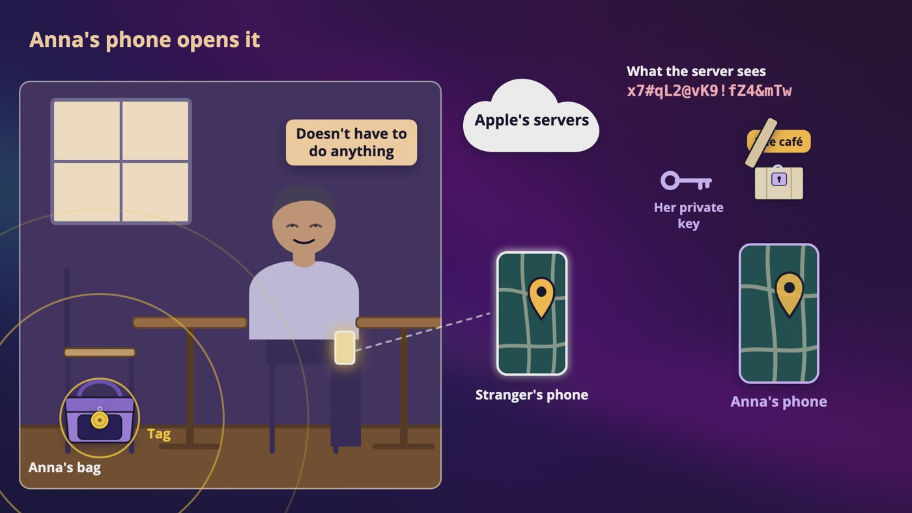

_A stranger's phone hears the tag, locks its own location with Anna's padlock, and uploads a box. Only Anna's private key can open it._

### People, in a locked box

- If the server can't read a location, the pub-sub server can still copy the box, and the key-value store can still hold the newest one.
- But Anna's helper can't measure the distance anymore. That step, and the 75 to 95% of forwards we used to throw away, all land on the phone.
- Ben also has to lock his spot so each friend can read it, and each device has its own keys. So one update isn't one box, unless you use the shared key trick from our groups.
- What's left is the outside of the box: the metadata, so who's connected to who, and when.

### Things, with no internet

- An AirTag's specs list Bluetooth and 2 other short-range radios, and no GPS, wifi or mobile network. Apple says no location data is stored in the tag.
- All it can do is whisper. It keeps sending one tiny Bluetooth signal, and that whisper is a padlock, Anna's public key.
- A stranger's phone at the café hears it, locks its own location with that padlock, and uploads the box to Apple. The stranger doesn't do anything.
- Anna's phone downloads the box and opens it with her private key, and there's a pin at the café.

### Who knows what

- The tag has no idea where it is. Apple's guide says the report has no login information, and Apple doesn't know who the finder is, or whose device was found. The owner never finds out who helped.

### Why the padlock keeps changing

- If a tag whispered the same padlock all day, anybody with a Bluetooth listener could follow it.
- Apple's guide says that for a missing device, the public key changes about every 15 minutes, worked out from a secret that's only on the owner's own devices.

> **In your interview:** If someone says, what if location is end-to-end encrypted, say that the server can't work out who's nearby, so distance moves to the phone, every update has to reach every phone, and that costs battery and data. You probably won't be asked to design the tag, so you only need to tell the padlock story.

> **In the real world:** Apple's privacy page says that on iOS 17 or later, shared location won't be accessible to Apple, and it's kept for up to 24 hours. Apple says its AirTag network can use more than a billion devices. Google's Find Hub is end-to-end encrypted too, but by default several phones have to spot a tag first. And in May 2024, Apple and Google announced their shared tracker warning, because a tag can also be dropped into someone's bag or coat.

**New terms**

| Term | Meaning |
|---|---|
| **Find My** | Apple's app for finding your devices, your things and your friends. |
| **AirTag** | Apple's tracker tag, about the size of a coin. |
| **Bluetooth** | The short-range radio that connects your headphones to your phone. |
| **Find Hub** | Google's version of this network. |
| **Detecting Unwanted Location Trackers** | A shared specification from Apple and Google. If an unknown tag is seen moving with you, your phone can warn you. |

## 11. Who Can See You?

> **The big idea:** A dot on a map is a person. The design question isn't only how we keep bad people out. It's also how someone gets out, safely, when the person on the other side has become the problem.

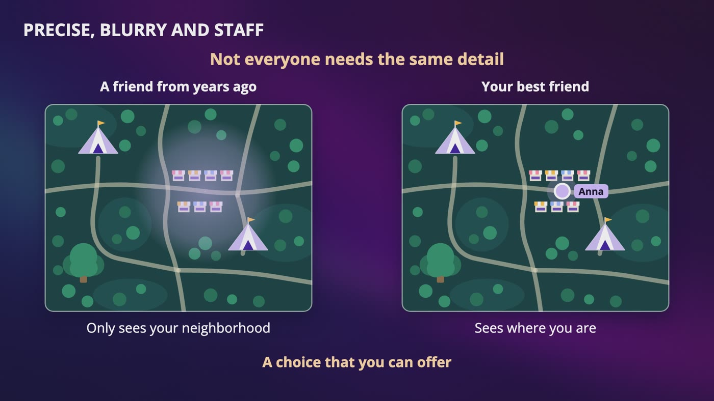

_Not everyone needs the same detail. A friend from years ago sees your neighborhood, and your best friend sees where you are._

### Who is the risk?

- The US Department of Justice's overview of stalking, from its numbers for 2019, says most victims know the person stalking them.
- It could be someone on your friends list, someone who had your phone for a minute, or someone you agreed to share with a year ago.

### What a good design does

- **Keep reminding you.** Does the person know right now that they're being tracked? Give them one screen for who can see me, with one button to stop. That button isn't a dot.
- **Make a decision to share expire.** Apple's guide offers 1 hour, until the end of the day, or indefinitely. I'd make the short option the easy one. It's our self-deleting value again, for permission.
- **Let someone leave without a scene.** A notification saying Cara stopped sharing could make things more dangerous, so offer a way to stop without an announcement.
- **Be careful with one-way sharing.** It can be fine, like with a delivery, but it's the easiest shape to misuse, so it deserves reminders that are hard to miss.
- **Limit your own staff.** Limit who can look, write down every time someone looks, and check those records.

### Keep less

- 333,000 updates a second at about 50 bytes each, our guess, is about 1.4 TB a day and about half a petabyte a year, before copies. That's also a complete record of where millions of people slept.
- So don't store it by default. If people want a history, they ask for it, they can delete it, and it expires on its own.
- If you really have to keep it, I'd use Cassandra, split by user, because you only ever ask for one person's history.
- Nothing here is legal advice, but GDPR names location data, and California's privacy law treats precise location as sensitive.

> **In your interview:** If they say to skip privacy, that's fine, but say something first: this data can be used to hurt someone, so I'd make sharing opt in, make it expire, show reminders, let people leave without a notice, and I wouldn't keep history by default. That's one breath.

> **In the real world:** Google said in December 2023 that Maps Timeline would be saved on your device, with auto-delete defaulting to 3 months when first turned on. When Facebook ended Nearby Friends, it also ended Location History and said it would delete what it had. And the US Federal Trade Commission charged Uber with failing to live up to its claim that it closely monitored employee access to rider and driver data.

**New terms**

| Term | Meaning |
|---|---|
| **Ghost Mode** | Snapchat's setting that hides you from everyone on its map, with a timer of 3 hours, 24 hours, or until you turn it off. |
| **Two-way sharing** | Friends who agree to see each other. In one-way sharing, I can see you and you can't see me. |

## 12. The Whole Live Location Design, for Your Interview

> **The big idea:** One small value for each person, a channel for each person, and a phone that's doing its best. The only really new thing was one sentence: it's okay to lose this.

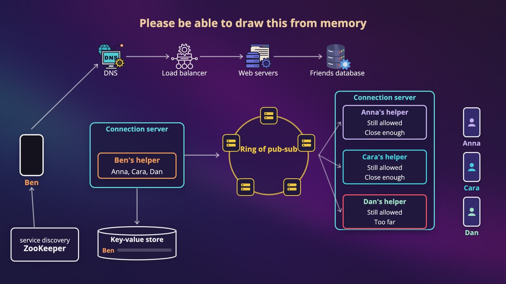

_The whole design: Ben's helper saves to the store and publishes, the ring finds the pub-sub server, and each friend's helper checks and measures._

| If they ask | You say |
|---|---|
| Why not a database for locations? | 333,000 writes a second, for a value that's old in 30 seconds, and it comes back by itself if lost. So it's in memory, with a self-deleting timer. |
| A pub-sub server dies? | A replacement in the same spot on the ring. Helpers subscribe again at slightly random times, and some updates get lost, which is fine. |
| How many servers? | Both calculations. Memory is about 80 GB, connected people only. CPU says about 130. Most forwards are thrown away. |
| Someone with a lot of friends? | 5,000 friends is about 167 forwards a second, because friends have a limit, and followers don't. |
| Battery? | Send when you've moved, go faster when someone's looking, and send a small still here. |
| Strangers? | One channel per square, subscribe to 9, and watch out for a crowded square. Opt in, with no exact position or distance. |
| What if it's encrypted? | The server can't measure distance, so every update reaches every friend's phone, which costs battery and data. |

### One dot, end to end

- Ben logs in with plain requests. His friends and sharing choices are in a real database.
- Service discovery gives him a connection server, and his phone opens a WebSocket. His helper looks up friends, reads their spots in one batch, and subscribes to their channels.
- He walks 50 meters, and his phone sends a spot with a time. His helper saves it, restarting the timer, and publishes it.
- The ring says which pub-sub server has his channel, and it sends one copy to each friend's helper. Each helper checks that sharing is still allowed, measures, and pushes or drops.
- If he sits down, he sends a small still here. If his phone dies, his dot goes grey and then goes away.

### Your 45 minutes

- **Step 1, 3 to 10 minutes:** friends or strangers, how far, how fresh, going quiet, history, who can see it, how many. Do the math, and say the privacy sentence.
- **Step 2, 10 to 15 minutes:** why phones can't talk directly, then the newest value makes the old one worthless, then draw the 2 sides.
- **Step 3, 10 to 25 minutes:** one update in slow motion, how many servers, then growing them.
- **Step 4, 3 to 5 minutes:** what you'd watch, like forwards thrown away, how old dots are, and battery. Never say your design is perfect.

### What to know

- **Know well enough for a sentence:** resizing and replacing a server, why friends aren't Adele, the phone's limits, squares for strangers, what encryption takes away, and why you wouldn't keep history by default.
- **Just recognize:** sharded pub-sub, Sentinel, Erlang and Elixir, and how the tag's padlocks change.

### The book club

- Anna walks into the café, and the woman behind the counter puts her bag in front of her, with her copy of Dune inside. A stranger's phone helped, and they'll never know.
- Dan walks in with a battery pack, and a new dot shows up at the table. At the end of the day, the sharing they all chose just ends, and 4 dots go away by themselves.

## Recap: Four dots in Lisbon

_The newest value makes the old one worthless._

| Every piece solved a real problem | |
|---|---|
| **A server in the middle** | Phones can't really reach each other |
| **One value in memory** | 333,000 writes a second, old in 30 seconds |
| **One channel per person** | We can't have everyone asking everyone |
| **Helpers** | Phones shouldn't throw updates away on battery |
| **Subscribing to all friends** | Otherwise we'd need a second system for who came online |
| **Ring of pub-sub servers** | About 13 million forwards a second |
| **Grey dots and timers** | A dead phone never says goodbye |
| **Still here messages** | Not moving looked like being gone |
| **One channel per square** | Strangers have no channel to subscribe to |
| **Padlocks that keep changing** | Anyone could follow a tag that never changed |
| **Sharing that expires** | Nobody should have to remember to turn it off |

**What to know really well**

- Why the newest value wins, and what that lets us throw away
- One update, in slow motion
- Why each person has a channel, and why you subscribe to all of your friends
- Memory against CPU
- What a dead phone looks like, with no goodbye

---

From the course **[System Design: Zero to Interview Hero](https://www.udemy.com/course/system-design-zero-to-hero/?referralCode=183D59A1EBE9E71D26FF)** by Nata Vacheishvili.
