# [Chapter 18: Design Google Maps](https://www.udemy.com/course/system-design-zero-to-hero/?referralCode=183D59A1EBE9E71D26FF)

_Dan's car, Ben's 30 minute deadline, and 3 completely different problems wearing one app._

[Download as PDF](../pdf/System-Design-Chapter-18-Notes.pdf)

## Contents

1. [Three Problems in One App](#1-three-problems-in-one-app)
2. [Flattening the Earth](#2-flattening-the-earth)
3. [The Numbers](#3-the-numbers)
4. [Map Tiles: A Mosaic of the World](#4-map-tiles-a-mosaic-of-the-world)
5. [Images or Instructions?](#5-images-or-instructions)
6. [Roads Are a Graph](#6-roads-are-a-graph)
7. [A\* and the Highway Trick](#7-a-and-the-highway-trick)
8. [Where Am I, Really?](#8-where-am-i-really)
9. [Everyone Is a Sensor](#9-everyone-is-a-sensor)
10. [How Long Will It Take?](#10-how-long-will-it-take)
11. [A Crash Up Ahead](#11-a-crash-up-ahead)
12. [The Whole Google Maps Design, for Your Interview](#12-the-whole-google-maps-design-for-your-interview)

## 1. Three Problems in One App

> **The big idea:** It looks like one giant app, and it's really 3 different problems. Drawing the map is mostly reads, finding a way is mostly thinking, and knowing the traffic is mostly writes.

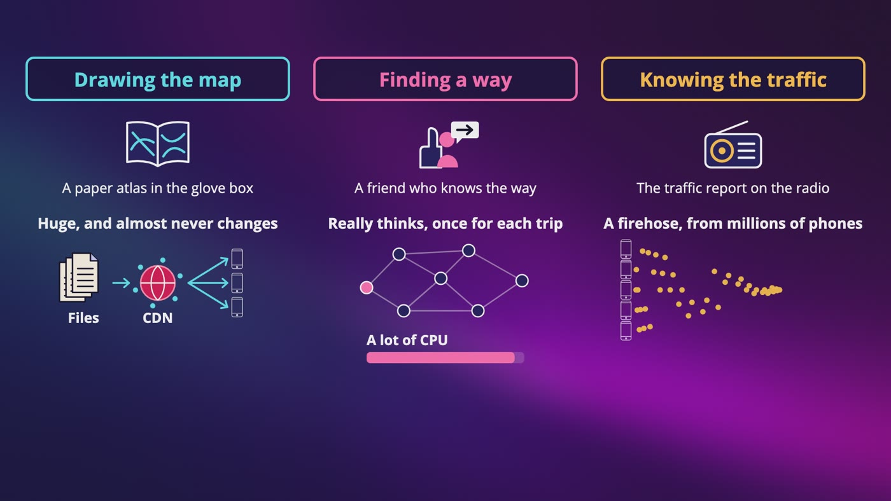

_Drawing the map is an atlas in the glove box, finding a way is a friend who knows the way, and knowing the traffic is the report on the radio._

|   | Drawing the map | Finding a way | Knowing the traffic |
|---|---|---|---|
| On a road trip | A paper atlas | A friend in the passenger seat | The traffic report on the radio |
| What it is | Files, sent by a CDN | A search, once per trip | A firehose from millions of phones |
| Mostly | Reads | Thinking | Writes |

### Step one: the answers we picked

- **Features:** show the map, give directions, and show the current position on the route, with an arrival time.
- **Devices:** mostly phones, so every image costs data and every report costs battery.
- **Road data:** we have it. You can't just walk around and draw the world, so companies buy map data or build on open data.
- **Travel modes:** driving and walking, because of Cara. The same roads have different weights.
- **Stops:** one destination, which keeps our search simple.
- **Live traffic and offline:** yes to both. Offline means the phone has to keep working by itself.
- **Size:** a billion people a day.

### Accuracy comes first

- You want it smooth and light on data and battery, but I'd put accuracy first.
- People trust the map. In the story below, they didn't lose a few minutes to a wrong number on a screen. They got stuck in a field.

> **In your interview:** Say that it's 3 problems, and I'd draw them as 3 separate boxes before anything else. And say accuracy out loud.

> **In the real world:** In June 2019, a crash on the main road to Denver's airport led Google Maps to suggest a detour. Days of rain had turned part of it, a dirt road, into mud, and reports say nearly 100 cars got stuck on a road too narrow to turn around on. Google said the road wasn't marked as private, and that things like weather can affect a road in ways it can't predict.

**New terms**

| Term | Meaning |
|---|---|
| **OpenStreetMap** | A free map of the world that volunteers make and keep up to date. It exists so that nobody has to own the map. |
| **Overture Maps** | A newer project from companies including Amazon, Meta and Microsoft. It combines open map data so that companies can share that work. |
| **Non-functional requirements** | How well it has to work, and not what it does. |

## 2. Flattening the Earth

> **The big idea:** A ball doesn't go flat without something giving way, so every flat map lies about something. A street map chooses Mercator: sizes are wrong, and shapes are right up close.

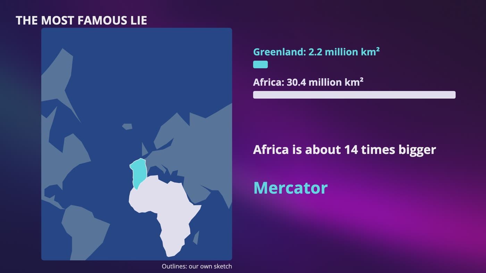

_Greenland, at about 2.2 million km², looks as big as Africa, at about 30.4 million km². Africa is about 14 times bigger._

### Mercator's deal

- It pulls the lines of longitude apart so they're straight and side by side, then stretches north and south by exactly the same amount.
- **Stretch by area:** nothing at the equator, about 1.6 times at Lisbon (about 39 degrees), 4 times at 60 degrees, about 10.5 times at 72 degrees, and about 33 times at 80 degrees.
- Dan doesn't care how big Greenland is. If 2 streets cross at a right angle, they cross at a right angle on his map, in every city on Earth.
- At the pole the stretch would be infinite, so the map just stops. At 85.05 degrees, the whole map comes out as a perfect square.

### From words to dots

- Dan typed airport, and we need a latitude and a longitude.
- Geocoding in a key-value store needs the exact key, so it fails on airport, or rua agusta with a letter missing.
- **It's really a search.** You clean up what they typed, fix typos, match pieces of names, then rank the answers using where they are.
- If a block has houses 1 to 100, number 50 is about halfway along it. It's a guess, but a pretty good one.

> **In your interview:** You won't spend long on this. Be able to say that maps stretch sizes to keep shapes, that the map stops at about 85 degrees, and that geocoding is a search, and not a lookup.

> **In the real world:** Microsoft's docs for Bing Maps say it chose Mercator so that small things keep their shape. Google's docs say its imagery gets cut off at about 85 degrees. And in August 2018, Google Maps on computers started showing a globe when you zoom out, and its tweet said that Greenland's no longer the size of Africa.

**New terms**

| Term | Meaning |
|---|---|
| **Projection** | A rule that says, this spot on the ball goes to this spot on the paper. |
| **Mercator** | A projection named after a mapmaker. Sizes are wrong across the world, and shapes are right up close. |
| **Web Mercator** | The version nearly every web map uses. It's Mercator with a small simplification that treats the Earth as a perfect ball. |
| **Geocoding** | Turning words into a latitude and a longitude. |
| **Reverse geocoding** | Going from a dot to words, like showing you what street you're on. |
| **GIS** | Geographic information system. The general name for software that works with maps. |
| **Normalization** | Cleaning up what someone typed, like making it lowercase and treating ST as street. |
| **Interpolation** | Working out a spot between 2 you know, like number 50 being about halfway along a block. |
| **Plus Codes** | Google's open source system that turns any spot into a short code, using only math, so a place with no address can still have something you can write down. |

## 3. The Numbers

> **The big idea:** For each number, ask what it decides. Big decides where the map lives, expensive decides how clever the search has to be, and busy decides what kind of database we need.

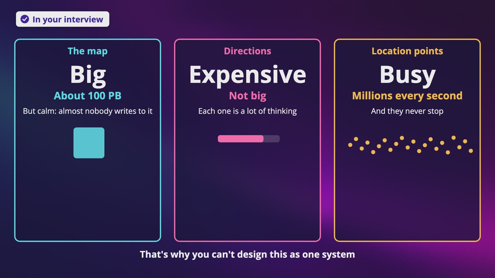

_3 problems with 3 very different numbers: the map is big, directions are expensive, and location points are busy._

### How big is the map?

- All the way zoomed in, the square is cut into about 4.4 trillion tiles. At 100 KB each, our own guess, that's about 440 PB.
- Most of it is ocean, desert and forest. Say a tenth needs its own detailed picture, so about 44, rounded to 50 PB.
- Each step out needs a quarter of the tiles: 50, plus 12.5, plus about 3, and so on, is about 67 PB. Let's call it **100 PB**, to be safe.
- It's almost never written and read by everybody, in pieces. So that's files on object storage, with a CDN in front.

### How many directions?

- A billion people, 5 times a week, divided by 7, is about 714 million a day.
- With a day of about 100,000 seconds, that's about 7,100 a second. The exact answer is closer to 8,300, and that's fine.
- Times 5 for the peak is **about 36,000 a second**. Each one is a search across a huge map of roads.

### How many points?

- 35 minutes of navigating a week is 5 billion minutes a day. At 1 point a second, that's 300 billion points a day, or **about 3 million points a second**.
- The phone sends a batch every 15 seconds, so that's 200,000 requests a second, and a million at the peak.

### The catch

- **Batching saves requests, and it doesn't save points.** The database still gets 3 million rows a second, and 15 million at the peak, if each point becomes a row.
- A design that sizes the database for a million writes a second is off by 15 times.

### How much do the points weigh?

- About 50 bytes a point, our own guess, times 300 billion is 15 TB a day, and about 5.5 PB a year, before copies.
- It's also a record of where a billion people drive, and we'll ask whether we should keep that at all.

> **In your interview:** Please say both numbers: batching gives us 200,000 requests a second, but the database still has to take 3 million points, unless we reduce them on the way. And say the 3 together: the map is big and calm, directions are expensive, and location points are busy.

## 4. Map Tiles: A Mosaic of the World

> **The big idea:** Cut the world into squares and only send what's on the screen. Every zoom level doubles the rows and columns, and a tile's address is just 3 numbers your phone can work out.

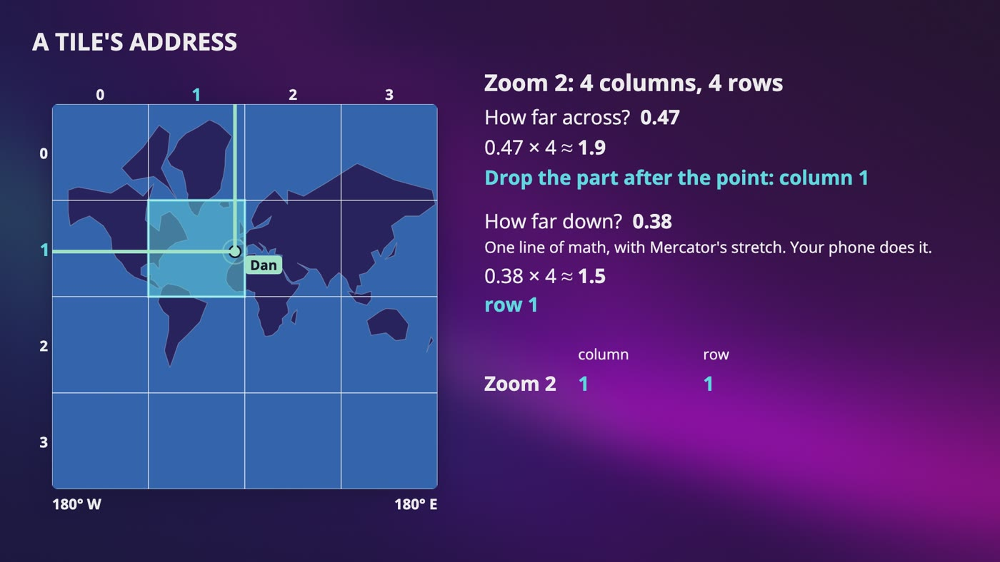

_At zoom 2 there are 4 columns and 4 rows. Dan is 0.47 across and 0.38 down, so he's in column 1, row 1._

### Zoom levels

- Zoom 0 is the whole world in 1 tile. Zoom 1 has 2 columns and 2 rows, so 4 tiles. Zoom 2 has 16.
- Each step gives us **4 times the tiles**. Zoom 21 is 4 multiplied by itself 21 times, which is the 4.4 trillion.
- At the equator, 1 tile is about 313 km wide at zoom 7, about 1.2 km at zoom 15, and about 19 meters at zoom 21.

### A tile's address

- Dan's at about 38.7 north and 9.15 west. We need the zoom, the column and the row, counted from the top left, starting at 0.
- **Column:** he's about 0.47 of the way across. At zoom 2, 0.47 times 4 is about 1.9, so we drop the part after the point. Column 1.
- **Row:** he's about 0.38 of the way down, which goes through a line of math with Mercator's stretch. 0.38 times 4 is about 1.5. Row 1.
- **Zooming in:** at zoom 3 it's column 3, row 3. At zoom 4 it's column 7, row 6. You double, and you add 0 or 1.
- At zoom 15, it's column 15,551 and row 12,558.

### Why not our geohash?

- One character more or less is a jump of 5 switches, which is 2.5 zoom levels, so it can't name every level. It also cuts evenly, and tiles are cut after Mercator's stretch.
- **Geohash is for finding things, and zoom, column and row is for drawing them.**

### Made ahead, and how the phone finds them

- The map barely changes, and thousands of people want the same tile, so make them ahead of time, on object storage with a CDN in front.
- Nobody looks at zoom 21 in the middle of the Pacific, so only make those if someone asks. All those blue squares can point to 1 file, which is our own reasoning.
- The app asks once when it starts, and the server gives today's pattern for tile addresses. The math stays on the phone, and the address can change whenever we want.

> **In your interview:** Be able to draw this, zoom by zoom, and work out one column by hand. You might read that a phone needs 9 tiles, but it depends on the screen, so it's not a rule.

> **In the real world:** OpenStreetMap's tile servers use exactly this pattern of 3 numbers with slashes between them, and Google's docs describe a tile's column and row at a zoom level, counted from the top left corner.

**New terms**

| Term | Meaning |
|---|---|
| **Map tile** | One of the small squares the map is cut into, like a tile in a mosaic. |
| **Viewport** | The part of the map that's on your screen right now. |
| **Zoom level** | One copy of the whole map, at one distance from far away to very close. |
| **Quadkey** | These same tiles, written as one string of digits. |

## 5. Images or Instructions?

> **The big idea:** Don't send a picture of a tile. Send a list of what's in it, and let the phone draw it. It stays sharp, it can rotate, and night mode costs no extra download.

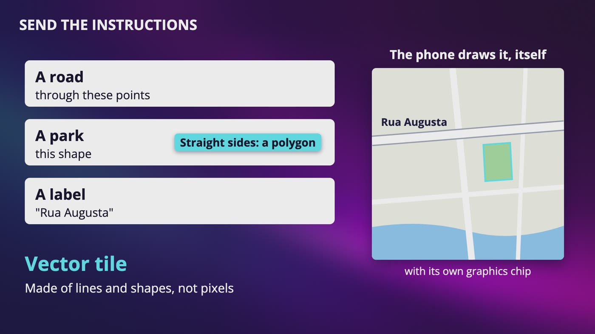

_A vector tile is a list of what's in it: a road through these points, a park of this shape, and a label. The phone draws it with its own graphics chip._

|   | Image tile (raster) | Vector tile |
|---|---|---|
| What's sent | A grid of pixels | Lines, shapes and labels |
| Zoom between levels | Stretches and goes blurry | Draws the same lines bigger |
| Rotating | Street names go sideways | Labels stay upright |
| Another language | A different image | It's only text |
| Dark map | Another copy of the world | Different colors, same data |

### So was 100 PB real?

- Vector tiles are smaller for the same area, so 100 PB was too high for a modern app. I'd say out loud that it's a ceiling, and that you'd measure it.

### The data, in the worst case

- 25 tiles a square kilometer at 100 KB each is 2.5 MB a square kilometer.
- At 30 km an hour, with a strip of map 1 km wide, that's 75 MB an hour, or 1.25 MB a minute. That's about 0.17 megabits a second, so it isn't scary for one phone.
- **Everyone:** 5 billion minutes a day, times 1.25 MB, divided by 100,000 seconds, is 62,500 MB a second, or 500 gigabits a second.
- With 200 CDN locations, that's about 312 MB a second at each one.

### Offline

- Ben taps download and picks a city. That's a bundle of the same tiles, for one area and a few zoom levels.
- A picture doesn't give directions, so the road data has to be in the download too, with something that can search on the phone.
- It can't know about traffic. It also gets old, so it needs a version number and a way to update.

> **In your interview:** I'd start with images, because they're easy to explain. Then say that in real apps today, we'd send vector tiles, and here's why. Please don't leave that part out.

> **In the real world:** OpenStreetMap's tiles are PNGs, 256 pixels on each side. Google Maps version 5 for Android, at the end of 2010, was already drawing with vectors, and a report from Engadget, a tech news site, mentions 2 fingers to tilt and rotate, and rerouting without a connection. Mapbox, a company that sells map tools to other apps, has published its format as an open specification.

**New terms**

| Term | Meaning |
|---|---|
| **Pixel** | One of the tiny colored squares that make up a picture on a screen. |
| **Raster image** | An image stored as a grid of pixels. Raster just means a grid. |
| **PNG** | A common image file. |
| **Polygon** | A shape with straight sides. |
| **Vector tile** | A tile sent as a list of what's in it. Vector means it's made of lines and shapes, not pixels. |
| **Binary file** | A compact format made for computers, and not text a person would read. |
| **POP** | Point of presence. One of a CDN's many locations. |

## 6. Roads Are a Graph

> **The big idea:** Junctions are dots, roads are arrows, and the weight is time. Dijkstra spreads out like water from the start, always finishing the closest unfinished junction next.

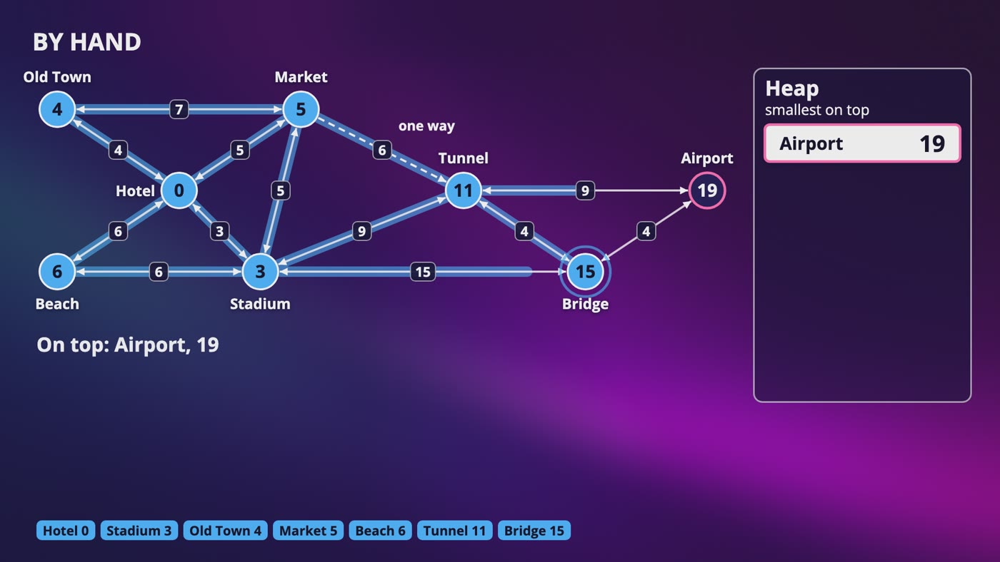

_The finished search on our made-up city: Hotel, Market, Tunnel, Bridge, Airport, in 19 minutes. The Stadium, 3 minutes away, isn't on it._

### The graph

- Every junction is a dot, and every road between 2 junctions is an arrow. A two-way street is 2 arrows.
- **The weight is minutes, not length.** That's why a long highway can beat a short little street, and why walking and driving need different weights.

### The waterline

- Pour water on the Hotel, and it spreads along every road at the same speed. When it first reaches a junction, that's the fastest way there.
- We find the closest junction with a heap, which promises that the most urgent one is on top.

### By hand

- **Hotel, 0:** Old Town 4, Beach 6, Market 5, Stadium 3.
- **Stadium, 3:** adds Tunnel 12 and Bridge 18. The Beach would be 9 and the Market 8, so we ignore those.
- **Old Town, 4:** nothing changes.
- **Market, 5:** the one-way road makes the Tunnel 11, which beats 12.
- **Beach, 6:** nothing gets better. It's the wrong direction, and the water doesn't know.
- **Tunnel, 11:** the Bridge becomes 15, and the Airport shows up at 20. But it isn't on top yet, so we're not done.
- **Bridge, 15:** the Airport becomes 19.
- **Airport, 19:** it's on top, so we stop, and walk the route backward.

### Why it works, and the problem

- Any other way would pass through something still in the heap, at 19 or more, and roads can't take away time. That's why it fails with negative weights.
- To get our answer, we finished all 8 junctions, including the wrong direction.
- Remember our 36,000 directions a second. At 2 seconds each, that's about 70,000 CPU cores, if every trip was that long.

> **In your interview:** Know this one well. Be able to do it by hand on a small map, and say that a heap makes each step cheap. Then be ready for the next question: this spreads everywhere, so how do you make it stop looking behind you?

> **In the real world:** Dijkstra said he came up with it in about 20 minutes, on a café terrace in Amsterdam, without pencil and paper, while out shopping with his fiancée. A large survey of route planning research tested it on a map of Western Europe with 18 million junctions. It visited about 9 million on an average search, in about 2 seconds on their machine.

**New terms**

| Term | Meaning |
|---|---|
| **Junction** | A place where roads meet. |
| **Weight** | The number on an arrow. Here, how many minutes we expect that road to take. |
| **Shortest path** | In this chapter, the smallest total time. |
| **Dijkstra's algorithm** | A search that always finishes the closest unfinished junction next, named after Edsger Dijkstra, a Dutch computer scientist. |

## 7. A\* and the Highway Trick

> **The big idea:** A\* gives the water a sense of direction with a guess. But what really gets you across a continent is hierarchy: small roads, then highways, then small roads.

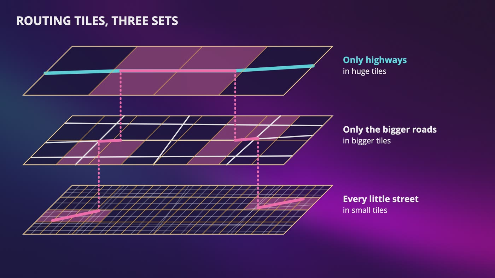

_3 sets of routing tiles: every little street in small tiles, bigger roads in bigger tiles, and only highways in huge tiles._

### Add a guess

- Dijkstra picks the smallest time so far. A\* picks the **smallest time so far, plus a guess of the time that's left**.
- Our guess is the straight line distance, with nothing in this city going faster than 1 km a minute.
- It's the same route and the same 19 minutes, and we finished 6 junctions, not 8. Old Town and the Beach stayed in the heap, at 20 and 22.

### The one rule

- **The guess must never be more than the real time.** Too low is fine, and you just look around a bit more. Too high, and you could skip the best road and get a wrong answer without knowing it.

### Why the guess gets weak

- One highway at 2 km a minute, even nowhere near this route, cuts every guess in half to stay honest. Old Town and the Beach get opened, and it's all 8 junctions again.
- When you simulate made-up grid cities of up to 90,000 junctions, the answers match Dijkstra every time. A\* visits about 60% fewer junctions on random trips, and only about 10% fewer from corner to corner.
- The survey says that on real road maps, the gain from this kind of guess is small or even nothing.

### What really saves you

- Long routes all end up on a small network of important roads. Dan thinks small roads, highway for hours, then small roads.
- We make 3 sets of **routing tiles**. Search small tiles near the start, jump up, cross on highway tiles, and come back down near the end.
- They're just files, so they go on object storage, and routing servers keep popular ones in a cache. You don't need a database.
- Simple levels might not give the very best route. We want a really good route, quickly, and I'd say so out loud.

> **In your interview:** Know Dijkstra well, know what A\* adds and its one rule, and say that hierarchy is what really saves you at world scale. Nobody's going to ask you for the math on that last part.

> **In the real world:** A\* was published in 1968 by 3 researchers at Stanford Research Institute, as part of the work on Shakey, a robot that had to plan its own way around a room. In that same survey, contraction hierarchies looked at about 280 junctions instead of about 9 million, in about 110 millionths of a second.

**New terms**

| Term | Meaning |
|---|---|
| **A\*** | A search that picks the smallest time so far plus a guess of the time that's left. Say it as A star. |
| **Hierarchy** | Levels. Here, small roads, bigger roads and highways. |
| **Routing tiles** | Squares that the road network is cut into, in 3 sets from every street to only highways. |
| **Adjacency list** | An address book for each junction, listing its roads going out. |
| **Contraction hierarchies** | A research idea where you add shortcut arrows ahead of time. You probably won't be asked how it works. |

## 8. Where Am I, Really?

> **The big idea:** A dot from a phone is a guess, so we first put it on a road, using several dots together. And when there's no signal, the phone has to keep going by itself.

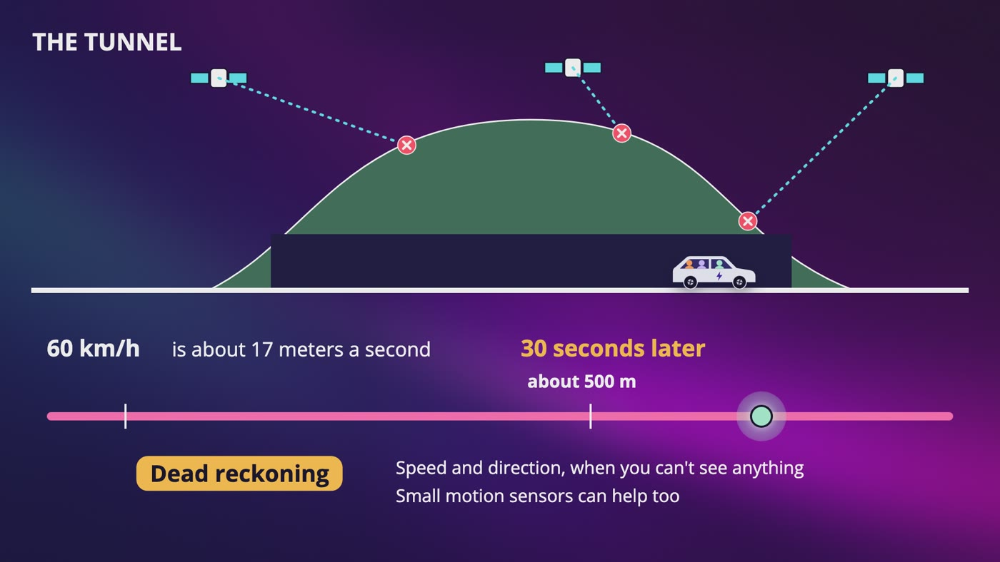

_In the tunnel, 60 km/h is about 17 meters a second, so 30 seconds later Dan is probably about 500 meters along. That's dead reckoning._

| Kind of data | What matters | Example |
|---|---|---|
| A message | Every one | Anna's WhatsApp message |
| A dot | Only the newest | Where Ben is right now |
| A point | Only the crowd | How fast a road's moving |

### Map matching

- A side street might be 10 meters away, and everything that comes next depends on knowing which road you're on.
- **Nearest road fails.** With 3 dots a second apart, the middle one is 6 meters from the main road and 4 from the alley. So Dan goes into the alley and back in 2 seconds.
- A car can't teleport. So we ask which path through the roads best explains all of these dots together.

### The tunnel

- GPS can't hear the satellites through a hill, and the mobile network is probably gone too.
- The phone already has the route and map pieces, and it knows how fast Dan was going, so it keeps moving the dot along the route. Small motion sensors can help.
- The error grows, then he comes out, and the dot jumps to where it really is.
- That's one more reason to send a whole route, and not one instruction at a time.

### Sending what we saw

- The phone records a point once a second and sends all 15 together every 15 seconds. That's about 750 bytes, and it only wakes the radio once.
- If Dan's sitting in a jam, we can send less. If the batch can't go out, it waits on the phone, because each point has its own time.

> **In your interview:** For map matching, one sentence is plenty: we ask which path through the roads best explains all of these dots together.

> **In the real world:** Google offers map matching as a service called Snap to Roads. Waze's own docs say that GPS signal is lost in tunnels, and its Beacons program puts small battery-powered transmitters in tunnels, which a phone can hear over Bluetooth.

**New terms**

| Term | Meaning |
|---|---|
| **Map matching** | Taking a dot and putting it on a road, like a spell check with a dictionary of all the roads. Also called snapping to a road. |
| **Dead reckoning** | An old word from ships, for working out where you are from your speed and direction when you can't see anything. |
| **Waze** | A navigation app that's built around drivers reporting what they see. |

## 9. Everyone Is a Sensor

> **The big idea:** The same phones that use the map make the map. Traffic needs to know how many cars are on a road and how fast they're going. It doesn't need Anna.

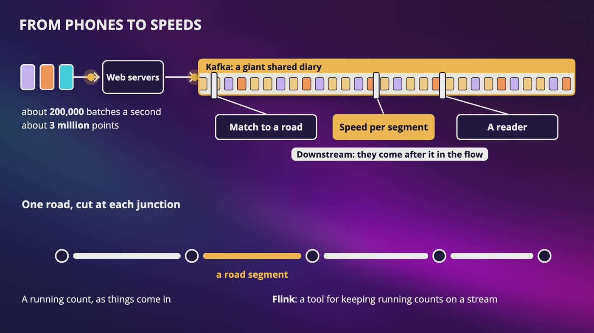

_Batches go through web servers into Kafka. One reader matches points to roads, and another works out a speed for each road segment._

### From phones to speeds

- About 200,000 batches a second, about 3 million points, go into Kafka, because several systems want them.
- The first reader does map matching. Every road is cut into **road segments**, usually from one junction to the next.
- The next reader works out a speed for each, with a running count. Flink is one way to do it.
- Say 40 phones went along the road to the bridge in 5 minutes, with a middle speed of 18 km an hour, on a road that's usually 60. It turns red. I'd use the middle one, so one parked van doesn't change the answer.
- With only 2 phones, don't be too sure, and lean on what that road normally does.

### It can notice the map is wrong

- A road with 200 cars every 5 minutes suddenly has 0. At 3 in the morning that's normal, and at 8 in the morning it might be closed.
- Thousands of phones in a straight line through a field means somebody built a road. This is our own reasoning.

### Fake jams

- Do the speeds look like cars? Are they 99 people who've used this app for a while?
- Every check has a cost. If you demand too much proof, a real jam takes longer to show up.

### What traffic really needs

- **Remove who it is** as early as you can. Speed readers only get a road, a time and a speed.
- **Trim the start and the end** of each trip, usually someone's home and work. That's our own reasoning.
- **Keep raw points for a short time,** and only the averages for longer.
- **Own history is a separate choice,** and it should expire.

### Where the points go

- 3 million rows a second, 15 million at the peak, is Cassandra again.
- If the folder is a user, you've built a file of each person's movements. If it's a road segment and an hour, sorted by time, you can answer what traffic needs, and nobody's file exists. Privacy just changed a table.
- During a partition, I'd keep accepting points, because a slightly old speed is much better than losing them.

> **In your interview:** Please say the sentence: it needs cars on a road, and it doesn't need Anna. And please don't say that it's fine because it's anonymous. Removing the name is the start of this, and not the end.

> **In the real world:** In February 2020, artist Simon Weckert pulled 99 phones with Google Maps open in a wagon down an empty Berlin street. News reports say a thick red line showed up about an hour later. Google said they "haven't quite cracked traveling by wagon". And a 2013 study called Unique in the Crowd used 15 months of phone location data for 1.5 million people, with no names. 4 points, a place and a time, were enough to pick out 95% of them.

**New terms**

| Term | Meaning |
|---|---|
| **Road segment** | A piece of a road, usually from one junction to the next. |
| **Aggregate location data** | Data from a lot of phones added together. |
| **Clustering key** | The part of a key that sorts things inside a folder. The partition key decides the folder. |

## 10. How Long Will It Take?

> **The big idea:** An arrival time isn't a measurement. It's a forecast, like the weather. And traffic has to go into the search itself, or the best route may never get looked at.

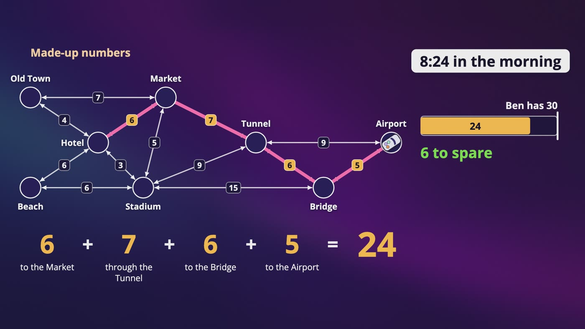

_With made-up forecast numbers, 6 + 7 + 6 + 5 turns our 19 minute route into 24 minutes, which leaves Ben 6 to spare._

### One request

- Dan's phone sends where he is, where he's going and how he's traveling, in the body of a POST request, so it stays out of the server logs.
- **1.** Geocode the words into a spot.
- **2.** The route planner loads routing tiles and finds a few good routes, called candidates.
- **3.** Each candidate gets an arrival time.
- **4 and 5.** Filter, then rank, usually by that arrival time.
- **6.** Send back the routes, the times and the road pieces the phone needs to keep going.
- On our city, the best 3 are 19, 20 and 20 minutes.

### Traffic later isn't traffic now

- Dan reaches the bridge in about 15 minutes, so he cares how it'll look then.
- **History:** this road on a weekday at 8:15 usually moves at this speed.
- **Right now:** very useful for the road you're about to turn onto. For a road an hour away, history is the better guess.
- 19 and 24 are the same route, and only one of them is honest.

### The trap in the candidates

- Finding the top routes without traffic and then adding traffic sounds reasonable.
- All 3 of ours go through the Tunnel. With a 20 minute jam they become 39, 40 and 40, and all miss Ben's flight.
- Stadium straight to Bridge is 22 minutes and skips the Tunnel. It's ranked around fifth, so it never made the list.
- So use weights with traffic **during** the search, at least for nearby roads. Same for tolls: treat those roads as if they don't exist, or you could have nothing left.

### Back to Colorado, and caching

- This is only reasoning: make the road's type part of its weight, count how many phones have driven it lately, and think about the weather.
- Not knowing should count against a road. Don't send 100 people at once onto a road you can't vouch for, and tell them what they're getting into.
- A cached road list can be useful for a little while, but work out the arrival time fresh. Key it by tiles and a time window, never exact coordinates.

> **In your interview:** It's enough to say historical plus live, and that you'd learn it from past trips. And please don't search first and add traffic later.

> **In the real world:** Google's 2020 post says it combines historical traffic patterns with live conditions, and that its predictions have been accurate for over 97% of trips, in Google's own words and by its own measure. It also says an unpaved road, or one covered in dirt or mud, is less likely to be recommended.

**New terms**

| Term | Meaning |
|---|---|
| **Candidates** | A few good routes that the route planner finds. You might hear this called top K shortest paths, where K is just a number. |
| **ETA** | Estimated time of arrival. |
| **DeepMind** | Google's AI research lab. |
| **Graph neural network** | A kind of machine learning Google used with DeepMind. It fits because roads are a graph, and traffic on one road spills onto the next. |

## 11. A Crash Up Ahead

> **The big idea:** Don't ask every driver about the crash. Ask the crash about the drivers, with a list for each routing tile. And don't send everyone onto one road, because the crowd changes the traffic.

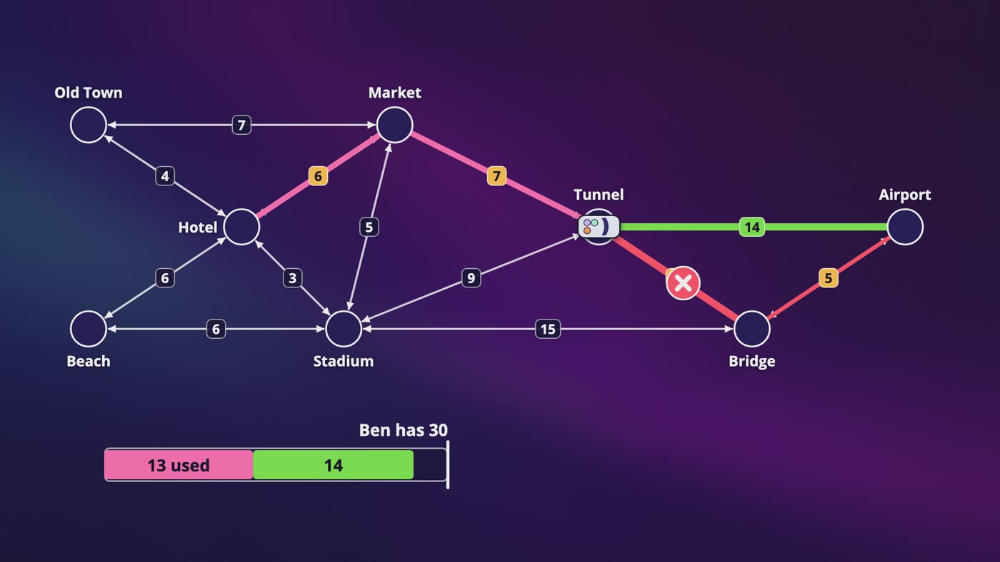

_The Bridge is stuck, and the rest of the trip would be 34 minutes. From the Tunnel exit, the airport road is 14, so 13 used plus 14 makes 27._

### Who's affected?

- 5 billion minutes a day over 1,440 minutes is about 3.5 million people navigating at any moment, and about 17 million at our peak.
- Checking each one is O(n). With 100 road changes a second, a made-up number, that's **1.7 billion route checks a second**, and almost every answer is no.

### The box is only a filter

- You might see a box around the tile where a driver started and the one they're going to. A route is a thin line through a big rectangle, so being in the box doesn't mean you're affected.
- Simulating a made-up 200 by 200 city with 10 by 10 tiles, about 1 tile in 6 in the box is on the route for a long trip, and about 1 in 3 for a shorter one.
- It's also worse than the Bloom filter's maybe. About 1 route in 4 or 5 stepped outside its own box, swinging out to reach a highway.
- So make it a bit bigger, then do a real check. You still have to touch every driver.

### Flip it around

- This is our own reasoning, and it's like the index at the back of a book. Keep a list for each routing tile of who's going through it.
- When there's a crash, read that one list, then check whether the Bridge is really on each route and still ahead.
- About 50 lists per driver, times 17 million drivers, is 850 million entries. At 20 bytes each that's about 17 GB, so it fits in memory across a few machines.
- It has to be kept up to date, and that's the real price. A self-deleting timer handles someone whose phone died.

### How do we tell them?

- A WebSocket fits, and server-sent events can work too. I'd choose WebSocket, because we might want to send more later.
- The fair reason against a push notification is size. Apple's docs say a normal push can hold at most 4 KB, so it can wake someone up, but it can't really carry a new route.

### Should we move everyone?

- If everyone takes the airport road, it's jammed. Say it becomes 30 minutes, so Ben's at 43. **Your answer changes the thing you're measuring.**
- So offer the new route to a part of the drivers, watch the speed on that road, then offer it to more. Only offer it if it saves a real amount of time.

> **In your interview:** You could mention the box as a filter, then say the list per tile, and say that you'd measure which is cheaper. I'd be really happy to hear someone think of it on their own.

## 12. The Whole Google Maps Design, for Your Interview

> **The big idea:** It's 3 small systems, and they mostly touch in one place: traffic becomes the weights. The only really new thing was some water, spreading out from a hotel.

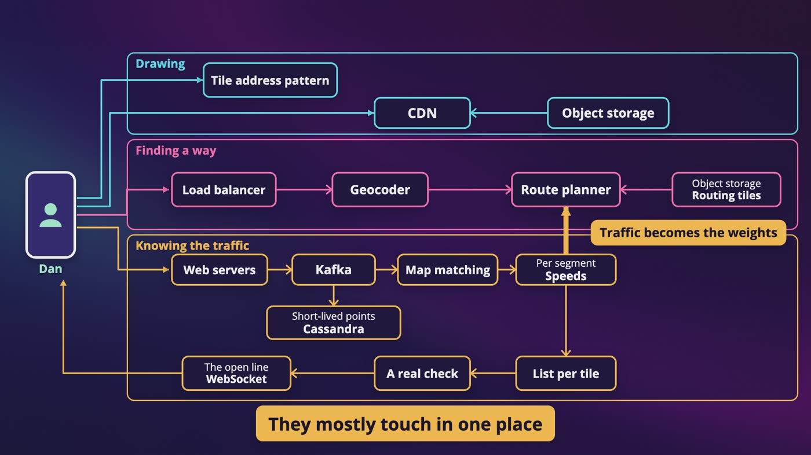

_All 3 problems on one diagram: drawing, finding a way and knowing the traffic. They mostly touch in one place, where traffic becomes the weights._

| If they ask | You say |
|---|---|
| How do you store the map? | Tiles as files on object storage with a CDN in front, and vector tiles for real apps. About 100 PB as a ceiling. |
| How does zoom work? | Each level doubles rows and columns, so 4 times the tiles. Geohash is for finding, and this is for drawing. |
| Fastest route across a country? | Roads are a graph, and the weight is time. Dijkstra with a heap. A\* adds a guess that must never be too high. Levels are what really save you. |
| Where does traffic come from? | The same phones. Match points to roads, stream them, and work out a speed per segment. |
| How do you update drivers? | A box is only a filter. Keep a list per tile, do a real check, use an open line, and don't move everyone onto one road. |
| Privacy? | Traffic needs cars on a road, and not Anna. Remove identity early, trim trips, keep raw points briefly, and don't call it anonymous and stop there. |

### One trip, end to end

- **Drawing:** the phone asks once for today's tile address pattern, does the math, and gets vector tiles from the CDN.
- **Finding a way:** the geocoder treats airport as a search. The route planner loads routing tiles, climbs up and back down, and uses traffic in its weights. It forecasts each candidate and returns 24 minutes.
- **Knowing the traffic:** every 15 seconds, a batch goes through web servers into Kafka. One reader matches roads, and another works out speeds with no names attached. Those go back into the weights.
- **The crash:** read the list for one tile, do a real check, send a message over the open line, and offer the airport road to some drivers.

### Your 45 minutes

- **Step 1, 3 to 10 minutes:** features, devices, road data, live traffic, travel modes, stops, offline. Accuracy first. Then 200,000 requests, and 3 million points.
- **Step 2, 10 to 15 minutes:** this is 3 problems. Draw 3 boxes.
- **Step 3, 10 to 25 minutes:** go deep on routing, then traffic.
- **Step 4, 3 to 5 minutes:** what you'd watch, like how far off arrival times were. Never say your design is perfect.

### What to know

- **Really well:** the 3 problems, Dijkstra by hand, zoom, column and row, batching saves requests and not points, and where traffic comes from and what it needs to keep.
- **For a sentence:** Mercator's deal, vector against images, A\*'s rule, hierarchy, map matching and the tunnel, forecasts, why candidates need traffic, and the crowd moving the jam.
- **Just recognize:** Web Mercator's exact number, quadkeys, contraction hierarchies, Plus Codes and graph neural networks.

### For the curious

- Our delivery van has a lot of stops. With 10 stops there are about 3.6 million possible orders, and with 20 it's about 2.4 quintillion. So real systems settle for a really good order.

### Departures

- Dan pulls up with 4 minutes to spare, and Ben runs. At the gate, he finds Anna's copy of Dune in his bag, with a note: for the flight.
- Dan types one word, home, and a long line goes up the screen.

**New terms**

| Term | Meaning |
|---|---|
| **Traveling salesman problem** | Finding which order a vehicle with a lot of stops should go in. |

## Recap: Dan's drive to the airport

_It looks like one giant app, when it's actually 3 completely different problems._

| Every piece solved a real problem | |
|---|---|
| **Mercator** | A ball doesn't go flat |
| **Tiles and zoom levels** | We can't send a 100 PB map |
| **Vector tiles** | Pictures go blurry, and every style is a new copy |
| **Dijkstra with a heap** | The shortest road isn't the soonest |
| **A\*** | The water spreads in every direction |
| **Routing tiles in levels** | A guess can't get you across a continent |
| **Map matching** | A dot from a phone is a guess |
| **Dead reckoning** | No signal in the tunnel |
| **Kafka and speeds per segment** | About 3 million points a second |
| **Forecasts** | Traffic later isn't traffic now |
| **A list for each tile** | 1.7 billion route checks a second |
| **Offering routes to some drivers** | The crowd changes the traffic |

**What to know really well**

- The 3 problems
- Dijkstra by hand
- Zoom, column and row, with 4 times the tiles at each level
- Batching saves requests, and not points
- Where traffic comes from, and what it really needs to keep

---

From the course **[System Design: Zero to Interview Hero](https://www.udemy.com/course/system-design-zero-to-hero/?referralCode=183D59A1EBE9E71D26FF)** by Nata Vacheishvili.
