# [Chapter 19: Design Message Queue](https://www.udemy.com/course/system-design-zero-to-hero/?referralCode=183D59A1EBE9E71D26FF)

_Midnight, a new edition of Dune, and what's really inside the box we've been calling a mailbox._

[Download as PDF](../pdf/System-Design-Chapter-19-Notes.pdf)

## Contents

1. [Opening the Box: What Are We Building?](#1-opening-the-box-what-are-we-building)
2. [One Book, Many Bookmarks](#2-one-book-many-bookmarks)
3. [Partitions, and What Stays in Order](#3-partitions-and-what-stays-in-order)
4. [Consumer Groups](#4-consumer-groups)
5. [Why a Log on Disk Is So Fast](#5-why-a-log-on-disk-is-so-fast)
6. [Batching: Send a Truck, Not a Bike](#6-batching-send-a-truck-not-a-bike)
7. [Who Sends, Who Asks](#7-who-sends-who-asks)
8. [When a Consumer Joins or Dies](#8-when-a-consumer-joins-or-dies)
9. [Copies, Leaders and In-Sync Replicas](#9-copies-leaders-and-in-sync-replicas)
10. [How Sure Do You Need to Be?](#10-how-sure-do-you-need-to-be)
11. [Growing, Delays and What's Changed](#11-growing-delays-and-whats-changed)
12. [The Whole Message Queue Design, for Your Interview](#12-the-whole-message-queue-design-for-your-interview)

## 1. Opening the Box: What Are We Building?

> **The big idea:** A queue does 2 jobs: nobody has to wait for anybody, and a burst becomes a line. And the first question is whether you mean a mailbox or a log.

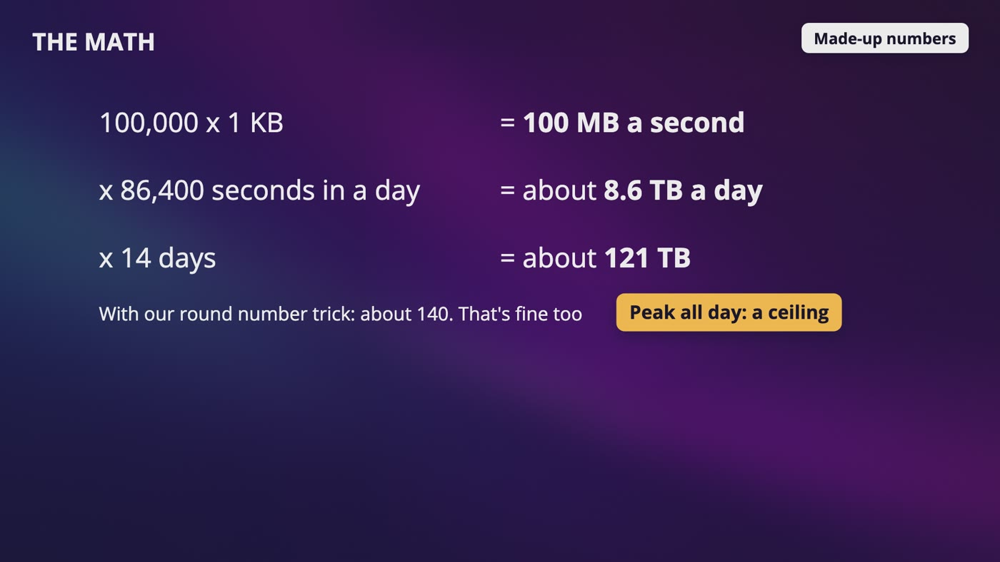

_100,000 messages a second at 1 KB each is 100 MB a second, about 8.6 TB a day and about 121 TB over 14 days. These are made-up numbers._

### Why a queue at all?

- **Decoupling:** the web server drops a message and says thank you right away, instead of waiting for shipping, billing and everyone else.
- **Surviving a burst:** say 2,000 orders a second come in for the first minute, and shipping can take 500 a second. Without a queue, it falls over.
- With a queue, 90,000 orders are waiting after that minute, and 3 minutes later the line's gone. Nobody lost anything.

### Mailbox or log?

- **Mailbox:** once a letter's picked up, it's gone. Amazon's SQS and RabbitMQ work like this.
- **Log:** in a diary, reading a line doesn't remove it, and each reader keeps their own place. That's Kafka.

### Step one: the answers we picked

- **Messages stay after reading,** for 2 weeks, because 4 teams read the same order. So we're building a log, and a team can have a bad week and still catch up.
- **A message is about 1 KB,** text and no pictures.
- **Order matters for one customer,** and not for the whole store, which is a huge gift.
- **Each team chooses how sure delivery has to be,** so this has a dial on it.
- **100,000 messages a second at our peak,** because this carries every page view and click too.

### What the math decides

- With 3 copies, that's about 363 TB. We're pretending the peak lasts all day, so it's a ceiling.
- It's way too much for memory, so this has to live on disks. And 100 MB a second goes in while 4 teams read it back out.

> **In your interview:** Say the 2 jobs out loud. Then ask the question most people skip: when you say queue, do you mean a mailbox, or do you mean a log?

> **In the real world:** LinkedIn built Kafka about 15 years ago to move huge streams of events between its systems, and now it's open source. In 2025, LinkedIn wrote that it was running Kafka at over 32 trillion records a day, on more than 10,000 machines. That's about 370 million a second.

**New terms**

| Term | Meaning |
|---|---|
| **Distributed message queue** | A message queue that runs across a lot of machines. |
| **Broker** | A go-between that takes messages from one side and hands them to the other. |
| **RabbitMQ** | A very popular open source message broker. It exists so you don't have to build all that delivering and retrying yourself. |
| **Throughput** | How much gets through in a second. |

## 2. One Book, Many Bookmarks

> **The big idea:** One copy of a book on a table, and everyone keeps their own bookmark. Reading a page doesn't remove it, and nobody's bookmark gets in anyone else's way.

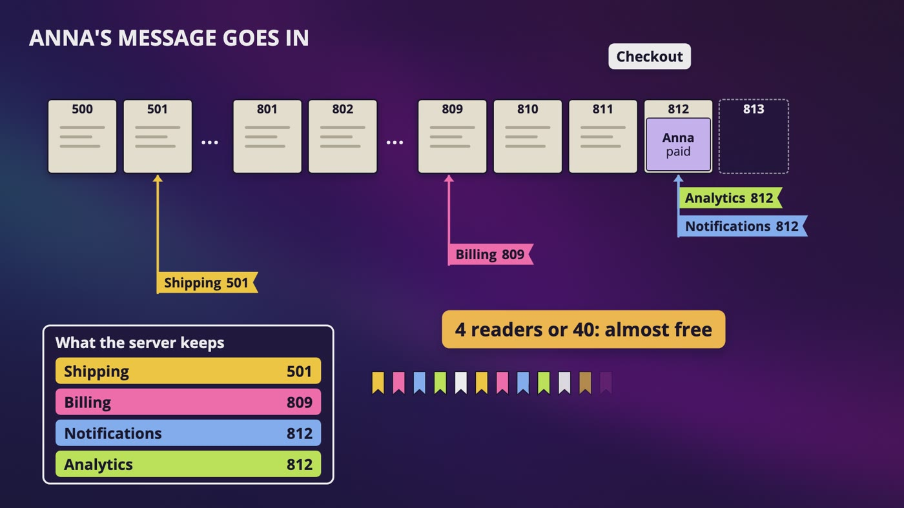

_Anna's message lands at offset 812. Each team has its own bookmark, and the server only keeps one small number for each._

|   | Mailbox | Log |
|---|---|---|
| After reading | The letter's gone | It stays, until it gets old |
| Best for | A list of jobs, each done once | Several teams, keeping events, or order |
| Example | Cropping a passport picture | Anna's order, read by 4 teams |
| One bad message | Set aside easily | Can get in the way of everything behind it |
| Deleting | One message at a time | Only whole old pieces |

### The real words

- A log has 2 rules: you only add to the end, and you never change what's written. It's our notebook from the key-value chapter, except that the notebook is now the whole product.
- **Producers** write at the end of the book. Here, that's our checkout, the warehouse and the courier scan.
- **Consumers** read. Here, that's shipping, billing, notifications and analytics.
- New messages only go at the end, so nothing moves. Message 812 is message 812 forever.

### Why readers are almost free

- The server only keeps one small number for each reader, not who's read what for each message.
- So 4 readers or 40 doesn't matter, and the message is still only stored once.

### Replay

- On Monday morning, billing finds a tax bug on every receipt since last night. They fix it, move their bookmark back, and read those pages again. Shipping never notices.
- A new fraud checker can start 2 weeks back and learn from everything still in the book.
- **Careful:** reading again means doing the work again. If the work was charging a card, replaying charges Anna twice.

### Cutting old pages

- After 2 weeks, the oldest pages get cut out, whether anybody's read them or not. Kafka's default is 1 week.
- If Dan's bookmark is too old, his page doesn't exist anymore, and he has to start from the oldest page left. The log doesn't wait for anyone.

> **In your interview:** Use a mailbox for a list of jobs. Use a log when several teams need the same events, when you need to keep them for a while, or when order matters.

**New terms**

| Term | Meaning |
|---|---|
| **Log** | A record of what happened. Here it has 2 rules: only add to the end, and never change what's written. |
| **Topic** | A name for one stream of messages, like one book. |
| **Offset (in a log)** | A message's position in the log, like a page number. |
| **Bookmark** | The number that each reader keeps, to know where it's up to. |
| **Replay** | Moving your bookmark back and reading those messages again. |

## 3. Partitions, and What Stays in Order

> **The big idea:** Order is only promised inside one partition. So choosing a key means choosing what stays in order, and it's a real design decision.

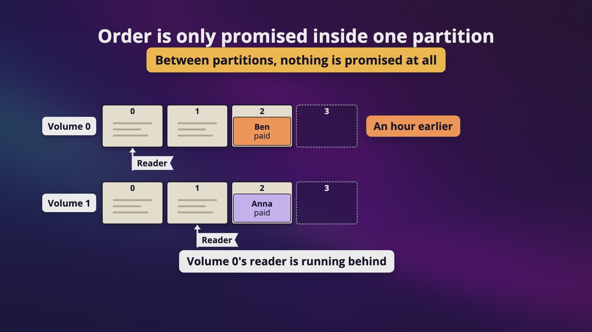

_Ben ordered an hour earlier in volume 0, Anna's in volume 1, and volume 0's reader is behind. Nothing is promised between partitions._

### Volumes

- Split the book into 3 volumes, each on a different server. Now each has a third of the writing, reading and storage.
- Each volume has its own page numbers. To point at one message, you need the topic, the partition and the offset.

### Where does Anna's message go?

- **Round robin** keeps volumes even, but her paid, packed and shipped land in 3 different volumes. Somebody can read shipped before paid.
- **Hash the key.** Using our pretend numbers with 3 volumes: Anna is 7, so volume 1. Ben is 12, so volume 0. Cara is 20, so volume 2. Dan is 25, so volume 1.
- Anna's messages always go in volume 1, so she can't come out backward. Mixed in with Dan's is completely fine.

### Single order across everything?

- You can do that, with 1 partition. But then it's 1 log on 1 machine, and all that throughput is gone.
- Please ask what they really need. It's usually order for each customer, each account or each order.

### Choosing the key

- **The customer:** all of Anna's orders stay in order. That's what we're using.
- **The order number:** each order stays in order, and it spreads out better, but Anna's 2 orders might not.
- **No key:** for page views, let messages spread out evenly.
- **The book, a bad one:** at midnight everybody's buying Dune, so 1 key goes to 1 partition, with 1 broker taking the whole flood. You picked your own hot key.

> **In your interview:** Say what you're keying by, say what that keeps in order, and say what happens with one very popular key. That's 3 sentences. And be able to say this without thinking: order is only promised inside one partition.

**New terms**

| Term | Meaning |
|---|---|
| **Partition** | One piece of a topic, like one volume of a book. |
| **Round robin** | Taking turns: the first message goes in volume 0, the next in volume 1, and so on. |

## 4. Consumer Groups

> **The big idea:** Each partition goes to only one member of a group, and different groups each get everything. So one design can act like a mailbox or a subscription.

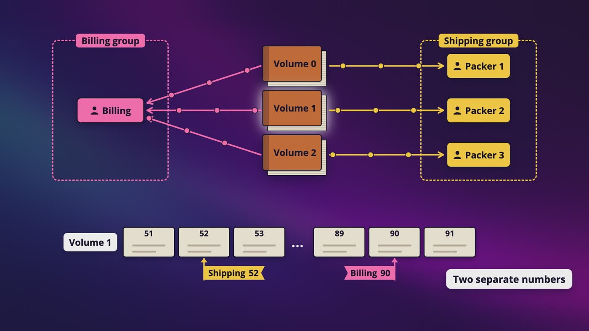

_Inside the shipping group, each volume has one packer. Billing is a separate group with its own bookmarks, and it reads everything too._

### Sharing the work

- If 5 packers each read everything, Anna gets 5 copies of Dune. If 1 reads everything, the whole flood goes through 1 reader.
- With 1 packer, it reads all 3 volumes. With 2, one reads 2 and the other reads 1. With 3, each has its own.
- With 5 packers and 3 volumes, 2 people stand around with no work, on the busiest night of the year.

### Why only one reader per volume?

- Say worker A takes paid and worker B takes packed. A is slow for a moment, so B finishes first. The messages were in order, and the people doing the work weren't.
- With a message every second, 2 workers and jobs of about 1.5 seconds, simulations show Anna's 3 events finish out of order nearly half of the time if the times vary a lot. If every job takes almost the same time, it almost never happens.
- That's what makes it nasty: fine in testing, then wrong on a bad night.
- And whose bookmark would it be? One reader means one clear bookmark.

### Different groups each get everything

- Shipping's bookmark on volume 1 is at offset 52, and billing's is at 90. Those are 2 separate numbers.
- Billing can be 1 small program reading all 3 volumes, while shipping uses 3 packers.
- **All workers in one group:** each message goes to one, so it's like a mailbox.
- **Each reader in its own group:** each gets every message, so it's like a newspaper subscription.

### The number you can't easily change

- The number of partitions is a ceiling on how many workers in a group can help at once. A sixth packer won't fix anything.
- Partitions aren't free. Each is more files on disk, more to keep track of, and more work when something fails.
- If shipping might need 30 workers some day, I'd make at least 32, even with only 5 packers today.

> **In your interview:** Know this one really well: one volume goes to one member of a group, different groups each get everything, more workers than partitions means some sit idle, and that's why the partition count has to be chosen carefully. Draw it with 3 volumes and 2 groups.

**New terms**

| Term | Meaning |
|---|---|
| **Consumer group** | A group of readers that share the work, where each partition goes to only one member. |
| **Consumer lag** | How far a reader's bookmark is from the end of the book. It's probably the first thing I'd put on a dashboard. |

## 5. Why a Log on Disk Is So Fast

> **The big idea:** It isn't reading that's slow, it's moving. We only add to the end and read in order, so we didn't find a faster disk. We stopped asking it to do the slow thing.

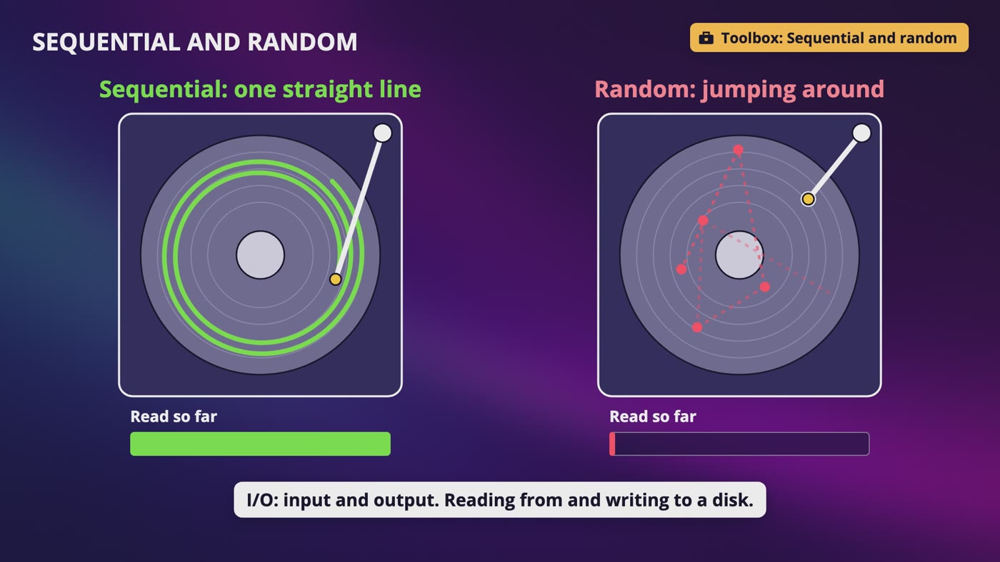

_On a spinning drive, reading in one straight line gets far more done than jumping around, because the arm spends its time traveling._

### Sequential against random

- Think about reading a book straight through, or opening it at a random page after every sentence.
- Kafka's design docs give a number for 6 ordinary spinning drives: about 600 MB a second writing in a line, and about 100 KB a second at random places. That's 6,000 times slower, on the same disks.
- Solid state drives have no arm, so the gap is a lot smaller. But only adding to the end is still about the cheapest thing you can ask of a disk.

### Why not just use a database?

- A database is great at finding one row, changing it and searching by anything. It pays for that with indexes and jumping around.
- We never change a message, and nobody asks for every order for Dune. We only add to the end and read in order.

### Segments

- Each volume is cut into smaller files. Kafka's default is about 1 GB, and only the newest one is written to.
- When everything in the oldest file is over 2 weeks old, you delete the whole file, and nothing else has to move.

### Finding one message

- Billing moves its bookmark to message 2,500,000. Messages are different sizes, so you can't just multiply.
- **The right file:** files are named by first offset, so 0, 1 million, 2 million, 3 million. We want the 2 million file.
- **The spot:** reading from the start would be about 500,000 messages. A small index has 1 entry per 4 KB (Kafka's default), about 244,000 entries.
- It's sorted, so we halve it like the phone book. About 18 looks, then read forward a few messages. That's 500,000 down to about 20.

### Memory, for free

- Most readers want what was written a moment ago, and the operating system already keeps recently used pieces of files in the page cache.
- Kafka's docs say that when readers are mostly caught up, you should see almost no disk reads at all.

> **In your interview:** Know why sequential is cheap, why this doesn't need a database, and how you'd find one message. Say the nice point out loud: it's not that we found a faster disk, it's that we stopped asking it to do the slow thing.

**New terms**

| Term | Meaning |
|---|---|
| **Sequential / random** | Reading or writing in one straight line, or jumping around. |
| **I/O** | Input and output. Reading from and writing to something like a disk. |
| **RAID** | Redundant array of independent disks. A way to make several disks act like one, usually so one can die without losing anything. |
| **Solid state drive** | A drive with no moving arm, where the gap between sequential and random is a lot smaller. |
| **Segment** | One of the smaller files that a volume is cut into. |
| **Page cache** | The recently used pieces of files that the operating system keeps in spare memory. |
| **Tiered storage** | Where finished segments can go to something like S3, while the newest stay on local disks. |

## 6. Batching: Send a Truck, Not a Bike

> **The big idea:** A round trip costs the same however small your message is, so fill the truck. Batching gives you throughput, and it costs you latency, so ask which one matters.

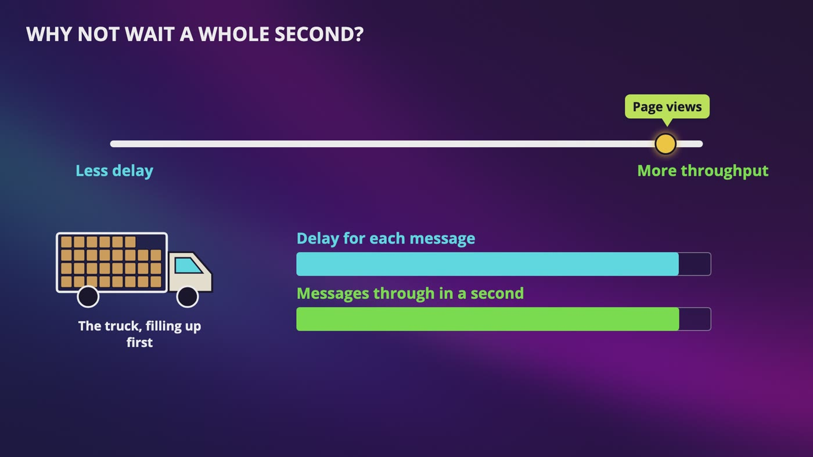

_The slider: toward the right, the truck fills up, so more gets through, and each message waits longer. Page views can sit at that end._

### The math

- With a made-up round trip of 1 millisecond, sending and waiting gives 1,000 trips a second.
- **1 message per trip** is 1,000 a second. **100 per trip** is 100,000 a second. **1,000 per trip** is 1,000,000 a second.
- To be honest about that million, it's 1 GB a second, or 8 gigabits, so a normal network connection would stop you first.
- Batching saves requests, and not messages. The broker still has to store every one.

### Three places

- **On the producer:** a little pile for each partition. The truck leaves when it's full, or after a small time. Kafka's producer waits up to 5 milliseconds by default.
- **On the broker:** the whole batch is added to the log in one long straight write, which the disk loves.
- **On the consumer:** a reader gets a whole chunk, so it doesn't pay for a trip per message.

### The slider

- **Page views:** nobody's waiting, so fill the truck.
- **Anna's order:** a few milliseconds is nothing she can feel, so a small wait is fine.
- **A stolen card check before packing:** you might slide all the way to the left.
- It's a setting, so each team can choose.

### Squeezing the truck

- Compression finds repeated things. One short message doesn't have much, and 1,000 orders all have the same field names.
- That's why Kafka compresses a whole batch in one piece. It costs a bit of CPU, and you save disk and network.

> **In your interview:** If an interviewer asks you to make this faster, please ask, faster in what way? Then the whole video is one sentence: batching gives you throughput, it costs you latency, and you ask which one matters.

**New terms**

| Term | Meaning |
|---|---|
| **Round trip** | A trip across the network there and back. It has a cost that doesn't care how small your message is. |
| **Zero copy** | Telling the operating system to send bytes straight from the page cache to the network, so our program doesn't touch them. It can't be used when the connection's encrypted with SSL. |
| **CRC** | Cyclic redundancy check. A small number worked out from a batch's bytes and saved with them. If it doesn't match later, something got damaged. |

## 7. Who Sends, Who Asks

> **The big idea:** The producer's library does the routing, using metadata to know where to go. And readers pull, because a slow reader can't drown and each team has its own speed.

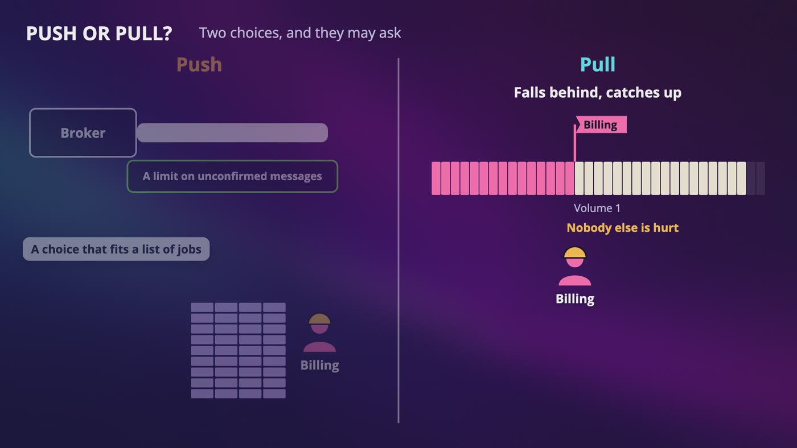

_With pull, a reader that gets slow just falls behind and catches up later. Nobody else is hurt._

|   | Push | Pull |
|---|---|---|
| Who decides how fast | The broker | The reader |
| If a reader gets slow | It can drown, so you need a limit | It falls behind and catches up |
| Good for | A list of jobs handed out right away | Several teams, each at its own speed |
| Example | RabbitMQ | Kafka |

### Which broker do I send to?

- **A router in the middle** is like a mail room. It's simple, but every message takes an extra trip, it's one more thing that can fail, and it doesn't have the producer's piles to build the truck.
- **So move the mail room inside the producer.** A library works out the partition, builds the batches and sends straight to the right broker.

### The map

- Your program starts with the addresses of 2 or 3 brokers, and asks any of them for the map.
- The metadata says which topics exist, how many partitions each has, and which broker's in charge of each.
- If the map's out of date, the old broker says that's not me anymore, or the connection fails. So the producer asks for a fresh map and tries again.

### Pull, with long polling

- Billing says, give me messages from volume 1, starting at offset 90, and gets a chunk. It also fits batching, because the reader decides how big a truck it wants.
- If there's nothing new, billing keeps asking and keeps hearing no. That's polling, the kid in the back seat.
- Long polling waits at the broker until there's something to send, or a short time runs out. So we get close to the speed of a push, and the reader stays in control.

### What's in a message?

- A key (Anna), a value (paid, order 41, 1 copy of Dune), a time, a CRC, and sometimes a few tags.
- The producer doesn't choose the offset. The broker hands that out when it adds the message.
- Tags can be read without opening the value, and they matter even more if your messages are encrypted.

> **In your interview:** Say that you could put a router in the middle, it's simpler, but it adds a trip and makes batching harder, so you'd do it in the client. Know that metadata tells it where to go, and that readers pull, with long polling. But don't say that pull is always right.

**New terms**

| Term | Meaning |
|---|---|
| **Library** | Ready-made code that you add to your program, so you don't have to write it. |
| **Push / pull** | Push: the broker sends messages as soon as they show up. Pull: the reader asks for them. |

## 8. When a Consumer Joins or Dies

> **The big idea:** When a reader dies, the group works out a new plan, and in the classic way there's a pause while it does. The next reader starts from the last committed bookmark, so it may repeat some work.

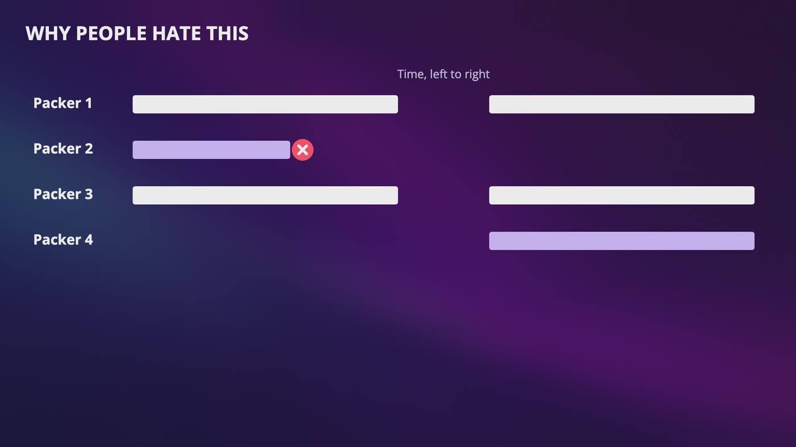

_Packer 2 dies, and in the classic way of doing this, everyone in the group stops reading. Then packer 4 takes over its volume._

### One slow walk

- **1.** Packer 2's machine dies right after its last heartbeat. Kafka's default says a reader's gone after 45 seconds of silence. At about 667 orders a second on volume 1, that's about 30,000 orders waiting. Nothing's lost, because it's a book.
- **2.** The timer runs out, and the coordinator says we need a new plan.
- **3.** The pause: every packer stops reading, even the healthy ones. They save their bookmarks and ask what the plan is.
- **4.** The group leader makes the plan and hands it to the coordinator, who tells everyone.
- **5.** Everyone gets their new volumes and starts reading again. Packer 4 finally gets volume 1.

### Where does packer 4 start?

- It can't ask packer 2, so the bookmark has to live somewhere safe.
- Say packer 2 had read up to offset 100, and last committed 60. Packer 4 starts at 60.
- Packer 2 may have already packed some of those 40 messages. For Anna, that could mean 2 copies of Dune.

### Where the bookmarks are kept

- Kafka started by keeping them in ZooKeeper, and moved away. The request to change it said ZooKeeper doesn't scale for that kind of high write load.
- So where do you put something small, written all the time, that has to survive a crash? In a log! Kafka's bookmarks are stored in one of its own ordinary topics.

### Slow isn't dead

- A stuck packer still sends heartbeats, looks alive and gets nothing done.
- So Kafka also checks how long since a reader asked for more messages. The default's 5 minutes, and after that it's out of the group too.

> **In your interview:** Please don't just say that the work moves to someone else. Say that it moves, and that there's a pause while it does. If they ask what happens when a consumer crashes, walk those 5 steps.

> **In the real world:** Kafka's 4.0 release, in March 2025, made a new rebalance protocol generally available, and its announcement says goodbye to stop-the-world rebalances. The brokers work out the plan, and readers change only what they have to. You have to choose it on the reader's side, because the old way is still the default there.

**New terms**

| Term | Meaning |
|---|---|
| **Group coordinator** | One broker that looks after one consumer group. It knows who's in the group and where their bookmarks are. |
| **Rebalancing** | Working out who reads what. |
| **Group leader** | Whichever member got picked to make the plan. It has no other power. |
| **Committing (a bookmark)** | A reader saving its place by telling the coordinator, I've finished up to here. |

## 9. Copies, Leaders and In-Sync Replicas

> **The big idea:** A partition splits the data, and a replica copies it. A message is committed when everyone on the in-sync list has it, and readers only ever see committed messages.

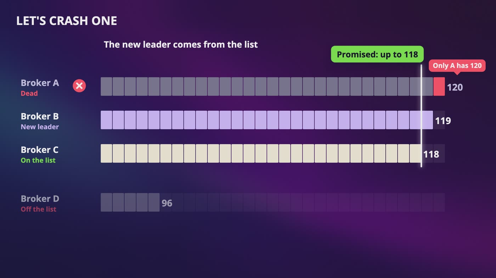

_Broker A dies holding 120. B becomes leader with 119, and C catches up. Only 118 was promised, so nothing a reader saw has disappeared._

| The name | What it does |
|---|---|
| Leader of a volume | The copy that takes writes |
| Controller | The machine that picks those leaders |
| Group leader | The one packer who writes the plan |

### Copies

- All writes and normally all reads go to the leader. Followers pull from it, just like normal consumers.
- Each volume has its own leader, spread around so no broker does all the work.
- Put copies in different racks, or even different buildings. Kafka has a setting that does this for you.

### Who counts as caught up?

- Waiting for every follower means all writes get stuck behind one sick machine. Waiting for nobody means we might lose it.
- Say A is the leader at 120, B has 119, C has 118, and D has 96. The list is A, B and C.
- In sync means close enough and still keeping up, and it doesn't mean identical.
- A count of messages kicks out healthy followers during a burst, so Kafka removed it. Now it's by time: not caught up in 30 seconds, the default, and it's off the list.

### Committed

- Everyone on the list has up to 118, so 118 is committed. Billing can read up to 118, and 119 and 120 are invisible to it for now.
- This isn't a quorum count. We wait for everybody who's currently on the list, however many that is. Kafka's docs say it doesn't use a majority vote.

### A broker dies

- A new leader comes from the list, so it's B or C. Say B, with 119.
- Message 120 is gone, but it was never committed. Nobody saw it, and the producer never heard got it, so it sends it again.
- D can't become leader. It only has 96, and people have already read up to 118.

> **In your interview:** Know that the list is who's close enough, that committed means everyone on the list has it, and that readers only see committed. And be clear about which of the 3 leaders you mean.

**New terms**

| Term | Meaning |
|---|---|
| **Replica** | A copy of the data. The copy that takes writes is the leader, and the others are followers. |
| **Rack** | A tall cabinet of servers in a data center. If its power fails, everything in it goes together. |
| **In-sync replicas (ISR)** | A live list the leader keeps of who's caught up. |
| **Committed (a message)** | When everyone on the in-sync list has it, so it's safe. |
| **High watermark** | The line that readers can read up to. You only need to recognize the name. |
| **Controller** | The machine with the job of deciding who's the new leader. |
| **Raft** | A well known set of rules for a group of machines to agree on one leader and one history. |

## 10. How Sure Do You Need to Be?

> **The big idea:** A delivery promise is about 2 moments: when you say got it, and when the thing has really been done. Which one comes first is the whole difference.

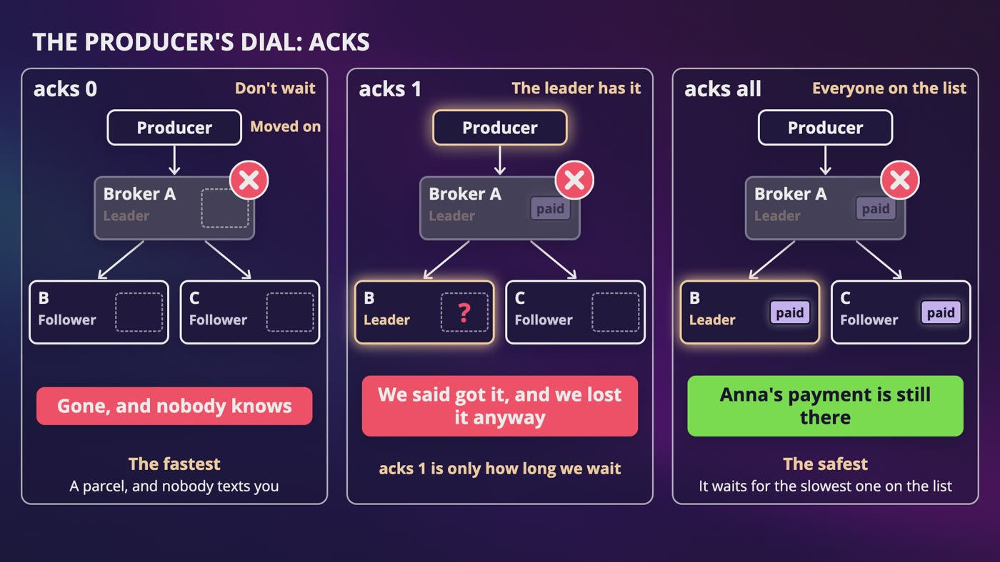

_Broker A dies in all 3 cases. With acks 0 it's gone, with acks 1 we said got it and lost it anyway, and with acks all, Anna's payment is still there._

| Setting | The leader says got it | If broker A dies |
|---|---|---|
| acks 0 | Nobody waits | Gone, and nobody knows |
| acks 1 | Once it's in the leader's log | We said got it, and we lost it anyway |
| acks all | Once everyone on the list has it | Anna's payment is still there |

### The trap in all

- If B and C fall off the list, all means A, and we're back at acks 1. Nobody even told us.
- So set a floor. With 3 copies and a floor of 2, one machine can die, and if 2 die, the producer gets an error.
- Refusing a write is choosing to be correct, like the last copy of Dune. The default floor is 1, so you have to ask for it.
- **A message:** all, with a floor. **A point:** 1 is probably fine. **A dot:** you might even use 0.

### The reader's 2 moments

- **Commit, then work:** the bookmark moves, the machine dies, and the book never gets packed. Anna's order was skipped. That's at most once.
- **Work, then commit:** the book gets packed, the machine dies, and packer 4 packs it again. That's at least once.
- Which mistake can you live with? For page views, at most once is okay. For orders and payments, pick at least once and deal with the repeats.

### Exactly once, honestly

- Inside Kafka there are 2 real features, the idempotent producer and transactions. If your work starts and ends in Kafka, you really can get exactly once.
- A card charge or a box to Anna's house isn't inside Kafka. Its docs say that for other systems, exactly once generally needs cooperation from those systems.
- So every message carries an ID. In one atomic step, save this ID only if it isn't there yet. If it's there, skip it. To charge a card, pass that same ID to the payment company.

> **In your interview:** This is where an interviewer's going to push you, and where many people overclaim. So please say this sentence: exactly once is at least once, plus a receiver that can handle repeats.

**New terms**

| Term | Meaning |
|---|---|
| **Acks** | Short for acknowledgments. Kafka's setting for how long a producer waits for got it. All is the default today. |
| **Min in-sync replicas** | A floor. If fewer than this many copies are on the list, refuse the write. |
| **At most once** | Each message gets processed 1 time or 0 times. |
| **Idempotent producer** | If a producer sends again, the broker notices the repeat, and only 1 copy goes in the log. It's on by default now. |
| **Transactions (Kafka)** | A program reads from some topics, writes to others and moves its bookmark, all as one step that either all happens or doesn't. |

## 11. Growing, Delays and What's Changed

> **The big idea:** Adding a partition changes the number we divide by, and that breaks order. And a lot of what you'll read is out of date, so explain the job first and then name the tool.

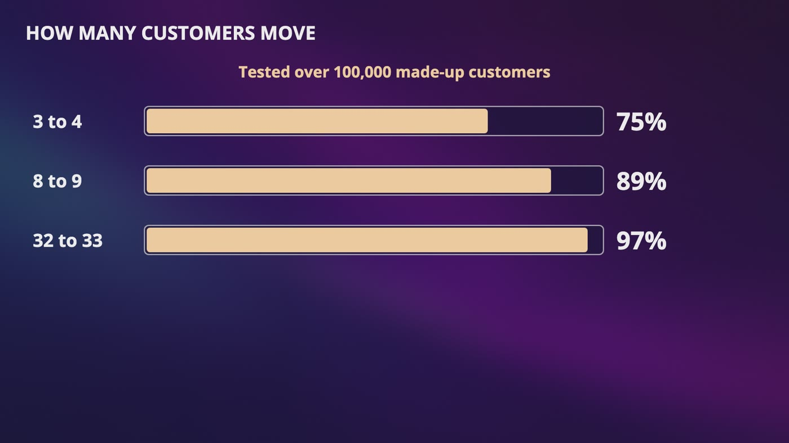

_Adding a partition moves keys. Over 100,000 made-up customers, going from 3 to 4 moves 75%, 8 to 9 moves 89%, and 32 to 33 moves 97%._

### Adding a partition

- Anna is 7. Divided by 3, that's volume 1. Divided by 4, it's volume 3. Her shipped can be read before her paid.
- Doubling from 8 to 16 moves half. Kafka's own docs warn about this.
- So ask whether anybody needs order for each key, make enough partitions up front, or use a ring if your system supports it.
- Kafka doesn't support taking partitions away. The common answer is a new topic with the number you want.

### Adding a broker

- Copy first, and delete after. The new broker joins as one more follower, pulls until it's caught up, and only then does an old copy go away.

### Holding a message back

- Say we hold the last copy of Dune for 15 minutes, then check the order.
- A log doesn't naturally do this. So use a holding area, where a small program watches the time and writes a message into the real topic when it's due.

### The broken order

- A broken order crashes our packer every time, so the bookmark can't move, and everyone behind it is stuck.
- Try a few times with backoff, then move it aside to a dead letter queue, where a person can look at it.
- **The cost:** if Anna's paid is moved aside, her packed goes first. You can stop the whole volume, or keep moving and let this customer's order get mixed up.
- For a page view, move it aside right away. For payments, you might also move aside everything else from that customer.

### Which do you use?

- A list of jobs, each done once, is a mailbox, like RabbitMQ or SQS. Several teams, replay and order is a log, like Kafka.

> **In your interview:** If you read that ZooKeeper is the center of this design, explain the job first: somebody has to keep metadata, who's alive and who leads what. Then say that it can be an outside service or built in. And please ask what they need.

> **In the real world:** Kafka removed ZooKeeper in version 4.0, in March 2025. LinkedIn said in 2025 that it's moving to Northguard, because of how hard Kafka had become to run at its size. Amazon's SQS lets you delay a message by up to 15 minutes, and RocketMQ has let you delay by any amount since version 5. Kafka's share groups became production ready in version 4.2.

**New terms**

| Term | Meaning |
|---|---|
| **Delayed message** | A message that should show up later, and not now. |
| **RocketMQ** | An open source system that came out of Alibaba's online stores, and that also keeps messages in logs. |
| **Time wheel** | A common way to track a lot of timers. One bucket per second, and a hand moves around and empties each one. |
| **Poison message** | A bad message that crashes the reader every time, so everyone behind it is stuck. |
| **Retry topic** | A separate log for things to try again later, so that the main line keeps moving. |
| **KRaft** | The design where Kafka does ZooKeeper's job itself, using Raft. |
| **etcd** | A small and reliable key-value store for keeping that same kind of information, which also uses Raft. |
| **Pulsar** | An open source system that started at Yahoo. It keeps logs in a separate storage layer, so brokers don't need disks. |
| **Northguard** | LinkedIn's own new system. |
| **Share groups** | A Kafka feature where members of a group can share one partition, message by message, like a mailbox. |

## 12. The Whole Message Queue Design, for Your Interview

> **The big idea:** It looks like a lot, and it's all one idea: you add to the end, and everybody keeps their own bookmark. The only really new thing was to stop throwing the letter away.

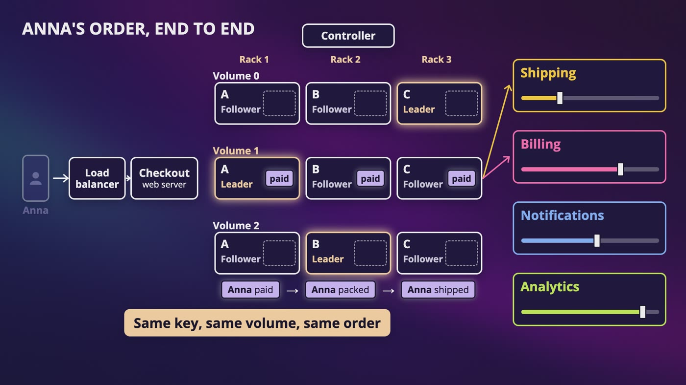

_Anna's order, end to end: same key, same volume, same order, with leaders and followers in different racks and 4 teams reading at their own speed._

| If they ask | You say |
|---|---|
| Mailbox or log? | A mailbox empties when a letter's picked up, and a book doesn't. Mailbox for a list of jobs, log for several readers, replay and order. |
| How do you keep order? | Only inside one partition, so choose a key. Say what happens with a hot key, and warn that adding partitions moves keys. |
| Why is a disk fast enough? | Sequential, batched, and caught-up readers come from the page cache. To find one message, use the file name, a small sorted index and some halving. |
| A consumer crashes? | Heartbeats stop, the coordinator rebalances, there's a pause, and the next reader starts from the last committed bookmark. |
| How do you avoid losing messages? | Copies in different racks, acks all, a floor on the in-sync list, and readers only see committed messages. |
| Exactly once? | Inside the log, with an idempotent producer and transactions. Outside, it's at least once, plus an ID that makes repeats harmless. |

### Anna's order, end to end

- It's midnight, and she taps buy. Our checkout writes a message with Anna as the key. The library hashes it, picks volume 1, finds the leader from its map, and drops it on a small truck.
- The leader adds the truck to the newest segment in one straight write, and followers in other racks pull it.
- When everyone on the in-sync list has it, it's committed, and with acks all, the leader says got it. Anna goes to bed.
- Four teams read it, each with its own bookmark. A packer pulls a chunk, packs her book, and only then commits. Billing uses her order number so that it can't be done twice.

### Your 45 minutes

- **Step 1, 3 to 10 minutes:** mailbox or log, how long, how big, order, how sure, how many. Then 100 MB a second, and about 363 TB with copies.
- **Step 2, 10 to 15 minutes:** draw the book, split it into volumes, and draw producers, brokers and 2 consumer groups.
- **Step 3, 10 to 25 minutes:** go deep on order and on delivery promises.
- **Step 4, 3 to 5 minutes:** what you'd watch, like consumer lag, the size of the in-sync list and how often you're rebalancing. Never say your design is perfect.

### What to know

- **For a sentence:** segments and the index, batching against latency, why readers pull, rebalancing and its pause, why adding partitions breaks keys, poison messages and delayed messages.
- **Just recognize:** zero copy, CRC, RAID, the high watermark, KRaft, tiered storage, share groups and the time wheel.

### Back to the book club

- While Anna's asleep, a packer's bookmark reaches her order, and one small message says shipped. A notification worker's bookmark reaches that page, and she wakes up to it.
- Ben's plane lands, and his phone says, give me everything after my bookmark. Cara asks, Dan, page 15? From a charger comes the answer: 16, and please nobody tell me anything.

## Recap: What happened to Anna's order

_The only really new thing was to stop throwing the letter away._

| Every piece solved a real problem | |
|---|---|
| **A log with bookmarks** | 4 teams need the same order |
| **Partitions** | 121 TB can't go through one machine |
| **Keys** | Anna's shipped could come before her paid |
| **Consumer groups** | 5 packers, and 5 copies of Dune |
| **Sequential writes and segments** | Everyone says disks are slow |
| **Batches** | A trip for every message |
| **A library in the producer** | A router adds a trip |
| **Pull, with long polling** | A slow reader could drown |
| **Committed bookmarks** | A dead reader can't say where it was |
| **Replicas and the in-sync list** | A dead broker takes the book with it |
| **Acks and a floor** | We said got it, and we lost it anyway |
| **An ID on every message** | A repeat could charge Anna twice |
| **A dead letter queue** | One bad message stops everyone behind it |

**What to know really well**

- The log and the bookmark
- Order only inside one partition, and how a key chooses it
- One reader per partition in a group, and different groups each getting everything
- In sync and committed
- The 2 moments, at most once and at least once, by hand

---

From the course **[System Design: Zero to Interview Hero](https://www.udemy.com/course/system-design-zero-to-hero/?referralCode=183D59A1EBE9E71D26FF)** by Nata Vacheishvili.
