# Chapter 20: Design AI Chatbot

_One honest answer for Anna, with no spoilers, and the one truly new idea that lets a lot of people share a chip._

[Download as PDF](../pdf/System-Design-Chapter-20-Notes.pdf)

## Contents

1. [Design AI Chatbot: What Are We Building?](#1-design-ai-chatbot-what-are-we-building)
2. [Tokens and GPUs, With No Math](#2-tokens-and-gpus-with-no-math)
3. [The Numbers Flip](#3-the-numbers-flip)
4. [Why Answers Appear Word by Word](#4-why-answers-appear-word-by-word)
5. [Your Whole Conversation, Every Time](#5-your-whole-conversation-every-time)
6. [Sharing One GPU](#6-sharing-one-gpu)
7. [Rate Limits, When Requests Aren't Equal](#7-rate-limits-when-requests-arent-equal)
8. [Prompt Caching: Not Thinking Twice](#8-prompt-caching-not-thinking-twice)
9. [When There's No Capacity Left](#9-when-theres-no-capacity-left)
10. [When It Breaks: Real Public Postmortems](#10-when-it-breaks-real-public-postmortems)
11. [The Whole AI Chatbot Design, for Your Interview](#11-the-whole-ai-chatbot-design-for-your-interview)

## 1. Design AI Chatbot: What Are We Building?

> **The big idea:** You've already learned almost all of this. The design has 2 sides of one wall: a small feature in our store, and the machine that writes the answers.

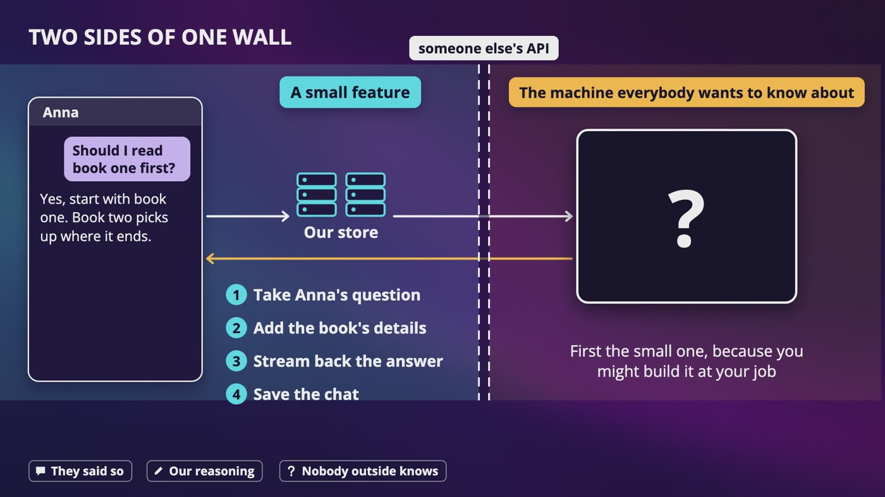

_2 designs on 2 sides of one wall: our small feature on one side, and the machine everybody wants to know about on the other._

### 3 labels, out loud

- **What a company has said:** they published it, and these things change fast, so please check the date.
- **Our own reasoning:** what you and I would build, and what you'd say in an interview.
- **What nobody outside knows:** and I'll just say so.

### Step one: the answers we picked

- **Who it's for:** everyone in a chat app, and other companies through an API. So 2 kinds of customers compete for the same machines.
- **Who pays:** most are free with some limits, some pay monthly, and API customers pay for how much they use. So not all customers are equal.
- **Answer length:** 1 line to a few pages, so one request can be nothing like the next.
- **Remembering the conversation:** yes, which means storage, and a surprise later.
- **First word:** about 1 second. So we've got 2 separate promises about speed.
- **Size:** 100 million people a day, about 10 messages each.

### The 2 sides

- We sell books, so our store doesn't think about anything. It calls someone else's API and passes back the answer.
- **Our side:** take Anna's question, add the book's details, stream back the answer, and save the chat.
- **The other side:** the machine itself. We build the small one because you might need it at your job, then walk around the wall.

> **In your interview:** You might hear design a chatbot, or design an API for a chatbot. Start by asking: are we building a chat product for people, or an API for other programs? And if your interviewer only cares about one side of the wall, ask which one, because you can spend your whole 45 minutes on the wrong one.

**New terms**

| Term | Meaning |
|---|---|
| **Model** | The program that writes the answers. |

## 2. Tokens and GPUs, With No Math

> **The big idea:** A model predicts one token at a time, on a chip that's scarce, and it needs memory for its notes while it works. That's enough to design everything else.

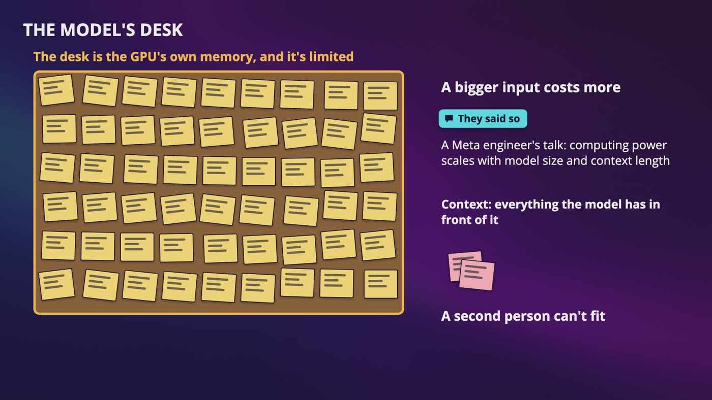

_The model's notes fill a desk, which is the GPU's own limited memory. A bigger input costs more, and a second person can't fit._

### The loop

- A model predicts the next small piece of text, adds it to the end of what it's been given, and does the entire thing again, until it predicts, I'm done.
- That's why the words appear one by one. A long answer isn't one job, it's hundreds of small jobs in a row.
- It's predicting, and it isn't looking anything up. So if Anna's assistant needs real facts about a real book, we have to hand them to it.

### A token

- Bookstore could be 2 tokens, book and store. Every model cuts text in its own way.
- Google's docs for Gemini say a token is about 4 characters, and 100 tokens is about 60 to 80 English words. That's as of October 2026.
- So let's say a page of a book is about 400 tokens.
- The model reads all the input before it can start writing, so a really long input means a longer wait for the first word.

### Training against using

- This chapter is only about inference. For most interviews of this kind, this is where the system design question is. But please ask, because training is a really different design.

### A GPU

- A CPU is like a few really skilled chefs. A GPU is like 1,000 helpers who can all chop one onion at the exact same moment.
- These chips are expensive, and you can't get more in a minute. When I say GPU, please hear, whatever very expensive chip you've got.

### The model's desk

- While writing, the model keeps notes about everything it's read, in the GPU's own memory, which is limited.
- A longer conversation means more notes on the desk, and that's why a bigger input costs more.

> **In your interview:** Know this: it predicts one token at a time, it runs on a chip that's scarce, and it needs memory for its notes while it works.

> **In the real world:** Anthropic has written that it serves Claude on 3 kinds of hardware, and an engineer at Meta has talked publicly about running these models on a mix of hardware. That same Meta talk says the computing power needed scales with model size and context length. How much anyone pays, and how many chips they have, nobody outside knows for certain.

**New terms**

| Term | Meaning |
|---|---|
| **Training** | Teaching the model by practicing on a huge amount of text. It's a giant project that happens before you ever meet the model. |
| **Hallucination** | When a model writes something that sounds completely sure of itself and is just wrong. |
| **Token** | A small piece of text. Sometimes a whole word, sometimes part of a word, and sometimes only a comma. |
| **Input / output** | The text you send in, and what the model writes. |
| **Prompt** | The whole thing that you send in. |
| **Inference** | Using the model to answer someone. It just means running the loop. |
| **GPU** | Graphics processing unit. A chip that does a huge number of small calculations at once, first built to draw video game graphics. |
| **TPU** | Tensor processing unit. Google's custom chip for machine learning. |
| **KV cache** | The model's notes. It stands for key-value cache, and it has nothing to do with our key-value store chapter. |
| **Context** | Everything that the model has in front of it. |

## 3. The Numbers Flip

> **The big idea:** You don't run out of storage here. You run out of GPUs. What's scarce is seconds of chip time, and everything else in this chapter is a way to spend them well.

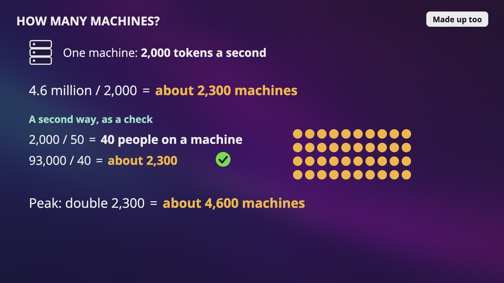

_4.6 million tokens a second at 2,000 per machine is about 2,300 machines, and the check gets the same answer. These numbers are made up._

### It starts out easy

- 100 million people times 10 messages is a billion a day, or about 11,600 messages a second. That's 7 times smaller than WhatsApp's 81,000.
- If you stopped here, you'd be completely wrong, because a WhatsApp message takes milliseconds.

### Then the tokens

- An answer of about 400 tokens, at about 50 tokens a second, is **8 seconds** of chip for one message. I made those up, so please say that out loud.
- 11,600 answers a second times 400 tokens is about **4.6 million tokens a second**.
- 11,600 start every second and each stays for 8 seconds, so about **93,000 answers** are being written right now.
- It's a coffee shop. If each coffee takes 8 seconds, you need 93,000 baristas.

### How many machines?

- At a made-up 2,000 tokens a second per machine, that's about 2,300 machines.
- **The check:** 2,000 divided by 50 is 40 people on a machine, and 93,000 divided by 40 is also about 2,300.
- If the peak is double, that's about 4,600 machines. Don't remember those numbers. Remember how sensitive it is: twice as long answers, twice the machines.

### Requests stop meaning much

- Anna gets 20 tokens, and Ben asks for a full comparison and gets 1,000. That's 50 to 1, from 2 requests.
- A thousand requests a second tells you nothing, like a restaurant serving a thousand orders without saying coffees or wedding banquets.
- So estimate in tokens, split into input and output, and then machines.

### 2 promises about speed

- **Time to first token** is mostly waiting in line, plus reading the input. **How fast tokens come after that** is separate.
- Something can be great at one and terrible at the other, like a restaurant that seats you instantly and then takes an hour.

> **In your interview:** Do it in this order: messages a second, tokens a second, answers running at the same moment, then machines, and say what you made up. When an interviewer says that it needs to be fast, please ask which one.

> **In the real world:** As of October 2026, Anthropic, Google and OpenAI all list output tokens at about 5 times the price of input tokens on many of their models. Why exactly, they don't say, but it fits with what we saw.

**New terms**

| Term | Meaning |
|---|---|
| **Time to first token** | How long until the first token shows up. |

## 4. Why Answers Appear Word by Word

> **The big idea:** Streaming doesn't make it faster, it makes it feel faster. Server-sent events fit because it's one way, and you stop the model when nobody's listening.

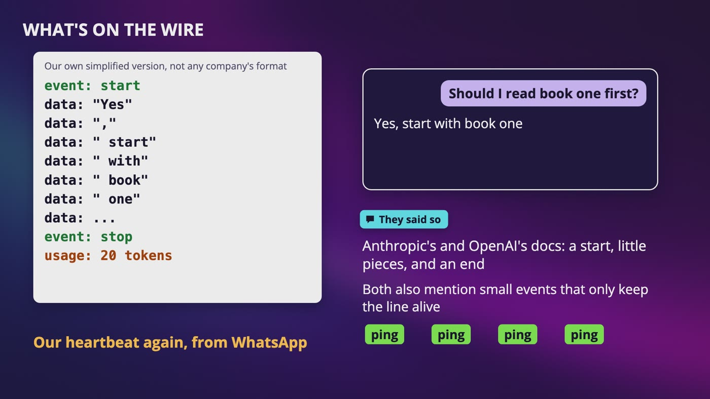

_Our own simplified version of what's on the wire: a start event, small pieces of text, and a stop with the token count._

### Which line?

- Anna sends one request and then only listens, so we don't need a phone call. That's server-sent events.
- It's normal HTTP, so it passes through the load balancers we already have.
- A voice product where both sides talk at once would probably use a WebSocket.

### What's on the wire

- An event that says we're starting, a lot of small events with a few characters each, and an event that says we're done, usually with how many tokens.
- There are also small events that only keep the line alive, our heartbeat again.
- An error can show up in the middle. We already said 200, which means everything's okay, so your code has to handle that.

### What if Anna hangs up?

- If nobody's listening, every token is expensive chip time for nobody. So when the connection closes, we tell the model server to stop, and that seat's free.

### Long connections

- This connection only lives for one answer. To ship new code, stop sending that server new requests and wait 8 seconds, or a few minutes for a very long answer.
- Make sure your load balancer doesn't have a timeout that cuts answers off.

### When the line breaks

- **Throw it away,** and she asks again. That wastes the chip time.
- **Save what you got,** and send a new request saying your response was cut off here, please continue.
- **Use a bookmark.** Each event has a number, and you come back for everything after it. Someone has to save every piece, though.

### Saving the answer

- **Every token:** about 4.6 million writes a second.
- **Each answer once a second:** about 93,000 writes a second.
- **Only when it's finished:** about 11,600 writes a second.
- Don't send a bike for every token. I'd save at the end, or every few seconds if you want it to survive a crash.

> **In your interview:** Say why you picked server-sent events, because that's the kind of decision they want to hear. And stopping the model when nobody's listening is a great thing to say.

> **In the real world:** As of October 2026, Anthropic's and OpenAI's docs both say their APIs stream answers with server-sent events, and Google's example for Gemini asks for that same format. Anthropic's docs say it can send an overloaded error partway through, and describe saving what you got and asking to continue. OpenAI's docs say closing the connection cancels a normal request, and describe a background mode where you come back for everything after an event.

**New terms**

| Term | Meaning |
|---|---|
| **Streaming** | Sending the answer in pieces as it's made. |

## 5. Your Whole Conversation, Every Time

> **The big idea:** The model remembers nothing, so we send the whole conversation every time. The cost grows fast, and memory and retrieval are just text that we add to the prompt.

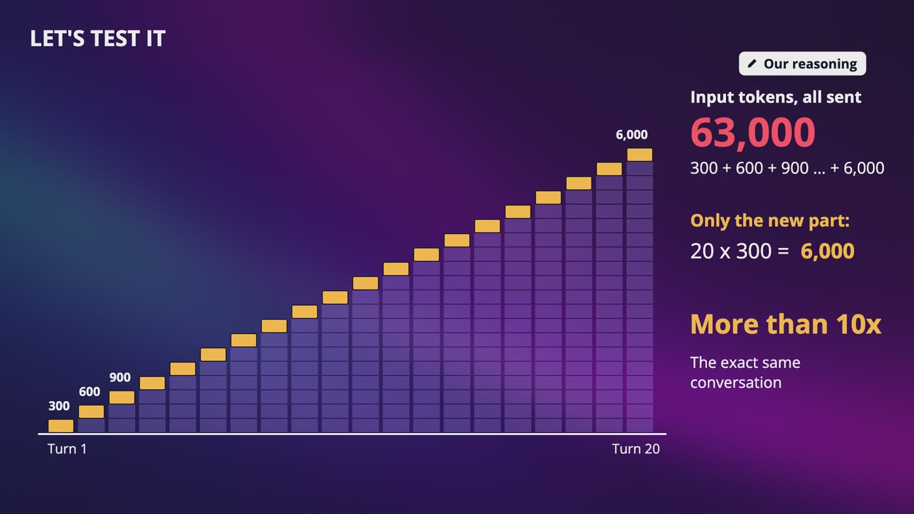

_Each turn resends everything: 300, 600, 900, up to 6,000 tokens. That's 63,000 input tokens in all, for only 6,000 of new text._

### It remembers nothing

- Every time Anna sends a message, we send the whole conversation again. It's only ever one very long question.
- It's like our stateless web servers: any model server can answer her next message.
- Some APIs store history for you, and the model still gets all of it. OpenAI's docs say those earlier tokens are still billed as input.

### Let's test it

- Say every request carries 300 tokens more than the last, a made-up number. Her 20th is 6,000 tokens.
- A 20 turn chat adds up to **63,000 input tokens**. Only the new part would be 6,000, so that's more than 10 times the work.
- 40 turns is 246,000. Twice the length is about 4 times the work, which is O(n²).

### When the chat gets too long

- If the input's too big, the request just gets an error, so our app has to act first.
- **Drop the oldest messages.** That's simple, and it's why an assistant can forget something from an hour ago.
- **Summarize the old part.** It costs a little, and you lose some details, but the conversation keeps going.

### Storing the chats

- It's the filing cabinet from WhatsApp, with one folder for each chat.
- End-to-end encryption doesn't work here, because the model has to read your words. That's our reasoning, not a claim about anybody's setup.
- So be ready to talk about who can read chats, how long you keep them, and how someone deletes one.

### Memory and facts

- **Memory:** this is our reasoning. Save a few notes about Anna in a normal database, and paste them into the start of the prompt. The model didn't remember anything. We reminded it.
- **Facts:** search our own data for this book, and put the best pieces in the prompt, with instructions like use only this.
- **An instruction isn't a lock.** The model might still spoil something, so never hand it the spoiler at all. Even that isn't a guarantee, because it may have read about a famous book in training.

> **In your interview:** Know this: the model remembers nothing, the whole history gets sent every time, the cost grows fast, and memory and retrieval are just text that we add to the prompt. And I'd bring up privacy before your interviewer does.

> **In the real world:** OpenAI's docs say each request is independent and stateless. Anthropic's docs describe each turn's input as all of the previous conversation plus the new message, and call the context window the model's working memory. Anthropic and OpenAI both offer compaction now.

**New terms**

| Term | Meaning |
|---|---|
| **Turn** | One question and its answer. |
| **Context window** | The total a model can look at, including the answer it's writing. |
| **Compaction** | Asking the model to write a short summary of the old part, and sending that instead. |
| **Retrieval (RAG)** | Fetching what's relevant before you ask. RAG stands for retrieval augmented generation. |

## 6. Sharing One GPU

> **The big idea:** Between any 2 steps, whoever's finished steps off and someone from the line steps on. A short answer stops waiting for a long one, and the chip does way more. We got both.

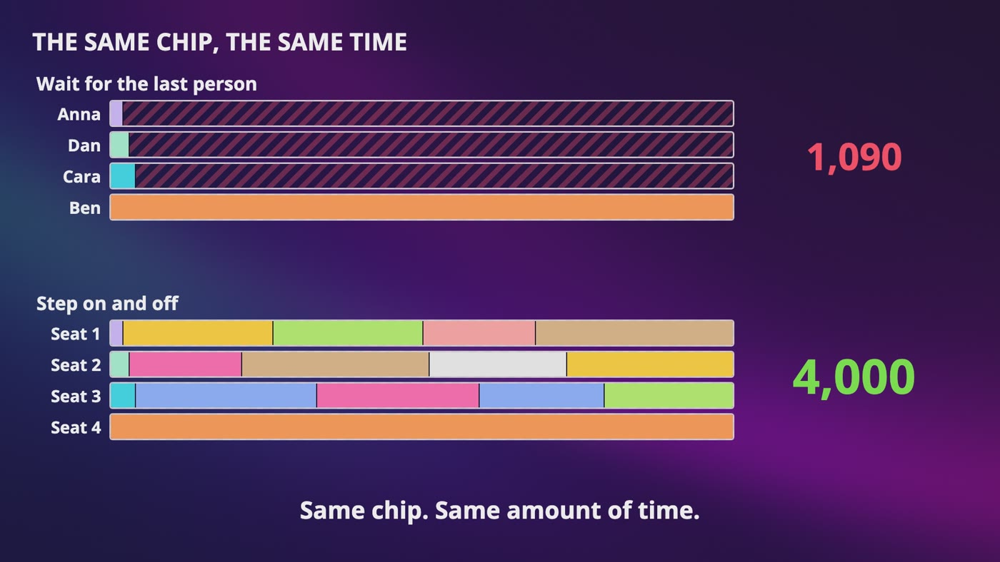

_The same chip for the same time: waiting for the last person makes 1,090 tokens, and letting people step on and off makes 4,000._

### The bus

- One step of the loop can make one new token for everybody on the bus, and it doesn't take anything like that many times as long.
- 4 seats, and 1 step gives everyone 1 token. Anna's answer is 20 tokens, Dan's 30, Cara's 40 and Ben's 1,000.
- **Wait for the last person:** Anna's done at step 20, and her seat stays empty for 980 more steps.
- That's 1,000 steps with 4 seats, so 4,000 seats' worth of work, and only 1,090 tokens. About 27%.

### Anyone can step on or off

- At step 20, Anna steps off and someone gets her seat. At step 30, Dan steps off. Ben just keeps riding.
- If there's always a line, that's 4,000 tokens instead of 1,090, from the same chip in the same time.
- Simulating 5,000 made-up requests with 8 seats, a middle request of about 87 tokens and a longest of 2,000: about 2.5 tokens a step against about 8.
- Depending on how uneven the lengths are, that's 2.5 to 4 times as much work.

### Seats are limited by the desk

- Usually memory stops us first, because everyone's notes live in the GPU's memory.
- Reserving the biggest desk anyone could need is like a restaurant keeping a table for 12 for every person, because they might invite friends.
- vLLM's idea came from your computer's operating system: cut the notes into small blocks, and give a new block only when it's needed. If the desk fills up anyway, someone has to wait.

### Who gets the next one?

- Round robin is a bad fit, because a machine with 20 long answers looks the same as one with 20 short ones.
- We want the least busy machine, and busy now means tokens in progress and memory used.
- We can also keep separate pools, so that a pasted book doesn't crowd out everyone's quick question. That's our reasoning.

> **In your interview:** This one's worth drawing with a pen. Draw the bus, take Anna off at step 20, and put someone new in her seat.

> **In the real world:** The paper that wrote this up is Orca, from 2022. In its own test on one large model, it reported about 37 times the throughput at the same latency, and please don't quote that as what you'd always get. A 2023 paper that came with vLLM reports 2 to 4 times the throughput of the systems it compared with. Anthropic wrote in 2025 that it had servers set up for very long inputs, separate from those for short requests.

**New terms**

| Term | Meaning |
|---|---|
| **Continuous batching** | Letting people step on and off between steps. The paper called it iteration-level scheduling, where iteration means one trip around the loop. |
| **vLLM** | An open source program for running these models, which started at UC Berkeley, so you don't have to build all of this yourself. |
| **Pages (memory)** | Small pieces of memory that an operating system hands out as they're needed. |

## 7. Rate Limits, When Requests Aren't Equal

> **The big idea:** Count tokens and not requests. Each piece of text costs 1 coin, so a request pays for its size. And you can't know the output size up front, so you have to choose how to handle that.

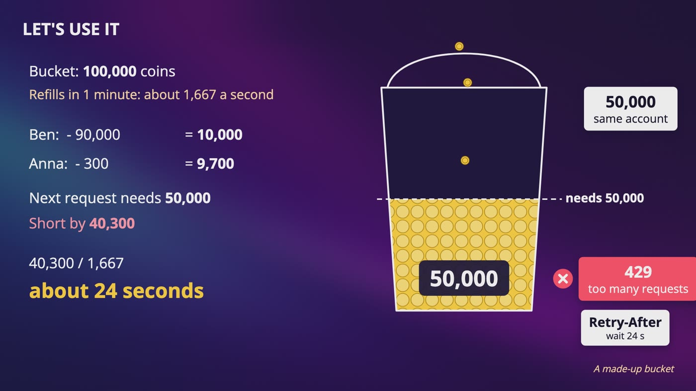

_A made-up bucket of 100,000 coins: Ben spends 90,000 and Anna 300. A 50,000 token request is 40,300 short, so it waits about 24 seconds._

|   | Reserve it | Count as you go |
|---|---|---|
| Like | A hotel holding an amount on your card | A bar tab |
| Good part | Safe, because nobody can overshoot | You only pay for what's real |
| Bad part | You hold room you didn't use | You can overshoot for a while |
| I'd lean this way when | Capacity's really tight | I can absorb a bit of a burst |
| Who says this | OpenAI's docs | Anthropic's docs |

### Why counting requests breaks

- Someone types hi, about 2 tokens. Someone pastes a 500 page book, about 200,000 tokens. That's 1 request each, and one's 100,000 times bigger.

### Let's use it

- A bucket of 100,000 coins refills in 1 minute, so about 1,667 coins a second.
- Ben pastes something for 90,000, leaving 10,000. Anna's 300 leaves 9,700.
- A 50,000 token request is 40,300 short, so it gets a 429, and Retry-After says about 24 seconds.

### More than one limit

- All 3 companies list limits on requests and on tokens, and going over any one gets you rejected. Even a tiny request costs a connection and some work.
- There are also limits on spending, because a leaked key could run up a huge bill in a day.
- Many servers check the same limit, so the bucket lives in one shared place, and we subtract in one atomic step.

### Back on our side of the wall

- We've got 1 account with this API. If Ben asks for essay after essay, he's spending the bucket that Anna needs. So our store needs its own limiter, for each customer.

### Counting for the bill

- We put that final count in a log, because we can't lose it and can't bill twice. Every request gets an ID, and a repeat doesn't count.
- A limiter a few coins off is fine, and a wrong bill isn't. So use a fast and slightly loose count at the door, and a careful one for the money.

> **In your interview:** Count tokens and not requests, say that you don't know the output size up front, give both answers and what each one costs, and keep the door separate from the bill.

> **In the real world:** As of October 2026, Anthropic's docs say its API uses the token bucket algorithm, and that 60 requests a minute might really be enforced as 1 a second. OpenAI's docs say your limit uses the larger of max tokens and the estimated tokens, and describe a slow down error if your traffic rises too quickly. Anthropic's output limit is checked in real time, and max tokens doesn't count toward it. Google's tokens per minute limit for Gemini counts input tokens, with other limits for the rest.

**New terms**

| Term | Meaning |
|---|---|
| **Coins** | Our name for a rate limiter's tokens, which have nothing to do with text. I'd say that out loud in your interview. |
| **Max tokens** | A ceiling that a caller can set, that says never write more than this. |
| **Tier** | One of the levels that companies set their limits at. |
| **Acceleration limits** | Limits on a sharp increase in usage. Our reasoning is that chips can't just appear in a minute. |

## 8. Prompt Caching: Not Thinking Twice

> **The big idea:** We keep the model's notes and pick up from there. It saves the reading and not the answer, it has to match from the very start, it expires, and it makes you want the same machine.

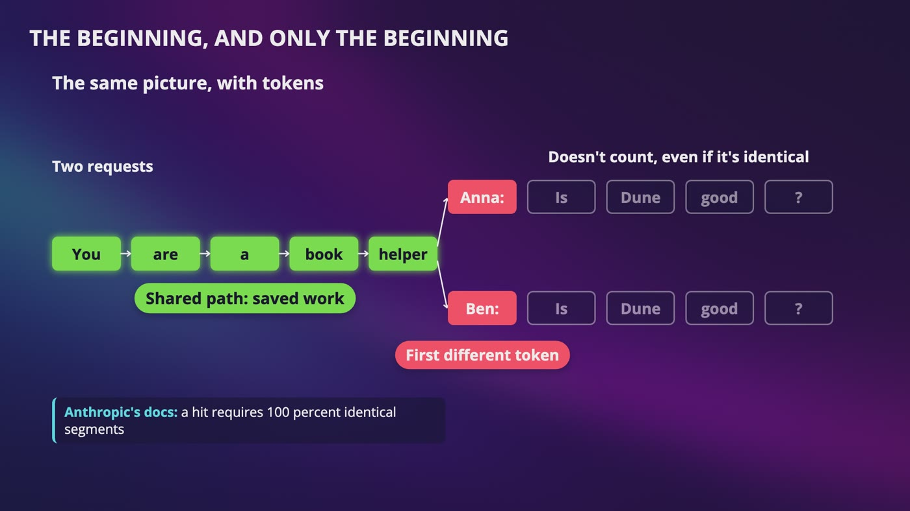

_Like the trie, 2 requests share a path until the first different token. Everything after it doesn't count, even if it's identical._

### Work that's already done

- With every message, the model rebuilds the same notes. And every customer starts with the same long instructions, say 2,000 tokens.
- This isn't the cache from our first chapter. That one saved answers. Here, the model still writes a brand new answer.

### The beginning, and only the beginning

- It has to match from the very first token, and exactly.
- **Put what never changes first, and what changes last.**
- If the first line of our instructions is today's date and time, down to the second, we just turned off our whole cache with one line.

### What it saves

- Each turn pays 1.25 times for its new 300 tokens, which is 7,500 over 20 turns, and a tenth for what's already there, which is 5,700.
- So 63,000 becomes the cost of about **13,200 normal tokens**. That's about 5 times cheaper, if every message lands before the cache expires.

### Expiry

- Notes take up GPU memory, so we can't keep them forever. If Anna makes a coffee and is gone too long, her next message is expensive again, and slower to start.

### Which machine?

- Her notes are on one specific machine. Any model server can still answer, and it's just slower and more expensive. If we lose the stickiness, nothing breaks.
- To pick the machine, hash the beginning of the text and walk around the clock. That's our reasoning, and I'm not saying anyone uses a ring.
- **The cost of being sticky:** one popular beginning can crush one machine, like Adele. So be willing to break the stickiness when a machine's too busy.

> **In your interview:** Know this: it saves the reading and not the answer, it has to match from the very start, so stable things go first, it expires, and it makes you want to route people back to the same machine.

> **In the real world:** As of October 2026, Anthropic's docs list cache reads at about a tenth of the normal input price for many models, and cache writes at 1.25 times. Its default expiry is 5 minutes, and OpenAI's newest models default to a minimum of 30. Anthropic's docs say cached reads don't count toward its input limit for most models, and OpenAI's docs say they still count. OpenAI's docs also say routing considers a hash of the first tokens, along with how busy the machines are.

**New terms**

| Term | Meaning |
|---|---|
| **Prompt caching** | Keeping the model's notes from reading a prompt, and reusing them when a later request has the same beginning. |

## 9. When There's No Capacity Left

> **The big idea:** These chips are scarce, so you have to decide who gets disappointed. The order is a short line with a maximum wait, an honest error, retries with jitter, separate lines, and a batch deal.

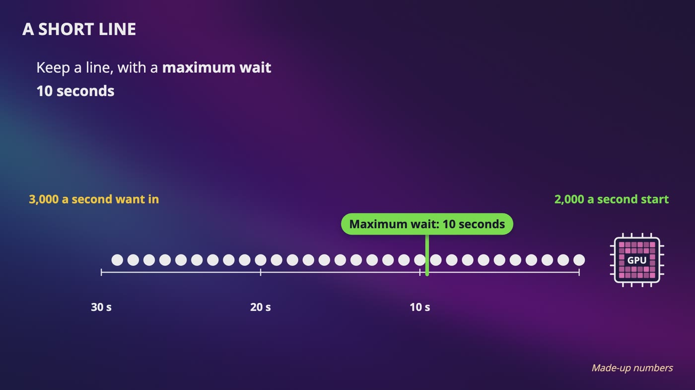

_3,000 a second want in, and 2,000 a second can start. Our line has a maximum wait of 10 seconds. These are made-up numbers._

| Error | Who says it | What it means |
|---|---|---|
| 429 | Your own limit | You're over your limit, so it's on you |
| 529 | Anthropic: overloaded error | We're full, and you did nothing wrong |
| 503 | OpenAI: server is overloaded | We're full, and you did nothing wrong |
| 503 | Google: temporarily overloaded or down | We're full, and you did nothing wrong |

### A short line

- Say we can start 2,000 answers a second, and 3,000 want to start. After 1 minute, 60,000 people are in line, and the last one waits 30 seconds.
- At midnight, nobody was watching a parcel. Here, Anna's looking at her screen, and she may give up, so you've spent a chip on nobody.
- So give it a maximum wait, say 10 seconds. That's a line of at most 20,000 people, and anyone past that gets told no, right away.

### Retrying and who goes first

- Wait longer each time and add jitter, so nobody causes a retry storm. OpenAI's docs also warn that failed requests count against your limit.
- Someone in a live chat is the password code, and a company summarizing a million documents overnight is the spring sale. So use separate lines, often tied to what people pay.
- How anyone really orders their lines inside, nobody outside knows.

### The overnight line

- A spoiler-free summary for every book doesn't need an answer right now.
- A **batch API** takes a huge pile of requests and returns the answers within a day, for half the price.
- Our reasoning: chips cost the same busy or not, and people sleep. So you move work into quiet hours, they pay less, and you stop wasting empty seats.

### Other things you can try

- These are all our own reasoning. Spill over to another region, as long as it's allowed to go there.
- Give shorter answers, by lowering the ceiling when you're busy.
- Send some requests to a smaller, cheaper model, but please tell the person.
- It can't be perfectly fair. Ben's essay holds a seat 50 times longer than Anna's question, so say what you chose, and why.

### Back on our side

- Selling books is the business. So the box says our assistant's busy, it shows the reviews and series order we have, and checkout never waits on this API.

> **In your interview:** Know the order: a short line with a maximum wait, an honest error, retries with jitter, separate lines for what's urgent, and a batch deal for what can wait. And keeping the store up when the API is full is a great thing to volunteer.

> **In the real world:** As of October 2026, Anthropic, Google and OpenAI all publish the same batch deal: a 50% discount and a 24 hour window. OpenAI's docs describe a faster paid mode, priority processing, renamed Fast mode in July 2026, and a cheaper mode called Flex. Anthropic's docs describe a Priority Tier, and say it's no longer sold to new customers.

**New terms**

| Term | Meaning |
|---|---|
| **Overloaded error** | A message that says you did nothing wrong, and they're just full. |
| **Batch API** | You send a huge pile of requests, and you get the answers back within a day, for half the price. |

## 10. When It Breaks: Real Public Postmortems

> **The big idea:** 3 companies published what went wrong, so we can learn from it for free. Roll out slowly, test at real size, watch whether it's actually good, and keep a way in.

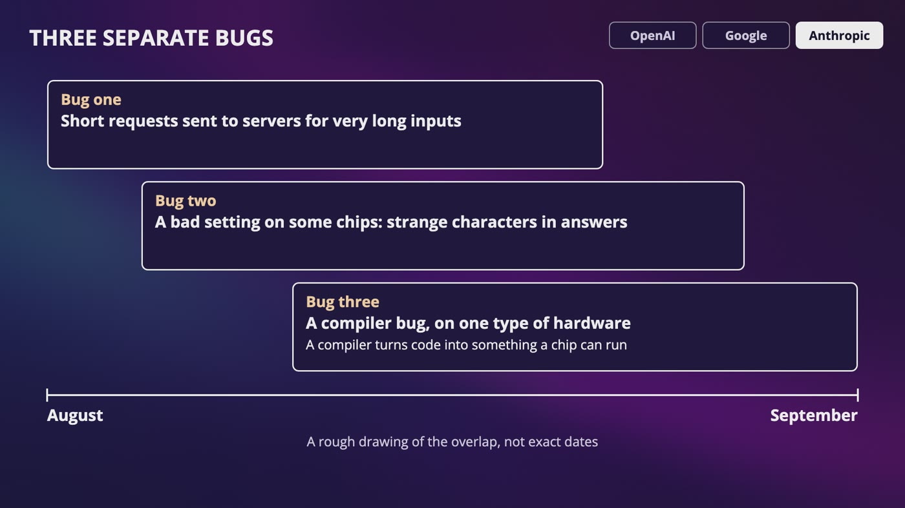

_Anthropic's 3 separate bugs, overlapping through August and into September, in a rough drawing that doesn't show exact dates._

### December 2024: OpenAI

- On December 11, for more than 4 hours, its services went down or got much worse. It was a monitoring tool.
- A new service made every machine ask Kubernetes' manager's office for a lot of expensive information. It was fine on a small staging cluster, and overwhelmed the office on the biggest ones.
- Their DNS depended on that office, so services couldn't find each other. Answers were cached for about 20 minutes, so nothing looked wrong, and the rollout carried on.
- To remove the bad service, engineers needed that same office. They were locked out of what they needed to fix it.
- **Its changes:** phased rollouts that watch the control plane, tests that break things on purpose, a guaranteed way in, and DNS that doesn't depend on that office.

### June 2025: Google

- On June 12, a long list of products was hit, including its Gemini API. Every API request to Google Cloud goes through Service Control.
- New code with a bug and no feature flag was added on May 29, and nothing ran it for 2 weeks.
- A policy update with blank fields landed in the database and was copied to every region within seconds. Every region crashed, then restarted and crashed again.
- Engineers found the cause within about 10 minutes, and a switch was fully rolled out in about 40 minutes.
- In one big region, everything came back at once and hit the same database, with no randomized backoff. That region took about 2 hours and 40 minutes.
- **Its changes:** making this system fail open, enforcing feature flags, and auditing systems for backoff.

### August 2025: Anthropic

- Nothing went down. In a September 2025 post, it described 3 separate bugs, and for some people, Claude's answers just got worse.
- **Bug 1:** some short requests went to servers for very long inputs, up to 16% of requests for one model at the worst hour. Routing was sticky, so the same people kept getting it.
- **Bug 2:** a bad setting on some chips put strange characters in answers. **Bug 3:** a compiler bug on one type of hardware.
- Up, fast and no errors all looked fine. The model often recovers from a small mistake, symptoms differed across 3 kinds of hardware, and privacy rules, which it wants to keep, limit when engineers can read a conversation.
- **Its changes:** more sensitive tests, quality checks on the real system all the time, and better ways to debug reports while keeping that privacy.

### What you can take from this

- **Roll things out slowly,** and watch what you're touching.
- **Test at real size.** Code that never runs isn't really tested.
- **Watch whether it's actually good,** and not only whether it's up. A wrong answer and a right answer look the same to a dashboard.
- **Keep a way in.** If this breaks, do I need this same thing in order to fix it?

> **In your interview:** Please don't read these as a ranking of who's good and who's bad, and don't say that in an interview. If you're talking to someone at one of these companies, it's completely fine to say, I read your postmortem, and here's what I took from it. Just say only what's in it.

**New terms**

| Term | Meaning |
|---|---|
| **Postmortem** | A write-up that says what broke and what they're changing, without blaming anybody. |
| **Kubernetes** | A very popular open source system for running programs across many machines. It starts them, restarts them when they crash, and moves them around. |
| **Control plane** | The part of Kubernetes that makes those decisions, like a manager's office. |
| **Cluster** | A big group of machines being run together. |
| **Staging** | A practice copy of a system. |
| **Feature flag** | A switch that lets you turn new code on slowly. |
| **Herd effect** | Google's name for programs all coming back at the same time and hitting the same thing. It's our retry storm. |
| **Compiler** | The program that turns code into something a chip can run. |

## 11. The Whole AI Chatbot Design, for Your Interview

> **The big idea:** The newest topic in the whole course turned out to be a mailbox, a bucket, a clock and a bookmark, plus one bus. You grow, something breaks, and you fix it.

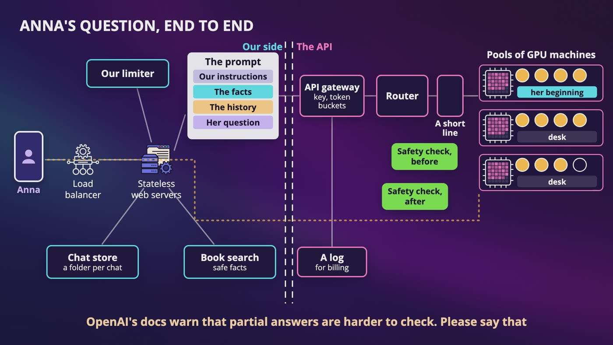

_Both sides of the wall on one diagram, with our limiter and prompt on one side, and the router and pools of GPU machines on the other._

| If they ask | You say |
|---|---|
| How do you stream? | Server-sent events, because it's one way, and you stop when nobody's listening. |
| How do you rate limit? | Tokens and not requests, in a token bucket. Reserve the output, or count it as it's made. |
| How do you share a GPU? | Continuous batching, so people step on and off between steps, and memory limits the seats. |
| Where does the history live? | In a store on our side, and it's resent every time, because the model remembers nothing. |
| How do you make it cheaper? | Prompt caching, batch work for what can wait, and shorter answers. |
| There's no capacity? | A short line, an honest error, jitter and priority. |

### Anna's question, end to end

- **Our side:** a load balancer, a stateless web server, and our limiter. We save her message, search for safe facts, and build the prompt: instructions, facts, history, then her question. Then we call the API.
- **The other side:** a door checks the key and counts tokens. A router looks for a machine with her beginning on its desk that isn't too busy. There's a short line, and a seat opens up.
- **Back:** tokens stream back as server-sent events, and if she closes the tab, we stop. At the end, we save the answer, and one event goes in a log for billing.
- You'd also add safety checks before and after the model. OpenAI's docs warn that partial answers are harder to check, so streaming makes this harder.

### Your 45 minutes

- 3 to 10 minutes on the problem, 10 to 15 on the high level design, 10 to 25 on the deep dive, and 3 to 5 on the wrap up.
- Ask whether it's a product or an API, do the math in tokens, and draw the 2 sides.
- Go deep on sharing a GPU, then say what you'd watch, including whether the answers are any good. Never say your design is perfect.
- **Just recognize:** vLLM, Orca and the KV cache.

### Back to the book club

- Anna's phone says to read book 1 first, and that's all it says. Dan, on page 16, gets 3 names and who they are, and nothing else. After all this time, somebody finally listened.
- 5 more chargers at 30 minutes each, at about 30 pages an hour, is 75 pages. So when Cara asks page 17, he says 91.

### What to do now

- Please don't rewatch everything. Pick 3 designs: one you like, one that scares you, and one that the company you want might ask.
- Close the videos, take a pen, set a timer for 45 minutes, and do it out loud, starting with the questions.
- When you get stuck, rewatch only that one video. Then have a friend play the interviewer and push back.
- Please never make assumptions, do your math out loud, and say what each choice costs.

## Recap: One honest answer for Anna

_The newest topic in the whole course turned out to be a mailbox, a bucket, a clock and a bookmark, plus one bus._

| Every piece solved a real problem | |
|---|---|
| **Estimating in tokens** | Requests stopped meaning much |
| **Streaming** | 8 seconds of blank screen |
| **Stopping when she hangs up** | Chip time for nobody |
| **Resending the history** | The model remembers nothing |
| **Compaction** | The context window runs out |
| **Retrieval** | The model predicts, and doesn't look things up |
| **Continuous batching** | One long answer held everyone hostage |
| **Small blocks of notes** | Memory fills up before the chip does |
| **Coins in a token bucket** | One request can be 100,000 times bigger |
| **Prompt caching** | 63,000 input tokens for 6,000 new ones |
| **A short line and a batch API** | More people than seats |
| **Checking that it's good** | A wrong answer looks fine to a dashboard |

**For your interview**

- It predicts one token at a time, on a chip that's scarce
- Estimate messages, tokens, answers running at once, then machines
- Streaming doesn't make it faster, it makes it feel faster
- The model remembers nothing, so the whole history gets sent every time
- Draw the bus: people step on and off between steps
- Count tokens and not requests, and keep the door separate from the bill
- Prompt caching saves the reading and not the answer
- Decide who gets disappointed: a short line, an honest error, jitter, priority and a batch deal

---

From the course **[System Design: Zero to Interview Hero](https://www.udemy.com/course/system-design-zero-to-hero/?referralCode=183D59A1EBE9E71D26FF)** by Nata Vacheishvili.
